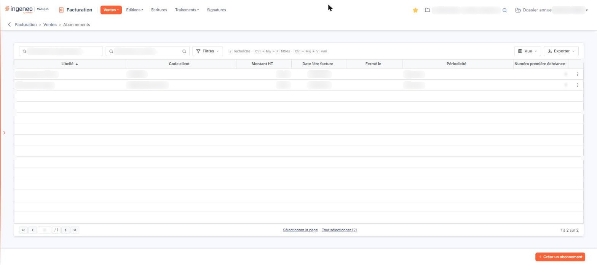
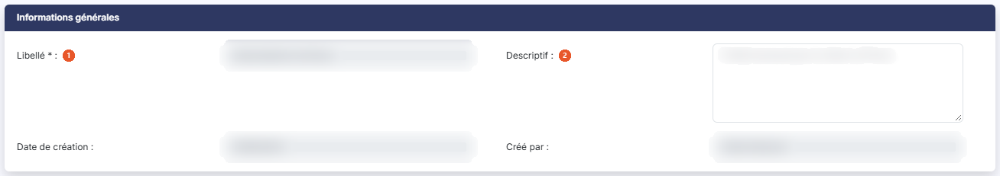
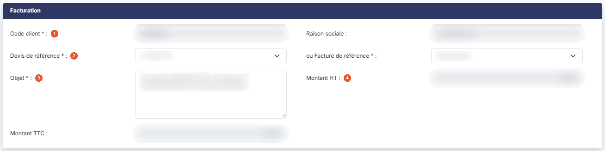
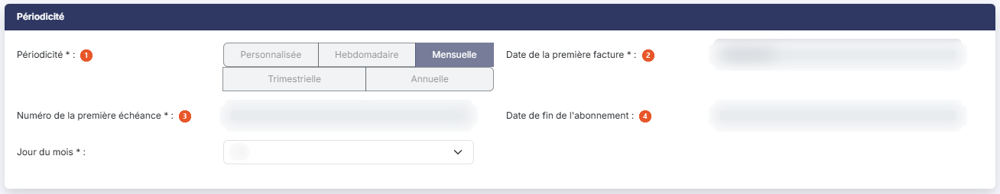
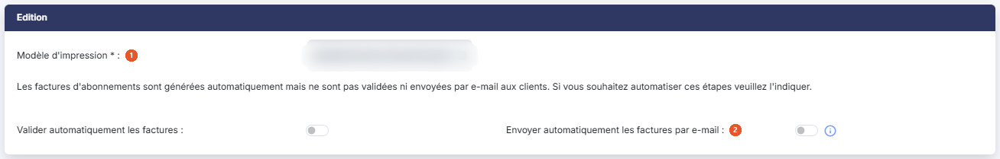

# Abonnements


**Où le trouver :** Menu **Ventes › Abonnements**



**En bref** — Cet écran décrit des abonnements à partir desquels le logiciel émet automatiquement des factures, en répliquant un devis ou une facture existante selon une périodicité.

* Pour créer un abonnement : bouton \[Créer un abonnement], choisissez la pièce modèle et la périodicité, puis bouton \[Enregistrer].
* Pour facturer sans attendre : sélectionnez les abonnements, puis bouton \[Génération manuelle des factures].
* Pour arrêter un abonnement : dans sa fiche, menu « Autres actions », bouton \[Fermer l'abonnement].


Cette option permet de décrire des abonnements, à partir desquels le logiciel émet automatiquement des factures aux dates voulues. Chaque abonnement s'appuie sur un devis ou une facture qui existe déjà, et qui est répliqué selon la périodicité que vous paramétrez.

<figure><figcaption>
Écran « Abonnements » de la nouvelle interface
</figcaption></figure>

Contrairement aux listes de pièces commerciales, cette liste n'est restreinte par aucun filtre à l'ouverture de l'écran : le nombre de lignes qu'elle annonce est bien le nombre d'abonnements du dossier, abonnements fermés compris.

## La liste des abonnements

Au-dessus du tableau, deux champs de recherche : « Rechercher un abonnement… » et « Rechercher un client… », ce dernier avec son pictogramme « Loupe ». Viennent ensuite le bouton \[Filtres], qui permet de poser des critères sur les colonnes, le bouton \[Vue], pour gérer vos vues et choisir les colonnes affichées, et le bouton \[Exporter], qui ouvre le menu d'édition de la liste (aperçu HTML, impression, Excel, PDF et « Envoyer la liste par e-mail »).

Le tableau présente sept colonnes, toutes triables, et il est trié sur le libellé à l'ouverture : **Libellé**, **Code client**, **Montant HT**, **Date 1ère facture**, **Fermé le**, **Périodicité** et **Numéro première échéance**.

La colonne **Fermé le** porte la date à laquelle l'abonnement a été fermé, et reste vide tant qu'il est actif.

Un clic sur une ligne la sélectionne. Sous le tableau, « Sélectionner la page » et « Tout sélectionner (N) » sélectionnent d'un coup les abonnements de la page ou tous les abonnements. En dernière colonne de chaque ligne, un pictogramme « Autres actions » (trois points) ouvre un menu de trois entrées : « Modifier », « Dupliquer » et « Supprimer ». Cet écran n'envoie aucune facture.

bouton **\[Créer un abonnement]**, en bas à droite de l'écran, ouvre une fiche vide. Dès qu'une ligne est sélectionnée, un bandeau apparaît au bas de l'écran à la place de ce bouton : il indique le nombre d'abonnements sélectionnés, propose « Tout désélectionner » et porte bouton **\[Supprimer]**, qui supprime les abonnements sélectionnés, et bouton **\[Génération manuelle des factures]**, qui déclenche la génération sans attendre le traitement automatique.

## La fiche d'un abonnement

La fiche présente quatre rubriques, dans cet ordre : « Informations générales », « Facturation », « Périodicité » et « Edition ».

## Rubrique « Informations générales »

<figure><figcaption>
Rubrique « Informations générales »
</figcaption></figure>

| Champ             | Ce qu'il faut savoir                          |
| ----------------- | --------------------------------------------- |
| 1. **Libellé**    | Champ obligatoire.                            |
| 2. **Descriptif** | Champ facultatif, saisi sur plusieurs lignes. |

## Rubrique « Facturation »

<figure><figcaption>
Rubrique « Facturation »
</figcaption></figure>

| Champ                     | Ce qu'il faut savoir                                                                                                                                                                                                                                                                                                                                                                                                                                                                                                                                                                                                                                                                                                                                                                                                                                                                                                                                                                                                                                                                            |
| ------------------------- | ----------------------------------------------------------------------------------------------------------------------------------------------------------------------------------------------------------------------------------------------------------------------------------------------------------------------------------------------------------------------------------------------------------------------------------------------------------------------------------------------------------------------------------------------------------------------------------------------------------------------------------------------------------------------------------------------------------------------------------------------------------------------------------------------------------------------------------------------------------------------------------------------------------------------------------------------------------------------------------------------------------------------------------------------------------------------------------------------- |
| 1. **Code client**        | 
Champ obligatoire. Il désigne le client à facturer. Saisissez son code ou utilisez le pictogramme « Loupe ». La <strong>Raison sociale</strong> s'affiche ensuite, sans être saisissable. Le client se choisit à la création de l'abonnement, et à ce moment-là seulement : sur un abonnement déjà enregistré, le champ passe en lecture seule et le pictogramme « Loupe » disparaît. Pour facturer un autre client, créez un nouvel abonnement.
                                                                                                                                                                                                                                                                                                                                                                                                                                                                                                                                                                                                                                      |
| 2. **Devis de référence** | 
<strong>ou Facture de référence :</strong> la facture d'abonnement est émise depuis un modèle, qui est soit un devis, soit une facture. Les deux champs portent un astérisque, mais ils décrivent une alternative — c'est le mot « ou » du second libellé qui le dit : renseignez l'un ou l'autre, pas les deux. Choisir une facture de référence efface le devis de référence, et l'inverse est vrai aussi. Les deux listes ne proposent que les pièces du client que vous avez retenu : commencez donc par le code client.
                                                                                                                                                                                                                                                                                                                                                                                                                                                                                                                                                          |
| 3. **Objet**              | 
Champ obligatoire. C'est l'objet qui figurera sur chaque facture émise. Vous pouvez y intégrer des informations relatives à la facture, en les indiquant entre crochets dans votre texte, comme le fait la proposition qui vous est faite à la création d'un abonnement. Le logiciel ne reconnaît que <strong>trois</strong> mots-clés, ceux-là mêmes que la proposition vous montre : <strong>[PERIODICITE]</strong>, remplacé par la périodicité de l'abonnement, <strong>[NUMECHEANCE]</strong>, par le numéro de l'échéance facturée, et <strong>[DATEECHEANCE]</strong>, par la date de cette échéance au format jj/mm/aaaa. Tout autre texte entre crochets est repris tel quel sur la facture. Trois mots-clés sont proposés par défaut : [PERIODICITE] pour la périodicité, [NUMECHEANCE] pour le numéro de l'échéance et [DATEECHEANCE] pour sa date. Ainsi, « Facturation [PERIODICITE] - Échéance n° [NUMECHEANCE] du [DATEECHEANCE] » donnera « Facturation mensuelle - Échéance n° 5 du 31/10/2018 », ou « Facturation trimestrielle - Échéance n° 3 du 01/10/2018 ».
 |
| 4. **Montant HT**         | **Montant TTC :** ils ne sont pas saisissables : le logiciel les affiche, pour contrôle, d'après le devis ou la facture de référence que vous avez retenu.                                                                                                                                                                                                                                                                                                                                                                                                                                                                                                                                                                                                                                                                                                                                                                                                                                                                                                                                      |

## Rubrique « Périodicité »

<figure><figcaption>
Rubrique « Périodicité »
</figcaption></figure>

C'est la rubrique dont les champs changent selon ce que vous répondez. Quatre champs y sont toujours présents :

| Champ                                      | Ce qu'il faut savoir                                                                                                                                                                                                                                    |
| ------------------------------------------ | ------------------------------------------------------------------------------------------------------------------------------------------------------------------------------------------------------------------------------------------------------- |
| 1. **Périodicité**                         | Champ obligatoire, cinq boutons-bascule — « Personnalisée », « Hebdomadaire », « Mensuelle », « Trimestrielle » et « Annuelle ». « Hebdomadaire » est retenu par défaut.                                                                                |
| 2. **Date de la première facture**         | Champ obligatoire. Cette date n'a pas à respecter les critères de périodicité que vous indiquez ; toutes les suivantes les respecteront.                                                                                                                |
| 3. **Numéro de la première échéance**      | Champ obligatoire, proposé à 1. Son pictogramme d'information le rappelle : « Par défaut la première échéance aura le numéro 1 mais si des échéances ont déjà été facturées d'une autre manière, vous avez la possibilité d'indiquer un autre numéro. » |
| 4. **Date de fin de l'abonnement**         | 
Champ facultatif. Passé cette date, plus aucune facture n'est émise. Le choix de la périodicité fait ensuite apparaître les champs qui lui correspondent, et eux seuls :
                                                                      |
| **Hebdomadaire :Jour de la semaine**       | Du lundi au dimanche.                                                                                                                                                                                                                                   |
| **Mensuelle :Jour du mois**                | De 1 à 31.                                                                                                                                                                                                                                              |
| **Trimestrielle :Mois du trimestre civil** | Trois boutons-bascule « Premier », « Deuxième » et « Troisième » — il s'agit bien des trimestres du calendrier, et non de ceux de votre exercice —, puis **Jour du mois :**.                                                                            |
| **Annuelle :Mois de l'année**              | Puis **Jour du mois :**.                                                                                                                                                                                                                                |

Si vous retenez un jour du mois qui n'existe pas dans tous les mois, le 31 par exemple, la facture est émise le dernier jour du mois.

## Rubrique « Edition »

<figure><figcaption>
Rubrique « Edition »
</figcaption></figure>

| Champ                                                  | Ce qu'il faut savoir                                                                                                                                                                                                                                                                                                                                                                                                                                                                                         |
| ------------------------------------------------------ | ------------------------------------------------------------------------------------------------------------------------------------------------------------------------------------------------------------------------------------------------------------------------------------------------------------------------------------------------------------------------------------------------------------------------------------------------------------------------------------------------------------ |
| 1. **Modèle d'impression**                             | 
Champ obligatoire. C'est le modèle qui sera utilisé pour toutes les factures émises par cet abonnement. La rubrique porte ensuite cette phrase : « Les factures d'abonnements sont générées automatiquement mais ne sont pas validées ni envoyées par e-mail aux clients. Si vous souhaitez automatiser ces étapes veuillez l'indiquer. » Les deux interrupteurs qui suivent sont là pour cela, et sont tous deux désactivés par défaut : <strong>Valider automatiquement les factures</strong>
 |
| 2. **Envoyer automatiquement les factures par e-mail** | Son pictogramme d'information précise que « L'e-mail sera adressé au contact par défaut de la fiche client. »                                                                                                                                                                                                                                                                                                                                                                                                |

## Les boutons de la fiche

En création, la fiche porte bouton **\[Enregistrer]**, en bas à droite. Le bouton \[Retour] n'est plus affiché : pour revenir à la liste, utilisez la flèche « Revenir en arrière », à gauche du fil d'Ariane.

En modification d'un abonnement actif, bouton **\[Enregistrer]** est accompagné d'un menu « Autres actions » (trois points) qui porte bouton **\[Prévisualiser]** et bouton **\[Fermer l'abonnement]**, ce dernier en rouge, chacun soumis au droit correspondant.

## Comment les factures sont émises, et comment les arrêter

Les factures d'abonnement sont générées par un traitement automatique de nuit, à la date de l'échéance : elles sont donc disponibles dès le matin de ce jour. Le numéro d'échéance est calculé depuis la date de la première facture.

Pour arrêter l'émission des factures, vous avez deux moyens : renseigner la **Date de fin de l'abonnement**, ce qui l'arrête à une date connue d'avance, ou utiliser bouton **\[Fermer l'abonnement]**, du menu « Autres actions » de la fiche, qui l'arrête immédiatement. La fermeture mémorise sa date et l'utilisateur qui l'a demandée, et la date s'affiche dans la colonne **Fermé le** de la liste.

Préférez la fermeture à la suppression : l'abonnement fermé reste consultable dans la liste, alors qu'un abonnement supprimé n'y figure plus.
