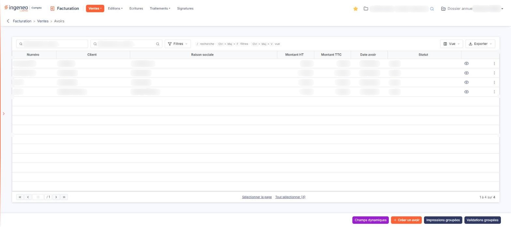
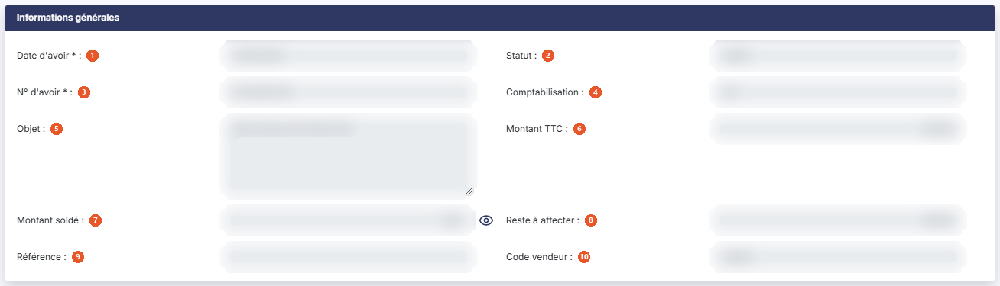
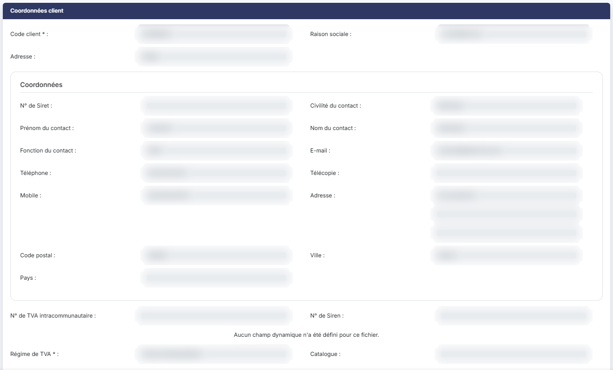
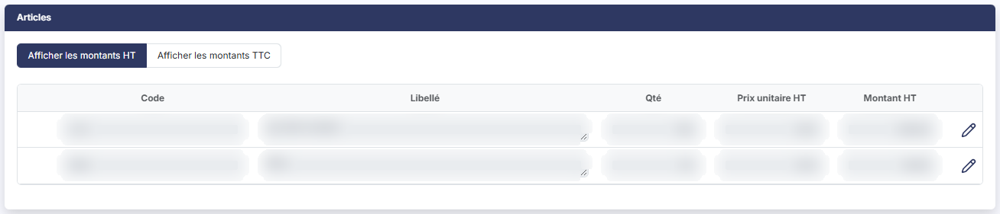
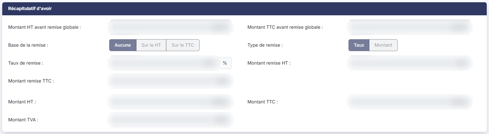
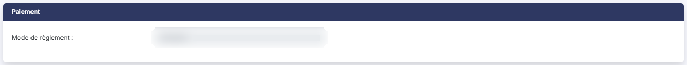
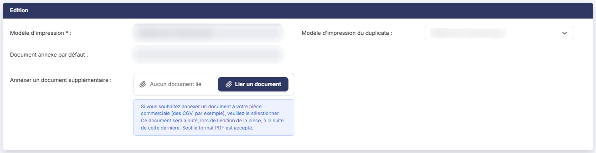

# Avoirs


**Où le trouver :** Menu **Ventes › Avoirs**



**En bref** — Cet écran liste les avoirs clients du dossier annuel et permet de les créer et de les valider. Un avoir peut aussi être généré depuis une facture validée.

* Pour saisir un avoir : bouton \[Créer un avoir], complétez l'en-tête et les lignes, puis bouton \[Enregistrer].
* Pour finaliser un avoir : ouvrez-le, puis bouton \[Valider] ; bouton \[Dévalider] pour revenir sur cette validation.


Cette option affiche les avoirs clients et permet de les créer et de les valider. Un avoir peut être saisi directement ici, ou généré depuis une facture validée.

<figure><figcaption>
Écran « Avoirs » de la nouvelle interface
</figcaption></figure>

Les avoirs fonctionnant sur le même principe que les factures, cette page ne traite que de ce qui leur est propre : reportez-vous au menu « Ventes », option « Factures », pour tout ce qui leur est commun.

Comme celle des factures, la liste porte tous les avoirs enregistrés dans le dossier annuel sélectionné, quelle que soit leur date. En revanche, aucun filtre n'est armé à l'ouverture de l'écran : le nombre de lignes annoncé par la pagination est bien le nombre d'avoirs du dossier.

## La liste des avoirs

La barre d'outils au-dessus du tableau porte deux zones de recherche, **Rechercher un avoir…** (qui remplace l'ancien champ « N° d'avoir ») et **Rechercher un client…** (saisissez le code ou les premières lettres de la raison sociale, ou utilisez le pictogramme « Loupe » pour ouvrir la fenêtre de recherche), puis bouton **\[Filtres]**, qui ouvre le volet « Filtrer » (« + Ajouter un critère sur… », « Vider les filtres » et bouton **\[Filtrer]**), et, à droite, bouton **\[Vue]** et bouton **\[Exporter]**. Ils fonctionnent comme ceux de la liste des factures. Dès qu'un critère est posé, le lien « Tout effacer » s'affiche.

Il n'y a ni menu « Filtres spéciaux » ni interrupteur de filtre, ni champ de total, contrairement à la liste des factures.

Le tableau présente sept colonnes, toutes triables : **Numéro**, **Client**, **Raison sociale**, **Montant HT**, **Montant TTC**, **Date avoir** et **Statut**.

Il n'y a ni colonne **Etat**, ni colonne **Retard** : un avoir ne porte pas de pastille d'état et n'a pas d'échéance, il ne peut donc pas être en retard. La colonne **Statut** indique si l'avoir est validé ou non — la valeur y est au masculin, « Validé », là où la liste des factures affiche « Validée ».

bouton **\[Vue]** permet de choisir les colonnes affichées, dans sa rubrique « Colonnes affichées » ; l'en-tête du tableau ne porte plus ni boîte à cocher ni pictogrammes de commande. Sous le tableau, « Sélectionner la page » et « Tout sélectionner (n) » ainsi que la pagination sont ceux de la liste des factures.

**Les commandes présentes sur chaque ligne**

Il n'y a plus de boîte à cocher : un clic sur la ligne la sélectionne. Chaque ligne porte huit commandes. Au survol de la ligne apparaissent quatre pictogrammes : « Afficher l'aperçu » (seul visible au repos), « Télécharger », « Valider » et « Envoyer par mail ». Ils sont suivis du menu « Autres actions » (trois points), qui porte « Modifier », « Dupliquer », « Editer un relevé de comptes » et « Supprimer ».

Il n'y a pas de commande « Régler » : un avoir ne se règle pas. Une fois validé, il devient affectable à des factures comme un règlement, depuis le menu « Ventes », option « Règlements », où il apparaît avec le mode « Avoir » et son numéro pour libellé.

Comme sur la facture, « Valider » reste affichée sur un avoir déjà validé.

Dans la barre du bas, en bas à droite : bouton **\[Créer un avoir]** ouvre une fiche d'avoir vide ; bouton **\[Impressions groupées]** et bouton **\[Validations groupées]** sont affichés dès l'ouverture de l'écran, sans sélection préalable ; bouton **\[Champs dynamiques]** est rangé dans le menu à trois points.

Dès qu'un avoir est sélectionné, un bandeau prend la place de la barre du bas (bouton **\[Créer un avoir]** n'est plus visible) avec le lien « Tout désélectionner », bouton **\[Envoyer tout par mail]**, bouton **\[Impressions groupées]**, bouton **\[Validations groupées]** et bouton **\[Supprimer]**.

Il n'y a pas de dévalidation groupée pour les avoirs.

Selon les droits qui vous ont été attribués, certaines de ces commandes peuvent ne pas vous être proposées.

## La fiche d'un avoir

La fiche présente six rubriques, et non sept comme la facture : « Informations générales », « Coordonnées client », « Articles », « Récapitulatif d'avoir », « Paiement » et « Edition ». Il n'y a pas de rubrique de notes.

Contrairement à la facture, la liste des champs d'un avoir n'est pas configurable : la fiche ne porte pas de bouton de choix des champs.

## Rubrique « Informations générales »

<figure><figcaption>
Rubrique « Informations générales »
</figcaption></figure>

Les champs y sont présentés dans cet ordre :

| Champ                   | Ce qu'il faut savoir                                                                                                                                                                                                                                                                                                                                                                                                                                                                                     |
| ----------------------- | -------------------------------------------------------------------------------------------------------------------------------------------------------------------------------------------------------------------------------------------------------------------------------------------------------------------------------------------------------------------------------------------------------------------------------------------------------------------------------------------------------- |
| 1. **Date d'avoir**     | Champ obligatoire.                                                                                                                                                                                                                                                                                                                                                                                                                                                                                       |
| 2. **Statut**           | Ce champ n'est pas saisissable. Il n'apparaît pas en création.                                                                                                                                                                                                                                                                                                                                                                                                                                           |
| 3. **N° d'avoir**       | Champ obligatoire. En création, il n'est pas saisissable et affiche le texte d'attente « En cours d'attribution » : le numéro n'est affecté à l'avoir que lorsqu'il est enregistré, imprimé, envoyé par courriel ou validé. En modification, il devient saisissable si vous avez autorisé la modification du numéro des avoirs dans « Paramètres > Facturation > Pièces commerciales » — cette autorisation est propre à chaque pièce, et l'accorder pour les factures ne l'accorde pas pour les avoirs. |
| 4. **Comptabilisation** | Champ Oui/Non non saisissable. Il n'apparaît pas en création.                                                                                                                                                                                                                                                                                                                                                                                                                                            |
| 5. **Objet**            | Champ facultatif. Si l'avoir a été créé à partir d'une facture, la référence à cette facture figure dans l'objet, mais vous pouvez la modifier.                                                                                                                                                                                                                                                                                                                                                          |
| 6. **Montant TTC**      | Le montant de l'avoir. Il n'apparaît qu'une fois l'avoir validé.                                                                                                                                                                                                                                                                                                                                                                                                                                         |
| 7. **Montant soldé**    | Lorsqu'un avoir est validé, il devient affectable à des factures, comme un règlement. Ce montant correspond au total de ces affectations.                                                                                                                                                                                                                                                                                                                                                                |
| 8. **Reste à affecter** | La différence entre le montant TTC et le montant soldé.                                                                                                                                                                                                                                                                                                                                                                                                                                                  |
| 9. **Référence**        | Champ facultatif.                                                                                                                                                                                                                                                                                                                                                                                                                                                                                        |
| 10. **Code vendeur**    | Champ facultatif.                                                                                                                                                                                                                                                                                                                                                                                                                                                                                        |

Retenez le vocabulaire, qui n'est pas celui de la facture : un avoir se solde et s'affecte, il ne se règle pas. Là où la facture dit « Montant réglé » et « Reste à payer », l'avoir dit « Montant soldé » et « Reste à affecter ».

La rubrique ne comporte ni champ **Etat**, ni champ **Date de livraison**, contrairement à la fiche d'une facture.

## Rubrique « Coordonnées client »

<figure><figcaption>
Rubrique « Coordonnées client »
</figcaption></figure>

Elle reprend la rubrique de même nom de la fiche d'une facture, avec deux différences :

* le sélecteur d'adresse s'intitule **Adresse :** et non « Adresse de facturation » ;
* il n'y a pas de sélecteur d'adresse de livraison.

En création, seuls **Code client :**, **Raison sociale :**, **Adresse :**, **N° de TVA intracommunautaire :**, **N° de Siren :**, **Régime de TVA :** et **Catalogue :** sont présentés : les coordonnées du contact et les lignes d'adresse n'apparaissent qu'une fois le client renseigné.

Comme sur la facture, le régime de TVA et le catalogue sont rangés dans cette rubrique bien qu'ils ne décrivent pas le client.

## Rubrique « Articles »

<figure><figcaption>
Rubrique « Articles »
</figcaption></figure>

Elle est identique à celle de la facture : même bascule « Afficher les montants HT » / « Afficher les montants TTC », HT par défaut, même tableau de huit colonnes dont deux masquées selon la bascule, et une seule colonne de quantité, **Qté**.

Une seule différence sous le tableau : il n'y a pas de bouton de note de ligne. Restent bouton **\[Nouvelle ligne]**, bouton **\[Nouveau commentaire]**, bouton **\[Nouveau sous-total]** et bouton **\[Supprimer les lignes]**.

Dans un avoir, le prix unitaire d'une ligne est toujours modifiable. Dans une facture, il ne l'est que si vous avez autorisé la modification des prix dans « Paramètres > Facturation > Pièces commerciales », et fait de même dans la fiche de l'article.

## Rubrique « Récapitulatif d'avoir »

<figure><figcaption>
Rubrique « Récapitulatif d'avoir »
</figcaption></figure>

Elle est identique au « Récapitulatif de facturation » de la facture à un champ près : un avoir ne porte pas d'**Acompte**.

## Rubrique « Paiement »

<figure><figcaption>
Rubrique « Paiement »
</figcaption></figure>

C'est la rubrique la plus réduite des cinq pièces : elle ne contient que **Mode de règlement :**, champ facultatif.

Un avoir n'a ni banque, ni type de paiement, ni délai de règlement, ni date d'échéance, ni échéancier.

## Rubrique « Edition »

<figure><figcaption>
Rubrique « Edition »
</figcaption></figure>

Elle est identique à celle de la facture : **Modèle d'impression :** obligatoire, **Document annexe par défaut :** et **Annexer un document supplémentaire :** avec son bouton **\[Lier un document]** : tant qu'aucun document n'est lié, la zone affiche « Aucun document lié ».

Comme sur la facture, un champ **Modèle d'impression du duplicata :** s'ajoute une fois l'avoir validé.

## Les boutons de la fiche

Tant que l'avoir n'est pas validé, la fiche porte : bouton **\[Enregistrer]**, bouton **\[Edition]**, bouton **\[Envoyer par mail]** et bouton **\[Valider]**. Le retour à la liste se fait par la flèche « Revenir en arrière », à gauche du fil d'Ariane : bouton **\[Retour]** n'est plus affiché.

Une fois l'avoir validé, bouton **\[Valider]** disparaît, bouton **\[Edition]** devient bouton **\[Edition originale]**, et deux boutons s'ajoutent : bouton **\[Edition duplicata]** et bouton **\[Avoir électronique]** — qui est, pour l'avoir, l'équivalent du bouton de facture électronique.

La fiche d'un avoir ne porte ni bouton de génération d'avoir, ni bouton de règlement, ni bouton de choix des champs.

Comme sur la facture, un avoir validé n'est plus modifiable bien que bouton **\[Enregistrer]** reste affiché, et les boutons d'ajout de ligne disparaissent de la rubrique « Articles ».
