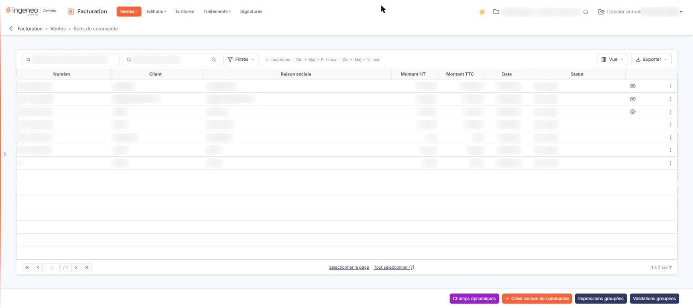
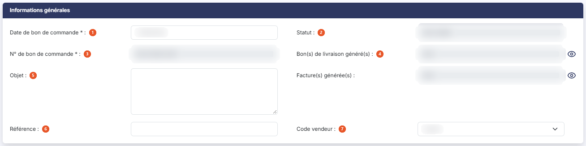
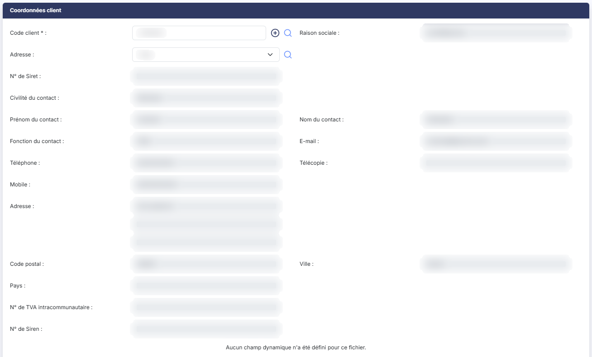
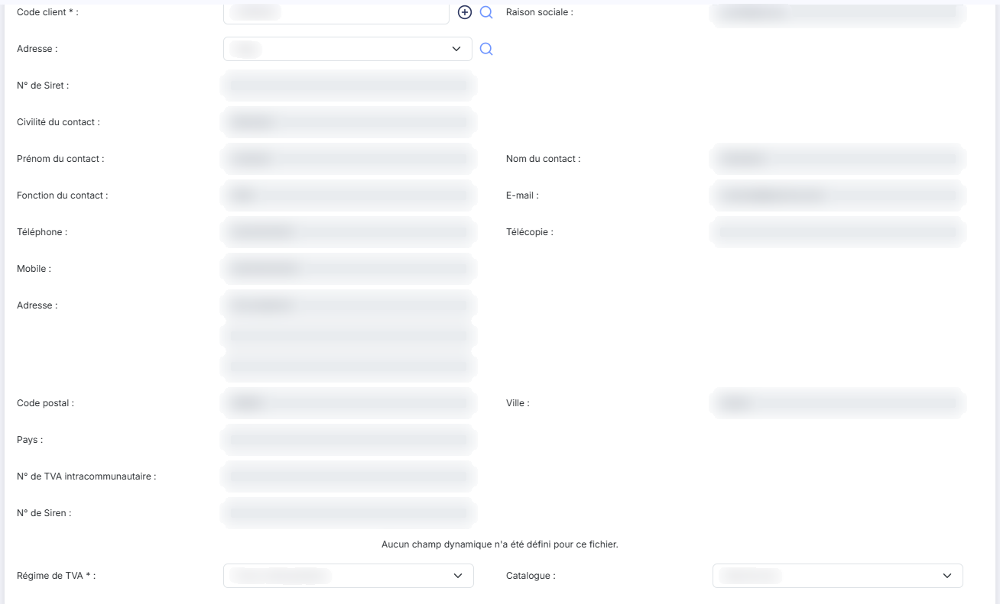
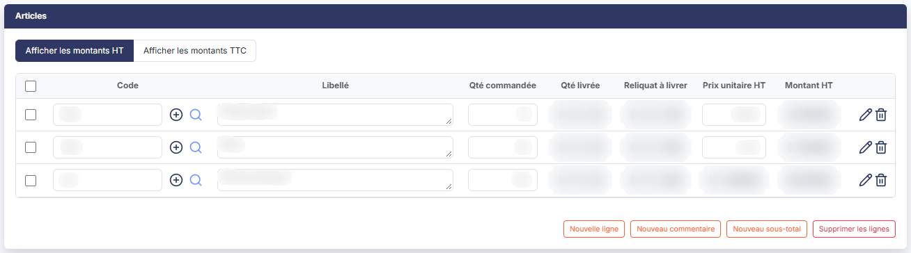
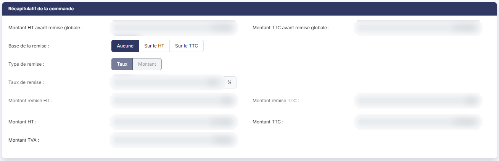
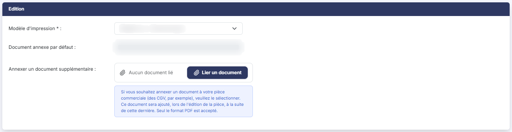

# Bons de commande


**Où le trouver :** Menu **Ventes › Bons de commande**



**En bref** — Cet écran liste les bons de commande et permet de les créer et de les valider ; chaque ligne suit la quantité commandée, livrée et restant à livrer.

* Pour saisir un bon de commande : bouton \[Créer un bon de commande], complétez l'en-tête et les lignes, puis bouton \[Enregistrer].
* Pour livrer ou facturer : ouvrez le bon, puis bouton \[Générer un bon de livraison] ou bouton \[Générer une facture].


Cette option affiche les bons de commande et permet de les créer et de les valider. Un bon de commande enregistre ce que votre client vous a commandé, puis sert à engendrer les bons de livraison et les factures correspondants.

<figure><figcaption>
Écran « Bons de commande » de la nouvelle interface
</figcaption></figure>

Le bon de commande fonctionne sur le même principe que la facture : cette page ne traite que ce qui lui est propre. Pour tout ce qui leur est commun — la barre d'outils au-dessus du tableau, la recherche d'un client, la saisie des lignes d'articles, le calcul de la remise globale, les modèles d'impression —, reportez-vous au menu « Ventes », option « Factures ».

Ce qui distingue vraiment cette pièce est le **suivi de ce qui reste à livrer** : là où la facture, l'avoir et le devis ne portent qu'une quantité, chaque ligne d'un bon de commande en porte trois — la quantité commandée, la quantité livrée et le reliquat à livrer. Le bon de livraison, de son côté, en porte deux, dont une seule est commune avec le bon de commande. Ne transposez donc pas d'une pièce à l'autre ce que vous lisez dans une colonne de quantité.

## La liste des bons de commande

La barre d'outils au-dessus du tableau porte deux champs de recherche, « Rechercher un bon de commande… » (saisissez le numéro) et « Rechercher un client… » (saisissez le client, ou cliquez la loupe à droite du champ), puis bouton **\[Filtres]**, bouton **\[Vue]** et bouton **\[Exporter]**. bouton **\[Filtres]** ouvre un volet « Filtrer » : choisissez une colonne dans « + Ajouter un critère sur… » (les sept colonnes du tableau, mais aussi d'autres champs de la pièce, comme Factures, Bons de livraison, Objet, Référence, Vendeur, les coordonnées du client ou les montants de remise), puis renseignez le critère. bouton **\[Vue]** ouvre un volet qui présente « Mes vues » (« Aucune vue enregistrée. » tant que vous n'en avez pas mémorisé) puis « Colonnes affichées », avec l'indication « 7 colonnes affichées sur 40 », « Rétablir les colonnes d'origine » et bouton **\[Appliquer]**. bouton **\[Exporter]** ouvre un volet qui rappelle « La liste affichée - N bons de commande » et propose « Aperçu édition HTML », « Imprimer Ctrl+P », « Exporter en Excel », « Exporter en PDF » et « Envoyer la liste par e-mail ». Aucun filtre n'est actif à l'ouverture : la liste présente tous les bons de commande, validés ou non. Contrairement à la liste des factures, il n'y a pas de bouton \[Filtres spéciaux].

Le tableau présente sept colonnes, toutes triables : **Numéro**, **Client**, **Raison sociale**, **Montant HT**, **Montant TTC**, **Date** et **Statut**.

La colonne de date s'appelle simplement **Date**, là où les autres pièces la nomment « Date facture », « Date avoir » ou « Date de devis » : il s'agit de la date du bon de commande.

Il n'y a ni colonne **Etat**, ni colonne **Retard** : un bon de commande ne porte pas de pastille d'état et n'a pas d'échéance. La colonne **Statut** indique s'il est validé ou non. Elle affiche « Validé » ou « Non validé ».

Lorsqu'aucun bon de commande n'a été enregistré, le tableau affiche « Aucun élément à afficher. ».

Un clic sur une ligne la sélectionne ; il n'y a pas de case à cocher. Au survol d'une ligne, ou quand elle est sélectionnée, trois commandes directes apparaissent à droite, « Télécharger », « Valider » et « Envoyer par mail », suivies du menu « Autres actions » (trois points), qui propose « Modifier », « Dupliquer » et « Supprimer ». Sur certaines lignes, une commande « Afficher l'aperçu » (œil) reste affichée même sans survol. Sous le tableau, « Sélectionner la page » et « Tout sélectionner (n) » sélectionnent les lignes de la page ou de toutes les pages, et un compteur du type « 1 à 7 sur 7 » indique l'étendue de la liste.

En bas à droite de l'écran, la barre du bas porte bouton **\[Champs dynamiques]**, bouton **\[Créer un bon de commande]**, bouton **\[Impressions groupées]** et bouton **\[Validations groupées]**.

Dès qu'au moins un bon de commande est sélectionné, un bandeau remplace cette barre. Il indique « 1 bon de commande sélectionnée », suivi du lien « Tout désélectionner », et propose bouton **\[Supprimer]**, bouton **\[Envoyer tout par mail]**, bouton **\[Impressions groupées]**, bouton **\[Validations groupées]**, bouton **\[Générer les factures]** et bouton **\[Générer les bons de livraison]**.

Les deux boutons de génération sont propres aux pièces qui précèdent la facture : la liste des bons de commande est la seule à proposer les deux, celle des bons de livraison ne proposant que la génération des factures.

Il n'y a pas de dévalidation groupée pour les bons de commande, alors que la liste des factures en propose une.

Selon les droits qui vous ont été attribués, certaines de ces commandes peuvent ne pas vous être proposées.

## La fiche d'un bon de commande

La fiche présente cinq rubriques, et non sept comme la facture : « Informations générales », « Coordonnées client », « Articles », « Récapitulatif de la commande » et « Edition ».

Le bon de commande n'a donc **pas de rubrique « Paiement »** : ni mode de règlement, ni banque, ni délai, ni date d'échéance, ni échéancier. C'est cohérent avec la pièce, qui n'est pas une demande de paiement — ces éléments se saisissent sur la facture qui en découlera. Il n'y a pas davantage de rubrique de notes.

Comme l'avoir et le devis, et contrairement à la facture, la liste des champs d'un bon de commande n'est pas configurable : la fiche ne porte pas de bouton de choix des champs, et les colonnes de ses tableaux sont figées.

## Rubrique « Informations générales »

<figure><figcaption>
Rubrique « Informations générales »
</figcaption></figure>

Les champs y sont présentés dans cet ordre :

| Champ                                | Ce qu'il faut savoir                                                                                                                                                                                                                                                                                                                       |
| ------------------------------------ | ------------------------------------------------------------------------------------------------------------------------------------------------------------------------------------------------------------------------------------------------------------------------------------------------------------------------------------------ |
| 1. **Date de bon de commande**       | Champ obligatoire.                                                                                                                                                                                                                                                                                                                         |
| 2. **Statut**                        | Ce champ n'apparaît pas en création. Il n'est pas saisissable.                                                                                                                                                                                                                                                                             |
| 3. **N° de bon de commande**         | Champ obligatoire. Il ne devient saisissable que si vous avez autorisé la modification du numéro des bons de commande dans le panneau « Paramètres », rubrique « Facturation », onglet « Pièces commerciales » — cette autorisation est propre à chaque pièce, et l'accorder pour les factures ne l'accorde pas pour les bons de commande. |
| 4. **Bon(s) de livraison généré(s)** | **Facture(s) générée(s) :** ces deux champs n'apparaissent pas en création. Ils vous indiquent les pièces déjà engendrées à partir de ce bon de commande.                                                                                                                                                                                  |
| 5. **Objet**                         | Champ facultatif.                                                                                                                                                                                                                                                                                                                          |
| 6. **Référence**                     | Champ facultatif.                                                                                                                                                                                                                                                                                                                          |
| 7. **Code vendeur**                  | Champ facultatif.                                                                                                                                                                                                                                                                                                                          |

La rubrique ne comporte ni champ **Etat**, ni **Comptabilisation**, ni **Montant TTC**, ni **Montant réglé**, ni **Reste à payer**, ni **Date de livraison**, contrairement à la fiche d'une facture.


Notez que les deux indicateurs de pièces générées ne sont pas dans le même ordre que sur la fiche d'un devis, qui annonce d'abord les factures : ici, les bons de livraison viennent en premier.


## Rubrique « Coordonnées client »

<figure><figcaption>
Rubrique « Coordonnées client »
</figcaption></figure>

<figure><figcaption>
Rubrique « Coordonnées client »
</figcaption></figure>

Cette rubrique est celle de l'avoir et du devis : le sélecteur d'adresse s'appelle simplement **Adresse :**, et il n'y a **pas de bloc d'adresse de livraison** — celui-ci n'existe que sur la facture.

La rubrique comporte une zone de champs dynamiques, qui affiche « Aucun champ dynamique n'a été défini pour ce fichier. » lorsqu'aucun champ dynamique n'est défini.

Tant qu'aucun client n'est renseigné, les champs de contact et d'adresse ne sont pas affichés : la rubrique se limite alors à **Code client :**, champ obligatoire, **Raison sociale :**, **Adresse :**, **N° de TVA intracommunautaire :**, **N° de Siren :**, **Régime de TVA :**, champ obligatoire, et **Catalogue :**.

## Rubrique « Articles » — trois colonnes de quantité

<figure><figcaption>
Rubrique « Articles »
</figcaption></figure>

Comme sur la facture, deux boutons commandent l'affichage des montants, « Afficher les montants HT », retenu par défaut, et « Afficher les montants TTC » ; le prix unitaire et le montant de chaque ligne suivent ce choix.

Le tableau des lignes porte en revanche **trois colonnes de quantité là où la facture, l'avoir et le devis n'en ont qu'une** :

| Champ                 | Ce qu'il faut savoir                           |
| --------------------- | ---------------------------------------------- |
| **Qté commandée**     | La quantité que votre client vous a commandée. |
| **Qté livrée**        | La quantité déjà livrée pour cette ligne.      |
| **Reliquat à livrer** | Ce qu'il reste à livrer sur cette ligne.       |

La colonne **Qté** de la facture n'existe donc pas ici. Le bon de commande est la seule pièce qui suive un reste à livrer.

Les boutons sous le tableau sont bouton **\[Nouvelle ligne]**, bouton **\[Nouveau commentaire]**, bouton **\[Nouveau sous-total]** et bouton **\[Supprimer les lignes]**. Comme sur le devis, il n'y a pas de note de ligne.

## Rubrique « Récapitulatif de la commande »

<figure><figcaption>
Rubrique « Récapitulatif de la commande »
</figcaption></figure>

Retenez le libellé de cette rubrique : chacune des cinq pièces commerciales le nomme autrement, et la facture dit « Récapitulatif de facturation ».

Son contenu est celui de la facture, \*\*sans le champ \*\*Acompte : : les deux montants avant remise globale, la base et le type de remise, le taux et les deux montants de remise, puis les montants HT, TTC et de TVA. La remise globale se calcule comme sur une facture.

## Rubrique « Edition »

<figure><figcaption>
Rubrique « Edition »
</figcaption></figure>

Trois champs : **Modèle d'impression :**, champ obligatoire, **Document annexe par défaut :** et **Annexer un document supplémentaire :**, accompagné de bouton **\[Lier un document]** (« Aucun document lié » s'affiche tant qu'aucun document n'est lié).

## Les boutons en pied de fiche

En création comme en modification, la barre du bas de la fiche porte : bouton **\[Enregistrer]**, bouton **\[Edition]**, bouton **\[Envoyer par mail]**, bouton **\[Valider]**, bouton **\[Générer une facture]** et bouton **\[Générer un bon de livraison]**. Il n'y a plus de bouton \[Retour] visible : pour revenir à la liste, utilisez la flèche « Revenir en arrière », à gauche du fil d'Ariane.

Sur les bons de commande non validés vus à l'écran, il n'y a ni dévalidation, ni règlement, ni génération d'avoir, ni édition duplicata, ni choix des champs.

Les deux boutons de génération vous sont proposés dès la création, avant tout enregistrement du bon de commande.

Chacun de ces boutons dépend du droit qui vous a été attribué.
