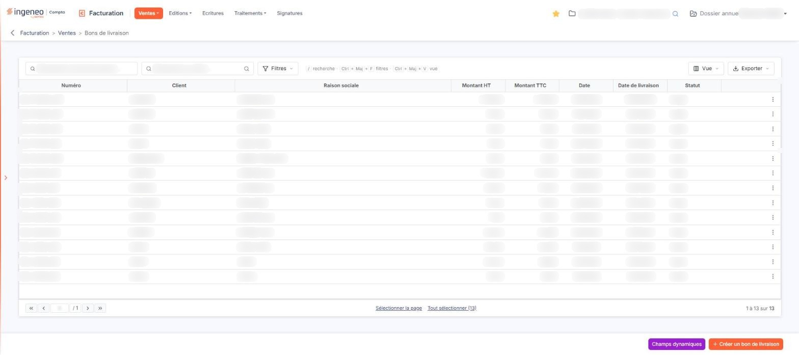
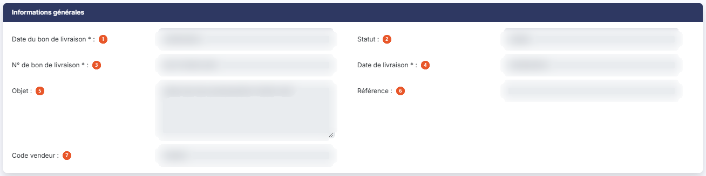
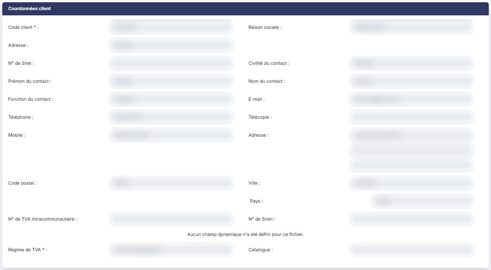
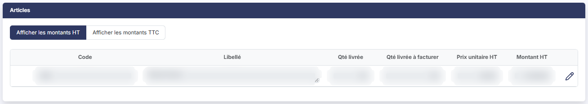
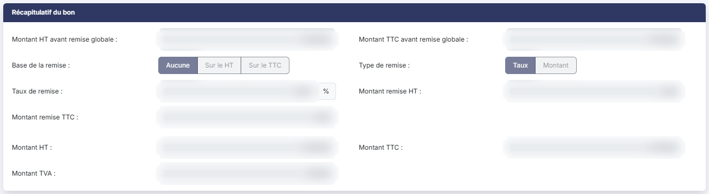
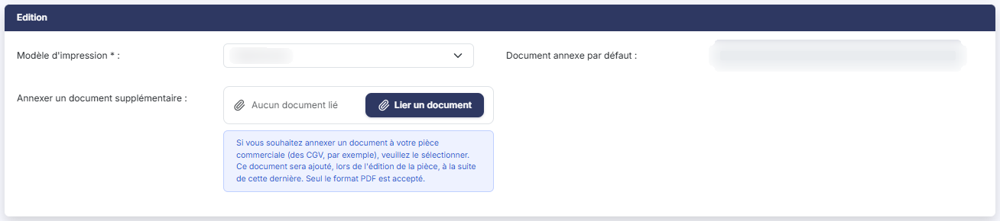

# Bons de livraison


**Où le trouver :** Menu **Ventes › Bons de livraison**



**En bref** — Cet écran liste les bons de livraison et permet de les créer et de les valider, puis d'en générer la facture. Un bon de livraison validé ne peut plus être dévalidé.

* Pour saisir un bon de livraison : bouton \[Créer un bon de livraison], complétez l'en-tête et les lignes, puis bouton \[Enregistrer].
* Pour facturer : ouvrez le bon, puis bouton \[Générer une facture].


Cette option affiche les bons de livraison et permet de les créer et de les valider. Un bon de livraison constate ce que vous avez livré à votre client, puis sert à engendrer la facture correspondante.

<figure><figcaption>
Écran « Bons de livraison » de la nouvelle interface
</figcaption></figure>

Le bon de livraison fonctionne sur le même principe que la facture : cette page ne traite que ce qui lui est propre. Pour tout ce qui leur est commun — la barre d'outils au-dessus du tableau, la recherche d'un client, la saisie des lignes d'articles, le calcul de la remise globale, les modèles d'impression —, reportez-vous au menu « Ventes », option « Factures ».

Trois points méritent votre attention avant tout : les colonnes de quantité ne sont pas celles des autres pièces, un bon de livraison validé ne peut plus être dévalidé, et sa fiche ne vous dit pas si une facture en a déjà été engendrée. Les trois sont détaillés ci-dessous.

## Un bon de livraison validé ne peut plus être dévalidé

La fiche d'un bon de livraison validé ne comporte pas de bouton de dévalidation, et la liste ne propose pas de dévalidation groupée.

Vérifiez donc la pièce avant de la valider.

## La liste des bons de livraison

La barre d'outils au-dessus du tableau porte deux champs de recherche, « Rechercher un bon de livraison… » (saisissez le numéro) et « Rechercher un client… » (saisissez le client, ou cliquez la loupe à droite du champ), puis bouton **\[Filtres]**, bouton **\[Vue]** et bouton **\[Exporter]**. bouton **\[Filtres]** ouvre un volet « Filtrer » : choisissez une colonne dans « + Ajouter un critère sur… » (les huit colonnes du tableau, mais aussi d'autres champs de la pièce, comme Facture, Objet, Référence, Vendeur, les coordonnées du client ou les montants de remise), puis renseignez le critère. bouton **\[Vue]** ouvre un volet qui présente « Mes vues » (« Aucune vue enregistrée. » tant que vous n'en avez pas mémorisé) puis « Colonnes affichées », avec l'indication « 8 colonnes affichées sur 40 », « Rétablir les colonnes d'origine » et bouton **\[Appliquer]**. bouton **\[Exporter]** ouvre un volet qui rappelle « La liste affichée - N bons de livraison » et propose « Aperçu édition HTML », « Imprimer Ctrl+P », « Exporter en Excel », « Exporter en PDF » et « Envoyer la liste par e-mail ». Contrairement à la liste des factures, il n'y a pas de bouton \[Filtres spéciaux].

Le tableau présente huit colonnes, toutes triables : **Numéro**, **Client**, **Raison sociale**, **Montant HT**, **Montant TTC**, **Date**, **Date de livraison** et **Statut**.

C'est la seule des listes de pièces commerciales à porter **deux colonnes de date**, et rien dans leurs intitulés ne dit laquelle est laquelle : la colonne **Date** est la date du bon de livraison — celle que les autres listes nomment « Date facture » ou « Date avoir » —, et la colonne **Date de livraison** est la date de livraison saisie sur la pièce.

Il n'y a ni colonne **Etat**, ni colonne **Retard** : un bon de livraison ne porte pas de pastille d'état et n'a pas d'échéance. La colonne **Statut** indique s'il est validé ou non — la valeur y est au masculin, « Validé », là où la liste des factures affiche « Validée ».

**Les commandes présentes sur chaque ligne**

Un clic sur une ligne la sélectionne ; il n'y a pas de case à cocher. Au survol d'une ligne, ou quand elle est sélectionnée, trois commandes directes apparaissent à droite, « Télécharger », « Valider » et « Envoyer par mail », suivies du menu « Autres actions » (trois points), qui propose « Modifier », « Dupliquer » et « Supprimer ». Sous le tableau, « Sélectionner la page » et « Tout sélectionner (n) » sélectionnent les lignes de la page ou de toutes les pages, et un compteur du type « 1 à 13 sur 13 » indique l'étendue de la liste.

Il n'y a ni commande « Régler », ni commande « Editer un relevé de comptes », que porte la liste des factures : un bon de livraison ne se règle pas et n'entre pas dans le relevé de compte du client — c'est la facture qui en découle qui le fait.

Comme sur la facture et l'avoir, « Valider » reste affichée sur un bon de livraison déjà validé.

En bas à droite de l'écran, la barre du bas porte bouton **\[Champs dynamiques]** et bouton **\[Créer un bon de livraison]**.

Dès qu'au moins un bon de livraison est sélectionné, un bandeau remplace cette barre. Il indique « 1 bon de livraison sélectionné », suivi du lien « Tout désélectionner », et propose bouton **\[Supprimer]**, bouton **\[Envoyer tout par mail]**, bouton **\[Générer les factures]** et bouton **\[Validations groupées]**.

Cette liste est la seule des cinq pièces commerciales à ne pas proposer d'impressions groupées : vous imprimez vos bons de livraison un par un, depuis leur fiche, ou vous imprimez la liste par bouton **\[Exporter]**, entrée « Imprimer Ctrl+P », ce qui n'est pas la même chose.

Il n'y a pas non plus de dévalidation groupée — voir le point a) ci-dessus.

Selon les droits qui vous ont été attribués, certaines de ces commandes peuvent ne pas vous être proposées.

## La fiche d'un bon de livraison

La fiche présente cinq rubriques, et non sept comme la facture : « Informations générales », « Coordonnées client », « Articles », « Récapitulatif du bon » et « Edition ».

Le bon de livraison n'a donc **pas de rubrique « Paiement »** : ni mode de règlement, ni banque, ni délai, ni date d'échéance, ni échéancier. Il n'y a pas davantage de rubrique de notes.

Comme l'avoir, le devis et le bon de commande, et contrairement à la facture, la liste des champs d'un bon de livraison n'est pas configurable : la fiche ne porte pas de bouton de choix des champs, et les colonnes de ses tableaux sont figées.

## Rubrique « Informations générales »

<figure><figcaption>
Rubrique « Informations générales »
</figcaption></figure>

Sept champs seulement, dans cet ordre :

| Champ                           | Ce qu'il faut savoir                                                                                                                                                                                                                                                                                                                         |
| ------------------------------- | -------------------------------------------------------------------------------------------------------------------------------------------------------------------------------------------------------------------------------------------------------------------------------------------------------------------------------------------- |
| 1. **Date du bon de livraison** | Champ obligatoire. C'est la date de la pièce.                                                                                                                                                                                                                                                                                                |
| 2. **Statut**                   | Ce champ n'apparaît pas en création. Il n'est pas saisissable.                                                                                                                                                                                                                                                                               |
| 3. **N° de bon de livraison**   | Champ obligatoire. Il ne devient saisissable que si vous avez autorisé la modification du numéro des bons de livraison dans le panneau « Paramètres », rubrique « Facturation », onglet « Pièces commerciales » — cette autorisation est propre à chaque pièce, et l'accorder pour les factures ne l'accorde pas pour les bons de livraison. |
| 4. **Date de livraison**        | Champ **obligatoire** sur cette pièce, alors que la facture porte une date de livraison facultative.                                                                                                                                                                                                                                         |
| 5. **Objet**                    | Champ facultatif.                                                                                                                                                                                                                                                                                                                            |
| 6. **Référence**                | Champ facultatif.                                                                                                                                                                                                                                                                                                                            |
| 7. **Code vendeur**             | Champ facultatif.                                                                                                                                                                                                                                                                                                                            |

La rubrique ne comporte ni champ **Etat**, ni **Comptabilisation**, ni **Montant TTC**, ni **Montant réglé**, ni **Reste à payer**, contrairement à la fiche d'une facture.

Elle ne comporte surtout **aucun indicateur de pièce engendrée** : alors que la fiche d'un bon de livraison validé vous propose d'en générer une facture, rien sur cette fiche ne vous dira ensuite qu'une facture en a été engendrée, ni laquelle. La fiche d'un devis en porte trois, celle d'un bon de commande deux. Pour retrouver la facture issue d'un bon de livraison, passez par la liste des factures.

## Rubrique « Coordonnées client »

<figure><figcaption>
Rubrique « Coordonnées client »
</figcaption></figure>

Cette rubrique est celle de l'avoir, du devis et du bon de commande : le sélecteur d'adresse s'appelle simplement **Adresse :**, et il n'y a **pas de bloc d'adresse de livraison** — celui-ci n'existe que sur la facture, alors même que le bon de livraison est la pièce qui constate la livraison. La rubrique comporte en revanche une zone de champs dynamiques, qui affiche « Aucun champ dynamique n'a été défini pour ce fichier. » lorsqu'aucun champ dynamique n'est défini.

Suivent les champs de contact et d'adresse du client, en lecture seule, puis **N° de TVA intracommunautaire :**, **N° de Siren :**, **Régime de TVA :**, champ obligatoire, et **Catalogue :**.

## Rubrique « Articles » — deux colonnes de quantité

<figure><figcaption>
Rubrique « Articles »
</figcaption></figure>

Comme sur la facture, deux boutons commandent l'affichage des montants, « Afficher les montants HT », retenu par défaut, et « Afficher les montants TTC » ; le prix unitaire et le montant de chaque ligne suivent ce choix.

Le tableau des lignes porte **deux colonnes de quantité**, qui ne sont pas celles du bon de commande :

| Champ                     | Ce qu'il faut savoir                                   |
| ------------------------- | ------------------------------------------------------ |
| **Qté livrée**            | La quantité livrée pour cette ligne.                   |
| **Qté livrée à facturer** | La part de cette quantité livrée qui reste à facturer. |

Retenez que les trois pièces de flux ne portent pas les mêmes colonnes de quantité : une seule colonne **Qté** sur la facture, l'avoir et le devis ; trois sur le bon de commande — **Qté commandée**, **Qté livrée** et **Reliquat à livrer** ; deux ici. Seule **Qté livrée** est commune aux deux bons. Ne transposez donc pas d'une pièce à l'autre ce que vous lisez dans une colonne de quantité.

Les boutons sous le tableau — bouton **\[Nouvelle ligne]**, bouton **\[Nouveau commentaire]**, bouton **\[Nouveau sous-total]** et bouton **\[Supprimer les lignes]** — ne sont proposés que tant que le bon de livraison n'est pas validé ; sur un bon validé, la seule commande portée par une ligne d'article est « Visualiser détails ». Comme sur le devis et le bon de commande, il n'y a pas de note de ligne.

## Rubrique « Récapitulatif du bon »

<figure><figcaption>
Rubrique « Récapitulatif du bon »
</figcaption></figure>

Retenez le libellé de cette rubrique : chacune des cinq pièces commerciales le nomme autrement, et la facture dit « Récapitulatif de facturation ».

Son contenu est celui de la facture, \*\*sans le champ \*\*Acompte : : les deux montants avant remise globale, la base et le type de remise, le taux et les deux montants de remise, puis les montants HT, TTC et de TVA. La remise globale se calcule comme sur une facture.

## Rubrique « Edition »

<figure><figcaption>
Rubrique « Edition »
</figcaption></figure>

Trois champs : **Modèle d'impression :**, champ obligatoire, **Document annexe par défaut :** et **Annexer un document supplémentaire :**, accompagné de bouton **\[Lier un document]** (« Aucun document lié » s'affiche tant qu'aucun document n'est lié).

Contrairement à la facture et à l'avoir, qui gagnent un modèle d'impression du duplicata dès qu'ils sont validés, le bon de livraison n'en porte pas, même validé : il n'y a qu'un seul modèle d'impression, et une seule édition.

## Les boutons en pied de fiche

Ils ne sont pas les mêmes avant et après validation.

Tant que le bon de livraison n'est pas validé : bouton **\[Enregistrer]**, bouton **\[Edition]**, bouton **\[Envoyer par mail]** et bouton **\[Valider]**.

Une fois validé : bouton **\[Enregistrer]**, bouton **\[Edition]**, bouton **\[Envoyer par mail]** et bouton **\[Générer une facture]**.

Il n'y a plus de bouton \[Retour] visible : pour revenir à la liste, utilisez la flèche « Revenir en arrière », à gauche du fil d'Ariane.

bouton **\[Générer une facture]** n'apparaît donc **qu'après la validation** : un bon de livraison non validé ne peut pas être transformé en facture depuis sa fiche. Et le bouton de validation disparaît une fois la pièce validée, sans être remplacé par un bouton de dévalidation — voir le point a).

Sur un bon de livraison validé, bouton **\[Enregistrer]** reste affiché alors que la pièce est verrouillée : seuls l'affichage HT/TTC et les boutons de remise du récapitulatif restent actionnables.

Il n'y a ni règlement, ni génération d'avoir, ni facture électronique, ni édition duplicata, ni archivage, ni signature électronique, ni choix des champs.

Chacun de ces boutons dépend du droit qui vous a été attribué.
