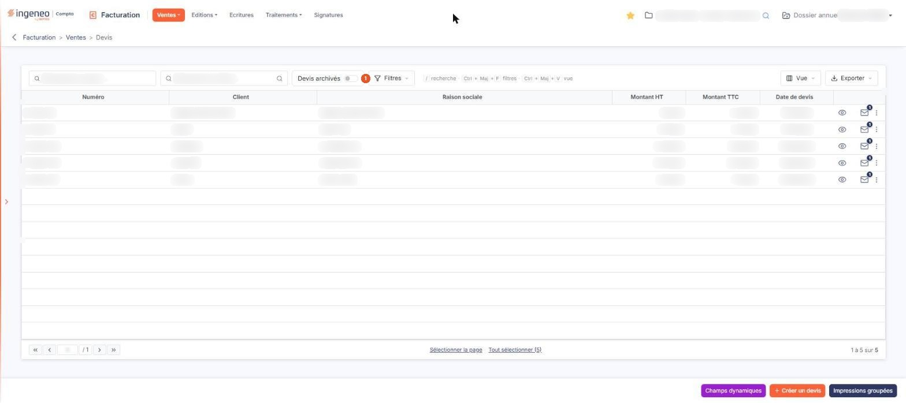
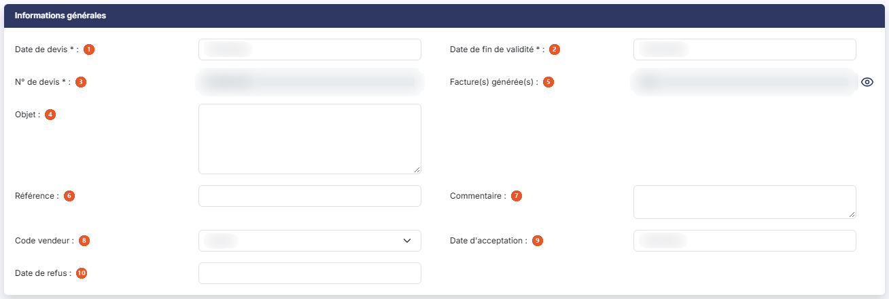
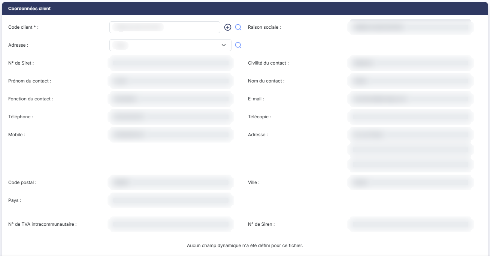
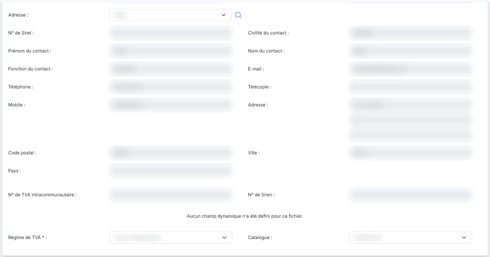
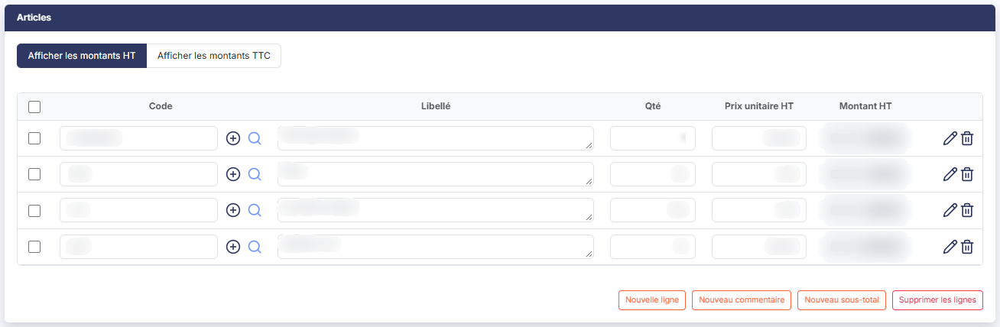
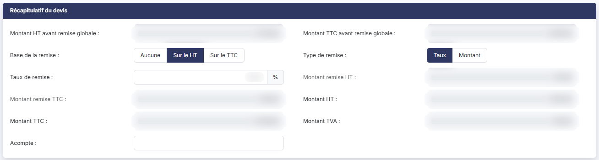
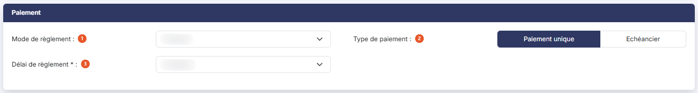
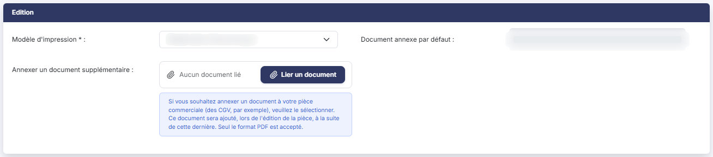

# Devis


**Où le trouver :** Menu **Ventes › Devis**



**En bref** — Cet écran liste les devis clients et permet de les créer, de les transformer en facture, bon de commande ou bon de livraison, et de les archiver. Les devis archivés sont masqués à l'ouverture.

* Pour saisir un devis : bouton \[Créer un devis], complétez l'en-tête et les lignes, puis bouton \[Enregistrer].
* Pour facturer un devis accepté : ouvrez-le, puis bouton \[Générer une facture].
* Pour voir les devis archivés : bouton \[Filtres spéciaux], puis activez l'interrupteur « Devis archivés ».


Cette option affiche les devis clients et permet de les créer, de les transformer en facture, en bon de commande ou en bon de livraison, et de les archiver.

<figure><figcaption>
Écran « Devis » de la nouvelle interface
</figcaption></figure>

Les devis fonctionnant sur le même principe que les factures, cette page ne traite que de ce qui leur est propre : reportez-vous au menu « Ventes », option « Factures », pour tout ce qui leur est commun.

Deux avertissements sur la liste. D'une part, elle porte tous les devis enregistrés dans le dossier annuel sélectionné, quelle que soit leur date : vous pouvez y voir des devis d'un autre exercice. D'autre part, un filtre est armé à l'ouverture de l'écran, mais dans le sens inverse de celui de la liste des factures : l'interrupteur **Devis archivés**, placé dans la barre d'outils à côté de la zone du client, est désactivé. Le nombre de devis annoncé sous la liste n'est donc pas le nombre de devis du dossier, et un devis archivé n'apparaît pas tant que vous n'avez pas activé cet interrupteur.

## La liste des devis

Au-dessus du tableau, la barre d'outils propose deux zones de recherche, « Rechercher un devis… » et « Rechercher un client… », puis l'interrupteur **Devis archivés** (le menu « Filtres spéciaux » n'existe plus), bouton **\[Filtres]**, bouton **\[Vue]** et bouton **\[Exporter]**. Il n'y a pas de champ de total.

**Devis archivés** : cet interrupteur, visible directement dans la barre d'outils, est désactivé à l'ouverture de l'écran : la liste ne contient alors que les devis non archivés.

bouton **\[Filtres]** ouvre un volet où « + Ajouter un critère sur… » vous fait choisir une colonne du tableau, puis bouton **\[Filtrer]** applique vos critères et bouton **\[Vider les filtres]** les retire ; dès qu'un critère est posé, le lien « Tout effacer » apparaît à côté de bouton **\[Filtres]**. bouton **\[Vue]** permet de choisir les colonnes affichées et d'enregistrer des vues.

Le tableau présente six colonnes, toutes triables : **Numéro**, **Client**, **Raison sociale**, **Montant HT**, **Montant TTC** et **Date de devis**.

Un devis n'a ni état, ni statut : il n'y a donc ni colonne **Etat**, ni colonne **Statut**, ni colonne **Retard**. Rien, dans la liste, ne dit si un devis a été accepté, refusé, archivé ou transformé : ces informations ne figurent que dans la fiche.

Sous le tableau, bouton **\[Sélectionner la page]** et bouton **\[Tout sélectionner (n)]** étendent la sélection à la page affichée ou à tous les devis ; les commandes d'impression et d'export sont regroupées sous bouton **\[Exporter]**.

**Les commandes présentes sur chaque ligne**

Un clic sur une ligne la sélectionne. Chaque ligne porte six commandes, au survol, dans la dernière colonne : les pictogrammes « Afficher l'aperçu », « Télécharger » et « Envoyer par mail » (le pictogramme « Enveloppe » porte une pastille chiffrée lorsque le devis a déjà été envoyé), suivis du menu « Autres actions » (trois points), qui porte « Modifier », « Dupliquer » et « Supprimer ».

Trois commandes de la liste des factures sont absentes — « Valider », « Régler » et « Editer un relevé de comptes » : un devis ne se valide pas, ne se règle pas et n'entre pas dans un relevé de comptes.

Dans la barre du bas, bouton **\[Créer un devis]** ouvre une fiche vierge, à côté de bouton **\[Impressions groupées]** et de bouton **\[Champs dynamiques]**. Dès qu'un devis est sélectionné, un bandeau de sélection prend la place de cette barre : il porte « Tout désélectionner », bouton **\[Envoyer tout par mail]**, bouton **\[Archiver]**, bouton **\[Impressions groupées]**, bouton **\[Transferts en factures]** et bouton **\[Supprimer]**.

Les deux boutons propres au devis s'adressent aux devis sélectionnés : bouton **\[Archiver]** les archive, bouton **\[Transferts en factures]** les transforme en factures. Il n'y a en revanche ni validation, ni dévalidation groupée.

Selon les droits qui vous ont été attribués, certaines de ces commandes peuvent ne pas vous être proposées.

## La fiche d'un devis

La fiche présente six rubriques, et non sept comme la facture : « Informations générales », « Coordonnées client », « Articles », « Récapitulatif du devis », « Paiement » et « Edition ». Il n'y a pas de rubrique de notes.

Contrairement à la facture, la liste des champs d'un devis n'est pas configurable : la fiche ne porte pas de bouton de choix des champs.

## Rubrique « Informations générales »

<figure><figcaption>
Rubrique « Informations générales »
</figcaption></figure>

C'est la rubrique qui distingue le plus le devis des quatre autres pièces. Les champs y sont présentés dans cet ordre :

| Champ                            | Ce qu'il faut savoir                                                                                                                                                                                                                                                                                                                                                                                                                                                                                                                            |
| -------------------------------- | ----------------------------------------------------------------------------------------------------------------------------------------------------------------------------------------------------------------------------------------------------------------------------------------------------------------------------------------------------------------------------------------------------------------------------------------------------------------------------------------------------------------------------------------------- |
| 1. **Date de devis**             | Champ obligatoire.                                                                                                                                                                                                                                                                                                                                                                                                                                                                                                                              |
| 2. **Date de fin de validité**   | Champ obligatoire, propre au devis.                                                                                                                                                                                                                                                                                                                                                                                                                                                                                                             |
| 3. **N° de devis**               | Champ obligatoire. En création, il n'est pas saisissable et affiche le texte d'attente « En cours d'attribution » : le numéro n'est affecté au devis que lorsqu'il est enregistré, imprimé, envoyé par courriel ou converti en une autre pièce. En modification, il devient saisissable si vous avez autorisé la modification du numéro des devis dans le menu « Paramètres », option « Pièces commerciales » — cette autorisation est propre à chaque pièce. Il reste en lecture seule si elle n'a pas été donnée, ou si le devis est archivé. |
| 4. **Objet**                     | Champ facultatif.                                                                                                                                                                                                                                                                                                                                                                                                                                                                                                                               |
| 5. **Facture(s) générée(s)**     | Champ Oui/Non non saisissable, qui indique si une ou plusieurs factures ont été générées à partir du devis. Le pictogramme « Œil » placé à sa droite, dont l'infobulle est « Visualiser les factures générées », en affiche la liste.                                                                                                                                                                                                                                                                                                           |
| 6. **Référence**                 | Champ facultatif.                                                                                                                                                                                                                                                                                                                                                                                                                                                                                                                               |
| 7. **Commentaire**               | Champ facultatif, propre au devis.                                                                                                                                                                                                                                                                                                                                                                                                                                                                                                              |
| 8. **Code vendeur**              | Champ facultatif.                                                                                                                                                                                                                                                                                                                                                                                                                                                                                                                               |
| 9. **Date d'acceptation**        | Champ facultatif.                                                                                                                                                                                                                                                                                                                                                                                                                                                                                                                               |
| 10. **Date de refus**            | Champ facultatif.                                                                                                                                                                                                                                                                                                                                                                                                                                                                                                                               |
| **Bon(s) de commande généré(s)** | **Bon(s) de livraison généré(s) :** mêmes champs pour les deux bons, avec leur propre pictogramme « Œil ». Ils ne sont affichés que lorsque la pièce correspondante a été générée.                                                                                                                                                                                                                                                                                                                                                              |
| **Archivé par**                  | Suivi de **le :** — ces deux champs ne s'affichent que sur un devis archivé, et donnent le nom de l'utilisateur qui l'a archivé et la date de l'archivage. Ils ne sont pas saisissables.                                                                                                                                                                                                                                                                                                                                                        |

La rubrique ne comporte ni **Etat**, ni **Statut**, ni **Comptabilisation**, ni **Montant TTC**, ni **Montant réglé**, ni **Reste à payer**, ni **Date de livraison** : un devis ne se valide pas, ne se comptabilise pas et ne se règle pas.

## Rubrique « Coordonnées client »

<figure><figcaption>
Rubrique « Coordonnées client »
</figcaption></figure>

<figure><figcaption>
Rubrique « Coordonnées client »
</figcaption></figure>

Elle reprend la rubrique de même nom de la fiche d'une facture, avec deux différences, les mêmes que sur l'avoir : le sélecteur d'adresse s'intitule **Adresse :** et non « Adresse de facturation », et il n'y a pas de sélecteur d'adresse de livraison.

Comme sur la facture, le régime de TVA et le catalogue sont rangés dans cette rubrique bien qu'ils ne décrivent pas le client.

## Rubrique « Articles »

<figure><figcaption>
Rubrique « Articles »
</figcaption></figure>

Elle est identique à celle de la facture : même bascule « Afficher les montants HT » / « Afficher les montants TTC », HT par défaut, même tableau de huit colonnes dont deux masquées selon la bascule, et une seule colonne de quantité, **Qté**.

Une seule différence sous le tableau : il n'y a pas de bouton de note de ligne. Restent bouton **\[Nouvelle ligne]**, bouton **\[Nouveau commentaire]**, bouton **\[Nouveau sous-total]** et bouton **\[Supprimer les lignes]**.

## Rubrique « Récapitulatif du devis »

<figure><figcaption>
Rubrique « Récapitulatif du devis »
</figcaption></figure>

Elle est identique au « Récapitulatif de facturation » de la facture, **Acompte** compris. C'est un écart avec l'avoir, qui ne porte pas d'acompte.

## Rubrique « Paiement »

<figure><figcaption>
Rubrique « Paiement »
</figcaption></figure>

Elle est réduite par rapport à celle de la facture :

| Champ                     | Ce qu'il faut savoir                                                    |
| ------------------------- | ----------------------------------------------------------------------- |
| 1. **Mode de règlement**  | Champ facultatif.                                                       |
| 2. **Type de paiement**   | Deux boutons-bascule, « Paiement unique » par défaut et « Echéancier ». |
| 3. **Délai de règlement** | Champ obligatoire.                                                      |

Un devis n'a ni banque, ni date d'échéance, ni statut Chorus Pro.

Comme sur la facture, les deux choix de **Type de paiement** ne donnent pas la même liste de champs. Tant que « Paiement unique » est retenu, les champs de l'échéancier et le tableau des échéances ne sont pas affichés. Dès que vous retenez « Echéancier », c'est l'inverse : **Délai de règlement** disparaît de la rubrique, et trois champs obligatoires s'affichent à sa place — **Nombre d'échéances**, **Périodicité** et **Date première échéance** — accompagnés d'un bouton **\[Appliquer]**, qui reporte ces valeurs dans le tableau des échéances, et du tableau lui-même, aux colonnes **N° échéance**, **Montant échéance**, **Date** et **Reste à payer**.

## Rubrique « Edition »

<figure><figcaption>
Rubrique « Edition »
</figcaption></figure>

Elle est identique à celle de la facture, sans le modèle d'impression du duplicata : un devis ne se validant pas, il n'a pas de duplicata.

## Les boutons de la fiche

La fiche d'un devis porte le plus grand nombre de boutons des cinq pièces commerciales : bouton **\[Enregistrer]**, bouton **\[Edition]**, bouton **\[Envoyer par mail]**, bouton **\[Signer électroniquement]**, bouton **\[Générer une facture]**, bouton **\[Générer un bon de commande]**, bouton **\[Générer un bon de livraison]**, bouton **\[Archiver]**, bouton **\[Charger une facture]**. Le retour à la liste se fait par la flèche « Revenir en arrière », à gauche du fil d'Ariane.

En création, ils ne sont que huit : bouton **\[Archiver]** n'apparaît qu'une fois le devis enregistré.

Il n'y a ni validation, ni dévalidation, ni règlement, ni génération d'avoir, ni édition originale ou duplicata, ni choix des champs.

Chacun de ces boutons dépend du droit qui vous a été attribué, et tous, sauf l'édition, disparaissent lorsque le devis est archivé : sur un devis archivé ne restent que bouton **\[Edition]** et bouton **\[Désarchiver]**, le retour se faisant par la flèche « Revenir en arrière ».

## Bouton \[Signer électroniquement]

Ce bouton n'est proposé que si trois conditions sont réunies : le devis n'est pas archivé, le service de signature électronique est actif pour votre cabinet, et le droit de signer électroniquement vous a été attribué.

Ce service ne s'active pas depuis la facturation, et l'option « Signatures » du menu ne l'active pas davantage : elle ne fait que récapituler les demandes déjà envoyées. Il faut que l'interface de signature électronique ait été activée pour votre cabinet, activation qui relève du module « Supervision datas ». Le bouton n'est en outre proposé que lorsque vous êtes positionné sur la société de votre cabinet, et en tant que collaborateur de ce cabinet.

Une fois une première signature demandée, la fiche porte une rubrique supplémentaire, « Signature électronique », qui donne le statut de la demande et sa date, tous deux en lecture seule, et un bouton **\[Actualiser]**. Cette rubrique n'existe pas avant la première demande.

L'option « Signatures » du menu du module récapitule de son côté toutes les demandes envoyées, avec leur date, leur heure, l'utilisateur qui les a envoyées, les destinataires, le statut et la date de ce statut.

## Les trois boutons de génération, et la question de l'archivage

Les trois boutons de génération créent, à partir du devis, une facture, un bon de commande ou un bon de livraison qui en reprend les caractéristiques.

Avant de générer, le logiciel affiche une fenêtre de confirmation, avec bouton **\[Confirmer]** et bouton **\[Annuler]**. Si le droit d'archiver les devis vous a été attribué, cette fenêtre pose en outre la question « Archiver le devis après transfert ? », proposée à « Oui ».

Un devis archivé, lui, ne peut plus être transformé.

Les champs **Facture(s) générée(s)**, **Bon(s) de commande généré(s)** et **Bon(s) de livraison généré(s)** de la rubrique « Informations générales » sont le seul endroit où lire ce qu'un devis a déjà engendré.

## Bouton \[Charger une facture]

Malgré son libellé, ce bouton ne charge aucun fichier. Il vous fait choisir une facture existante, puis en recopie le contenu dans le devis en cours : c'est le moyen de préparer un devis à partir d'une facture, à l'inverse de la transformation habituelle du devis en facture.

Ce que vous aviez déjà saisi dans le devis est remplacé, et rien n'est enregistré à ce stade : si vous quittez la fiche sans enregistrer, le devis reste dans son état antérieur.

Ce bouton n'est proposé que sur un devis qui n'est ni accepté, ni archivé.

## Bouton \[Archiver] et Bouton \[Désarchiver]

bouton **\[Archiver]** archive le devis en mémorisant la date d'archivage et le nom de l'utilisateur qui l'a demandé, tous deux affichés ensuite dans la rubrique « Informations générales ».

Utilisé depuis la liste des devis, il archive tous les devis sélectionnés ; utilisé depuis la fiche, il n'archive que le devis en cours.

bouton **\[Désarchiver]** annule l'archivage. Il n'est proposé que sur un devis archivé, et sous réserve du droit correspondant.

Rappelez-vous que les devis archivés sont masqués de la liste par défaut : activez l'interrupteur **Devis archivés** de la barre d'outils pour les retrouver.
