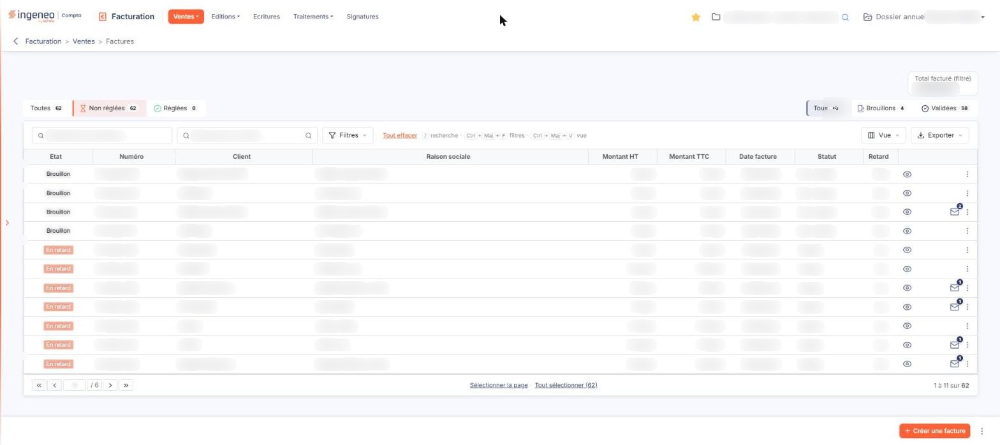
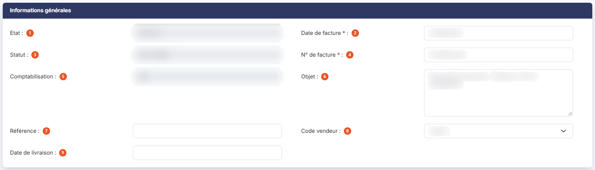
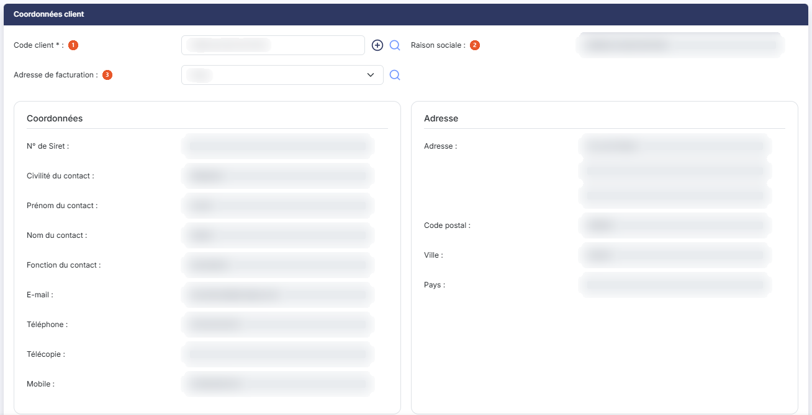
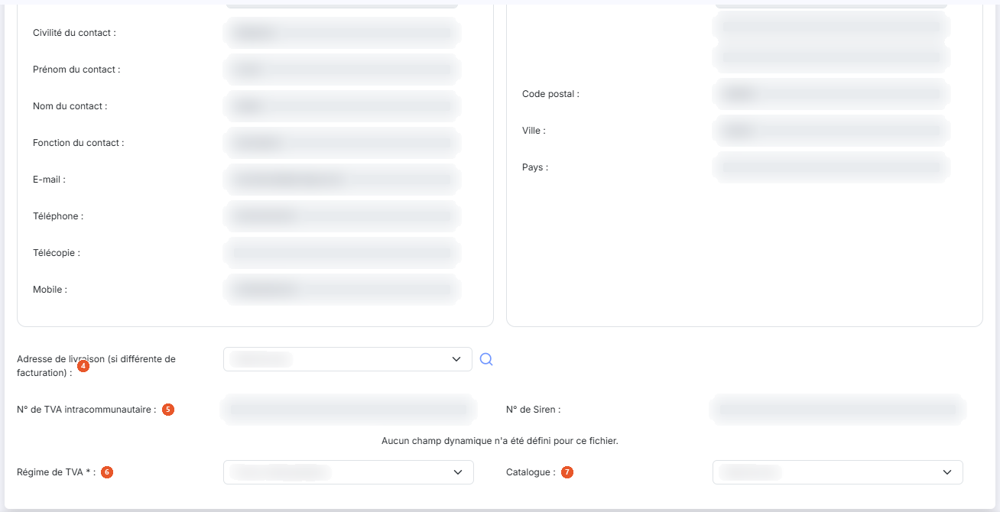
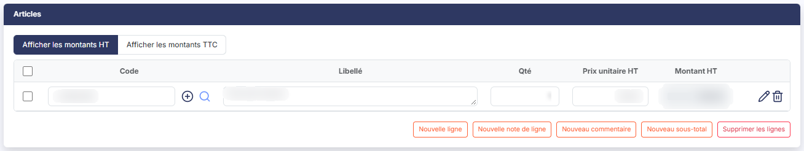
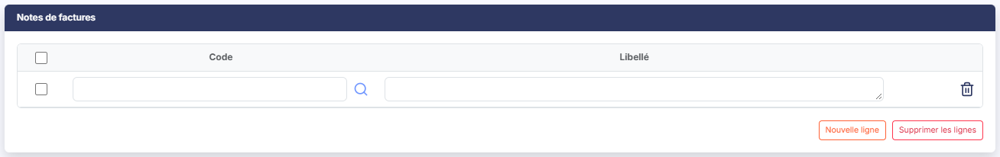
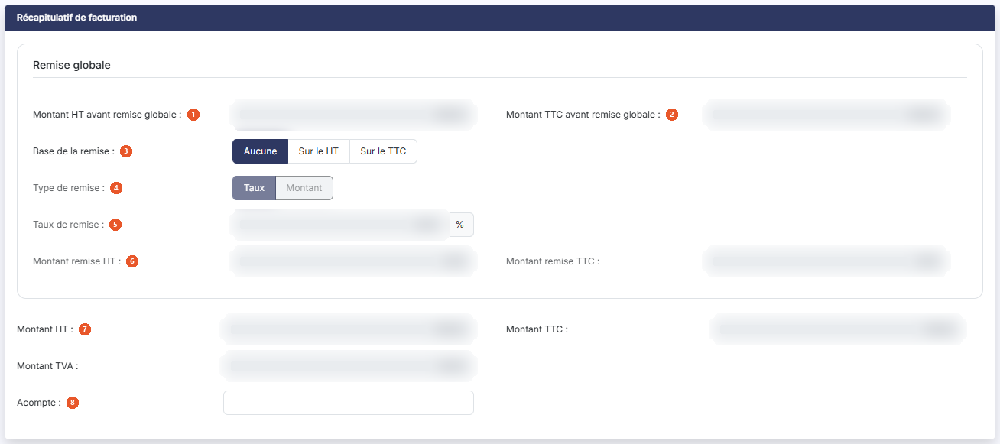
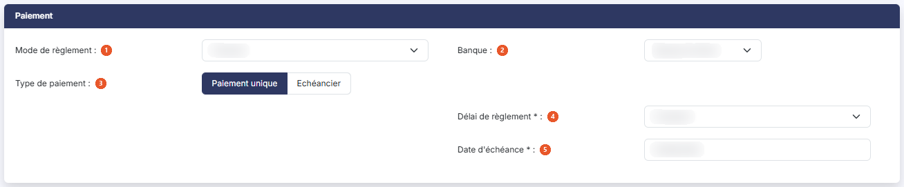
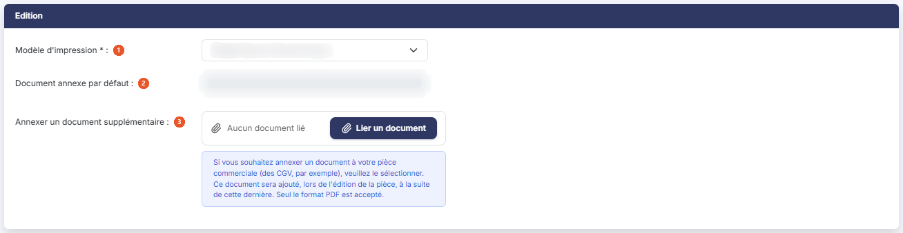

# Factures


**Où le trouver :** Menu **Ventes › Factures**



**En bref** — Cet écran liste les factures clients du dossier annuel et permet de les créer, de les modifier, de les valider et de les régler. À l'ouverture, seules les factures non réglées sont affichées.

* Pour saisir une facture : bouton \[Créer une facture], complétez l'en-tête et les lignes, puis bouton \[Enregistrer].
* Pour finaliser une facture : ouvrez-la, bouton \[Valider], puis bouton \[Régler la facture] pour enregistrer son règlement.
* Pour voir aussi les factures réglées : bouton \[Filtres spéciaux], puis désactivez l'interrupteur « Factures non réglées ».


Cette option affiche les factures clients et permet de les créer, de les modifier, de les valider et de les régler. Une facture peut être saisie directement ici, ou générée depuis un devis, un bon de commande ou un bon de livraison.

<figure><figcaption>
Écran « Factures » de la nouvelle interface
</figcaption></figure>

La liste présente toutes les factures enregistrées dans le dossier annuel sélectionné, quelle que soit leur date : elle n'est donc pas limitée à la période de saisie du dossier, et vous pouvez y voir des pièces datées d'un autre exercice. Pour ne travailler que sur une période, utilisez le volet de filtres que bouton **\[Filtres]** ouvre au-dessus du tableau.

Un filtre est armé à l'ouverture de l'écran : le filtre rapide **Non réglées** du groupe « Règlement », placé au-dessus du tableau, est retenu. Le nombre de lignes annoncé par la pagination n'est donc pas le nombre de factures du dossier, et une facture entièrement réglée n'apparaît pas tant que vous n'avez pas choisi **Toutes** ou **Réglées**. Les factures non validées (les brouillons) s'affichent avec **Non réglées** comme avec **Toutes**, mais pas avec **Réglées**.

## La liste des factures

La barre d'outils au-dessus du tableau porte, de gauche à droite :

| Champ                       | Ce qu'il faut savoir                                                                                                                                                                                                                                                                                                                                                                                                                                                                                                                                                                                                                                                                                                                                                                                                                                                                                                                                                                                                                                                                                                                                                                                                                                                 |
| --------------------------- | -------------------------------------------------------------------------------------------------------------------------------------------------------------------------------------------------------------------------------------------------------------------------------------------------------------------------------------------------------------------------------------------------------------------------------------------------------------------------------------------------------------------------------------------------------------------------------------------------------------------------------------------------------------------------------------------------------------------------------------------------------------------------------------------------------------------------------------------------------------------------------------------------------------------------------------------------------------------------------------------------------------------------------------------------------------------------------------------------------------------------------------------------------------------------------------------------------------------------------------------------------------------- |
| **Rechercher une facture…** | Zone de recherche rapide. Elle remplace l'ancien champ « N° de facture ».                                                                                                                                                                                                                                                                                                                                                                                                                                                                                                                                                                                                                                                                                                                                                                                                                                                                                                                                                                                                                                                                                                                                                                                            |
| **Rechercher un client…**   | Saisissez les premières lettres du code ou de la raison sociale, ou utilisez le pictogramme « Loupe » placé à droite de la zone pour ouvrir la fenêtre de recherche. Le raccourci clavier Ctrl + Alt + R ouvre cette même fenêtre.                                                                                                                                                                                                                                                                                                                                                                                                                                                                                                                                                                                                                                                                                                                                                                                                                                                                                                                                                                                                                                   |
| **Filtres rapides**         | 
Il n'y a plus de menu « Filtres spéciaux ». Deux groupes de segments, au-dessus de la barre d'outils, restreignent la liste ; chaque segment affiche le nombre de factures qu'il retient. À gauche, le groupe « Règlement » : <strong>Toutes</strong>, <strong>Non réglées</strong> (retenu à l'ouverture de l'écran) et <strong>Réglées</strong>. À droite, le groupe « Statut » : <strong>Tous</strong> (retenu à l'ouverture), <strong>Brouillons</strong> et <strong>Validées</strong>. Les nombres affichés sur « Statut » suivent le choix fait dans « Règlement ». Dès qu'un autre segment est retenu, le lien « Tout effacer » s'affiche à droite de la barre d'outils : il remet « Règlement » sur <strong>Toutes</strong> et « Statut » sur <strong>Tous</strong>. bouton <strong>[Filtres]</strong> : il ouvre le volet « Filtrer », qui annonce « Aucun critère. Choisissez une colonne pour commencer. » tant qu'aucun critère n'est posé. La liste déroulante « + Ajouter un critère sur… » propose les colonnes de la liste. Le lien « Vider les filtres » retire les critères du volet ; bouton <strong>[Filtrer]</strong> les applique. Ces critères se cumulent avec les zones de recherche et avec les deux groupes de filtres rapides.
 |
| **Total facturé (filtré)**  | Cette case encadrée n'est pas saisissable. Elle figure au-dessus du tableau, à droite, sur sa propre ligne, au-dessus des filtres rapides, et totalise les factures que les filtres laissent afficher : il change donc avec les critères que vous posez.                                                                                                                                                                                                                                                                                                                                                                                                                                                                                                                                                                                                                                                                                                                                                                                                                                                                                                                                                                                                             |

Le tableau présente neuf colonnes, toutes triables par un clic sur leur en-tête : **Etat**, **Numéro**, **Client**, **Raison sociale**, **Montant HT**, **Montant TTC**, **Date facture**, **Statut** et **Retard**.

La colonne **Etat** porte une pastille de couleur qui résume la situation de la facture : « Brouillon » tant qu'elle n'est pas validée, « Payée » lorsqu'il ne reste rien à payer, « En retard » lorsqu'une échéance est dépassée sans être soldée, et « Validée » dans les autres cas.

La colonne **Statut** indique si la facture est validée ou non, et la colonne **Retard** répond par « Oui » ou par « Non ».

L'en-tête du tableau ne porte plus ni boîtes à cocher ni pictogrammes de commande : ils sont remplacés par deux boutons à droite de la barre d'outils.

* bouton **\[Vue]** : il ouvre le menu des vues, avec « Mes vues » (« Enregistrer la vue actuelle ») et « Colonnes affichées » (flèches de déplacement, « Rétablir les colonnes d'origine » et « Appliquer ») ; c'est lui qui remplace le pictogramme « Configuration » et permet de choisir les colonnes affichées ;
* bouton **\[Exporter]** : il ouvre un menu qui propose « Aperçu édition HTML », « Imprimer », « Exporter en Excel », « Exporter en PDF » et « Envoyer la liste par e-mail », avec les réglages « Portrait » / « Paysage » et « Ajustée » / « Fixe » ; c'est lui qui remplace le pictogramme « Imprimante » ;
* sous le tableau, « Sélectionner la page » retient les lignes de la page affichée et « Tout sélectionner (n) » celles de toutes les pages.

Le tableau est paginé. Le nombre de lignes par page est calculé d'après la résolution de votre écran.

**Les commandes présentes sur chaque ligne**

Il n'y a plus de boîte à cocher : un clic sur la ligne la sélectionne, un second clic la désélectionne. Les commandes sont regroupées à droite de la ligne, dans la dernière colonne, et n'apparaissent qu'au survol (seuls le pictogramme « Afficher l'aperçu » et, le cas échéant, l'enveloppe avec sa pastille restent visibles au repos). Elles sont, dans cet ordre : « Afficher l'aperçu », « Télécharger », « Valider », « Régler » et « Envoyer par mail », suivies du menu « Autres actions » (trois points), qui porte « Modifier », « Dupliquer », « Editer un relevé de comptes » et « Supprimer ».

Ces commandes sont proposées quel que soit le statut de la facture : « Valider » reste donc affichée sur une facture déjà validée.

Lorsque la facture a déjà été envoyée par courriel, une pastille chiffrée se superpose au pictogramme « Enveloppe » et en donne le nombre d'envois. En survolant cette pastille, vous affichez la liste des envois sous la forme d'un tableau intitulé « Envois de la facture » suivi du numéro, avec les colonnes **Date**, **Heure** et **Destinataires**.

En bas à droite de l'écran, bouton **\[Créer une facture]** ouvre une fiche de facture vide ; un menu à trois points, à côté, donne accès à bouton **\[Champs dynamiques]**, qui ouvre les champs que vous avez vous-même créés.

Dès qu'une facture est sélectionnée, un bandeau s'affiche en bas de l'écran (« 1 facture sélectionnée ») avec le lien « Tout désélectionner », et il remplace alors bouton **\[Créer une facture]**. Il porte bouton **\[Envoyer tout par mail]**, bouton **\[Dévalidations groupées]** et bouton **\[Supprimer]**, qui traitent en une seule fois les factures sélectionnées ; à partir de deux factures sélectionnées, bouton **\[Impressions groupées]** et bouton **\[Validations groupées]** s'y ajoutent.

Selon les droits qui vous ont été attribués, certaines de ces commandes peuvent ne pas vous être proposées.

## La fiche d'une facture

La fiche présente sept rubriques, dans cet ordre : « Informations générales », « Coordonnées client », « Articles », « Notes de factures », « Récapitulatif de facturation », « Paiement » et « Edition ».

La liste des champs de la fiche n'est pas figée : elle dépend du paramétrage accessible par bouton **\[Choix des champs]** décrit plus bas. Certains champs présentés ci-après peuvent donc ne pas figurer sur votre écran.

## Rubrique « Informations générales »

<figure><figcaption>
Rubrique « Informations générales »
</figcaption></figure>

Trois des champs décrits ci-après — **Etat**, **Statut** et **Comptabilisation** — ne figurent pas sur une facture en cours de création : ils ne rendent compte que de l'état d'une facture déjà enregistrée, et n'apparaissent donc qu'en modification.

| Champ                              | Ce qu'il faut savoir                                                                                                                                                                                                                                                                                                                                                                                                                                                                                                                                                                                                                                                                                                                                                                                                                                                                                                                                                                             |
| ---------------------------------- | ------------------------------------------------------------------------------------------------------------------------------------------------------------------------------------------------------------------------------------------------------------------------------------------------------------------------------------------------------------------------------------------------------------------------------------------------------------------------------------------------------------------------------------------------------------------------------------------------------------------------------------------------------------------------------------------------------------------------------------------------------------------------------------------------------------------------------------------------------------------------------------------------------------------------------------------------------------------------------------------------ |
| 1. **Etat**                        | Ce champ n'est pas saisissable. Il reprend la pastille de la liste.                                                                                                                                                                                                                                                                                                                                                                                                                                                                                                                                                                                                                                                                                                                                                                                                                                                                                                                              |
| 2. **Date de facture**             | Champ obligatoire.                                                                                                                                                                                                                                                                                                                                                                                                                                                                                                                                                                                                                                                                                                                                                                                                                                                                                                                                                                               |
| 3. **Statut**                      | Ce champ n'est pas saisissable. Il indique si la facture est validée ou non.                                                                                                                                                                                                                                                                                                                                                                                                                                                                                                                                                                                                                                                                                                                                                                                                                                                                                                                     |
| 4. **N° de facture**               | 
Champ obligatoire, mais que vous n'avez pas à composer : sa forme est décrite dans « Paramètres > Facturation > Pièces commerciales », séparément pour chacune des cinq pièces commerciales. Le champ connaît trois situations : - en création, il n'est jamais saisissable et affiche le texte d'attente « En cours d'attribution ». Le numéro n'est en effet affecté à la facture que lorsqu'elle est enregistrée, imprimée, envoyée par courriel ou validée — c'est ce que rappelle le pictogramme d'information placé à sa droite ; - en modification, il est saisissable si vous avez autorisé la modification du numéro des factures dans « Paramètres > Facturation > Pièces commerciales » ; - en modification, il reste en lecture seule si cette autorisation n'a pas été donnée, ou si la facture est validée. Cette autorisation est propre à chaque pièce : l'accorder pour les factures ne l'accorde ni pour les avoirs, ni pour les devis, ni pour les deux bons.
 |
| 5. **Comptabilisation**            | Champ Oui/Non non saisissable, qui indique si les écritures comptables relatives à la facture ont été générées ou non.                                                                                                                                                                                                                                                                                                                                                                                                                                                                                                                                                                                                                                                                                                                                                                                                                                                                           |
| 6. **Objet**                       | Champ facultatif, saisi sur plusieurs lignes. Si la facture a été créée à partir d'un devis, la référence à ce devis figure dans l'objet, mais vous pouvez la modifier.                                                                                                                                                                                                                                                                                                                                                                                                                                                                                                                                                                                                                                                                                                                                                                                                                          |
| 7. **Référence**                   | Champ facultatif.                                                                                                                                                                                                                                                                                                                                                                                                                                                                                                                                                                                                                                                                                                                                                                                                                                                                                                                                                                                |
| 8. **Code vendeur**                | Champ facultatif, à choisir dans la liste.                                                                                                                                                                                                                                                                                                                                                                                                                                                                                                                                                                                                                                                                                                                                                                                                                                                                                                                                                       |
| 9. **Date de livraison**           | 
Champ facultatif. Sur une facture validée, trois champs supplémentaires apparaissent dans la rubrique, après « Objet » :
                                                                                                                                                                                                                                                                                                                                                                                                                                                                                                                                                                                                                                                                                                                                                                                                                                                               |
| **Les trous dans la numérotation** | Si vous supprimez la dernière facture créée, son numéro est libéré et sera réattribué à la facture suivante. Si en revanche d'autres factures ont été créées après elle, son numéro n'est pas réutilisé, car les numéros doivent à la fois se suivre et respecter la chronologie. Pour combler un trou, indiquez le numéro manquant dans le champ « Début » du n° séquentiel de la facture, dans « Paramètres > Facturation > Pièces commerciales », puis rétablissez ce champ après avoir créé la facture.                                                                                                                                                                                                                                                                                                                                                                                                                                                                                      |
| **Montant TTC**                    | Le montant de la facture.                                                                                                                                                                                                                                                                                                                                                                                                                                                                                                                                                                                                                                                                                                                                                                                                                                                                                                                                                                        |
| **Montant réglé**                  | Le total des règlements affectés à la facture. Le pictogramme « Œil » placé à sa droite, dont l'infobulle est « Visualiser les règlements validés », en affiche le détail.                                                                                                                                                                                                                                                                                                                                                                                                                                                                                                                                                                                                                                                                                                                                                                                                                       |
| **Reste à payer**                  | La différence entre le montant TTC et le montant réglé.                                                                                                                                                                                                                                                                                                                                                                                                                                                                                                                                                                                                                                                                                                                                                                                                                                                                                                                                          |

## Rubrique « Coordonnées client »

<figure><figcaption>
Rubrique « Coordonnées client »
</figcaption></figure>

<figure><figcaption>
Rubrique « Coordonnées client »
</figcaption></figure>

| Champ                                                      | Ce qu'il faut savoir                                                                                                                                                                                                                                                                                                                                                                                                                                                                                                                                                                                                                                                                                                   |
| ---------------------------------------------------------- | ---------------------------------------------------------------------------------------------------------------------------------------------------------------------------------------------------------------------------------------------------------------------------------------------------------------------------------------------------------------------------------------------------------------------------------------------------------------------------------------------------------------------------------------------------------------------------------------------------------------------------------------------------------------------------------------------------------------------- |
| 1. **Code client**                                         | Champ obligatoire. Saisissez le code du client, utilisez le pictogramme « Loupe » pour ouvrir la fenêtre de recherche, ou le bouton « + » pour créer un client sans quitter la facture.                                                                                                                                                                                                                                                                                                                                                                                                                                                                                                                                |
| 2. **Raison sociale**                                      | Reprise de la fiche client, non saisissable.                                                                                                                                                                                                                                                                                                                                                                                                                                                                                                                                                                                                                                                                           |
| 3. **Adresse de facturation**                              | 
À choisir parmi les adresses de la fiche client. La facture est la seule des cinq pièces à distinguer une adresse de facturation : sur les quatre autres, le sélecteur s'intitule simplement « Adresse ». Viennent ensuite les coordonnées du client, reprises de sa fiche et non saisissables ici : numéro de Siret, civilité, prénom, nom et fonction du contact, courriel, téléphone, télécopie, mobile, puis l'adresse, le code postal, la ville et le pays. Pour les modifier, passez par « Paramètres > Données > Tiers et commercial > Clients ». Ces coordonnées ne s'affichent qu'une fois le code client renseigné : sur une facture en cours de création, elles ne figurent pas encore à l'écran.
 |
| 4. **Adresse de livraison (si différente de facturation)** | À renseigner seulement lorsque la livraison ne se fait pas à l'adresse de facturation. Là encore, la facture est la seule pièce à porter ce sélecteur.                                                                                                                                                                                                                                                                                                                                                                                                                                                                                                                                                                 |
| 5. **N° de TVA intracommunautaire**                        | 
<strong>N° de Siren :</strong> repris de la fiche client, non saisissables. Un bloc de champs dynamiques termine la rubrique. Tant que vous n'en avez créé aucun pour ce fichier, il affiche « Aucun champ dynamique n'a été défini pour ce fichier. ».
                                                                                                                                                                                                                                                                                                                                                                                                                                                      |
| 6. **Régime de TVA**                                       | Champ obligatoire. Il gère les cas de facturation en local comme à l'export. Il est normalement attribué dans la fiche client ; à défaut, indiquez-le ici.                                                                                                                                                                                                                                                                                                                                                                                                                                                                                                                                                             |
| 7. **Catalogue**                                           | Ce sélecteur n'apparaît que si vous avez activé la gestion des catalogues dans « Paramètres > Facturation > Articles ». Les articles de la facture reçoivent alors les prix indiqués dans leur fiche pour le catalogue retenu.                                                                                                                                                                                                                                                                                                                                                                                                                                                                                         |

Ces deux derniers champs sont rangés dans cette rubrique bien qu'ils ne décrivent pas le client. Il en est de même sur les quatre autres pièces commerciales.

## Rubrique « Articles »

<figure><figcaption>
Rubrique « Articles »
</figcaption></figure>

C'est dans cette rubrique que sont saisies les lignes de la facture.

Deux boutons-bascule en tête de rubrique commandent l'affichage : « Afficher les montants HT », retenu par défaut, et « Afficher les montants TTC ». Le tableau porte huit colonnes — les commandes de ligne, **Code**, **Libellé**, **Qté**, **Prix unitaire HT**, **Prix unitaire TTC**, **Montant HT** et **Montant TTC** — dont deux sont masquées selon la bascule retenue : les colonnes TTC en affichage HT, les colonnes HT en affichage TTC.

La facture, l'avoir et le devis n'ont qu'une seule colonne de quantité, **Qté**. Les deux bons en ont davantage : le bon de commande distingue la quantité commandée, la quantité livrée et le reliquat à livrer, le bon de livraison la quantité livrée et la quantité livrée à facturer.

Le code article se saisit dans la cellule **Code**, accompagnée d'un pictogramme « Loupe » qui ouvre la fenêtre de recherche d'article ; le raccourci clavier Ctrl + Alt + R ouvre cette même fenêtre.

Chaque ligne porte une boîte à cocher « Sélectionner », la commande « Modifier » (un crayon, à la fin de la ligne), qui ouvre la saisie détaillée de la ligne, et la commande « Supprimer » (une corbeille, à droite du crayon).

Dans une facture, le prix unitaire d'une ligne n'est modifiable que si deux conditions sont réunies : que vous ayez autorisé la modification des prix dans « Paramètres > Facturation > Pièces commerciales », et que vous ayez fait de même dans la fiche de l'article. Dans un avoir, il l'est toujours.

Sous le tableau : bouton **\[Nouvelle ligne]** ajoute une ligne d'article, bouton **\[Nouvelle note de ligne]** une note rattachée à une ligne, bouton **\[Nouveau commentaire]** une ligne de commentaire, bouton **\[Nouveau sous-total]** une ligne de sous-total, et bouton **\[Supprimer les lignes]** supprime en une seule fois toutes les lignes cochées.

bouton **\[Nouvelle note de ligne]** n'existe que sur la facture.

## Rubrique « Notes de factures »

<figure><figcaption>
Rubrique « Notes de factures »
</figcaption></figure>

Cette rubrique n'existe que sur la facture : ni l'avoir, ni le devis, ni les deux bons ne la portent.

Elle présente un tableau à deux colonnes, **Code** et **Libellé**. La saisie du code est assistée : les premières lettres suffisent pour que le logiciel propose les notes enregistrées dans « Paramètres > Données > Tiers et commercial > Notes de factures ». Le libellé repris reste modifiable pour la seule facture en cours.

bouton **\[Nouvelle ligne]** ajoute une note et bouton **\[Supprimer les lignes]** retire celles qui sont cochées.

## Rubrique « Récapitulatif de facturation »

<figure><figcaption>
Rubrique « Récapitulatif de facturation »
</figcaption></figure>

Cette rubrique porte un libellé différent sur chaque pièce : « Récapitulatif de facturation » ici, puis « Récapitulatif d'avoir », « Récapitulatif du devis », « Récapitulatif de la commande » et « Récapitulatif du bon ».

| Champ                                   | Ce qu'il faut savoir                                                                                                                                                                                             |
| --------------------------------------- | ---------------------------------------------------------------------------------------------------------------------------------------------------------------------------------------------------------------- |
| 1. **Montant HT avant remise globale**  | Le total HT des lignes, net des remises affectées à chacune d'elles.                                                                                                                                             |
| 2. **Montant TTC avant remise globale** | Le même total, en TTC.                                                                                                                                                                                           |
| 3. **Base de la remise**                | Trois boutons-bascule, « Aucune » par défaut, « Sur le HT » et « Sur le TTC ». La remise globale n'est modifiable que si vous l'avez autorisée dans « Paramètres > Facturation > Pièces commerciales ».          |
| 4. **Type de remise**                   | Deux boutons-bascule, « Taux » par défaut et « Montant ».                                                                                                                                                        |
| 5. **Taux de remise**                   | Exprimé en pourcentage, à saisir si vous avez retenu le type « Taux ».                                                                                                                                           |
| 6. **Montant remise HT**                | **Montant remise TTC :** à saisir si vous avez retenu le type « Montant », selon la base retenue.                                                                                                                |
| 7. **Montant HT**                       | , **Montant TTC :** et **Montant TVA :** le résultat après remise globale. Ces trois montants ne sont pas directement modifiables.                                                                               |
| 8. **Acompte**                          | Montant en saisie libre, purement informatif : il ne tient pas compte des règlements affectés à la facture. C'est le champ « Reste à payer » qui en tient compte. Seuls la facture et le devis portent ce champ. |

## Rubrique « Paiement »

<figure><figcaption>
Rubrique « Paiement »
</figcaption></figure>

Cette rubrique n'existe que sur la facture, l'avoir et le devis. Le bon de commande et le bon de livraison n'ont aucune rubrique de paiement : leurs fiches ne comptent que cinq rubriques.

| Champ                     | Ce qu'il faut savoir                                                                                                                                                                                                                   |
| ------------------------- | -------------------------------------------------------------------------------------------------------------------------------------------------------------------------------------------------------------------------------------- |
| 1. **Mode de règlement**  | Champ facultatif. La liste comprend, à côté de vos propres modes de règlement, des modes créés par les traitements du logiciel — les écarts de règlement et les imports depuis la comptabilité — qui ne sont pas destinés à la saisie. |
| 2. **Banque**             | Champ facultatif. La renseigner permet de faire figurer vos coordonnées bancaires sur la facture, si le modèle d'impression les prévoit. La facture est la seule des cinq pièces à porter ce champ.                                    |
| 3. **Type de paiement**   | Deux boutons-bascule, « Paiement unique » par défaut et « Echéancier ».                                                                                                                                                                |
| 4. **Délai de règlement** | Champ obligatoire. S'il est renseigné dans la fiche client, il est proposé ici et reste modifiable pour la facture en cours.                                                                                                           |
| 5. **Date d'échéance**    | Champ obligatoire. Elle est calculée d'après le délai de règlement retenu. La facture est la seule des cinq pièces à porter une date d'échéance.                                                                                       |

Les deux choix de **Type de paiement** ne donnent pas la même liste de champs, et la rubrique change entièrement lorsque vous passez de l'un à l'autre.

Tant que « Paiement unique » est retenu, les champs **Nombre d'échéances**, **Périodicité** et **Date première échéance** ainsi que le tableau des échéances — colonnes **N° échéance**, **Montant échéance**, **Date** et **Reste à payer** — ne sont pas affichés.

Dès que vous retenez « Echéancier », c'est l'inverse : **Délai de règlement** et **Date d'échéance** disparaîssent de la rubrique, et les trois champs de l'échéancier s'affichent à leur place. Ils sont tous les trois obligatoires. Le bouton **\[Appliquer]**, placé à leur droite, reporte ces trois valeurs dans le tableau des échéances.

Le champ **Statut Chorus Pro** figure dans le choix des champs de la fiche, mais deux conditions commandent son affichage : la facture doit être validée, et la facturation Chorus Pro doit être autorisée dans « Paramètres > Facturation > Chorus ». Tant que l'une des deux manque, le champ n'apparaît pas, même après avoir retenu « Echéancier ».

Sur une facture validée, « Mode de règlement », « Banque » et « Délai de règlement » ne sont plus des listes mais des zones de texte non saisissables.

## Rubrique « Edition »

<figure><figcaption>
Rubrique « Edition »
</figcaption></figure>

| Champ                                     | Ce qu'il faut savoir                                                                                                                                                                                                                                                                                                                                                                                                         |
| ----------------------------------------- | ---------------------------------------------------------------------------------------------------------------------------------------------------------------------------------------------------------------------------------------------------------------------------------------------------------------------------------------------------------------------------------------------------------------------------- |
| 1. **Modèle d'impression**                | Champ obligatoire. Il s'agit du gabarit d'édition de la facture. Les modèles se créent et se modifient dans « Paramètres > Modèles > Documents > Pages de document ». Si vous avez désigné un modèle de facture par défaut dans « Paramètres > Facturation > Pièces commerciales », c'est celui-là qui est proposé, sauf si la fiche client en désigne un autre. Dans tous les cas, il reste modifiable pour chaque facture. |
| 2. **Document annexe par défaut**         | Il rappelle le document que vous avez choisi de joindre systématiquement au fichier .PDF des factures, dans « Paramètres > Facturation > Pièces commerciales ». Seul le format .PDF est accepté.                                                                                                                                                                                                                             |
| 3. **Annexer un document supplémentaire** | Bouton **\[Lier un document]** permet de joindre un document à la seule facture en cours : tant qu'aucun document n'est lié, la zone affiche « Aucun document lié ». Un message d'aide sous la zone rappelle que seul le format PDF est accepté.                                                                                                                                                                             |

Sur une facture validée, un champ **Modèle d'impression du duplicata** s'ajoute et reste saisissable.

Cette rubrique est la même sur les cinq pièces commerciales, à ceci près que le devis, le bon de commande et le bon de livraison n'ont pas de modèle d'impression du duplicata.

## Les boutons de la fiche

Tant que la facture n'est pas validée, la fiche porte, en bas à droite : bouton **\[Edition]**, bouton **\[Enregistrer]**, bouton **\[Envoyer par mail]**, bouton **\[Valider]** et bouton **\[Choix des champs]**. Pour quitter la fiche sans enregistrer et revenir à la liste, utilisez la flèche « Revenir en arrière », à gauche du fil d'Ariane : le bouton \[Retour] n'est plus affiché.

Une fois la facture validée, bouton **\[Valider]** disparaît, bouton **\[Edition]** devient bouton **\[Edition originale]**, et quatre boutons s'ajoutent : bouton **\[Edition duplicata]**, bouton **\[Générer un avoir]**, bouton **\[Régler la facture]** et bouton **\[Facture électronique]**. Lorsqu'un document annexe est joint, bouton **\[Supprimer le document]** s'y ajoute également.

Sur une facture validée, les montants, les dates et les lignes ne sont plus modifiables : seuls restent actionnables la bascule d'affichage HT/TTC, les boutons-bascule de remise et de type de paiement, et le modèle d'impression du duplicata. bouton **\[Enregistrer]** reste pourtant affiché, alors qu'aucune donnée de fond ne peut plus être enregistrée. Les rubriques de lignes perdent leurs boutons d'ajout et la seule commande de ligne d'article devient « Visualiser détails ».

## Bouton \[Choix des champs]

<figure><figcaption>
Bouton [Choix des champs]
</figcaption></figure>

Ce bouton ouvre une fenêtre qui liste les champs de la fiche, rubrique par rubrique, avec deux colonnes : **Libellé** et **Afficher**. Un message en tête de fenêtre prévient que modifier l'affichage des champs recharge la page et fait perdre les données non enregistrées. Chaque champ porte un interrupteur, que vous activez pour l'afficher, sauf ceux qui ne peuvent pas être masqués, pour lesquels la colonne **Afficher** porte la mention « Oui » figée — c'est le cas de « Date de facture », « N° de facture », « Code client », « Régime de TVA », « Délai de règlement », « Date d'échéance » et « Modèle d'impression ».

C'est ce paramétrage qui explique qu'une fiche de facture ne présente pas partout les mêmes champs.

La facture est la seule des cinq pièces commerciales à disposer de ce réglage : les fiches d'avoir, de devis, de bon de commande et de bon de livraison n'ont pas de bouton de choix des champs.
