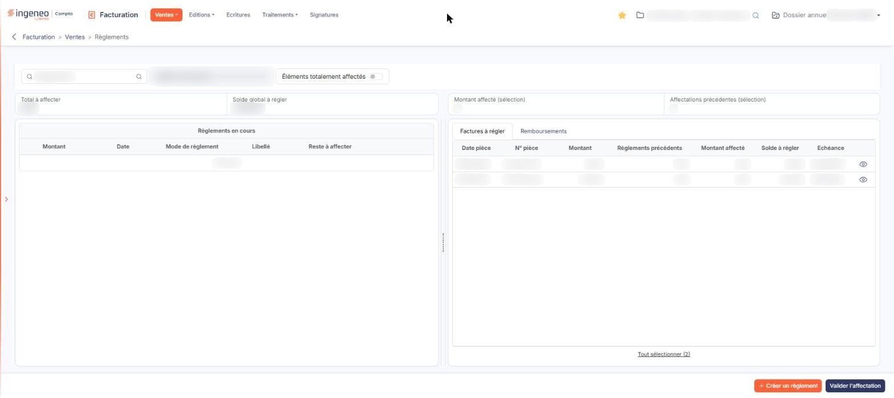

# Règlements


**Où le trouver :** Menu **Ventes › Règlements**



**En bref** — Cet écran sert, client par client, à saisir les règlements et à les affecter aux factures, ce qui alimente le suivi des paiements, les relances et les écritures de règlement.

* Pour enregistrer un paiement reçu : bouton \[Créer un règlement], complétez la fenêtre « Saisie règlement », puis enregistrez.
* Pour solder une facture : cochez le règlement à gauche, la ou les pièces à droite, puis bouton \[Valider l'affectation].


La gestion des règlements a trois objets : suivre le paiement des factures, alimenter les relances clients, et générer les écritures comptables de règlement.

<figure><figcaption>
Écran « Règlements » de la nouvelle interface
</figcaption></figure>

Ce n'est pas une liste de pièces mais un écran de saisie d'affectation, en deux volets : à gauche les règlements enregistrés, à droite les pièces auxquelles les affecter. Un séparateur à glisser sépare les deux zones et permet de les élargir ou de les réduire ; un double-clic le ramène à sa position d'origine.

Tout ce qui est affiché concerne un seul client, celui dont le code figure en haut à gauche.

Un filtre est armé à l'ouverture de l'écran : l'interrupteur **Éléments totalement affectés**, placé sur la ligne du client, à droite de sa raison sociale, et dont l'infobulle est « Afficher les éléments totalement affectés », est désactivé. Les trois tableaux ne montrent donc que ce qui reste à affecter, et le nombre de lignes qu'ils présentent n'est pas un nombre d'enregistrements : un règlement entièrement affecté et une facture entièrement réglée en sont absents. Activez cet interrupteur pour retrouver l'historique.

La gestion des règlements ne fonctionne pas de la même façon selon ce que vous avez indiqué dans le panneau « Paramètres » : « Paramètres > Facturation > Connexion comptabilité », quant à la génération des écritures de règlement. Si vos écritures de règlement clients vous parviennent par votre relevé bancaire, vous n'avez pas à les générer depuis la facturation : indiquez-le dans le panneau « Paramètres » : « Paramètres > Facturation > Connexion comptabilité ». Vous devez néanmoins saisir les règlements ici pour suivre le solde de vos factures et gérer vos relances.

## Le choix du client

**Client** : saisissez le code du client dans la zone « Rechercher un client… », ou utilisez le pictogramme « Loupe », dont l'infobulle est « Recherche avancée », pour ouvrir la fenêtre « Sélection d'un client ». La raison sociale s'affiche à droite, dans une zone non saisissable.

La fenêtre « Sélection d'un client » présente un champ **Client** précédé d'une loupe, puis un tableau à deux colonnes triables, **Code client** et **Raison sociale** ; il n'y a plus de bouton \[Afficher] : la liste s'affiche dès l'ouverture, avec sa pagination, et se restreint à mesure que vous saisissez dans le champ. Il n'y a pas de commande sur les lignes : cliquez sur la ligne pour retenir le client, comme le rappelle la mention « Cliquez pour sélectionner » en bas de la fenêtre.

## Ce que présentent les deux zones

La zone de gauche porte le tableau **Règlements en cours**, précédé du total **Total à affecter**. Ses colonnes sont **Montant**, **Date**, **Mode de règlement**, **Libellé** et **Reste à affecter**.

Un avoir validé y figure comme un règlement, avec le mode « Avoir » et son numéro pour libellé.

Chaque ligne porte une boîte à cocher « Sélectionner », la commande « Modifier », qui ouvre la fenêtre de saisie du règlement, un pictogramme « Œil » qui prévisualise la pièce à l'origine du règlement, et la commande « Supprimer ».

L'infobulle de ce pictogramme nomme la pièce concernée : sur un règlement issu d'un avoir, elle indique « Visualiser l'avoir ».

La zone de droite porte deux onglets : **Factures à régler**, actif à l'ouverture, et **Remboursements**. Au-dessus d'eux, deux cases encadrées, **Montant affecté (sélection)** et **Affectations précédentes (sélection)**, donnent deux valeurs qui affichent « — » tant qu'aucun règlement n'est coché à gauche. La rubrique « Règlement sélectionné » n'existe plus.

À gauche de ces deux cases, dans un bloc distinct qui porte aussi **Total à affecter**, le champ **Solde global à régler** (valeurs en orange) totalise ce qui reste à solder dans l'onglet actif. Il ne dépend donc pas du règlement coché, mais de l'onglet retenu : il change lorsque vous passez de **Factures à régler** à **Remboursements**.

L'onglet **Factures à régler** présente les colonnes **Date pièce**, **N° pièce**, **Montant**, **Règlements précédents**, **Montant affecté**, **Solde à régler** et **Echéance**. Chaque ligne porte un pictogramme « Œil » (infobulle « Visualiser la facture ») qui prévisualise la facture. Les boîtes à cocher de ligne ne sont plus affichées ; sous le tableau, « Tout sélectionner (n) » sélectionne toutes les lignes.

L'onglet **Remboursements** présente les colonnes **Montant**, **Date**, **Mode de remboursement**, **Libellé**, **Règlements précédents**, **Montant affecté** et **Solde à régler**. Tant qu'aucun remboursement n'est enregistré pour le client, il affiche « Liste vide ».

## Bouton \[Créer un règlement]

Situé dans la barre du bas, à côté de bouton **\[Valider l'affectation]**, et affiché lorsque l'onglet **Factures à régler** est actif, ce bouton ouvre la fenêtre « Saisie règlement », qui enregistre un règlement pour le client retenu. Quatre champs, tous obligatoires :

| Champ                 | Ce qu'il faut savoir                                                                                                                                                                                                                                                                                     |
| --------------------- | -------------------------------------------------------------------------------------------------------------------------------------------------------------------------------------------------------------------------------------------------------------------------------------------------------- |
| **Montant**           | Le logiciel propose le solde à régler, que vous pouvez modifier.                                                                                                                                                                                                                                         |
| **Date**              | Le logiciel propose la date du jour, que vous pouvez modifier ; elle doit rester comprise dans la période de saisie du dossier annuel en cours.                                                                                                                                                          |
| **Mode de règlement** | Le sélecteur est prépositionné sur le mode de règlement de la fiche client, et reste modifiable. La liste comprend, à côté de vos propres modes, des modes créés par les traitements du logiciel — les écarts de règlement et les imports depuis la comptabilité — qui ne sont pas destinés à la saisie. |
| **Libellé**           | Le logiciel propose le mode de règlement suivi de la raison sociale du client.                                                                                                                                                                                                                           |

La fenêtre se referme par bouton **\[Enregistrer et fermer]** ou par bouton **\[Annuler]**, et une croix dans son bandeau de titre ferme également la fenêtre.

Ouverte par la commande « Modifier » d'une ligne, la même fenêtre présente trois champs de plus, en lecture seule : **Affectations précédentes :**, **Montant affecté :** et **Reste à affecter :**.

Sur un règlement issu d'un avoir, tous les champs sont en lecture seule et seul bouton **\[Annuler]** est proposé : un tel règlement se consulte, il ne se modifie pas.

## Bouton \[Créer un remboursement]

Situé dans la barre du bas, à la place de bouton **\[Créer un règlement]**, il est affiché lorsque l'onglet **Remboursements** est actif et ouvre la fenêtre « Remboursement client », qui porte en tête la phrase « Cette option permet de saisir des remboursements de trop perçus ou d'avoirs clients. »

Elle contient les mêmes quatre champs obligatoires que la saisie d'un règlement, avec trois différences : le champ s'intitule **Mode de remboursement :** et n'est pas prépositionné — vous devez choisir un mode ; le libellé proposé est « Remb. client » suivi de la raison sociale ; et le **Montant** est proposé à zéro, là où la saisie d'un règlement propose le solde à régler.

Les remboursements enregistrés alimentent l'onglet **Remboursements** de la zone de droite.

## Bouton \[Valider l'affectation]

L'affectation se prépare en deux temps : cochez d'abord, dans la zone de gauche, le règlement à imputer ; cochez ensuite, dans la zone de droite, la ou les pièces sur lesquelles l'imputer. Les cases **Montant affecté (sélection)** et **Affectations précédentes (sélection)** se renseignent alors d'après le règlement coché.

Choisissez l'onglet **Factures à régler** ou l'onglet **Remboursements** selon ce que vous voulez solder : l'affectation d'un remboursement se prépare de la même manière que celle d'un règlement.

Cliquez enfin sur bouton **\[Valider l'affectation]**.

Un règlement qui n'a pas été entièrement affecté conserve un **Reste à affecter** et demeure dans la zone de gauche, pour une affectation ultérieure à d'autres pièces. C'est aussi pour cette raison que l'interrupteur **Éléments totalement affectés** existe : ce qui est soldé de part et d'autre disparaît de l'écran.

## La suppression d'un règlement

Vous pouvez supprimer un règlement que vous avez enregistré, par la commande « Supprimer » de sa ligne.

Conformément à l'attestation délivrée dans le cadre de la loi anti-fraude à la TVA — BOI-TVA-DECLA-30-10-30-20160803 —, toutes les suppressions de règlements sont mémorisées. La fenêtre de suppression le rappelle : elles sont éditables depuis le générateur d'états d'édition, en choisissant le fichier « Règlements supprimés ».

Avant de confirmer, vous pouvez saisir un **Commentaire**, qui sera lui aussi édité avec la suppression.

Si vous utilisez le module Comptabilité et que le règlement n'est pas issu d'un avoir, le logiciel vous demande en outre ce qu'il doit faire de l'écriture, entre « Passer une écriture d'annulation », « Annuler le règlement sans passer d'écriture » et « Supprimer l'écriture ». Le choix qui vous est proposé dépend de ce que la comptabilité permet encore : une écriture modifiée, validée ou entrée dans un rapprochement bancaire n'est plus supprimable.

La suppression se confirme par bouton **\[Confirmer]**.
