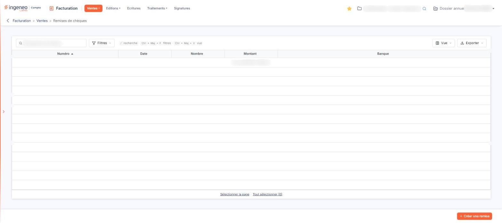
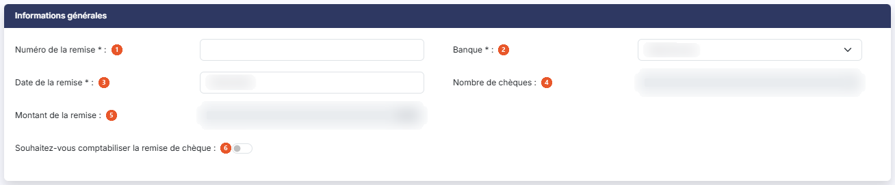
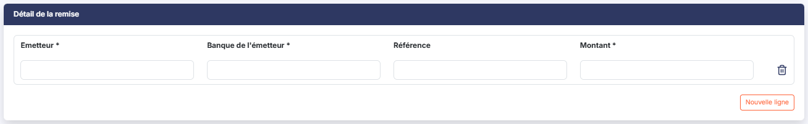

# Remises de chèques


**Où le trouver :** Menu **Ventes › Remises de chèques**



**En bref** — Cet écran sert à saisir les remises de chèques déposées en banque et à en tenir la liste ; chaque remise peut être comptabilisée ou non.

* Pour saisir une remise : bouton \[Créer une remise], ajoutez un chèque par ligne, puis bouton \[Enregistrer].
* Pour finaliser une remise : bouton \[Valider], puis bouton \[Edition] pour imprimer le bordereau.


Cette option permet de saisir les remises de chèques que vous déposez en banque et d'en tenir la liste. Une remise regroupe autant de lignes qu'il y a de chèques à remettre, et vous pouvez choisir, remise par remise, de la comptabiliser ou non.

<figure><figcaption>
Écran « Remises de chèques » de la nouvelle interface
</figcaption></figure>

## La liste des remises

La liste présente cinq colonnes, toutes triables : **Numéro**, **Date**, **Nombre** (le nombre de chèques de la remise), **Montant** et **Banque**. Au-dessus de la liste, la zone « Rechercher une remise… » et les boutons \[Filtres], \[Vue] et \[Exporter] permettent de rechercher, filtrer, personnaliser et exporter la liste. Tant que vous n'avez enregistré aucune remise, le logiciel affiche le message « Aucun élément à afficher. » Les boutons \[Sélectionner la page] et \[Tout sélectionner (n)] sélectionnent les lignes ; un clic sur une ligne la sélectionne.

Le bouton \[Filtres] ouvre un volet « Filtrer » : le lien « + Ajouter un critère sur… » propose les colonnes de la liste, puis les boutons \[Vider les filtres] et \[Filtrer] effacent ou appliquent les critères. Le bouton \[Vue] ouvre un menu « Mes vues » (« Enregistrer la vue actuelle ») et « Colonnes affichées », où vous cochez les colonnes à afficher, avec les boutons \[Rétablir les colonnes d'origine] et \[Appliquer]. Le bouton \[Exporter] ouvre le menu d'aperçu, d'impression et d'export de la liste (Excel, PDF, envoi de la liste par e-mail).

Le menu \[Vue] propose une sixième colonne, **Date de validation**, qui n'est pas affichée par défaut : c'est elle qui vous indique qu'une remise a été validée. Le volet \[Filtres] propose les mêmes colonnes, la date de validation comprise : vous pouvez donc rechercher une remise sur une information qui n'est pas affichée dans la liste.

bouton **\[Créer une remise]**

Placé en bas à droite de l'écran, hors de la liste, il ouvre une fiche vierge pour créer une remise.

bouton **\[Supprimer]**

Il n'y a plus de bouton \[Supprimer] sous la liste.

## La fiche d'une remise

La fiche comporte deux rubriques, présentées dans cet ordre : « Informations générales » puis « Détail de la remise ». Elle se termine, en bas à droite, par trois boutons : le bouton **\[Enregistrer]**, le bouton **\[Valider]** et le bouton **\[Edition]**. Pour revenir à la liste, utilisez la flèche « Revenir en arrière », à gauche du fil d'Ariane.

## Rubrique « Informations générales »

<figure><figcaption>
Rubrique « Informations générales »
</figcaption></figure>

| Champ                                                   | Ce qu'il faut savoir                                                                                                                                                        |
| ------------------------------------------------------- | --------------------------------------------------------------------------------------------------------------------------------------------------------------------------- |
| 1. **Numéro de la remise**                              | 12 caractères au maximum. Il permet de différencier les remises entre elles.                                                                                                |
| 2. **Banque**                                           | La liste propose les banques du dossier, telles qu'elles figurent dans le panneau Paramètres, rubrique « Données », onglet « Dossier et comptabilité », entrée « Banques ». |
| 3. **Date de la remise**                                | Le calendrier s'ouvre au clic dans le champ.                                                                                                                                |
| 4. **Nombre de chèques**                                | Non modifiable. Le logiciel le calcule d'après les lignes que vous saisissez dans la rubrique « Détail de la remise ».                                                      |
| 5. **Montant de la remise**                             | Non modifiable. Le logiciel le calcule lui aussi d'après les lignes de détail.                                                                                              |
| 6. **Souhaitez-vous comptabiliser la remise de chèque** | Interrupteur désactivé par défaut.                                                                                                                                          |

## Rubrique « Détail de la remise »

<figure><figcaption>
Rubrique « Détail de la remise »
</figcaption></figure>

Créez autant de lignes qu'il y a de chèques à remettre en banque. Une ligne vide est présente à l'ouverture de la fiche ; le bouton **\[Nouvelle ligne]** placé sous la grille en ajoute une, et le pictogramme « Effacer » (une corbeille), à droite de la ligne, la supprime.

Les colonnes de saisie sont les suivantes :

* **Emetteur** : obligatoire, 35 caractères au maximum. Il s'agit du nom de l'émetteur du chèque.
* **Banque de l'émetteur** : obligatoire, 50 caractères au maximum.
* **Référence** : facultative, 35 caractères au maximum.
* **Montant** : obligatoire. Il s'agit du montant du chèque de cet émetteur.
