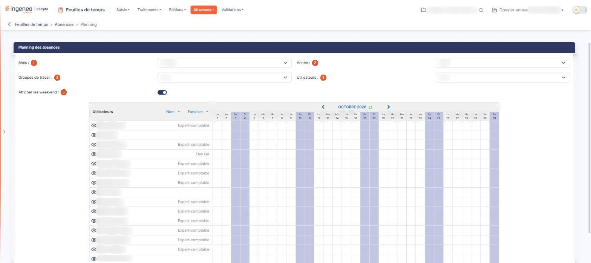
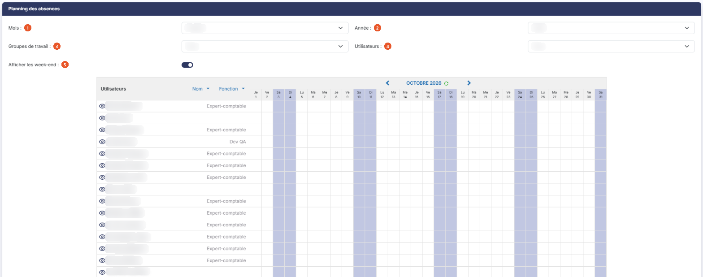
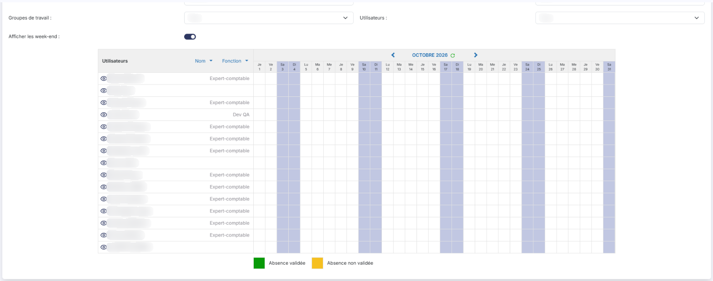

# Planning


**Où le trouver :** Menu **Absences › Planning**



**En bref** — Cet écran présente, mois par mois, les absences des collaborateurs : une ligne par collaborateur, une colonne par jour. Il se consulte, il ne se saisit pas.

* Pour changer de mois : flèche « < » ou « > » au-dessus des jours, ou listes Mois et Année.
* Pour cibler des personnes : listes Groupes de travail et Utilisateurs.
* Pour connaître une absence : survolez la case colorée.


Cette option vous présente, sous le titre « Planning des absences », les absences des collaborateurs mois par mois : une ligne par collaborateur, une colonne par jour du mois. Elle se consulte, elle ne se saisit pas.

<figure><figcaption>
Écran « Planning » de la nouvelle interface
</figcaption></figure>

## Les filtres

<figure><figcaption>
Rubrique « Les filtres »
</figcaption></figure>

Les filtres occupent trois lignes au-dessus du planning. Il n'y a pas de bouton pour les appliquer : le planning se met à jour dès que vous en modifiez un.

| Champ                        | Ce qu'il faut savoir                                                                                                                                                                                                                                                                                                                                    |
| ---------------------------- | ------------------------------------------------------------------------------------------------------------------------------------------------------------------------------------------------------------------------------------------------------------------------------------------------------------------------------------------------------- |
| 1. **Mois**                  | Les douze mois, de « Janvier » à « Décembre ». Le mois en cours est proposé à l'ouverture.                                                                                                                                                                                                                                                              |
| 2. **Année**                 | Quinze années, de la suivante à 2013, dans l'ordre décroissant. L'année en cours est proposée à l'ouverture. Cette liste ne suit pas l'exercice sur lequel vous travaillez : le planning est piloté par le calendrier, pas par le dossier annuel.                                                                                                       |
| 3. **Groupes de travail**    | Le choix « Tous » et les groupes de travail du dossier, qui se créent dans l'écran « Groupes de travail (GI) » du panneau Paramètres (onglet « Données », catégorie « Organisation et temps »). Tant qu'aucun groupe n'est enregistré, la liste se réduit à « Tous ».                                                                                   |
| 4. **Utilisateurs**          | Le choix « Tous » et les collaborateurs, classés par prénom. La liste contient tous les utilisateurs actifs dont la date de fin d'utilisation n'est pas dépassée. Lorsque vous travaillez sur le dossier d'une société gérée, les collaborateurs du cabinet n'y figurent pas, sauf vous-même ; sur le dossier du cabinet lui-même, ils y figurent tous. |
| 5. **Afficher les week-end** | Interrupteur activé à l'ouverture, il commande la présence des colonnes du samedi et du dimanche.                                                                                                                                                                                                                                                       |

## Le planning

La colonne de gauche, intitulée « Utilisateurs », porte deux commandes de tri, **Nom** et **Fonction** : cliquez sur l'une ou sur l'autre pour classer les lignes, la flèche indiquant le sens du tri.

Au-dessus des jours, un bandeau centré rappelle le mois et l'année affichés. Il est encadré de trois commandes : la flèche « < » vous porte au mois précédent, la flèche « > » au mois suivant, et le pictogramme circulaire d'infobulle « Recharger le planning » réaffiche le planning sans changer de mois.

Vient ensuite une colonne par jour du mois, dont l'en-tête donne l'abréviation du jour de la semaine puis le quantième. Les colonnes du samedi et du dimanche sont grisées, ainsi que celles des jours fériés.

Chaque ligne présente le nom du collaborateur et sa fonction. Selon vos droits, ce nom est précédé d'un pictogramme « Œil », « Visualiser la fiche utilisateur ».

Une case colorée n'est pas seulement un repère : survolez-la, une infobulle vous donne le type d'absence, et les heures concernées s'il s'agit d'une absence partielle. Selon vos droits et l'état de la demande, cette infobulle vous propose en outre de la consulter ou de la valider, et un clic sur la case vous y porte.

## La légende

<figure><figcaption>
Rubrique « La légende »
</figcaption></figure>

Sous le planning, deux pastilles de couleur en donnent la lecture : le vert signale une « Absence validée », l'orange une « Absence non validée ». Le planning présente les absences demandées et les absences validées, la légende vous permettant de les distinguer. Les demandes refusées n'y figurent pas.
