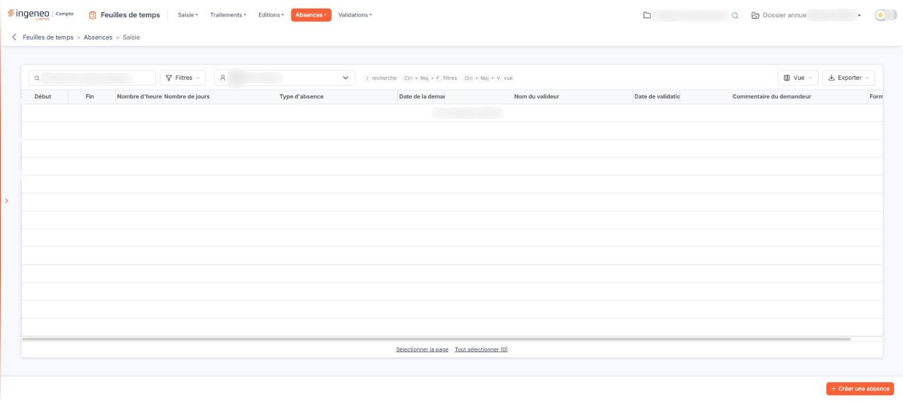
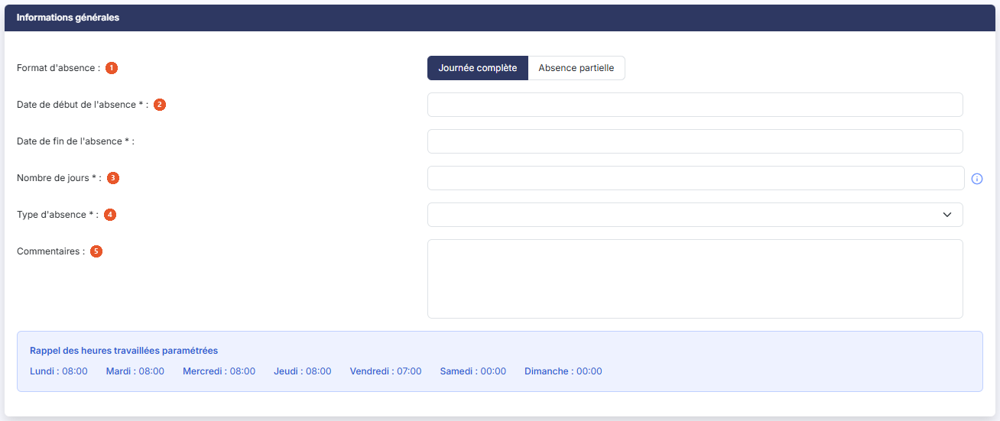
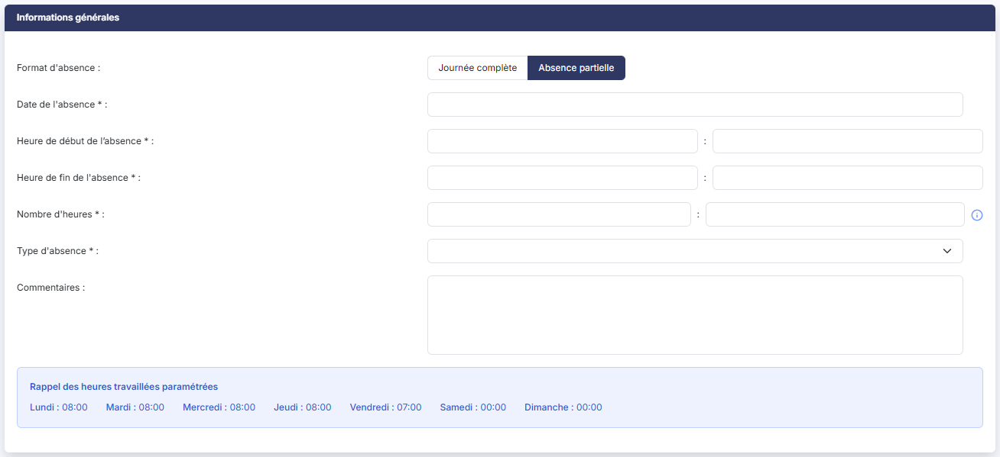

# Saisie


**Où le trouver :** Menu **Absences › Saisie**



**En bref** — Cet écran permet d'enregistrer une demande d'absence et de retrouver celles d'un collaborateur : dates, durée, type d'absence et état de validation.

* Pour déposer une demande : choisissez le Collaborateur, bouton \[Créer une absence], renseignez le format, les dates et le Type d'absence, puis bouton \[Enregistrer].
* Pour supprimer des demandes : sélectionnez-les dans la grille, puis bouton \[Supprimer].


Cette option vous permet d'enregistrer une demande d'absence et de retrouver celles qui sont déjà saisies. L'écran présente d'abord un sélecteur de collaborateur, puis la grille des absences de ce collaborateur, et enfin, en bas à droite, le bouton \[Créer une absence], qui permet d'ajouter une demande.

<figure><figcaption>
Écran « Saisie » de la nouvelle interface
</figcaption></figure>

## Le collaborateur

**Collaborateur** : cette liste, placée dans la barre au-dessus de la grille, désigne la personne dont vous voyez les absences, et celle pour laquelle vous saisissez. Une icône de personne accompagne le nom affiché.

Vous ne pouvez saisir que pour vous-même et pour les personnes qui vous ont désigné comme délégataire sur leur fiche. Pour saisir pour un tiers, faites-vous ajouter comme délégataire sur sa fiche utilisateur : c'est le seul chemin, aucun droit de profil n'ouvre cette liste. Ce paramétrage se fait dans l'écran « Utilisateurs » du panneau Paramètres (rubrique « Feuilles de temps »), rubrique « Délégataires de saisie des temps ».

## La grille des absences

<figure><figcaption>
Bouton [Créer une absence]
</figcaption></figure>

La grille présente une ligne par demande d'absence du collaborateur retenu, avec les colonnes « Début », « Fin », « Nombre d'heures », « Nombre de jours », « Type d'absence », « Date de la demande », « Nom du valideur », « Date de validation », « Commentaire du demandeur » et « Format d'absence ». La grille est plus large que l'écran : faites-la défiler horizontalement pour atteindre les dernières colonnes. Chaque colonne se trie par un clic sur son en-tête. Sur « Nombre d'heures » et « Nombre de jours », la flèche de tri n'est pas visible, la colonne étant trop étroite pour l'afficher : le tri fonctionne néanmoins.

Au-dessus de la grille, un champ « Rechercher un type d'absence… » et les boutons \[Filtres], \[Vue] (colonnes affichées) et \[Exporter] (aperçu, impression, export Excel ou PDF, envoi de la liste par e-mail) permettent de chercher, de filtrer et de présenter la liste. Il n'y a pas de case à cocher : un clic sur une ligne la sélectionne, et « Sélectionner la page » et « Tout sélectionner » sous la grille étendent la sélection à la page ou à toutes les pages. Pour le détail de la sélection ligne à ligne, page par page ou sur l'ensemble des pages, reportez-vous au chapitre « Fonctionnement d'une grille » des généralités.

Lorsque le collaborateur retenu n'a aucune absence enregistrée, la grille affiche « Aucun élément à afficher. ».

bouton **\[Créer une absence]**

Placé en bas à droite de l'écran, il ouvre la fiche d'une nouvelle demande d'absence pour le collaborateur retenu dans le sélecteur.

## La fiche d'une demande d'absence

<figure><figcaption>
Rubrique « La fiche d'une demande d'absence »
</figcaption></figure>

<figure><figcaption>
Rubrique « Le format « Absence partielle » »
</figcaption></figure>

La fiche ne comporte qu'une rubrique, « Informations générales ». Les champs suivis d'un astérisque sont obligatoires.

Votre cabinet peut faire précéder la fiche d'un texte d'accompagnement, qu'il règle dans l'écran « Configuration » du panneau Paramètres (rubrique « Feuilles de temps »). Lorsqu'il est renseigné, ce texte s'affiche en tête de la rubrique, au-dessus du champ « Format d'absence ».

**Format d'absence** : ce premier choix commande tous les autres. Il vous propose « Journée complète », actif à l'ouverture, et « Absence partielle ». Choisissez le format qui convient : le logiciel affiche alors les champs correspondants.

Le champ de durée dépend du forfait du collaborateur, qui se règle sur sa fiche dans l'écran « Utilisateurs » du panneau Paramètres (rubrique « Feuilles de temps »). Pour un collaborateur au forfait jours, le format « Journée complète » demande un **Nombre de jours \* :** ; pour les autres, il demande un **Nombre d'heures \* :**. Le format « Absence partielle » demande toujours un nombre d'heures.

Quel que soit le format, la fiche se termine par le bloc **Rappel des heures travaillées paramétrées :**, qui n'est pas une zone de saisie mais un rappel : il reprend, jour par jour du lundi au dimanche, l'horaire théorique enregistré sur la fiche du collaborateur, dans la rubrique « Heures travaillées dans la semaine » de l'écran « Utilisateurs » du panneau Paramètres (rubrique « Feuilles de temps »).

### Le format « Journée complète »

| Champ                                                                         | Ce qu'il faut savoir                                                                                                                                                                                                                                                     |
| ----------------------------------------------------------------------------- | ------------------------------------------------------------------------------------------------------------------------------------------------------------------------------------------------------------------------------------------------------------------------ |
| 
2. <strong>Date de début de l'absence</strong> <em>Obligatoire</em>
 | **Date de fin de l'absence \* :** bornent l'absence. Saisissez la date directement ou utilisez le calendrier qui s'ouvre lorsque vous cliquez dans la zone ; à l'ouverture de la fiche, le curseur est déjà dans la date de début et son calendrier s'ouvre de lui-même. |
| 
3. <strong>Nombre de jours</strong> <em>Obligatoire</em>
            | Durée de l'absence, pour un collaborateur au forfait jours. Une infobulle rappelle la règle : « Le nombre de jours doit être entier. ».                                                                                                                                  |
| 
4. <strong>Type d'absence</strong> <em>Obligatoire</em>
             | Liste des types d'absence du dossier. Ils se créent dans l'écran « Types d'absences » du panneau Paramètres (onglet « Données », catégorie « Organisation et temps ») : tant qu'aucun type n'y est enregistré, cette liste est vide.                                     |
| 5. **Commentaires**                                                           | Zone de texte libre, facultative, que le valideur retrouvera avec la demande.                                                                                                                                                                                            |

### Le format « Absence partielle »

La liste des champs change : l'absence ne portant que sur une partie d'une journée, la date de fin disparaît et la durée s'exprime en heures.

| Champ                                                                       | Ce qu'il faut savoir                                                                                                                                                                                                         |
| --------------------------------------------------------------------------- | ---------------------------------------------------------------------------------------------------------------------------------------------------------------------------------------------------------------------------- |
| 
4. <strong>Type d'absence</strong> <em>Obligatoire</em>
           | **Commentaires :** ont le même rôle que dans le format « Journée complète ».                                                                                                                                                 |
| 
<strong>Date de l'absence</strong> <em>Obligatoire</em>
           | Le jour concerné. C'est le même champ que la date de début du format précédent, sous un autre libellé.                                                                                                                       |
| 
<strong>Heure de début de l'absence</strong> <em>Obligatoire</em>
 | **Heure de fin de l'absence \* :** se saisissent en deux zones, les heures puis les minutes.                                                                                                                                 |
| 
<strong>Nombre d'heures</strong> <em>Obligatoire</em>
             | Durée de l'absence, également en heures et minutes. Une infobulle rappelle la règle : « Le nombre d'heures d'absences ne peut être supérieur au nombre d'heures de travail théorique paramétré dans la fiche utilisateur. ». |

bouton **\[Enregistrer]**

Il enregistre la demande d'absence et vous ramène à la liste.

bouton **\[Edition]**

Il édite la fiche de la demande d'absence.

**Flèche « Revenir en arrière »**

Placée à gauche du fil d'Ariane, elle vous ramène à la liste sans rien enregistrer.

bouton **\[Supprimer]**

Sélectionnez d'abord dans la grille les demandes à supprimer, puis cliquez sur ce bouton. Une demande déjà validée ou déjà refusée ne se supprime pas depuis cet écran : le logiciel vous en avertit par le message « La demande d'absence ne peut être supprimée car elle a déjà été validée. » ou « … car elle a déjà été refusée. ».
