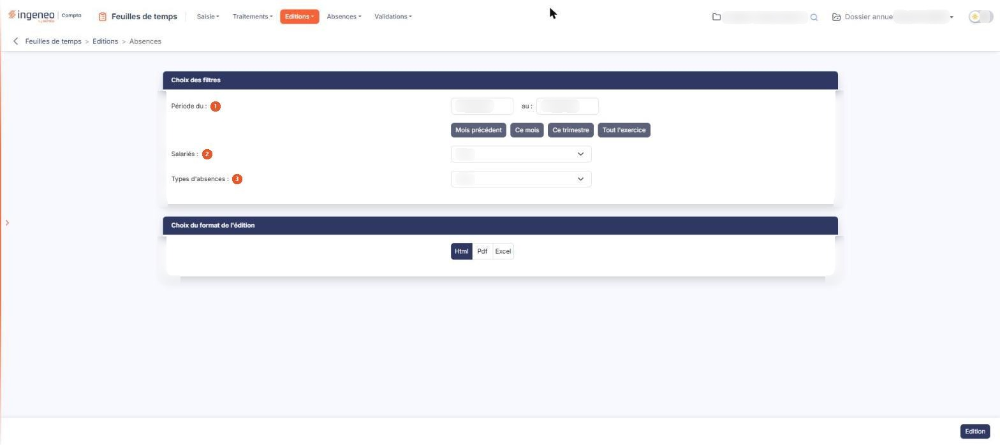
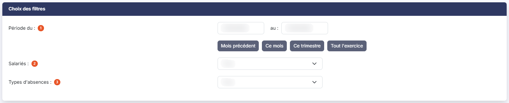
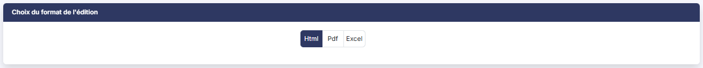

# Absences


**Où le trouver :** Menu **Editions › Absences**



**En bref** — Cet écran permet d'éditer la liste des absences enregistrées sur une période, pour le salarié et le type d'absence que vous retenez.

* Pour éditer une période : renseignez « Période du : » et « au : », ou bouton \[Ce mois], puis bouton \[Edition].
* Pour couvrir tout l'exercice : bouton \[Tout l'exercice], puis bouton \[Edition].


L'édition « Absences » restitue la liste des absences enregistrées sur une période, pour les salariés que vous retenez.

<figure><figcaption>
Écran « Absences » de la nouvelle interface
</figcaption></figure>

Cet écran ne sert qu'à préparer cette édition : vous y choisissez les filtres et le format, puis vous lancez l'édition : au format Html elle s'ouvre dans un nouvel onglet de votre navigateur, tandis qu'aux formats Pdf et Excel le fichier vous est remis par votre navigateur. Il ne comporte ni grille, ni enregistrement.

Il est composé de deux rubriques, décrites ci-dessous dans l'ordre où elles s'affichent.

## Rubrique « Choix des filtres »

<figure><figcaption>
Rubrique « Choix des filtres »
</figcaption></figure>

| Champ                   | Ce qu'il faut savoir                                                                                                                                                                                                                                                                                                                                                                                                                                                                                                                                                                                                                                                                                                                                                                                                                                                                                                                                                                                                                                   |
| ----------------------- | ------------------------------------------------------------------------------------------------------------------------------------------------------------------------------------------------------------------------------------------------------------------------------------------------------------------------------------------------------------------------------------------------------------------------------------------------------------------------------------------------------------------------------------------------------------------------------------------------------------------------------------------------------------------------------------------------------------------------------------------------------------------------------------------------------------------------------------------------------------------------------------------------------------------------------------------------------------------------------------------------------------------------------------------------------ |
| 1. **Période du**       | 
Et** au :** les deux bornes de la période à éditer. Vous les saisissez directement, ou vous utilisez le calendrier qui s'ouvre lorsque vous cliquez dans la zone. Le logiciel propose le premier et le dernier jour du <strong>mois civil en cours</strong>, qui n'est pas nécessairement compris dans l'exercice que vous avez sélectionné. Vérifiez ces deux dates avant de lancer l'édition : si la période retenue n'est pas celle que vous vouliez, l'état sort sans les absences attendues. Quatre boutons placés sous les dates renseignent la période pour vous. Le bouton <strong>[Mois précédent]</strong> retient le mois civil qui précède. Le bouton <strong>[Ce mois]</strong> retient le mois civil en cours. Le bouton <strong>[Tout l'exercice]</strong> retient les dates de début et de fin de l'exercice sélectionné : c'est celui à employer pour rester dans votre exercice. Aucun de ces quatre boutons n'apparaît retenu à l'ouverture de l'écran, alors même que la période proposée est celle du mois en cours.
 |
| 2. **Salariés**         | La liste ne contient que les salariés dont vous êtes valideur d'absences, ainsi que vous-même. Si votre profil dispose du droit de voir tous les salariés, la liste contient l'ensemble des salariés. Vous n'y retenez qu'un seul salarié à la fois, malgré l'intitulé au pluriel ; elle vaut « Tous » par défaut.                                                                                                                                                                                                                                                                                                                                                                                                                                                                                                                                                                                                                                                                                                                                     |
| 3. **Types d'absences** | La liste reprend le contenu des types d'absences (panneau « Paramètres », rubrique « Données » > « Organisation et temps », entrée « Types d'absences ») et vaut « Tous » par défaut. Vous n'y retenez qu'un seul type à la fois. Tant qu'aucun type d'absence n'a été créé, elle ne propose que « Tous ».                                                                                                                                                                                                                                                                                                                                                                                                                                                                                                                                                                                                                                                                                                                                             |

## Rubrique « Choix du format de l'édition »

<figure><figcaption>
Rubrique « Choix du format de l'édition »
</figcaption></figure>

Trois formats de sortie vous sont proposés, sans libellé de champ : « Html », retenu par défaut, « Pdf » et « Excel ».

Lorsque vous retenez « Pdf », deux boutons supplémentaires apparaissent, eux aussi sans libellé de champ : « Portrait » et « Paysage », ce dernier étant retenu par défaut. Ils ne sont proposés que pour ce format : ils disparaissent dès que vous revenez à « Html » ou que vous retenez « Excel ».

bouton **\[Edition]**

Placé à droite de la barre du bas, il produit l'état. C'est le seul bouton de la barre du bas : il n'y a ni enregistrement du paramétrage, ni retour. Les quatre boutons de période décrits plus haut se trouvent, eux, dans la rubrique « Choix des filtres ». Il n'apparaît que si vous disposez du droit de lancer cette édition.

**L'état produit**

L'état s'intitule « Liste des absences » ; sous le titre figurent le nom de la société puis la période retenue (« Période du … au … »).

À droite de l'en-tête, la mention « Édité le … à … par … » indique la date et l'heure de production et le nom de l'utilisateur. Une bande de trois compteurs suit (Absences, Jours d'absence, Salariés).

Un bloc « Paramètres de l'édition », replié, rappelle les filtres retenus : sa ligne de résumé se lit « Salarié : tous · Type d'absence : tous · absences refusées écartées » lorsque les deux listes restent sur « Tous », et le déplier détaille Période, Salarié, Type d'absence et Absences refusées (« Écartées »). Lorsqu'aucune absence ne tombe dans la période, le message « Aucune absence sur la période. » s'affiche à la place du détail.
