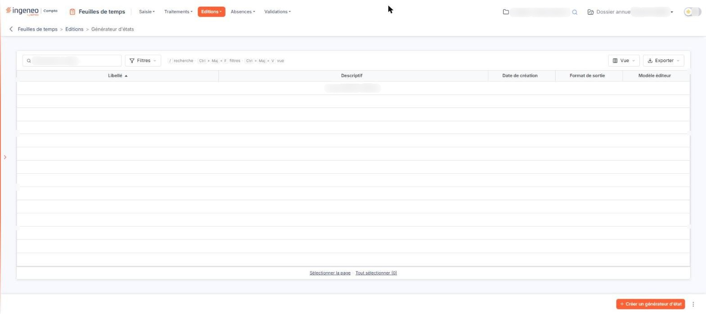

# Générateur d'états


**Où le trouver :** Menu **Editions › Générateur d'états**



**En bref** — Cette page renvoie au chapitre « Généralités » en tête de l'aide, qui décrit le générateur d'états, commun à tous les modules où il est présent.

* Pour composer vos propres éditions : reportez-vous au chapitre « Généralités » en tête de l'aide.


<figure><figcaption>
Écran « Générateur d'états » de la nouvelle interface
</figcaption></figure>

L'aide en ligne concernant le générateur d'états d'édition, commune à tous les modules du logiciel où il est présent, se trouve dans le chapitre « Généralités » en tête de la présente aide.
