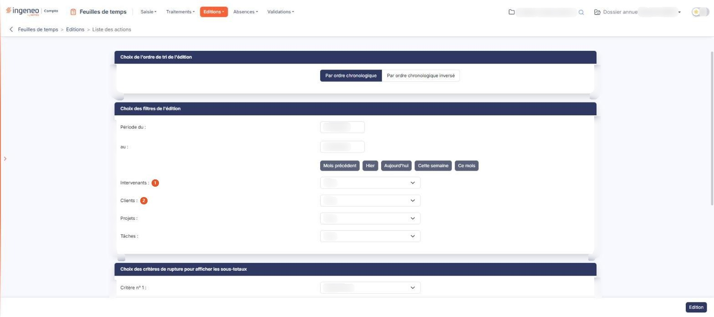
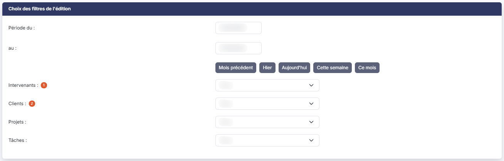
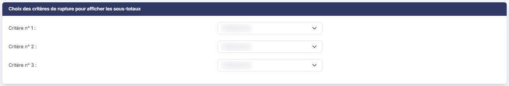
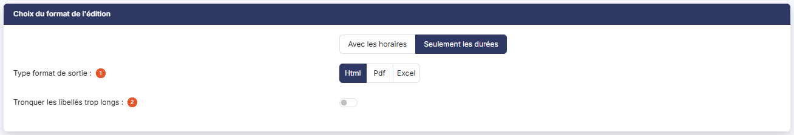

# Liste des actions


**Où le trouver :** Menu **Editions › Liste des actions**



**En bref** — Cet écran permet d'éditer les temps saisis, ligne par ligne, sur la période de votre choix, avec filtres, sous-totaux et format de sortie.

* Pour éditer une période : renseignez « Période du : / au : », ou bouton \[Ce mois], puis bouton \[Edition].
* Pour obtenir des sous-totaux : choisissez les Critère n° 1 à Critère n° 3, puis bouton \[Edition].
* Pour choisir le format : « Html », « Pdf » ou « Excel » sous « Type format de sortie », puis bouton \[Edition].


L'édition « Liste des actions » restitue les temps saisis, ligne par ligne, sur la période de votre choix.

<figure><figcaption>
Écran « Liste des actions » de la nouvelle interface
</figcaption></figure>

Cet écran ne sert qu'à préparer cette édition : vous y choisissez l'ordre de tri, les filtres, les sous-totaux et le format, puis vous lancez l'édition : au format Html elle s'ouvre dans un nouvel onglet de votre navigateur, tandis qu'aux formats Pdf et Excel le fichier vous est remis par votre navigateur. Il ne comporte ni grille ni champ obligatoire, et rien n'y est enregistré.

Il est composé de quatre rubriques, décrites ci-dessous dans l'ordre où elles s'affichent.

## Rubrique « Choix de l'ordre de tri de l'édition »

<figure><figcaption>
Rubrique « Choix de l'ordre de tri de l'édition »
</figcaption></figure>

Vous choisissez entre « Par ordre chronologique », retenu par défaut, et « Par ordre chronologique inversé ».

## Rubrique « Choix des filtres de l'édition »

<figure><figcaption>
Rubrique « Choix des filtres de l'édition »
</figcaption></figure>

| Champ                 | Ce qu'il faut savoir                                                                                                                                                                                                                                                                                                                                                                                                                                                                                          |
| --------------------- | ------------------------------------------------------------------------------------------------------------------------------------------------------------------------------------------------------------------------------------------------------------------------------------------------------------------------------------------------------------------------------------------------------------------------------------------------------------------------------------------------------------- |
| 1. **Intervenants**   | La liste propose tous les utilisateurs actifs de la société gérée. Elle vaut « Tous » par défaut, et vous n'y retenez qu'un seul intervenant à la fois.                                                                                                                                                                                                                                                                                                                                                       |
| 2. **Clients**        | , **Projets :** et **Tâches :** ces trois listes reprennent le contenu des écrans correspondants du panneau Paramètres (rubrique « Données »). Elles valent « Tous » par défaut, et vous n'y retenez là encore qu'une seule valeur à la fois.                                                                                                                                                                                                                                                                 |
| **Période du : / au** | 
Les deux dates encadrent la période éditée. Vous les saisissez directement ou vous les choisissez avec le pictogramme « Calendrier ». Le logiciel propose par défaut le premier et le dernier jour du mois en cours. Cinq boutons placés sous ces deux dates renseignent la période d'un seul clic : bouton <strong>[Mois précédent]</strong>, bouton <strong>[Hier]</strong>, bouton <strong>[Aujourd'hui]</strong>, bouton <strong>[Cette semaine]</strong> et bouton <strong>[Ce mois]</strong>.
 |

## Rubrique « Choix des critères de rupture pour afficher les sous-totaux »

<figure><figcaption>
Rubrique « Choix des critères de rupture pour afficher les sous-totaux »
</figcaption></figure>

Trois listes, **Critère n° 1 :**, **Critère n° 2 :** et **Critère n° 3 :**, vous permettent de retenir jusqu'à trois critères de rupture parmi « Intervenants », « Clients », « Projets » et « Tâches ». Un sous-total s'affiche à chaque changement de valeur du critère retenu.

Les trois listes valent « Sélectionnez » par défaut : l'édition sort alors sans aucun sous-total intermédiaire.

## Rubrique « Choix du format de l'édition »

<figure><figcaption>
Rubrique « Choix du format de l'édition »
</figcaption></figure>

Le premier choix, qui ne porte pas de libellé, oppose « Avec les horaires » et « Seulement les durées », retenu par défaut. Retenir « Avec les horaires » ajoute à l'état les deux colonnes « Début » et « Fin », et ne change rien d'autre — ni les autres colonnes, ni l'écran.

| Champ                                   | Ce qu'il faut savoir                                                                                                                                                                                 |
| --------------------------------------- | ---------------------------------------------------------------------------------------------------------------------------------------------------------------------------------------------------- |
| 1. **Type format de sortie**            | Vous choisissez entre « Html », retenu par défaut, « Pdf » et « Excel ». Ce choix commande le champ affiché juste en dessous, qui n'est donc pas toujours le même.                                   |
| 2. **Tronquer les libellés trop longs** | Ce champ n'apparaît que si vous avez retenu le format « Html ». Activez l'interrupteur pour que les libellés trop longs soient coupés sur l'état. Il est désactivé par défaut.                       |
| **Type orientation**                    | Ce champ n'apparaît que si vous avez retenu le format « Pdf ». Vous choisissez entre « Portrait » et « Paysage », retenu par défaut ; le champ « Tronquer les libellés trop longs » disparaît alors. |

Avec le format « Excel », le logiciel n'affiche ni l'un ni l'autre de ces deux champs.

bouton **\[Edition]**

Il produit l'état. C'est le seul bouton de la page, placé en bas à droite de l'écran : il n'y a ni enregistrement du paramétrage, ni retour. Il n'apparaît que si vous disposez du droit de lancer cette édition.

Lorsqu'aucun temps n'a été saisi sur la période retenue, l'état s'ouvre quand même, avec ses quatre compteurs à zéro (Temps total 00:00) et le message « Aucune action sur la période. » à la place du détail.

**L'état produit**

L'état s'ouvre sur un en-tête qui porte son titre « Liste des actions », le nom de la société et la période (« Période du … au … »), avec à droite la mention « Édité le … à … par … » suivie du nom de l'utilisateur. Une bande de quatre compteurs suit (Actions, Temps total, Intervenants, Clients), puis un bloc « Paramètres de l'édition », replié : sa ligne de résumé rappelle les sous-totaux, l'ordre de tri et le format horaire retenus, et le déplier détaille Période, Intervenant, Client, Projet, Tâche, Sous-totaux, Ordre de tri, Format horaire et Libellés tronqués (HTML).

Il présente une ligne par temps saisi, avec les colonnes Date, Durée, Intervenant, Client, Projet, Tâche, Descriptif, Date de validation et Nom du valideur. Si vous avez retenu « Avec les horaires », les colonnes « Début » et « Fin » s'intercalent entre « Date » et « Durée ».

Il se termine par une ligne de sous-total et une ligne de total. Les durées sont exprimées en heures et minutes, sous la forme 00:00.
