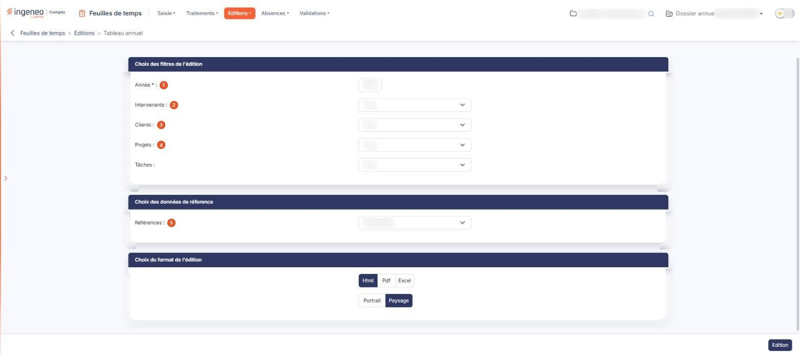
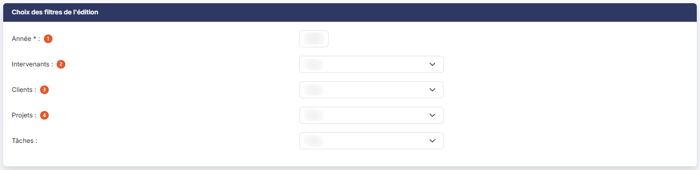
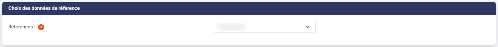
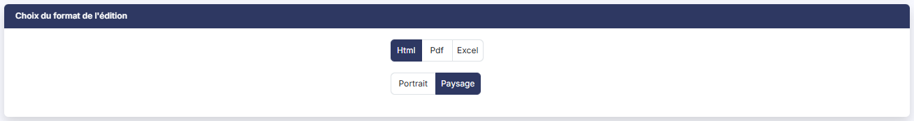

# Tableau annuel


**Où le trouver :** Menu **Editions › Tableau annuel**



**En bref** — Cet écran permet d'éditer les temps d'une année sous forme de tableau : une ligne par intervenant, client, projet ou tâche, et une colonne par mois.

* Pour éditer une année : renseignez l'Année, puis bouton \[Edition].
* Pour changer les lignes du tableau : choisissez « Intervenants », « Clients », « Projets » ou « Taches » sous « Références », puis bouton \[Edition].


L'édition « Tableau annuel » restitue les temps d'une année sous forme de tableau : une ligne par donnée de référence — intervenant, client, projet ou tâche — et une colonne par mois.

<figure><figcaption>
Écran « Tableau annuel » de la nouvelle interface
</figcaption></figure>

C'est l'écran jumeau du « Tableau mensuel », dont il ne diffère que par un filtre : il n'y a pas de champ « Mois », puisque l'édition porte sur l'année entière.

Cet écran ne sert qu'à préparer cette édition : vous y choisissez les filtres, la donnée portée en lignes et le format, puis vous lancez l'édition : au format Html elle s'ouvre dans un nouvel onglet de votre navigateur, tandis qu'aux formats Pdf et Excel le fichier vous est remis par votre navigateur. Il ne comporte ni grille, ni enregistrement.

Il est composé de trois rubriques, décrites ci-dessous dans l'ordre où elles s'affichent.

## Rubrique « Choix des filtres de l'édition »

<figure><figcaption>
Rubrique « Choix des filtres de l'édition »
</figcaption></figure>

| Champ               | Ce qu'il faut savoir                                                                                                                                                                                                                                                                |
| ------------------- | ----------------------------------------------------------------------------------------------------------------------------------------------------------------------------------------------------------------------------------------------------------------------------------- |
| 1. **Année**        | 
Saisissez l'année à éditer. C'est le seul champ obligatoire de l'écran, signalé par un astérisque rouge. Le logiciel propose l'année civile en cours, qui n'est pas nécessairement celle de l'exercice que vous avez sélectionné : vérifiez-la avant de lancer l'édition.
 |
| 2. **Intervenants** | La liste propose tous les utilisateurs actifs de la société gérée. Elle vaut « Tous » par défaut, et vous n'y retenez qu'un seul intervenant à la fois.                                                                                                                             |
| 3. **Clients**      | **Tâches :** ces deux listes reprennent le contenu des écrans correspondants du panneau Paramètres (rubrique « Données ») et valent « Tous » par défaut. Vous n'y retenez là encore qu'une seule valeur à la fois.                                                                  |
| 4. **Projets**      | Cette liste dépend du client. Tant que « Clients » vaut « Tous », elle ne contient que « Tous ». Dès que vous retenez un client, le logiciel la recharge avec les projets de ce client, s'il en porte au moins un.                                                                  |

## Rubrique « Choix des données de réference »

<figure><figcaption>
Rubrique « Choix des données de réference »
</figcaption></figure>

**Références** : choisissez la donnée que le tableau porte en lignes : « Intervenants », retenu par défaut, « Clients », « Projets » ou « Taches ». Ce choix se retrouve sous le titre de l'état (« Analyse par intervenant » pour « Intervenants ») et dans le bloc « Paramètres de l'édition », à la ligne « Données de référence ».

## Rubrique « Choix du format de l'édition »

<figure><figcaption>
Rubrique « Choix du format de l'édition »
</figcaption></figure>

Deux choix, présentés sans libellé de champ :

* le format de sortie : « Html », retenu par défaut, « Pdf » ou « Excel » ;
* l'orientation : « Portrait » ou « Paysage », retenu par défaut.

bouton **\[Edition]**

Il produit l'état. C'est le seul bouton de la page, placé en bas à droite de l'écran : il n'y a ni enregistrement du paramétrage, ni retour. Il n'apparaît que si vous disposez du droit de lancer cette édition.

Lorsqu'aucun temps n'a été saisi sur l'année retenue, l'état s'ouvre quand même, avec ses compteurs à zéro et le message « Aucun temps saisi sur la période. » à la place du tableau.

**L'état produit**

L'état s'ouvre sur un en-tête qui porte son titre « Tableau annuel », le nom de la société, l'année (« Année 2026 ») et la donnée de référence retenue (« Analyse par intervenant »), avec à droite la mention « Édité le … à … par … » suivie du nom de l'utilisateur. Une bande de quatre compteurs suit (Temps saisi, Collaborateurs, Mois saisis, Moyenne par mois saisi), puis un bloc « Paramètres de l'édition », replié : sa ligne de résumé rappelle la donnée de référence et les filtres (« aucun filtre »), et le déplier détaille Année, Intervenant, Client, Projet, Tâche, Données de référence et Tableaux. La mention « Filtres: -> Aucun » n'existe plus.

Le tableau porte en première colonne la donnée de référence que vous avez retenue, puis les douze mois de l'année en abrégé, et enfin une colonne « Total ». Une ligne « Total » ferme le tableau.

Les durées sont exprimées en heures et minutes, sous la forme 00:00.
