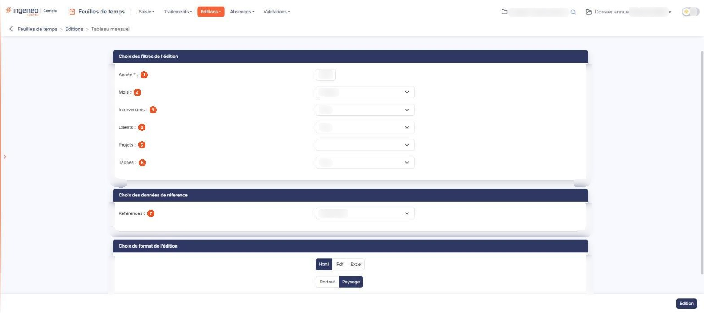
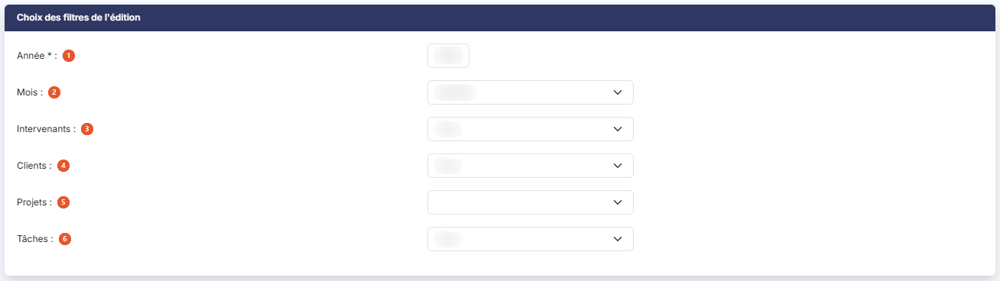
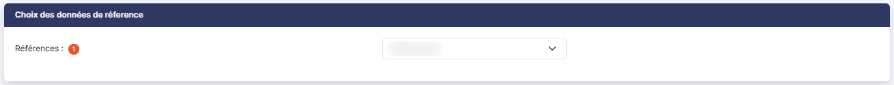
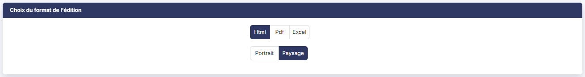

# Tableau mensuel


**Où le trouver :** Menu **Editions › Tableau mensuel**



**En bref** — Cet écran permet d'éditer les temps d'un mois sous forme de tableau : une ligne par intervenant, client, projet ou tâche, et une colonne par jour.

* Pour éditer un mois : renseignez l'Année et le Mois, puis bouton \[Edition].
* Pour changer les lignes du tableau : choisissez « Intervenants », « Clients », « Projets » ou « Taches » sous « Références », puis bouton \[Edition].


L'édition « Tableau mensuel » restitue les temps d'un mois sous forme de tableau : une ligne par donnée de référence — intervenant, client, projet ou tâche — et une colonne par jour du mois.

<figure><figcaption>
Écran « Tableau mensuel » de la nouvelle interface
</figcaption></figure>

Cet écran ne sert qu'à préparer cette édition : vous y choisissez les filtres, la donnée portée en lignes et le format, puis vous lancez l'édition : au format Html elle s'ouvre dans un nouvel onglet de votre navigateur, tandis qu'aux formats Pdf et Excel le fichier vous est remis par votre navigateur. Il ne comporte ni grille, ni enregistrement.

Il est composé de trois rubriques, décrites ci-dessous dans l'ordre où elles s'affichent.

## Rubrique « Choix des filtres de l'édition »

<figure><figcaption>
Rubrique « Choix des filtres de l'édition »
</figcaption></figure>

| Champ               | Ce qu'il faut savoir                                                                                                                                                                                                                                                                |
| ------------------- | ----------------------------------------------------------------------------------------------------------------------------------------------------------------------------------------------------------------------------------------------------------------------------------- |
| 1. **Année**        | 
Saisissez l'année à éditer. C'est le seul champ obligatoire de l'écran, signalé par un astérisque rouge. Le logiciel propose l'année civile en cours, qui n'est pas nécessairement celle de l'exercice que vous avez sélectionné : vérifiez-la avant de lancer l'édition.
 |
| 2. **Mois**         | Choisissez le mois à éditer. Le logiciel propose le mois en cours. La liste ne comporte pas de valeur « Tous » : l'édition porte toujours sur un seul mois. Pour obtenir une année entière, utilisez la sous-rubrique « Tableau annuel ».                                           |
| 3. **Intervenants** | La liste propose tous les utilisateurs actifs de la société gérée. Elle vaut « Tous » par défaut, et vous n'y retenez qu'un seul intervenant à la fois.                                                                                                                             |
| 4. **Clients**      | La liste reprend le contenu de l'écran « Clients » du panneau Paramètres (rubrique « Données ») et vaut « Tous » par défaut.                                                                                                                                                        |
| 5. **Projets**      | Cette liste dépend du client. Tant que « Clients » vaut « Tous », elle reste vide. Dès que vous retenez un client, le logiciel la recharge avec les projets de ce client ; si le client n'en porte aucun, elle affiche « Tous ».                                                    |
| 6. **Tâches**       | La liste reprend le contenu de l'écran « Tâches » du panneau Paramètres (rubrique « Données ») et vaut « Tous » par défaut.                                                                                                                                                         |

## Rubrique « Choix des données de réference »

<figure><figcaption>
Rubrique « Choix des données de réference »
</figcaption></figure>

**Références** : choisissez la donnée que le tableau porte en lignes : « Intervenants », retenu par défaut, « Clients », « Projets » ou « Taches ». Ce choix se retrouve sous le titre de l'état (« Analyse par intervenant » pour « Intervenants ») et dans le bloc « Paramètres de l'édition », à la ligne « Données de référence ».

## Rubrique « Choix du format de l'édition »

<figure><figcaption>
Rubrique « Choix du format de l'édition »
</figcaption></figure>

Deux choix, présentés sans libellé de champ :

* le format de sortie : « Html », retenu par défaut, « Pdf » ou « Excel » ;
* l'orientation : « Portrait » ou « Paysage », retenu par défaut.

Les deux choix restent proposés quel que soit le format retenu.

bouton **\[Edition]**

Il produit l'état. C'est le seul bouton de la page, placé en bas à droite de l'écran : il n'y a ni enregistrement du paramétrage, ni retour. Il n'apparaît que si vous disposez du droit de lancer cette édition.

Lorsqu'aucun temps n'a été saisi sur le mois retenu, l'état s'ouvre quand même, avec ses compteurs à zéro et le message « Aucun temps saisi sur la période. » à la place du tableau.

**L'état produit**

L'état s'ouvre sur un en-tête qui porte son titre « Tableau mensuel », le nom de la société, la période (« Période » suivie du mois et de l'année, par exemple « Novembre 2026 ») et la donnée de référence retenue (« Analyse par intervenant »), avec à droite la mention « Édité le … à … par … » suivie du nom de l'utilisateur. Une bande de quatre compteurs suit (Temps saisi, Collaborateurs, Jours saisis, Moyenne par jour saisi), puis un bloc « Paramètres de l'édition », replié : sa ligne de résumé rappelle la donnée de référence et les filtres (« aucun filtre »), et le déplier détaille Période, Intervenant, Client, Projet, Tâche, Données de référence et Tableaux.

Le tableau porte en première colonne la donnée de référence que vous avez retenue, puis une colonne par jour du mois — le jour de la semaine en abrégé et son quantième —, et enfin une colonne « Totaux ». Une ligne « Totaux » ferme le tableau.

Les durées sont exprimées en heures et minutes, sous la forme 00:00.
