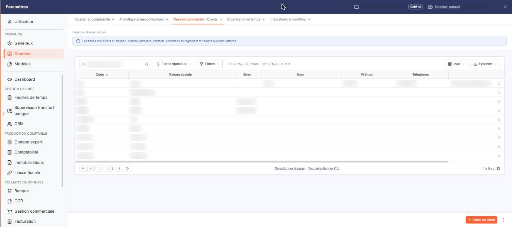
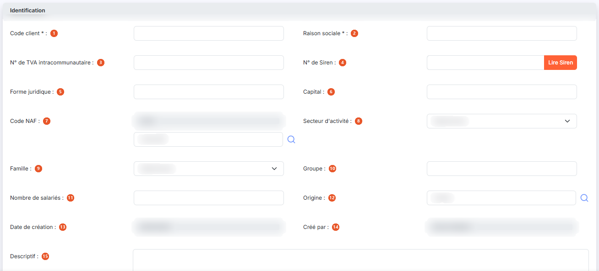
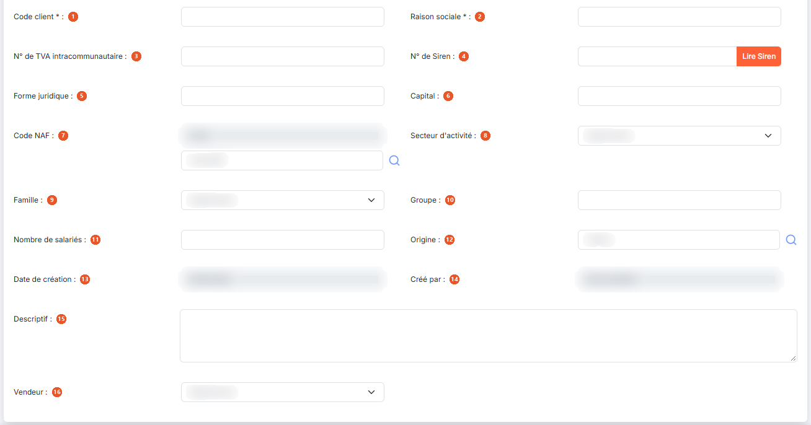
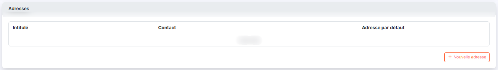
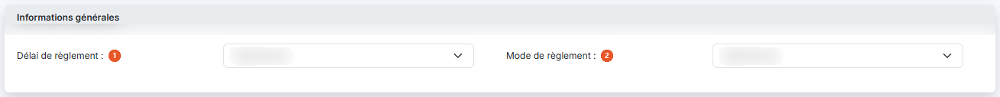
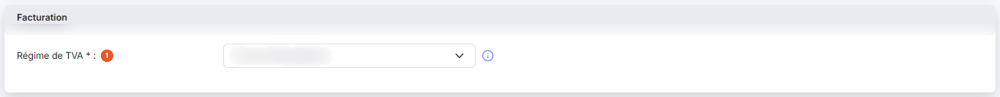
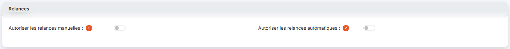
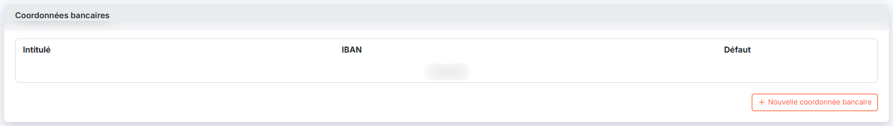
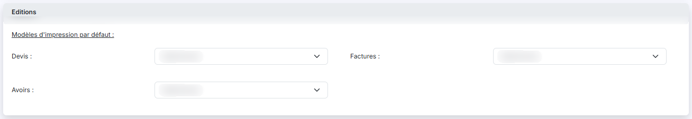
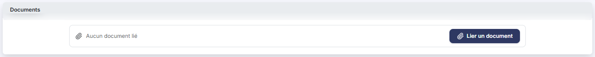

# Clients


**Où le trouver :** Panneau **Paramètres** › **Données** › **Tiers et commercial** › **Clients**



**En bref** — Cet écran permet de gérer le fichier des clients, commun à plusieurs modules. Dans les Feuilles de temps, ce sont les clients auxquels vos projets se rattachent.

* Pour créer un client : bouton \[Créer un client], renseignez le Code client et la Raison sociale, puis bouton \[Enregistrer].
* Pour retrouver un client : champ « Rechercher un client… », ou bouton \[Filtres]. Pour voir les clients archivés : bouton \[Filtres spéciaux], puis interrupteur « Clients archivés ».
* Pour modifier, dupliquer ou supprimer un client : pictogramme « Autres actions » de sa ligne.


Le fichier « Clients » est commun à plusieurs modules d'Ingeneo Compta. Ainsi, où que vous ayez créé ou modifié un client, il sera visible de la même manière dans tous les modules.

<figure><figcaption>
Écran « Clients » de la nouvelle interface
</figcaption></figure>

Dans les Feuilles de temps, le fichier « Clients » est ce à quoi se rattachent vos projets : la fiche d'un projet exige un code client, et ce sont ces projets qui vous sont ensuite proposés lorsque vous saisissez vos temps.

Un client ne peut être supprimé s'il est lié à des projets, à des actions, à des opportunités, à des pièces commerciales ou à des règlements ; le logiciel refuse alors la suppression et vous l'indique.

La fiche client ne présente pas les mêmes rubriques selon le module depuis lequel vous l'ouvrez. Le présent chapitre décrit la fiche telle qu'elle se présente **depuis les Feuilles de temps**.

## La liste des clients

<figure><figcaption>
Rubrique « La liste des clients »
</figcaption></figure>

La liste présente sept colonnes : **Code**, **Raison sociale**, **Siren**, **Nom**, **Prénom**, **Téléphone** et **E-mail pro.** Elle est triée par défaut sur le code, dans l'ordre croissant, et chacune des sept colonnes peut servir de critère de tri. Les cinq dernières ne sont renseignées que pour les clients qui portent ces informations : il est normal qu'elles restent vides sur une partie des lignes.

Au-dessus de la liste, la barre « Rechercher un client… » permet de retrouver un client. Le bouton **\[Filtres spéciaux]** ouvre un menu. Le bouton **\[Filtres]** permet d'ajouter un critère sur une colonne de la liste ; dès qu'un critère est posé, un lien « Tout effacer » apparaît à côté et remplace l'ancien bouton \[Annuler les filtres]. Il n'y a plus de bouton \[Afficher].

Il n'y a plus de case à cocher : un clic sur une ligne la sélectionne. En fin de ligne, le pictogramme « Autres actions » (trois points) ouvre un menu de trois entrées : « Modifier », qui ouvre la fiche du client en modification, « Supprimer » pour la suppression et « Dupliquer » pour la duplication.

Dans la barre située au-dessus de la liste, le bouton **\[Vue]** ouvre le menu des vues et des colonnes affichées, et le bouton **\[Exporter]** le menu d'aperçu, d'impression et d'export de la liste. Sous la liste, les liens « Sélectionner la page » et « Tout sélectionner », suivi du nombre de clients, étendent la sélection à la page ou à l'ensemble des pages.

En bas à droite de l'écran, le bouton **\[Créer un client]** ouvre une fiche vierge ; un menu à trois points, à côté, propose « Champs dynamiques » et « Valeurs par défaut ». Les actions qui portent sur les clients sélectionnés — bouton **\[Archiver]** et, à partir de deux clients sélectionnés, bouton **\[Modification groupée]** — ne sont plus au bas de la liste : elles sont proposées dans le bandeau de sélection, qui apparaît dès qu'une ligne est sélectionnée.

## Rubrique « Identification »

<figure><figcaption>
Rubrique « Identification »
</figcaption></figure>

<figure><figcaption>
Rubrique « Identification »
</figcaption></figure>

| Champ                               | Ce qu'il faut savoir                                                                                                       |
| ----------------------------------- | -------------------------------------------------------------------------------------------------------------------------- |
| 1. **Code client**                  | Vous ne le saisissez qu'à la création : lorsque vous ouvrez la fiche d'un client existant, ce champ n'est plus modifiable. |
| 2. **Raison sociale**               | —                                                                                                                          |
| 3. **N° de TVA intracommunautaire** | —                                                                                                                          |
| 4. **N° de Siren**                  | —                                                                                                                          |
| 5. **Forme juridique**              | —                                                                                                                          |
| 6. **Capital**                      | —                                                                                                                          |
| 7. **Code NAF**                     | Ce champ est double : le code, qui n'est pas saisissable directement, et le libellé, accompagné d'une loupe de recherche.  |
| 8. **Secteur d'activité**           | La liste est alimentée par « Paramètres > Données > Tiers et commercial > Secteurs d'activité ».                           |
| 9. **Famille**                      | La liste est alimentée par « Paramètres > Données > Tiers et commercial > Familles de clients ».                           |
| 10. **Groupe**                      | Zone de saisie libre.                                                                                                      |
| 11. **Nombre de salariés**          | —                                                                                                                          |
| 12. **Origine**                     | Zone de saisie accompagnée d'une loupe de recherche.                                                                       |
| 13. **Date de création**            | Renseignée automatiquement et non modifiable.                                                                              |
| 14. **Créé par**                    | Renseigné automatiquement avec le nom de l'utilisateur qui crée la fiche, et non modifiable.                               |
| 15. **Descriptif**                  | Zone de texte.                                                                                                             |
| 16. **Vendeur**                     | —                                                                                                                          |
| **Bouton \[Lire Siren]**            | Accolé au numéro de Siren, il complète la fiche client à partir des informations publiques rattachées à ce numéro.         |

## Rubrique « Adresses »

<figure><figcaption>
Rubrique « Adresses »
</figcaption></figure>

La rubrique présente une liste à trois colonnes — **Intitulé**, **Contact** et **Adresse par défaut** — et un bouton **\[Nouvelle adresse]**. Tant qu'aucune adresse n'a été saisie, la liste affiche « Liste vide ».

Sur chaque adresse déjà saisie, vous disposez des commandes « Modifier », « Supprimer » et « Dupliquer ».

Le bouton \[Nouvelle adresse] déplie la saisie d'une adresse **sous la liste** : ce n'est pas une fenêtre. Seul l'**Intitulé de l'adresse** y est obligatoire ; vous disposez ensuite d'un commentaire, du numéro de Siret, des coordonnées du contact (civilité, prénom, nom, fonction, adresses de messagerie professionnelle et personnelle, téléphone, télécopie, mobile), de l'adresse postale, du code postal, de la ville, du pays et du code officiel géographique de l'INSEE. Le champ **Adresse par défaut** termine la saisie.

La saisie se termine par le bouton **\[Enregistrer]** ou par le bouton **\[Annuler]** ; le bouton **\[Rafraîchir la carte]** met à jour la carte affichée à partir de l'adresse saisie.

## Rubrique « Informations générales »

<figure><figcaption>
Rubrique « Informations générales »
</figcaption></figure>

| Champ                     | Ce qu'il faut savoir |
| ------------------------- | -------------------- |
| 1. **Délai de règlement** | —                    |
| 2. **Mode de règlement**  | —                    |

## Rubrique « Facturation »

<figure><figcaption>
Rubrique « Facturation »
</figcaption></figure>

Depuis les Feuilles de temps, cette rubrique ne comporte qu'un seul champ.

**Régime de TVA** : obligatoire. Il permet de gérer tous les cas de facturation en local ou à l'export, que l'entreprise soit domiciliée en France métropolitaine ou en France d'outre-mer.

## Rubrique « Relances »

<figure><figcaption>
Rubrique « Relances »
</figcaption></figure>

| Champ                                      | Ce qu'il faut savoir                                                                                                       |
| ------------------------------------------ | -------------------------------------------------------------------------------------------------------------------------- |
| 1. **Autoriser les relances manuelles**    | Positionné sur Non.                                                                                                        |
| 2. **Autoriser les relances automatiques** | Positionné sur Non.                                                                                                        |
| **Date de la dernière relance**            | Non saisissable. Ce champ n'est présent que lorsque vous ouvrez la fiche d'un client existant : il est absent en création. |

## Rubrique « Coordonnées bancaires »

<figure><figcaption>
Rubrique « Coordonnées bancaires »
</figcaption></figure>

La rubrique présente une liste à trois colonnes — **Intitulé**, **IBAN** et **Défaut** — et un bouton **\[Nouvelle coordonnée bancaire]** qui déplie la saisie d'une coordonnée bancaire. Tant qu'aucune coordonnée n'a été saisie, la liste affiche « Liste vide ».

Un client peut disposer de plusieurs banques. Pour chaque banque, seul l'intitulé permettant la différenciation est obligatoire.

## Rubrique « Editions »

<figure><figcaption>
Rubrique « Editions »
</figcaption></figure>

Sous l'intitulé « Modèles d'impression par défaut », vous pouvez paramétrer, pour les **Devis**, les **Factures** et les **Avoirs**, le modèle qui sera affecté par défaut pour le client.

## Les boutons de la fiche

<figure><figcaption>
Rubrique « Documents »
</figcaption></figure>

| Champ                        | Ce qu'il faut savoir                                                                                                                                                                                                                                                                                                                                                                                                                                                                           |
| ---------------------------- | ---------------------------------------------------------------------------------------------------------------------------------------------------------------------------------------------------------------------------------------------------------------------------------------------------------------------------------------------------------------------------------------------------------------------------------------------------------------------------------------------- |
| **Bouton \[Enregistrer]**    | 
Situé en bas à droite de la fiche, il enregistre la fiche du client. Si vous avez demandé, dans « Paramètres > Données > Organisation et temps > Projets génériques », qu'un projet générique soit créé automatiquement à la création d'un client, le logiciel crée ces projets pour le client dès son enregistrement. Le menu « Autres actions » (trois points, en bas de la fiche, à côté d'[Enregistrer]) porte trois entrées : « Courriers », « Archiver » et « Tarifs dédiés ».
 |
| **Entrée « Courriers »**     | Elle donne accès aux courriers du client, bâtis sur les modèles portant la catégorie « Courrier client ». Ces modèles ne se paramètrent pas depuis les Feuilles de temps, dont la rubrique du panneau « Paramètres » ne comporte que « Utilisateurs » et « Configuration » : ils se paramètrent depuis « Paramètres > Modèles > Documents > Pages de document ».                                                                                                                               |
| **Entrée « Archiver »**      | Elle n'apparaît que lorsque vous ouvrez la fiche d'un client existant.                                                                                                                                                                                                                                                                                                                                                                                                                         |
| **Entrée « Tarifs dédiés »** | Elle donne accès aux tarifs propres à ce client.                                                                                                                                                                                                                                                                                                                                                                                                                                               |
| **Chevron « Retour »**       | Placé à gauche de la barre d'onglets du panneau « Paramètres », il quitte la fiche sans enregistrer votre saisie et vous ramène à la liste des clients.                                                                                                                                                                                                                                                                                                                                        |
