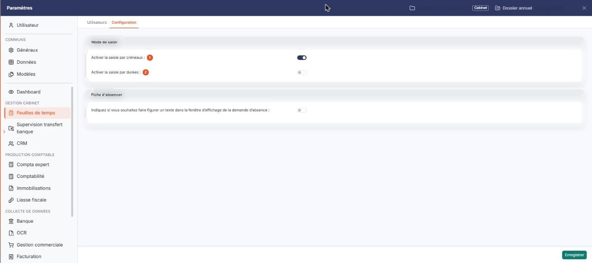
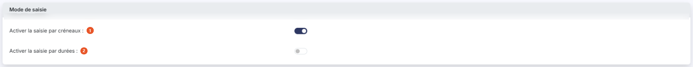
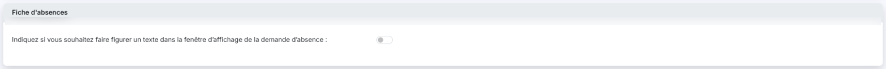

# Configuration


**Où le trouver :** Panneau **Paramètres** › **Feuilles de temps** › **Configuration**



**En bref** — Cet écran permet de choisir les modes de saisie des temps proposés à vos intervenants, et de décider si un texte accompagne les demandes d'absence.

* Pour choisir le mode de saisie : activez « Activer la saisie par créneaux » et, ou non, « Activer la saisie par durées », puis bouton \[Enregistrer].
* Pour accompagner les demandes d'absence d'un texte : activez l'interrupteur de la rubrique « Fiche d'absences », saisissez le Texte, puis bouton \[Enregistrer].


Cette option, que vous ouvrez par « Paramètres » > « Feuilles de temps » > onglet « Configuration », rassemble les paramètres du module. Vous y choisissez les modes de saisie des feuilles de temps mis à la disposition de vos intervenants, et vous y décidez si un texte doit accompagner les demandes d'absence.

<figure><figcaption>
Écran « Configuration » de la nouvelle interface
</figcaption></figure>

Ces paramètres valent pour le dossier tout entier, donc pour tous vos intervenants.

## Rubrique « Mode de saisie »

<figure><figcaption>
Rubrique « Mode de saisie »
</figcaption></figure>

Le module propose deux façons de saisir les temps, que vous activez indépendamment l'une de l'autre, chacun par un interrupteur.

| Champ                                 | Ce qu'il faut savoir                                                                                                                  |
| ------------------------------------- | ------------------------------------------------------------------------------------------------------------------------------------- |
| 1. **Activer la saisie par créneaux** | La saisie par créneaux horaires demande, pour chaque action, une heure de début et une heure de fin. C'est le mode retenu par défaut. |
| 2. **Activer la saisie par durées**   | La saisie par durées ne demande que la quantité de temps passé sur l'action, sans horaires.                                           |

Un mode de saisie qui n'est pas activé n'est pas accessible : l'option correspondante du menu « Saisie » reste dans le menu, mais l'écran n'affiche plus qu'un message vous indiquant que le mode n'est pas activé. Ainsi, tant que l'interrupteur « Activer la saisie par durées » est désactivé, l'option « Saisie > Par jour - Durées » n'affiche que la phrase « Vous n'avez pas activé la saisie par durée », et aucune saisie n'y est possible.

C'est donc ici que vous imposez à tous vos intervenants de saisir leur temps de la même manière, en n'activant qu'un seul des deux modes.

## Rubrique « Fiche d'absences »

<figure><figcaption>
Rubrique « Fiche d'absences »
</figcaption></figure>

\*\*Indiquez si vous souhaitez faire figurer un texte dans la fenêtre d'affichage de la demande d'absence : \*\*activez l'interrupteur pour qu'un texte de votre choix soit présenté à vos intervenants au moment où ils saisissent une demande d'absence.

Le champ **Texte :**, dans lequel ce texte se saisit, n'est pas affiché tant que cet interrupteur est désactivé.

## Bouton \[Enregistrer]

<figure><figcaption>
Bouton [Enregistrer]
</figcaption></figure>

Placé en bas à droite du panneau, il enregistre les paramètres du module. C'est le seul bouton de cet écran.
