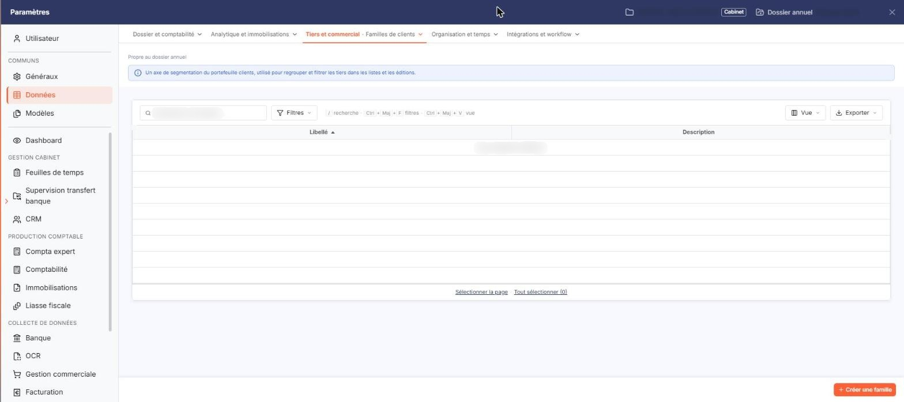
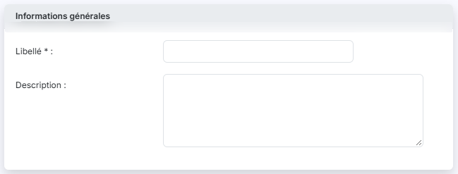

# Familles de clients


**Où le trouver :** Panneau **Paramètres** › **Données** › **Tiers et commercial** › **Familles de clients**



**En bref** — Cet écran permet de créer vos familles de clients pour classer votre clientèle. Chaque famille est ensuite proposée dans la fiche client.

* Pour créer une famille : bouton \[Créer une famille], saisissez le Libellé, puis bouton \[Enregistrer].
* Pour supprimer des familles : sélectionnez-les dans la liste, puis bouton \[Supprimer].


Les familles de clients vous permettent de classer vos clients selon votre propre classification. Une fois créée, une famille est proposée dans la liste déroulante **Famille** de la rubrique « Identification » de chaque fiche client ; tant qu'aucune famille n'a été créée, cette liste ne propose que l'entrée « Sélectionnez ».

<figure><figcaption>
Écran « Familles de clients » de la nouvelle interface
</figcaption></figure>

Pour chaque famille, vous devez saisir un libellé et vous avez la possibilité d'y associer une description. Deux familles ne peuvent avoir le même libellé.

Cet écran ne comporte pas de code : une famille est identifiée par son seul libellé.

## La liste des familles de clients

La liste présente deux colonnes : **Libellé** et **Description**. Elle est triée par défaut sur le libellé, dans l'ordre croissant, et chacune des deux colonnes peut servir de critère de tri.

Au-dessus de la liste, la barre « Rechercher une famille… » permet de retrouver l'une d'elles, et le bouton **\[Filtres]** permet d'ajouter un critère sur une colonne. Tant qu'aucun critère n'est posé, la totalité des familles créées est affichée.

Lorsqu'aucune famille n'a encore été créée, le logiciel affiche le message « Aucun élément à afficher. » ; le pied de la liste ne porte alors que les liens « Sélectionner la page » et « Tout sélectionner (0) », sans pagination.

Dans la barre située au-dessus de la liste, le bouton **\[Vue]** ouvre le menu des vues et des colonnes affichées, et le bouton **\[Exporter]** le menu d'aperçu, d'impression et d'export de la liste. Il n'y a plus de case à cocher : un clic sur une ligne la sélectionne, et les liens « Sélectionner la page » et « Tout sélectionner » étendent la sélection à la page ou à l'ensemble des pages.

## Bouton \[Créer une famille]

<figure><figcaption>
Bouton [Créer une famille]
</figcaption></figure>

Situé en bas à droite de l'écran (raccourci Ctrl+Inser),.

## Autres vues de l'écran

<figure><figcaption>
Informations générales
</figcaption></figure>
