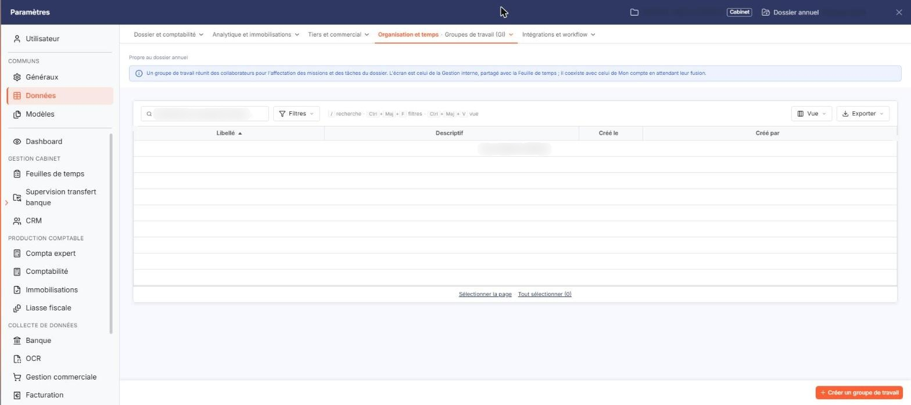
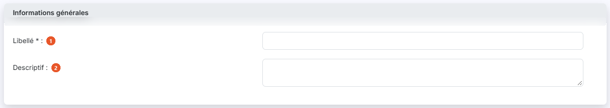
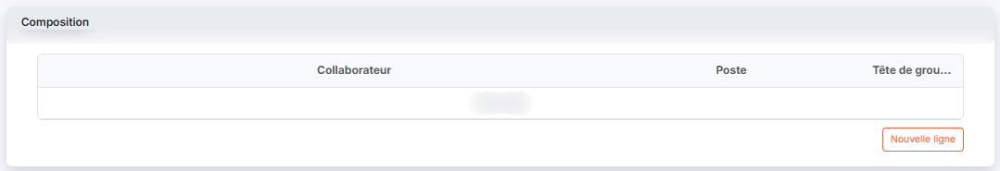

# Groupes de travail


**Où le trouver :** Panneau **Paramètres** › **Données** › **Organisation et temps** › **Groupes de travail**



**En bref** — Cet écran permet de réunir plusieurs collaborateurs, chacun à un poste, dans un groupe de travail. Les groupes servent de filtre au planning des absences.

* Pour créer un groupe : bouton \[Créer un groupe de travail], saisissez le Libellé, puis bouton \[Enregistrer].
* Pour composer le groupe : rubrique « Composition », bouton \[Nouvelle ligne], choisissez le Collaborateur et le Poste, validez par le pictogramme « Coche », puis bouton \[Enregistrer].


Un groupe de travail réunit plusieurs collaborateurs, chacun occupant un poste au sein du groupe.

<figure><figcaption>
Écran « Groupes de travail » de la nouvelle interface
</figcaption></figure>

Une fois créés, vos groupes de travail sont proposés dans le filtre **Groupes de travail** de l'option « Planning » du menu « Absences », qui restreint alors le planning affiché aux seuls collaborateurs du groupe retenu.

Ce fichier est commun à plusieurs modules : un groupe créé ici est visible de la même manière partout où il est proposé.

Cet écran s'ouvre depuis le panneau Paramètres : onglet « Données », catégorie « Organisation et temps », puis « Groupes de travail (GI) ». Ne le confondez pas avec l'entrée « Groupes de travail », sans « (GI) », qui est celle de Mon compte et vaut pour tout le cabinet. Un bandeau précise que l'écran est celui de la Gestion interne, partagé avec la Feuille de temps, et qu'il est propre au dossier annuel.

## La liste des groupes de travail

<figure><figcaption>
Rubrique « La liste des groupes de travail »
</figcaption></figure>

La liste présente quatre colonnes : **Libellé**, **Descriptif**, **Créé le** et **Créé par**. Toutes les quatre servent de critère de tri, le tri par défaut se faisant sur le libellé.

Aucun filtre n'est posé par défaut : la totalité des groupes de travail est affichée.

Au-dessus de la liste, un champ « Rechercher un groupe de travail… » et les boutons \[Filtres], \[Vue] (colonnes affichées) et \[Exporter] (aperçu, impression, export Excel ou PDF, envoi de la liste par e-mail) permettent de chercher, de filtrer et de présenter la liste. Sous la liste, « Sélectionner la page » et « Tout sélectionner » étendent la sélection à la page ou à toutes les pages.

Il n'y a pas de case à cocher : un clic sur une ligne la sélectionne.

En bas à droite du panneau, le bouton **\[Créer un groupe de travail]** ouvre une fiche vierge. Le bouton **\[Supprimer]** se trouve dans le bandeau de sélection qui s'affiche quand vous avez sélectionné une ou plusieurs lignes en cliquant dessus : il porte sur les groupes sélectionnés. Un groupe de travail rattaché à une mission ne peut pas être supprimé : le logiciel refuse alors la suppression et vous indique le groupe concerné.

## Rubrique « Informations générales »

<figure><figcaption>
Rubrique « Informations générales »
</figcaption></figure>

| Champ             | Ce qu'il faut savoir                                                                   |
| ----------------- | -------------------------------------------------------------------------------------- |
| 1. **Libellé**    | Limité à 30 caractères. Deux groupes de travail ne peuvent pas porter le même libellé. |
| 2. **Descriptif** | Zone de texte libre.                                                                   |

## Rubrique « Composition »

<figure><figcaption>
Rubrique « Composition »
</figcaption></figure>

C'est ici que vous désignez les membres du groupe. Le tableau comporte trois colonnes : **Collaborateur**, **Poste** et **Tête de groupe**.

bouton **\[Enregistrer]**

Il enregistre le groupe de travail et sa composition. Si une ligne de composition est restée ouverte en saisie, le logiciel vous invite à la valider d'abord.

**Chevron « Retour »**

Placé à gauche des onglets de catégorie du panneau, il quitte la fiche sans enregistrer votre saisie et vous ramène à la liste des groupes de travail.
