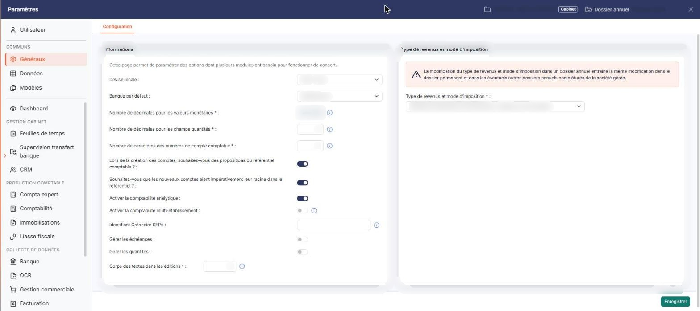
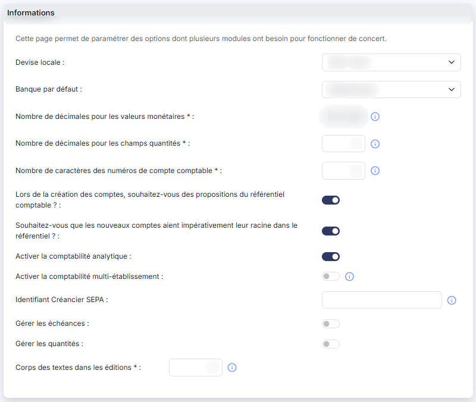
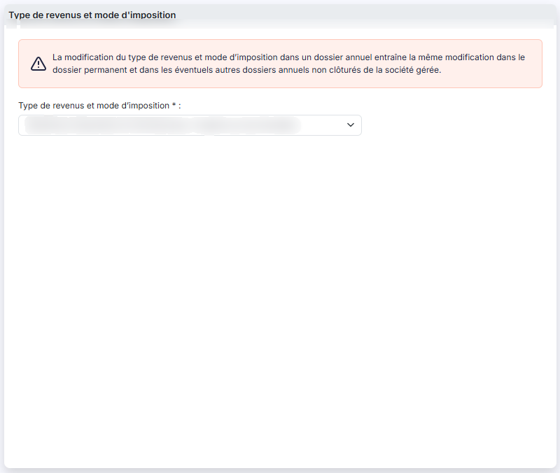

# Multimodule


**Où le trouver :** Panneau **Paramètres**



**En bref** — Cet écran rassemble les paramètres dont plusieurs modules ont besoin pour fonctionner de concert : décimales, longueur des comptes, échéances, analytique, devise, banque par défaut et régime d'imposition.

* Pour activer les échéances de règlement : répondez « Oui » à « Gérer les échéances », renseignez les délais proposés, puis bouton \[Enregistrer].
* Pour indiquer le régime de la société : choisissez le « Type de revenus et mode d'imposition », puis bouton \[Enregistrer].


L'option « Multimodule » est ainsi nommée parce qu'elle rassemble des paramètres dont plusieurs de vos modules ont besoin pour fonctionner de concert. Aucun n'est propre aux feuilles de temps.

<figure><figcaption>
Écran « Multimodule » de la nouvelle interface
</figcaption></figure>

Le logiciel vous le rappelle en tête de l'écran : « Cette page permet de paramétrer des options dont plusieurs modules ont besoin pour fonctionner de concert. »

Les champs dont le libellé porte un astérisque sont obligatoires.

## Rubrique « Paramètres - Informations relevant de plusieurs modules »

<figure><figcaption>
Rubrique « Paramètres - Informations relevant de plusieurs modules »
</figcaption></figure>

| Champ                                                    | Ce qu'il faut savoir                                                                                                                                                                                                                                                                                                                                                                                                                                                                                                                                                                                                                                                                                                                                 |
| -------------------------------------------------------- | ---------------------------------------------------------------------------------------------------------------------------------------------------------------------------------------------------------------------------------------------------------------------------------------------------------------------------------------------------------------------------------------------------------------------------------------------------------------------------------------------------------------------------------------------------------------------------------------------------------------------------------------------------------------------------------------------------------------------------------------------------- |
| **Nombre de décimales pour les valeurs monétaires**      | Ce paramètre détermine avec combien de décimales sont saisies et affichées toutes les valeurs monétaires de vos modules. Il peut prendre les valeurs 0, 1, 2, 3 et 4, mais il ne vous est pas modifiable : prenez contact avec le service technique.                                                                                                                                                                                                                                                                                                                                                                                                                                                                                                 |
| **Nombre de décimales pour les champs quantités**        | Même principe pour les champs de quantité, de 0 à 4 décimales.                                                                                                                                                                                                                                                                                                                                                                                                                                                                                                                                                                                                                                                                                       |
| **Nombre de caractères des numéros de compte comptable** | 
Nombre de caractères que comportent tous les comptes de votre plan comptable. La valeur doit être comprise entre 6 et 12. Afin de conserver les possibilités de comparaison, la modification est effectuée sur le dossier annuel en cours et sur les deux dossiers annuels précédents. **Lors de la création des comptes, souhaitez-vous des propositions du référentiel comptable ? : **répondez « Oui » pour que le logiciel vous propose des comptes du référentiel comptable au moment où vous créez un compte. **Souhaitez-vous que les nouveaux comptes aient impérativement leur racine dans le référentiel ? : **répondez « Oui » pour interdire la création d'un compte dont la racine ne figure pas dans ce même référentiel.
 |
| **Identifiant Créancier SEPA**                           | L'Identifiant Créancier SEPA (ICS) est obligatoire si vous souhaitez générer des ordres de prélèvements SEPA. Cette information est à récupérer auprès de votre banque.                                                                                                                                                                                                                                                                                                                                                                                                                                                                                                                                                                              |
| **Gérer les échéances**                                  | Répondez « Oui » pour gérer des échéances de règlement. Le logiciel affiche alors un champ complémentaire, **Renseigner automatiquement les échéances pour les fournisseurs et les clients :** Si vous portez ce dernier à « Oui », deux listes s'ajoutent, **Délai de règlement par défaut des fournisseurs :** et **Délai de règlement par défaut des clients :**, précédées de la phrase « Pour les comptes dont les paramètres d'échéances ne sont pas définis, les paramètres ci-dessous s'appliquent. ». Tous ces champs restent masqués tant que la réponse est « Non ».                                                                                                                                                                      |
| **Activer la comptabilité analytique**                   | Répondez « Oui » pour disposer des fonctions analytiques de vos modules.                                                                                                                                                                                                                                                                                                                                                                                                                                                                                                                                                                                                                                                                             |
| **Activer la comptabilité multi-établissement**          | En activant cette option, vous devrez affecter les écritures à un établissement. Les établissements se créent dans le module « Dossier permanent », menu « Social », option « Etablissements ».                                                                                                                                                                                                                                                                                                                                                                                                                                                                                                                                                      |
| **Gérer les quantités**                                  | Répondez « Oui » pour gérer la saisie de quantités.                                                                                                                                                                                                                                                                                                                                                                                                                                                                                                                                                                                                                                                                                                  |
| **Devise locale**                                        | Choisissez la devise du dossier dans la liste, présentée sous la forme « Code - Libellé ».                                                                                                                                                                                                                                                                                                                                                                                                                                                                                                                                                                                                                                                           |
| **Banque par défaut**                                    | Choisissez, parmi les banques enregistrées dans le dossier, celle que le logiciel proposera par défaut. La liste ne contient que ces banques : tant qu'aucune n'a été créée, elle ne propose que l'entrée « Sélectionnez ».                                                                                                                                                                                                                                                                                                                                                                                                                                                                                                                          |
| **Corps des textes dans les éditions**                   | Ce paramètre détermine la taille d'affichage des textes standards dans les éditions ; sa valeur doit être comprise entre 8 et 18.                                                                                                                                                                                                                                                                                                                                                                                                                                                                                                                                                                                                                    |

## Rubrique « Type de revenus et mode d'imposition »

<figure><figcaption>
Rubrique « Type de revenus et mode d'imposition »
</figcaption></figure>

Le logiciel affiche en tête de rubrique l'avertissement suivant : « La modification du type de revenus et mode d'imposition dans un dossier annuel entraîne la même modification dans le dossier permanent et dans les éventuels autres dossiers annuels non clôturés de la société gérée. »

**Type de revenus et mode d'imposition** : indiquez à quel régime est soumise la société gérée. La liste propose les bénéfices agricoles, les bénéfices industriels et commerciaux selon qu'ils relèvent de l'impôt sur le revenu ou de l'impôt sur les sociétés, les bénéfices non commerciaux, les revenus fonciers professionnels ou non, ainsi que les cas « Non imposable » et « Nouvelle-Calédonie ». Cette information est capitale dans plusieurs modules.

## Bouton \[Enregistrer]

<figure><figcaption>
Bouton [Enregistrer]
</figcaption></figure>

Il enregistre les paramètres. C'est le seul bouton de cet écran.
