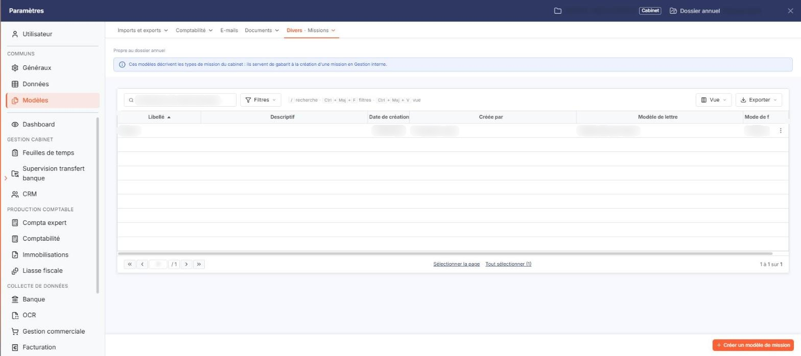
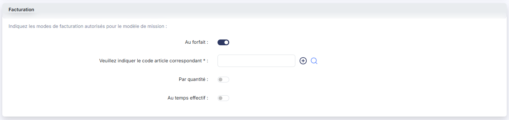
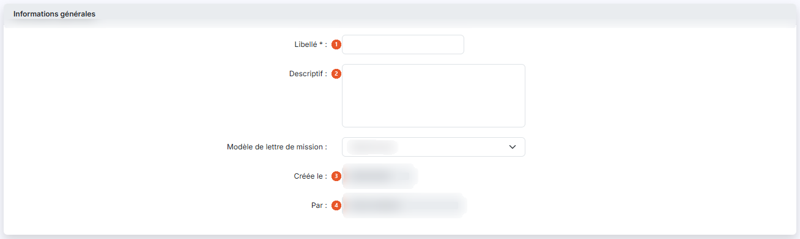
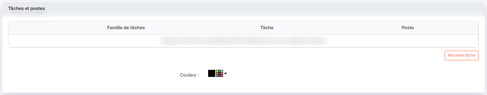

# Nature de Projets


**Où le trouver :** Panneau **Paramètres**



**En bref** — Cet écran permet de définir les natures de projets, qui servent à classer vos projets. Chaque nature est ensuite proposée dans la fiche projet.

* Pour créer une nature : bouton \[Nouveau], saisissez le Libellé, puis bouton \[Enregistrer].
* Pour supprimer des natures : cochez-les dans la liste, puis bouton \[Supprimer].


Les natures de projets vous permettent de classer vos projets. Une fois créée, une nature est proposée dans la liste déroulante **Nature de projet** de la fiche de chaque projet, et la colonne **Nature de Projet** de la liste des projets vous permet de trier vos projets sur ce classement.

<figure><figcaption>
Écran « Nature de Projets » de la nouvelle interface
</figcaption></figure>

Pour chaque nature, vous saisissez un libellé et vous avez la possibilité d'y associer un descriptif.

Deux natures ne peuvent avoir le même libellé, et cet écran ne comporte pas de code : une nature de projet est identifiée par son seul libellé.

Une nature qui est utilisée par un projet ou par un projet générique ne peut être supprimée ; le logiciel refuse alors la suppression et vous indique les natures concernées.

## La liste des natures de projets

<figure><figcaption>
Rubrique « La liste des natures de projets »
</figcaption></figure>

<figure><figcaption>
Rubrique « Facturation »
</figcaption></figure>

La liste présente six colonnes : **Libellé**, **Descriptif**, **Date de création**, **Créée par**, **Modèle de lettre** et **Mode de facturation**. Le **Libellé**, le **Descriptif**, la colonne **Créée par** et le **Modèle de lettre** servent de critère de tri ; la **Date de création**, elle, ne le permet pas. La liste étant plus large que l'écran, la colonne **Mode de facturation** est tronquée à droite.

Les colonnes **Modèle de lettre** et **Mode de facturation** ne sont pas alimentées depuis les Feuilles de temps : elles reprennent des informations renseignées ailleurs et ne vous sont proposées ici qu'en consultation.

Cet écran ne comporte aucun filtre au-dessus de la liste : la totalité des natures créées pour la société est affichée.

Sur chaque ligne, vous disposez d'un pictogramme « Crayon » qui ouvre la fiche de la nature en modification, d'un pictogramme « Croix » pour la suppression et d'un pictogramme « Feuille + » pour la duplication.

En bas de la liste, le bouton **\[Nouveau]** ouvre une fiche vierge et le bouton **\[Supprimer]** porte sur les natures que vous avez cochées.

## Rubrique « Informations générales »

<figure><figcaption>
Rubrique « Informations générales »
</figcaption></figure>

| Champ             | Ce qu'il faut savoir                                                                                                                           |
| ----------------- | ---------------------------------------------------------------------------------------------------------------------------------------------- |
| 1. **Libellé**    | Limité à 20 caractères. C'est le nom sous lequel la nature est proposée dans les fiches projets. Il reste modifiable sur une nature existante. |
| 2. **Descriptif** | Zone de texte libre, limitée à 1 024 caractères.                                                                                               |
| 3. **Créée le**   | Non saisissable. Ce champ est renseigné avec la date du jour à la création, puis conserve la date de création de la nature.                    |
| 4. **Par**        | Non saisissable. Ce champ est renseigné avec votre nom à la création, puis conserve le nom de l'utilisateur ayant créé la nature.              |

Le **Modèle de lettre** affiché dans la liste ne figure pas sur cette fiche : il se renseigne depuis le module « Gestion interne » et n'est ici que consultable, dans la colonne de la liste.

## Bouton \[Enregistrer]

<figure><figcaption>
Bouton [Enregistrer]
</figcaption></figure>

Il enregistre la nature de projet.

## Bouton \[Retour]

Il quitte la fiche sans enregistrer votre saisie et vous ramène à la liste des natures de projets.

## Autres vues de l'écran

<figure><figcaption>
Tâches et postes
</figcaption></figure>
