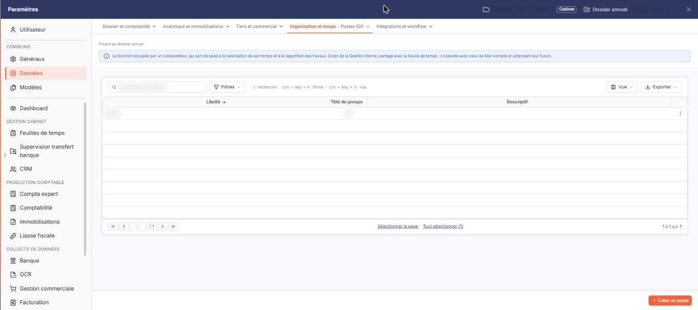
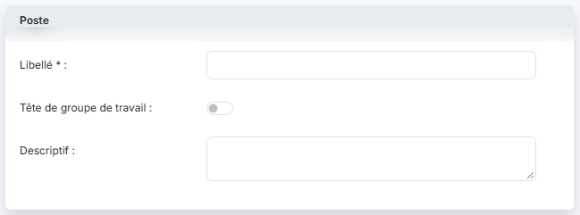

# Postes


**Où le trouver :** Panneau **Paramètres** › **Données** › **Organisation et temps** › **Postes**



**En bref** — Cet écran permet de recenser les postes que peuvent occuper vos collaborateurs. Un poste peut être déclaré tête de groupe, pour désigner le responsable d'un groupe de travail.

* Pour créer un poste : bouton \[Créer un poste], saisissez le Libellé, activez au besoin « Tête de groupe de travail », puis bouton \[Enregistrer].
* Pour modifier ou supprimer un poste : pictogramme « Autres actions » de sa ligne, puis « Modifier » ou « Supprimer ».


Le fichier « Postes » recense les postes que peuvent occuper vos collaborateurs.

<figure><figcaption>
Écran « Postes » de la nouvelle interface
</figcaption></figure>

Un poste est ensuite proposé à deux endroits : dans la rubrique « Composition » d'un groupe de travail, dans le panneau Paramètres, onglet « Données », catégorie « Organisation et temps », puis « Groupes de travail (GI) », où chaque membre du groupe occupe un poste ; et dans la rubrique « Postes » de la fiche d'un utilisateur, dans le panneau Paramètres, rubrique « Feuilles de temps », puis « Utilisateurs ».

Un poste peut être déclaré **tête de groupe** : c'est ce qui permettra de désigner comme responsable le collaborateur qui l'occupe au sein d'un groupe de travail. Il doit toujours exister au moins un poste tête de groupe.

Ce fichier est commun à plusieurs modules : un poste créé ici est visible de la même manière partout où il est proposé.

Cet écran s'ouvre depuis le panneau Paramètres : onglet « Données », catégorie « Organisation et temps », puis « Postes (GI) ». Ne le confondez pas avec l'entrée « Postes », sans « (GI) », qui est celle de Mon compte et vaut pour tout le cabinet. Un bandeau précise que l'écran est celui de la Gestion interne, partagé avec la Feuille de temps, et qu'il est propre au dossier annuel.

## La liste des postes

<figure><figcaption>
Rubrique « La liste des postes »
</figcaption></figure>

<figure><figcaption>
Rubrique « Poste »
</figcaption></figure>

La liste présente trois colonnes : **Libellé**, **Tête de groupe** et **Descriptif**. Les trois colonnes servent de critère de tri, le tri par défaut se faisant sur le libellé.

Aucun filtre n'est posé par défaut : la totalité des postes est affichée.

Au-dessus de la liste, un champ « Rechercher un poste… » et les boutons \[Filtres], \[Vue] (colonnes affichées) et le bouton \[Exporter] (aperçu, impression, export Excel ou PDF, envoi de la liste par e-mail) permettent de chercher, de filtrer et de présenter la liste. Sous la liste, « Sélectionner la page » et « Tout sélectionner » étendent la sélection à la page ou à toutes les pages.

Il n'y a pas de case à cocher : un clic sur une ligne la sélectionne. Chaque ligne porte un bouton « Autres actions » (trois points) dont le menu propose « Modifier », qui ouvre la fiche du poste, et « Supprimer ».

En bas à droite du panneau, le bouton **\[Créer un poste]** ouvre une fiche vierge. Le bouton **\[Supprimer]** se trouve dans le bandeau de sélection qui s'affiche quand vous avez sélectionné une ou plusieurs lignes en cliquant dessus : il porte sur les postes sélectionnés.

Deux situations empêchent la suppression d'un poste, et le logiciel vous l'indique alors : le poste est le seul à être déclaré tête de groupe, ou il a déjà été affecté à au moins un collaborateur.

## Rubrique « Poste »

La fiche d'un poste ne comporte que cette seule rubrique.

| Champ                         | Ce qu'il faut savoir                                                                                                                                                                                                                                                                                                                                                                 |
| ----------------------------- | ------------------------------------------------------------------------------------------------------------------------------------------------------------------------------------------------------------------------------------------------------------------------------------------------------------------------------------------------------------------------------------ |
| **Libellé**                   | Limité à 30 caractères. Deux postes ne peuvent pas porter le même libellé.                                                                                                                                                                                                                                                                                                           |
| **Tête de groupe de travail** | Interrupteur, désactivé sur une fiche vierge. Lorsque le poste que vous consultez est le seul poste tête de groupe existant, l'interrupteur est activé et verrouillé (grisé) et une infobulle vous en donne la raison : « Il doit exister au moins une tête de groupe. » Cette infobulle n'apparaît que sur la fiche d'un poste existant, alors que la règle vaut dans tous les cas. |
| **Descriptif**                | Zone de texte libre.                                                                                                                                                                                                                                                                                                                                                                 |

Sur la fiche d'un poste existant, deux informations supplémentaires vous sont présentées, sur la même ligne et sans être saisissables : **Créé le**, qui porte la date de création du poste, et **par**, qui porte le nom de l'utilisateur qui l'a créé.

bouton **\[Enregistrer]**

Il enregistre le poste et vous ramène à la liste des postes.

**Chevron « Retour »**

Placé à gauche des onglets de catégorie du panneau, il quitte la fiche et vous ramène à la liste des postes.
