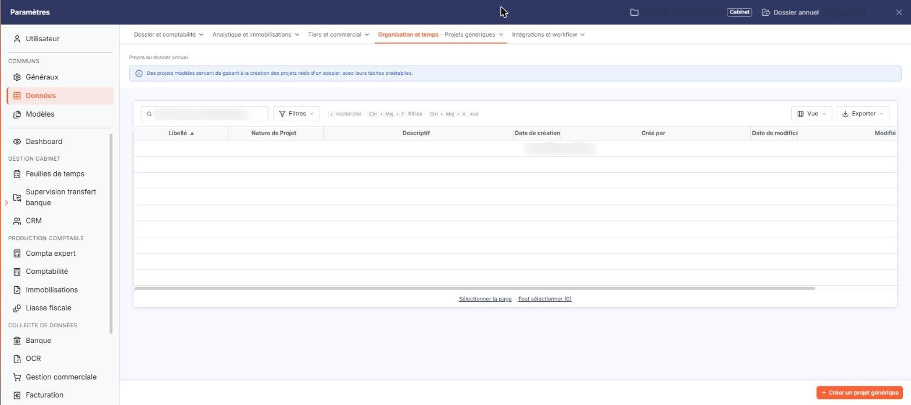
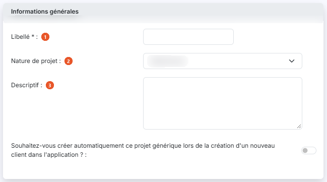

# Projets génériques


**Où le trouver :** Panneau **Paramètres** › **Données** › **Organisation et temps** › **Projets génériques**



**En bref** — Cet écran permet de décrire une seule fois des projets modèles, les projets génériques, que vous reportez ensuite chez vos clients.

* Pour créer un projet générique : bouton \[Créer un projet générique], saisissez le Libellé, puis bouton \[Enregistrer].
* Pour le reporter sur vos clients : sélectionnez-le dans la liste, puis bouton \[Générer les projets].
* Pour qu'il soit repris sur chaque nouveau client : activez l'interrupteur de création automatique dans sa fiche, puis bouton \[Enregistrer].


Un projet générique est un modèle de projet destiné à être repris chez vos clients. Plutôt que de saisir le même projet client par client, vous le décrivez une seule fois ici.

<figure><figcaption>
Écran « Projets génériques » de la nouvelle interface
</figcaption></figure>

Vous pouvez ensuite le reporter sur vos clients de deux manières : à la demande, par le bouton **\[Générer les projets]** de la liste, ou automatiquement à chaque création d'un nouveau client, en activant, sur sa fiche, l'interrupteur de la question posée.

Cet écran s'ouvre depuis le panneau Paramètres : onglet « Données », catégorie « Organisation et temps », puis « Projets génériques ». Un bandeau rappelle qu'il est propre au dossier annuel.

## La liste des projets génériques

<figure><figcaption>
Rubrique « La liste des projets génériques »
</figcaption></figure>

La liste présente sept colonnes : **Libellé**, **Nature de Projet**, **Descriptif**, **Date de création**, **Créé par**, **Date de modification** et **Modifié par**. Toutes les sept servent de critère de tri. La liste étant plus large que l'écran, faites-la défiler horizontalement pour atteindre les dernières colonnes ; l'en-tête **Date de modification** peut apparaître tronqué.

Aucun filtre n'est posé par défaut : la totalité des projets génériques est affichée.

Au-dessus de la liste, un champ « Rechercher un projet générique… » et les boutons \[Filtres], \[Vue] (colonnes affichées) et le bouton \[Exporter] (aperçu, impression, export Excel ou PDF, envoi de la liste par e-mail) permettent de chercher, de filtrer et de présenter la liste. Sous la liste, « Sélectionner la page » et « Tout sélectionner » étendent la sélection à la page ou à toutes les pages.

En bas à droite du panneau, le bouton **\[Créer un projet générique]** ouvre une fiche vierge ; il reste proposé même lorsque la liste est vide. Il n'y a pas de case à cocher : un clic sur une ligne la sélectionne. Dans le bandeau de sélection qui s'affiche quand une ou plusieurs lignes sont sélectionnées, le bouton **\[Générer les projets]** reporte les projets génériques que vous avez sélectionnés sur vos clients non archivés, et le bouton **\[Supprimer]** porte sur les projets génériques que vous avez sélectionnés.

## Rubrique « Informations générales »

<figure><figcaption>
Rubrique « Informations générales »
</figcaption></figure>

La fiche d'un projet générique ne comporte que cette seule rubrique.

| Champ                   | Ce qu'il faut savoir                                                                                           |
| ----------------------- | -------------------------------------------------------------------------------------------------------------- |
| 1. **Libellé**          | Limité à 20 caractères. Deux projets génériques ne peuvent pas porter le même libellé.                         |
| 2. **Nature de projet** | La liste reprend les natures de projet enregistrées et vaut « Sélectionner » tant que vous n'avez rien retenu. |
| 3. **Descriptif**       | Zone de texte libre, limitée à 1 024 caractères.                                                               |

**Souhaitez-vous créer automatiquement ce projet générique lors de la création d'un nouveau client dans l'application ? :** interrupteur, désactivé par défaut. Activez-le pour que ce projet générique soit repris de lui-même sur chaque nouveau client que vous créerez.

bouton **\[Enregistrer]**

Il enregistre le projet générique.

**Chevron « Retour »**

Placé à gauche des onglets de catégorie du panneau, il quitte la fiche sans enregistrer votre saisie et vous ramène à la liste des projets génériques.
