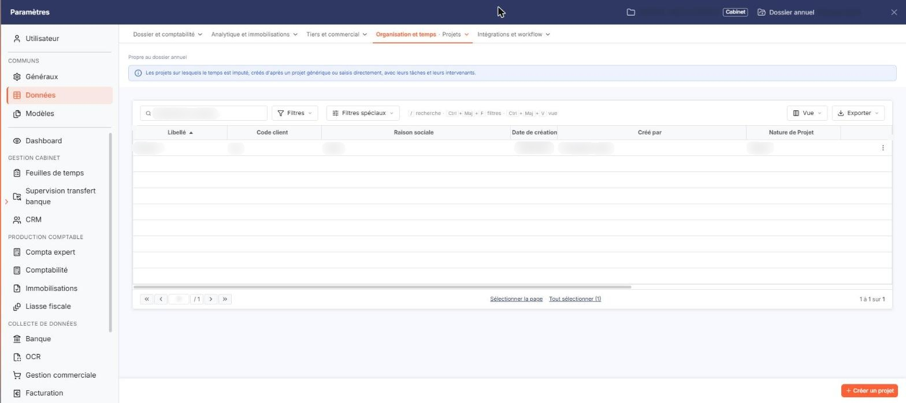
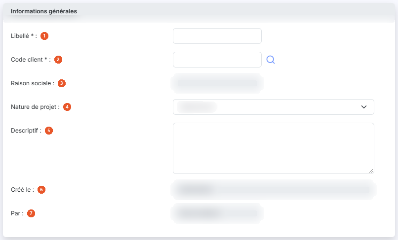

# Projets


**Où le trouver :** Panneau **Paramètres** › **Données** › **Organisation et temps** › **Projets**



**En bref** — Cet écran permet de gérer les projets, chacun rattaché à un client. C'est le projet qui vous est proposé lors de la saisie de vos lignes de temps.

* Pour créer un projet : bouton \[Créer un projet], saisissez le Libellé et le Code client, puis bouton \[Enregistrer].
* Pour clore un projet : ouvrez sa fiche, puis bouton \[Clôturer].
* Pour voir aussi les projets clôturés : bouton \[Filtres spéciaux], puis interrupteur « Projets clos ».


Le fichier « Projets » est commun à plusieurs modules. En fonction du module, il peut parfois s'intituler « Missions » plutôt que « Projets ».

<figure><figcaption>
Écran « Projets » de la nouvelle interface
</figcaption></figure>

Un projet est nécessairement rattaché à un client. C'est le projet qui vous est proposé lors de la saisie de vos lignes de temps : sans projet, aucun temps ne peut être affecté à un client.

Un projet est ouvert tant qu'il n'a pas été clôturé.

Un projet ne peut être supprimé s'il est lié à des saisies de temps ou à une mission de la Gestion interne ; le logiciel refuse alors la suppression et vous l'indique.

## La liste des projets

<figure><figcaption>
Rubrique « La liste des projets »
</figcaption></figure>

La liste présente neuf colonnes : **Libellé**, **Code client**, **Raison sociale**, **Date de création**, **Créé par**, **Nature de Projet**, **Cloturé par**, **Date de clôture** et **Descriptif**. Toutes servent de critère de tri, à l'exception de la **Date de création** et de la **Date de clôture**. La liste étant plus large que l'écran, les dernières colonnes ne sont visibles qu'après avoir fait défiler la liste horizontalement.

Au-dessus de la liste, la barre « Rechercher un projet… » permet de retrouver un projet. Le bouton **\[Filtres spéciaux]** ouvre un menu. Le bouton **\[Filtres]** permet d'ajouter un critère sur une colonne de la liste ; dès qu'un critère est posé, un lien « Tout effacer » apparaît à côté. Il n'y a plus de bouton \[Annuler le filtre].

Il n'y a plus de case à cocher : un clic sur une ligne la sélectionne. En fin de ligne, le pictogramme « Autres actions » (trois points) ouvre un menu de trois entrées : « Modifier », qui ouvre la fiche du projet en modification, « Dupliquer » pour la duplication et « Supprimer » pour la suppression.

Dans la barre située au-dessus de la liste, le bouton **\[Vue]** ouvre le menu des vues et des colonnes affichées, et le bouton **\[Exporter]** le menu d'aperçu, d'impression et d'export de la liste. Sous la liste, les liens « Sélectionner la page » et « Tout sélectionner », suivi du nombre de projets, étendent la sélection à la page ou à l'ensemble des pages.

En bas à droite de l'écran, le bouton **\[Créer un projet]** ouvre une fiche vierge.

## Rubrique « Informations générales »

<figure><figcaption>
Rubrique « Informations générales »
</figcaption></figure>

La fiche d'un projet ne comporte que cette seule rubrique.

| Champ                   | Ce qu'il faut savoir                                                                                                                                                                                                                                                                                                                                                                                                                                                                        |
| ----------------------- | ------------------------------------------------------------------------------------------------------------------------------------------------------------------------------------------------------------------------------------------------------------------------------------------------------------------------------------------------------------------------------------------------------------------------------------------------------------------------------------------- |
| 1. **Libellé**          | Limité à 20 caractères. C'est ce libellé qui vous est proposé dans le sélecteur lors de la saisie des lignes de temps. Il doit être unique **par client** : deux clients distincts peuvent donc avoir un projet portant le même libellé, les temps restant différenciés par le client. Vous ne le saisissez qu'à la création : lorsque vous ouvrez la fiche d'un projet existant, ce champ n'est plus modifiable, alors même qu'il continue de porter l'astérisque des champs obligatoires. |
| 2. **Code client**      | Un projet est toujours affecté à un client. Une loupe de recherche accolée au champ vous permet de choisir le client.                                                                                                                                                                                                                                                                                                                                                                       |
| 3. **Raison sociale**   | Non saisissable. Elle est renseignée par le logiciel à partir du code client.                                                                                                                                                                                                                                                                                                                                                                                                               |
| 4. **Nature de projet** | Cette liste permet de classer les projets ; elle est alimentée par « Paramètres > Modèles > Divers > Missions ».                                                                                                                                                                                                                                                                                                                                                                            |
| 5. **Descriptif**       | Zone de texte libre.                                                                                                                                                                                                                                                                                                                                                                                                                                                                        |
| 6. **Créé le**          | Non saisissable. Ce champ est renseigné avec la date du jour à la création, puis conserve la date de création du projet.                                                                                                                                                                                                                                                                                                                                                                    |
| 7. **Par**              | Non saisissable. Ce champ est renseigné avec votre nom à la création, puis conserve le nom de l'utilisateur ayant créé le projet.                                                                                                                                                                                                                                                                                                                                                           |

## Bouton \[Enregistrer]

<figure><figcaption>
Bouton [Enregistrer]
</figcaption></figure>

Il enregistre le projet.

## Bouton \[Clôturer]

<figure><figcaption>
Bouton [Clôturer]
</figcaption></figure>

<figure><figcaption>
Bouton [Clôturer]
</figcaption></figure>

Il n'apparaît que lorsque vous ouvrez la fiche d'un projet existant : il n'est pas proposé à la création.

## Chevron « Retour »

Situé à gauche de la barre d'onglets du panneau « Paramètres », il quitte la fiche sans enregistrer votre saisie et vous ramène à la liste des projets.
