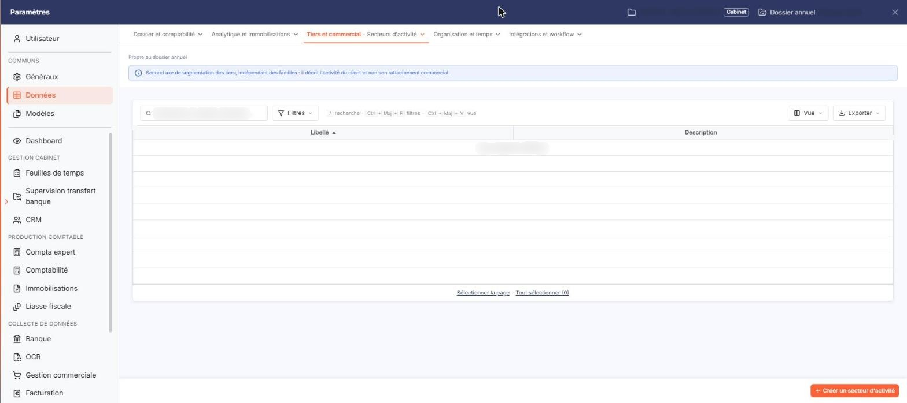
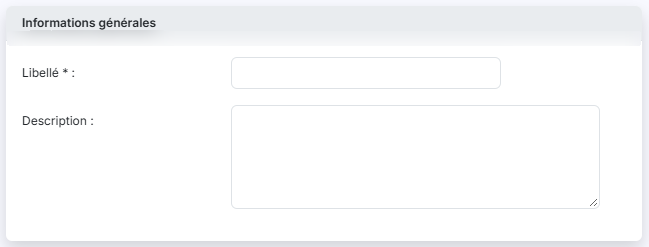

# Secteurs d'activité


**Où le trouver :** Panneau **Paramètres** › **Données** › **Tiers et commercial** › **Secteurs d'activité**



**En bref** — Cet écran permet de créer vos secteurs d'activité pour classer vos clients selon leur métier. Chaque secteur est ensuite proposé dans la fiche client.

* Pour créer un secteur d'activité : bouton \[Créer un secteur d'activité], saisissez le Libellé, puis bouton \[Enregistrer].
* Pour supprimer des secteurs : sélectionnez-les dans la liste, puis bouton \[Supprimer].


Les secteurs d'activité vous permettent de classer vos clients selon leur métier. Une fois créé, un secteur d'activité est proposé dans la liste déroulante **Secteur d'activité** de la rubrique « Identification » de chaque fiche client ; tant qu'aucun secteur n'a été créé, cette liste ne propose que l'entrée « Sélectionnez ».

<figure><figcaption>
Écran « Secteurs d'activité » de la nouvelle interface
</figcaption></figure>

Pour chaque secteur d'activité, vous devez saisir un libellé et vous avez la possibilité d'y associer une description. Deux secteurs d'activité ne peuvent avoir le même libellé.

Cet écran ne comporte pas de code : un secteur d'activité est identifié par son seul libellé.

## La liste des secteurs d'activité

La liste présente deux colonnes : **Libellé** et **Description**. Elle est triée par défaut sur le libellé, dans l'ordre croissant, et chacune des deux colonnes peut servir de critère de tri.

Au-dessus de la liste, la barre « Rechercher un secteur d'activité… » permet de retrouver l'une d'elles, et le bouton **\[Filtres]** permet d'ajouter un critère sur une colonne. Tant qu'aucun critère n'est posé, la totalité des secteurs d'activité créés est affichée.

Lorsqu'aucun secteur d'activité n'a encore été créé, le logiciel affiche le message « Aucun élément à afficher. » ; le pied de la liste ne porte alors que les liens « Sélectionner la page » et « Tout sélectionner (0) », sans pagination.

Dans la barre située au-dessus de la liste, le bouton **\[Vue]** ouvre le menu des vues et des colonnes affichées, et le bouton **\[Exporter]** le menu d'aperçu, d'impression et d'export de la liste. Il n'y a plus de case à cocher : un clic sur une ligne la sélectionne, et les liens « Sélectionner la page » et « Tout sélectionner » étendent la sélection à la page ou à l'ensemble des pages.

## Bouton \[Créer un secteur d'activité]

<figure><figcaption>
Bouton [Créer un secteur d'activité]
</figcaption></figure>

Situé en bas à droite de l'écran (raccourci Ctrl+Inser),.

## Autres vues de l'écran

<figure><figcaption>
Informations générales
</figcaption></figure>
