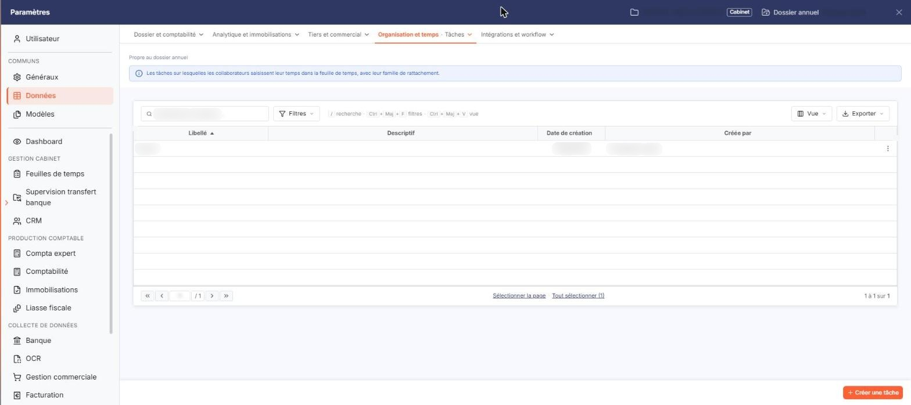
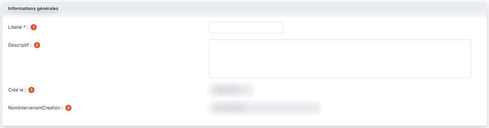

# Tâches


**Où le trouver :** Panneau **Paramètres** › **Données** › **Organisation et temps** › **Tâches**



**En bref** — Cet écran permet de définir les tâches qui catégorisent le temps passé sur vos dossiers. Chaque tâche est ensuite proposée en saisie des temps.

* Pour créer une tâche : bouton \[Créer une tâche], saisissez le Libellé, puis bouton \[Enregistrer].
* Pour modifier ou supprimer une tâche : pictogramme « Autres actions » de sa ligne, puis « Modifier » ou « Supprimer ».


Les tâches vous permettent de catégoriser le temps que vous passez sur vos dossiers. Une fois créée, une tâche vous est proposée dans le champ **Tâche** des écrans de saisie des temps, où elle reste facultative.

<figure><figcaption>
Écran « Tâches » de la nouvelle interface
</figcaption></figure>

Il est préférable de la renseigner : les éditions du module permettent d'effectuer des tris et des sélections fondés sur les tâches, et c'est ce qui vous permet de suivre la nature des travaux de chaque intervenant.

Cet écran ne comporte pas de code : une tâche est identifiée par son seul libellé, et deux tâches ne peuvent pas porter le même.

Cet écran s'ouvre depuis le panneau Paramètres : onglet « Données », catégorie « Organisation et temps », puis « Tâches ». Ne la confondez pas avec l'entrée « Tâches (GI) » de la même catégorie. Un bandeau rappelle qu'elle est propre au dossier annuel.

## La liste des tâches

<figure><figcaption>
Rubrique « La liste des tâches »
</figcaption></figure>

La liste présente quatre colonnes : **Libellé**, **Descriptif**, **Date de création** et **Créée par**. Toutes les quatre servent de critère de tri, le tri par défaut se faisant sur le libellé.

Aucun filtre n'est posé par défaut : la totalité des tâches créées pour le dossier est affichée.

Au-dessus de la liste, un champ « Rechercher une tâche… » et les boutons \[Filtres], \[Vue] (colonnes affichées) et le bouton \[Exporter] (aperçu, impression, export Excel ou PDF, envoi de la liste par e-mail) permettent de chercher, de filtrer et de présenter la liste. Sous la liste, « Sélectionner la page » et « Tout sélectionner » étendent la sélection à la page ou à toutes les pages.

Il n'y a pas de case à cocher : un clic sur une ligne la sélectionne. Chaque ligne porte un bouton « Autres actions » (trois points) dont le menu propose « Modifier », qui ouvre la fiche de la tâche en modification, et « Supprimer ». À la différence de la liste « Projets », cet écran ne propose pas de duplication.

En bas à droite du panneau, le bouton **\[Créer une tâche]** ouvre une fiche vierge. Le bouton **\[Supprimer]** se trouve dans le bandeau de sélection qui s'affiche quand vous avez sélectionné une ou plusieurs lignes en cliquant dessus : il porte sur les tâches sélectionnées.

Une tâche déjà employée dans une saisie de temps ne peut pas être supprimée, pas plus qu'une tâche utilisée par le module « Gestion interne » ; le logiciel vous l'indique et nomme la tâche concernée.

## Rubrique « Informations générales »

<figure><figcaption>
Rubrique « Informations générales »
</figcaption></figure>

La fiche d'une tâche ne comporte que cette seule rubrique.

| Champ                         | Ce qu'il faut savoir                                                                                                                                                                                                                                                    |
| ----------------------------- | ----------------------------------------------------------------------------------------------------------------------------------------------------------------------------------------------------------------------------------------------------------------------- |
| 1. **Libellé**                | Limité à 20 caractères. C'est le nom sous lequel la tâche vous est proposée en saisie des temps. Il n'est saisissable qu'à la création : sur une tâche existante, ce champ n'est plus modifiable, et l'astérisque qui marque son caractère obligatoire n'y figure plus. |
| 2. **Descriptif**             | Zone de texte libre, limitée à 1 024 caractères.                                                                                                                                                                                                                        |
| 3. **Créé le**                | Non saisissable. Ce champ est renseigné avec la date du jour à la création, puis conserve la date de création de la tâche.                                                                                                                                              |
| 4. **NomIntervenantCreation** | Non saisissable. Malgré son libellé, ce champ porte le nom de l'utilisateur qui a créé la tâche ; il est renseigné avec le vôtre à la création.                                                                                                                         |

## Bouton \[Enregistrer]

<figure><figcaption>
Bouton [Enregistrer]
</figcaption></figure>

Il enregistre la tâche.

## Chevron « Retour »

Placé à gauche des onglets de catégorie du panneau, il quitte la fiche sans enregistrer votre saisie et vous ramène à la liste des tâches.
