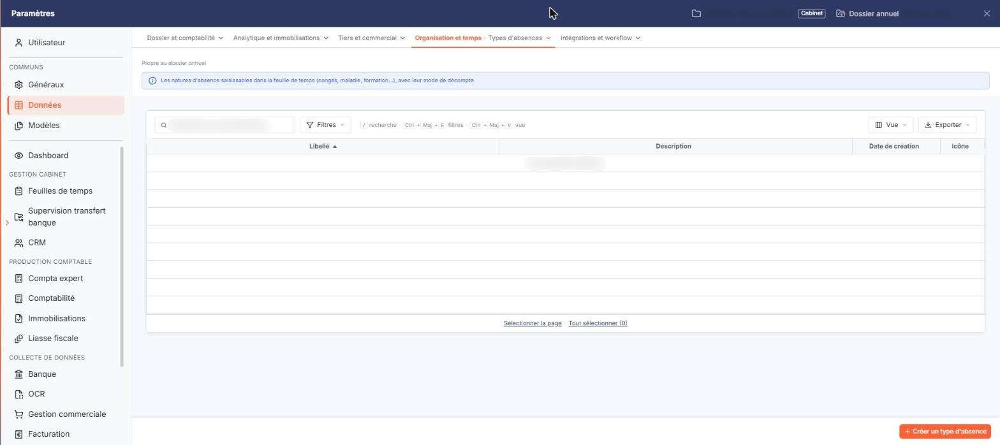
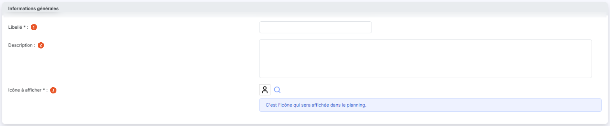
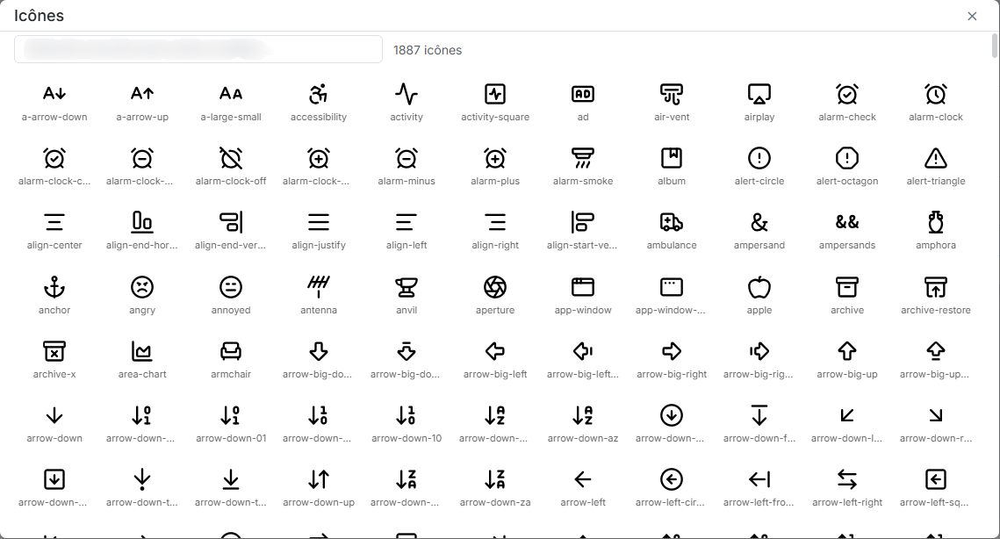

# Types d'absences


**Où le trouver :** Panneau **Paramètres** › **Données** › **Organisation et temps** › **Types d'absences**



**En bref** — Cet écran permet de recenser les motifs d'absence de votre société, chacun avec une icône affichée dans le planning. Ils sont proposés dans la saisie des absences.

* Pour créer un type d'absence : bouton \[Créer un type d'absence], saisissez le Libellé, choisissez l'Icône à afficher, puis bouton \[Enregistrer].
* Pour supprimer des types : sélectionnez-les dans la liste, puis bouton \[Supprimer].


Le fichier « Types d'absences » recense les motifs d'absence de votre société : congés payés, récupération, formation, et tout autre motif que vous souhaitez distinguer.

<figure><figcaption>
Écran « Types d'absences » de la nouvelle interface
</figcaption></figure>

Ces types sont ensuite proposés dans la liste **Type d'absence** de l'option « Saisie » du menu « Absences », où le champ est obligatoire : tant qu'aucun type n'est enregistré ici, cette liste est vide. Ils servent également de filtre à l'édition « Absences » du menu « Editions ».

Chaque type porte une icône, qui est celle affichée dans le planning des absences.

Cet écran s'ouvre depuis le panneau Paramètres : onglet « Données », catégorie « Organisation et temps », puis « Types d'absences ». Un bandeau rappelle qu'il est propre au dossier annuel.

Ce fichier est commun à plusieurs modules : un type créé ici est visible de la même manière partout où il est proposé.

## La liste des types d'absences

<figure><figcaption>
Rubrique « La liste des types d'absences »
</figcaption></figure>

La liste présente quatre colonnes : **Libellé**, **Description**, **Date de création** et **Icône**. Les quatre colonnes servent de critère de tri, le tri par défaut se faisant sur le libellé. La flèche de tri s'affiche sur la colonne triée, ici **Libellé**.

Cet écran est une liste et rien d'autre : il ne comporte ni onglet, ni rubrique, et aucun filtre n'est posé par défaut. La totalité des types d'absences est affichée.

Au-dessus de la liste, un champ « Rechercher un type d'absence… » et les boutons \[Filtres], \[Vue] (colonnes affichées) et le bouton \[Exporter] (aperçu, impression, export Excel ou PDF, envoi de la liste par e-mail) permettent de chercher, de filtrer et de présenter la liste. Sous la liste, « Sélectionner la page » et « Tout sélectionner » étendent la sélection à la page ou à toutes les pages.

En bas à droite du panneau, le bouton **\[Créer un type d'absence]** ouvre une fiche vierge. Il n'y a pas de case à cocher : un clic sur une ligne la sélectionne, et le bouton **\[Supprimer]**, placé dans le bandeau de sélection qui s'affiche alors, porte sur les types sélectionnés. Un type d'absence déjà rattaché à une demande d'absence ne peut pas être supprimé : le logiciel refuse alors la suppression et vous indique le type concerné.

## Rubrique « Informations générales »

<figure><figcaption>
Rubrique « Informations générales »
</figcaption></figure>

La fiche d'un type d'absence ne comporte que cette seule rubrique.

| Champ                   | Ce qu'il faut savoir                                                                                                                                                                                                                                                                                                                             |
| ----------------------- | ------------------------------------------------------------------------------------------------------------------------------------------------------------------------------------------------------------------------------------------------------------------------------------------------------------------------------------------------ |
| 1. **Libellé**          | Limité à 40 caractères. Deux types d'absences ne peuvent pas porter le même libellé.                                                                                                                                                                                                                                                             |
| 2. **Description**      | Zone de texte libre, limitée à 1 024 caractères.                                                                                                                                                                                                                                                                                                 |
| 3. **Icône à afficher** | Ce champ ne se saisit pas au clavier : il présente l'icône actuellement retenue, suivie d'un pictogramme « Loupe » qui ouvre la fenêtre de choix. Une icône vous est déjà proposée sur une fiche vierge : le champ n'est jamais vide. Un encadré d'information rappelle à quoi elle sert : « C'est l'icône qui sera affichée dans le planning. » |

## La fenêtre « Icônes »

<figure><figcaption>
Rubrique « La fenêtre « Icônes » »
</figcaption></figure>

Ouverte par le pictogramme « Loupe » du champ **Icône à afficher**, cette fenêtre annonce « 1887 icônes » et les présente en planche, chacune accompagnée de son nom en anglais (« a-arrow-down », « accessibility », « activity »…). Un champ « Rechercher une icône (nom Lucide, en anglais)… » en haut de la fenêtre permet de retrouver une icône par son nom.

La croix « Fermer » de la barre de titre referme la fenêtre.

bouton **\[Enregistrer]**

Il enregistre le type d'absence.

**Chevron « Retour »**

Placé à gauche des onglets de catégorie du panneau, il quitte la fiche sans enregistrer votre saisie et vous ramène à la liste des types d'absences.
