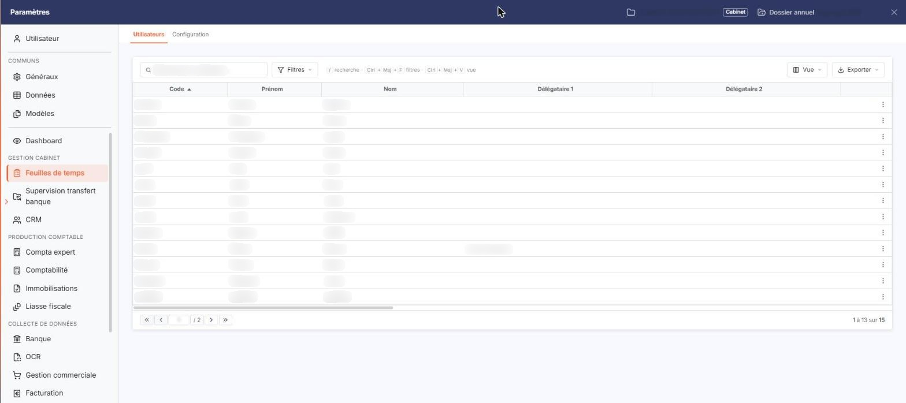
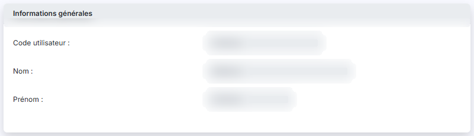
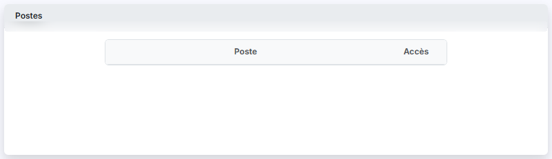
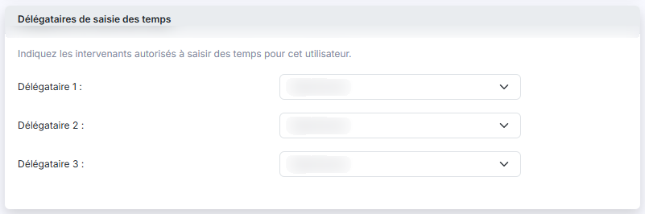
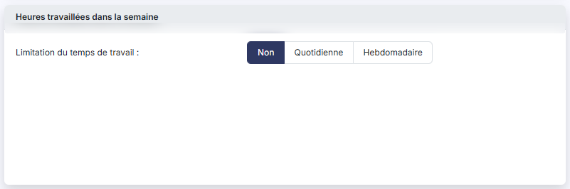
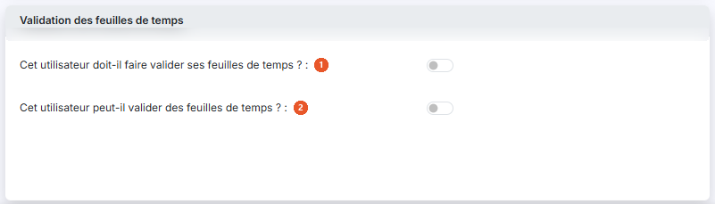
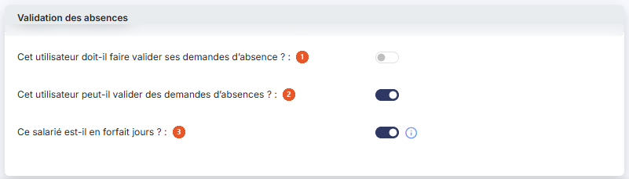
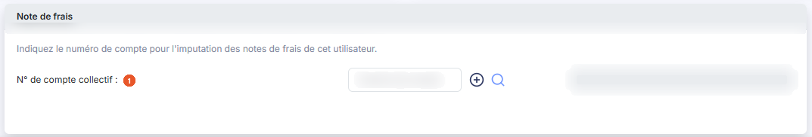

# Utilisateurs


**Où le trouver :** Panneau **Paramètres** › **Feuilles de temps** › **Utilisateurs**



**En bref** — Cet écran rassemble, pour chaque utilisateur, les paramètres propres aux feuilles de temps : délégataires de saisie, valideurs de temps et d'absences, et limites d'horaire.

* Pour permettre à quelqu'un de saisir à la place d'un collaborateur : pictogramme « Trois points » de la ligne du collaborateur, « Modifier », désignez le délégataire, puis bouton \[Enregistrer].
* Pour désigner les valideurs : activez la question de la rubrique « Validation des feuilles de temps » ou « Validation des absences », choisissez les valideurs, puis bouton \[Enregistrer].


Cette option, ouverte par « Paramètres » > « Feuilles de temps » > onglet « Utilisateurs », rassemble les informations d'utilisation propres aux feuilles de temps de chaque utilisateur : qui peut saisir des temps à sa place, qui valide ses temps et ses absences, et quelles limites d'horaire lui sont appliquées.

<figure><figcaption>
Écran « Utilisateurs » de la nouvelle interface
</figcaption></figure>

C'est ici que se règle ce que chacun verra dans le reste du module : les listes d'intervenants des écrans de saisie et de validation ne sont pas gouvernées par les droits du profil, mais par les délégataires et les valideurs que vous désignez sur cette fiche.

Vous ne pouvez ni créer ni supprimer d'utilisateur depuis cette option : cela se fait dans le module « Mon compte ». Vous ne pouvez que modifier la fiche d'un utilisateur existant.

## La liste des utilisateurs

La liste présente les utilisateurs de la société gérée, triés par défaut sur leur **Code**.

Elle reprend, après le **Code**, le **Prénom** et le **Nom**, l'ensemble des paramètres de la fiche : les trois colonnes **Délégataire 1** à **Délégataire 3**, les colonnes **Doit faire valider ses absences** et **Peut valider des absences**, les trois colonnes **Valideur d'absences 1** à **Valideur d'absences 3**, les trois colonnes **Valideur FDT 1** à **Valideur FDT 3**, puis **Forfait jours** et **Limitation du temps de travail**. Chacune sert de critère de tri.

La liste est plus large que votre écran : parcourez-la par le défilement horizontal, ou choisissez les colonnes affichées par le bouton **\[Vue]**.

Au-dessus de la liste, vous disposez d'une zone « Rechercher un utilisateur… » et de trois boutons : le bouton **\[Filtres]**, le bouton **\[Vue]**, qui permet de choisir les colonnes affichées, et le bouton **\[Exporter]**, dont le menu propose notamment l'impression, l'export Excel ou PDF et l'envoi de la liste par e-mail.

Sur chaque ligne, un pictogramme « Trois points » ouvre un menu qui ne contient qu'une entrée, « Modifier » : elle ouvre la fiche de l'utilisateur en modification. C'est la seule commande de ligne. Il n'y a ni bouton de création ni bouton de suppression sous la liste, qui ne porte que la pagination.

## Rubrique « Informations générales »

<figure><figcaption>
Rubrique « Informations générales »
</figcaption></figure>

Les champs **Code utilisateur :**, **Nom :** et **Prénom :** vous rappellent de quel utilisateur il s'agit. Ils ne sont pas saisissables : ils se modifient dans le module « Mon compte ».

Tant que vous n'avez retenu aucun compte dans la rubrique « Note de frais », aucun champ de cette fiche n'est marqué comme obligatoire.

## Rubrique « Postes »

<figure><figcaption>
Rubrique « Postes »
</figcaption></figure>

Cette rubrique présente une liste à deux colonnes, **Poste** et **Accès**, destinée à indiquer quels postes cet utilisateur peut occuper. Les postes se créent dans le panneau « Paramètres », rubrique « Données » > « Organisation et temps », entrée « Postes (GI) ».

## Rubrique « Délégataires de saisie des temps »

<figure><figcaption>
Rubrique « Délégataires de saisie des temps »
</figcaption></figure>

Le logiciel vous invite à « Indiquez les intervenants autorisés à saisir des temps pour cet utilisateur. »

Les champs **Délégataire 1 :**, **Délégataire 2 :** et **Délégataire 3 :** vous permettent de désigner jusqu'à trois personnes. Un délégataire est une personne autorisée à saisir et à modifier les temps d'une autre. Les trois listes proposent les autres utilisateurs du cabinet ; l'utilisateur de la fiche n'y figure pas.

C'est le mécanisme central du module : dans les écrans « Saisie > Par jour - Créneaux » et « Absences > Saisie », chacun ne peut saisir que pour lui-même et pour les personnes qui l'ont désigné comme délégataire sur leur propre fiche. Pour permettre à quelqu'un de saisir à la place d'un collaborateur, ouvrez la fiche de ce collaborateur et ajoutez-l'y en délégataire, et non l'inverse. Aucun droit de profil n'ouvre cette liste.

## Rubrique « Heures travaillées dans la semaine »

<figure><figcaption>
Rubrique « Heures travaillées dans la semaine »
</figcaption></figure>

Le champ **Limitation du temps de travail :** vous propose trois choix, et le contenu de la rubrique change selon celui que vous retenez.

| Champ            | Ce qu'il faut savoir                                                                                                                                                                       |
| ---------------- | ------------------------------------------------------------------------------------------------------------------------------------------------------------------------------------------ |
| **Non**          | Aucun autre champ ne s'affiche.                                                                                                                                                            |
| **Quotidienne**  | Sept lignes s'affichent, de **Lundi :** à **Dimanche :**, chacune avec une zone d'heures et une zone de minutes. Vous y indiquez le temps de travail maximum de chaque jour de la semaine. |
| **Hebdomadaire** | Une seule ligne s'affiche, **Temps de travail hebdomadaire maximum :**, avec une zone d'heures et une zone de minutes.                                                                     |

## Rubrique « Validation des feuilles de temps »

<figure><figcaption>
Rubrique « Validation des feuilles de temps »
</figcaption></figure>

| Champ                                                                | Ce qu'il faut savoir                                                                                                                                                                                                                                                                                                                                                                                                  |
| -------------------------------------------------------------------- | --------------------------------------------------------------------------------------------------------------------------------------------------------------------------------------------------------------------------------------------------------------------------------------------------------------------------------------------------------------------------------------------------------------------- |
| 1. **Cet utilisateur doit-il faire valider ses feuilles de temps ?** | Si vous activez l'interrupteur, le logiciel affiche la phrase « Indiquez les intervenants autorisés à valider les feuilles de temps de cet utilisateur : » et trois champs **Valideur 1 :**, **Valideur 2 :** et **Valideur 3 :**, où vous désignez jusqu'à trois valideurs. Ce sont ces trois champs que la liste appelle **Valideur FDT 1** à **Valideur FDT 3** : les deux libellés désignent la même information. |
| 2. **Cet utilisateur peut-il valider des feuilles de temps ?**       | Activez l'interrupteur pour que cet utilisateur puisse valider des feuilles de temps.                                                                                                                                                                                                                                                                                                                                 |

Ces désignations commandent le contenu de l'option « Validations > Validation des temps » : chacun n'y voit que les personnes dont il est valideur de feuilles de temps.

## Rubrique « Validation des absences »

<figure><figcaption>
Rubrique « Validation des absences »
</figcaption></figure>

| Champ                                                                 | Ce qu'il faut savoir                                                                                                                                                                                                                                                                                                                 |
| --------------------------------------------------------------------- | ------------------------------------------------------------------------------------------------------------------------------------------------------------------------------------------------------------------------------------------------------------------------------------------------------------------------------------ |
| 1. **Cet utilisateur doit-il faire valider ses demandes d'absence ?** | Si vous activez l'interrupteur, le logiciel affiche la phrase « Indiquer les intervenants pouvant valider les absences de cet utilisateur : » et trois champs **Valideur 1 :**, **Valideur 2 :** et **Valideur 3 :**. Désigner plusieurs valideurs évite que les demandes restent en attente lorsque le premier est lui-même absent. |
| 2. **Cet utilisateur peut-il valider des demandes d'absences ?**      | Activez l'interrupteur pour que cet utilisateur puisse valider des demandes d'absence. Là encore, il ne verra que les personnes dont il est désigné valideur d'absences, et jamais ses propres demandes.                                                                                                                             |
| 3. **Ce salarié est-il en forfait jours ?**                           | Si l'interrupteur est activé, les absences du salarié sont décomptées en journées ou demi-journées ; s'il est désactivé, elles sont décomptées en heures. Ce champ figure dans cette rubrique bien qu'il ne concerne pas la validation, mais l'unité de décompte des absences.                                                       |

## Rubrique « Note de frais »

<figure><figcaption>
Rubrique « Note de frais »
</figcaption></figure>

Le logiciel vous invite à « Indiquez le numéro de compte pour l'imputation des notes de frais de cet utilisateur. »

| Champ                         | Ce qu'il faut savoir                                                                                                                                                                                                                                                                                                                                                                                                         |
| ----------------------------- | ---------------------------------------------------------------------------------------------------------------------------------------------------------------------------------------------------------------------------------------------------------------------------------------------------------------------------------------------------------------------------------------------------------------------------- |
| 1. **N° de compte collectif** | 
Saisissez le numéro de compte dans la zone, ou recherchez-le par le pictogramme « Loupe » ; le pictogramme « Créer », un « + » cerclé, vous permet d'en créer un. La zone qui suit affiche le libellé du compte et n'est pas saisissable. Dès qu'un compte est retenu, le pictogramme « Loupe » cède la place à un pictogramme qui ouvre la fiche de ce compte, et le logiciel affiche en dessous un second champ.
 |
| **N° de compte auxiliaire**   | Dès qu'il s'affiche, comme l'indique l'astérisque de son libellé. Il se renseigne de la même manière que le précédent, et la zone qui le suit affiche le libellé du compte auxiliaire retenu.                                                                                                                                                                                                                                |

## Bouton \[Enregistrer]

<figure><figcaption>
Bouton [Enregistrer]
</figcaption></figure>

Placé en bas à droite du panneau, il enregistre les paramètres de l'utilisateur.

## Retour à la liste

Le bouton \[Retour] n'est plus affiché : pour quitter la fiche sans enregistrer votre saisie et revenir à la liste des utilisateurs, utilisez le chevron « Retour », à gauche de la barre d'onglets du panneau.
