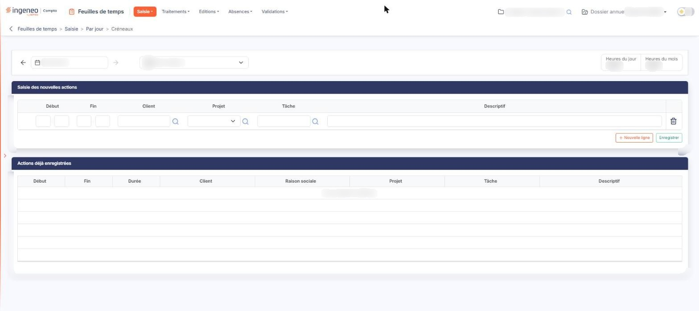
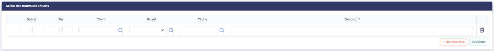
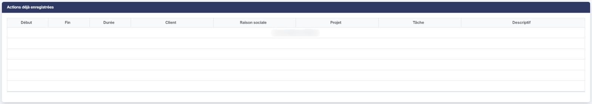

# Par jour - Créneaux


**Où le trouver :** Menu **Saisie › Par jour - Créneaux**



**En bref** — Cet écran permet d'enregistrer vos lignes de temps jour par jour, en indiquant pour chaque action une heure de début et une heure de fin, et de retrouver les actions déjà enregistrées.

* Pour saisir vos temps : choisissez la Date et l'Intervenant, renseignez Début, Fin, Client et Projet, puis bouton \[Enregistrer].
* Pour saisir plusieurs actions d'un coup : bouton \[Nouvelle ligne], complétez chaque ligne, puis bouton \[Enregistrer].
* Pour corriger une ligne déjà enregistrée : pictogramme de modification de sa ligne, corrigez-la, puis bouton \[Enregistrer].


Cette option vous permet d'enregistrer vos lignes de temps jour par jour, en indiquant pour chaque action une heure de début et une heure de fin.

<figure><figcaption>
Écran « Par jour - Créneaux » de la nouvelle interface
</figcaption></figure>

L'écran se compose de trois parties : un bandeau qui fixe la date et l'intervenant concernés, la rubrique « Saisie des nouvelles actions », dans laquelle vous entrez vos lignes, et la rubrique « Actions déjà enregistrées », qui présente les lignes de temps de cette date et de cet intervenant.

## Le bandeau de contexte

| Champ           | Ce qu'il faut savoir                                                                                                                                                                                                                                                                                                                                                                                                                                                                                                             |
| --------------- | -------------------------------------------------------------------------------------------------------------------------------------------------------------------------------------------------------------------------------------------------------------------------------------------------------------------------------------------------------------------------------------------------------------------------------------------------------------------------------------------------------------------------------- |
| **Date**        | Elle est préremplie à la date du jour. Vous pouvez la remplacer par une autre date, à la main ou à l'aide du pictogramme « Calendrier » placé à gauche, à l'intérieur de la zone ; la rubrique « Actions déjà enregistrées » présente alors les lignes de temps de cette date. Vous ne pouvez pas saisir pour une date postérieure au jour en cours : à la date du jour, la flèche placée à droite de la zone « Date » est grisée, et son infobulle indique « Il n'est pas possible de saisir au delà de la journée en cours. ». |
| **Intervenant** | Vous êtes sélectionné par défaut. La liste s'ouvre sur un champ de recherche, marqué d'une loupe à son extrémité droite, qui vous permet de retrouver une personne par son nom, et chaque personne y est précédée de son avatar. Vous ne pouvez saisir que pour vous-même et pour les personnes qui vous ont désigné comme délégataire sur leur fiche. Pour saisir pour un tiers, faites-vous ajouter comme délégataire sur sa fiche utilisateur.                                                                                |

**Heures du jour** et **Heures du mois :** ces deux zones, placées à droite du bandeau, ne sont pas saisissables. « Heures du jour » totalise les heures déjà enregistrées pour la date et l'intervenant retenus ; « Heures du mois » totalise celles du mois.


Attention : les lignes que vous enregistrez sont rattachées à la date et à l'intervenant affichés dans ce bandeau **au moment où vous cliquez sur \[Enregistrer]**. Si vous avez commencé votre saisie pour une date ou un intervenant, puis que vous en avez changé, c'est le nouveau contexte qui s'applique.


## Rubrique « Saisie des nouvelles actions »

<figure><figcaption>
Rubrique « Saisie des nouvelles actions »
</figcaption></figure>

Cette grille est toujours affichée et vous propose d'emblée une ligne vide. Le bouton \[Nouvelle ligne], placé sous la grille à côté d'\[Enregistrer], permet d'en ajouter ; vous pouvez ainsi saisir plusieurs actions, puis les enregistrer.

**Début** et **Fin :** champs obligatoires. Chacune de ces deux colonnes comporte deux petites zones séparées par un deux-points, l'une pour les heures et l'autre pour les minutes. S'il n'y a pas de minutes, vous pouvez laisser la seconde zone vide. L'heure de début et l'heure de fin ne peuvent pas être identiques.

| Champ          | Ce qu'il faut savoir                                                                                                                                                                                                                                                                           |
| -------------- | ---------------------------------------------------------------------------------------------------------------------------------------------------------------------------------------------------------------------------------------------------------------------------------------------- |
| **Client**     | Champ obligatoire. Il s'agit du client pour lequel le temps a été passé. Saisissez son code dans la zone, ou cliquez sur le pictogramme « Loupe » pour ouvrir la fenêtre de sélection.                                                                                                         |
| **Projet**     | Champ obligatoire. Il s'agit du projet (ou de la mission) sur lequel le temps a été passé. Choisissez-le dans la liste déroulante, ou cliquez sur le pictogramme « Loupe » pour le rechercher. Cette liste dépend du client de la ligne : renseignez d'abord le client, sinon elle reste vide. |
| **Tâche**      | Champ facultatif. Saisissez-la dans la zone ou choisissez-la par le pictogramme « Loupe ». Il est préférable de la renseigner : les éditions du module permettent d'effectuer des tris et des sélections fondés sur les tâches.                                                                |
| **Descriptif** | Champ facultatif. Cette zone, la plus large de la grille, reçoit le commentaire libre de l'action.                                                                                                                                                                                             |

Chaque ligne se termine, à droite, par une **corbeille**, dont l'infobulle indique « Effacer », qui vous permet d'abandonner la ligne en cours de saisie.


Attention : rien à l'écran ne signale les champs obligatoires. Une ligne à laquelle il manque une information n'est pas enregistrée et reste dans la grille de saisie.


**Les fenêtres de sélection**

Les trois pictogrammes « Loupe » ouvrent des fenêtres bâties sur le même modèle : un champ de recherche, marqué d'une loupe, qui porte le nom de la donnée et filtre la liste à la saisie, une liste à deux colonnes triables, une pagination, et la consigne « Cliquez pour sélectionner » en bas. Elles se ferment par la croix placée en haut à droite.

* « Sélection d'un client » présente les colonnes « Code client » et « Raison sociale » ; le clic sur une ligne ferme la fenêtre et reporte le **code** du client dans la ligne de saisie ;
* « Sélection d'un projet » et « Sélection d'une tâche » présentent les colonnes « Libellé » et « Descriptif ».

Lorsque aucun élément ne répond à la recherche, la fenêtre affiche « Aucun élément à afficher. ».

## Rubrique « Actions déjà enregistrées »

<figure><figcaption>
Rubrique « Actions déjà enregistrées »
</figcaption></figure>

Cette grille présente les lignes de temps déjà enregistrées pour la date et l'intervenant retenus dans le bandeau.

Elle comporte une colonne de commandes, sans libellé, puis les colonnes « Début », « Fin », « Durée », « Client », « Raison sociale », « Projet », « Tâche » et « Descriptif », qui se trient toutes par un clic sur leur en-tête. Tant qu'aucune ligne n'a été enregistrée pour la journée, la grille affiche « Aucun élément à afficher. ».

De part et d'autre de la zone « Date » du bandeau, deux flèches vous permettent de changer de journée sans ressaisir la date : celle de gauche, dont l'infobulle indique « Jour précédent », recule la date d'un jour, et celle de droite, « Jour suivant », l'avance d'un jour ; elle est grisée tant que la date affichée est celle du jour. La zone « Date » du bandeau suit ce déplacement.

| Champ                                   | Ce qu'il faut savoir                                                                                                                                                                                                                                                                                                                                                                                                                                          |
| --------------------------------------- | ------------------------------------------------------------------------------------------------------------------------------------------------------------------------------------------------------------------------------------------------------------------------------------------------------------------------------------------------------------------------------------------------------------------------------------------------------------- |
| **Modifier une ligne déjà enregistrée** | Cliquez sur le pictogramme de modification de la ligne concernée. Elle quitte la rubrique « Actions déjà enregistrées » et revient dans la grille de saisie, où vous pouvez la corriger puis l'enregistrer de nouveau. Il faut pour cela qu'une des lignes de la grille de saisie soit libre. Ce pictogramme n'est proposé que si vos droits le permettent.                                                                                                   |
| **Chevauchement de plages horaires**    | Si la plage horaire d'une ligne recouvre une ou plusieurs lignes déjà enregistrées, le logiciel vous en avertit et vous demande de confirmer le remplacement. Si vous confirmez, la nouvelle ligne écrase les précédentes, mais uniquement sur la plage de recouvrement ; si vous annulez, la ligne reste dans la grille de saisie pour que vous puissiez la corriger. Le remplacement est en revanche refusé lorsque la ligne recouverte a déjà été validée. |

bouton **\[Enregistrer]**

Il enregistre les lignes saisies dans la rubrique « Saisie des nouvelles actions » ; elles passent alors dans la rubrique « Actions déjà enregistrées ». Vous pouvez enregistrer vos lignes une par une ou plusieurs ensemble, sans conséquence.

Avec \[Nouvelle ligne], c'est l'un des deux seuls boutons de l'écran : il n'y a ni bouton « Retour », ni bouton « Supprimer », ni bouton « Imprimer ».
