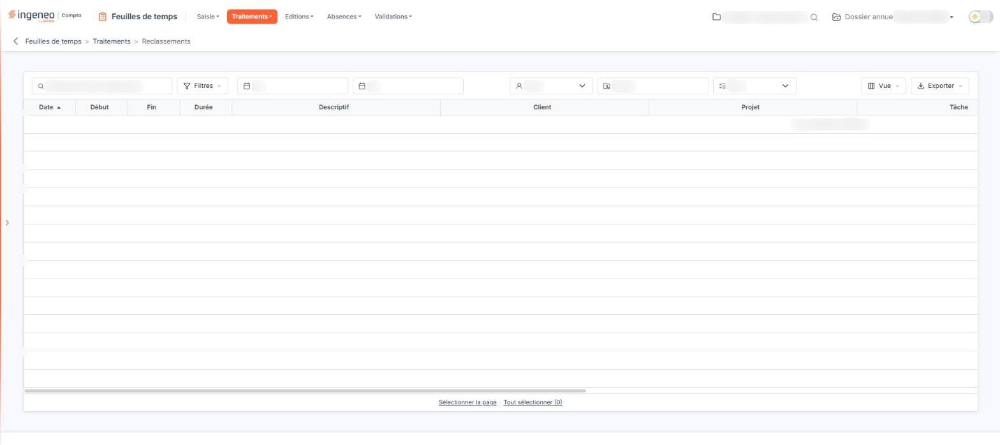

# Reclassements


**Où le trouver :** Menu **Traitements › Reclassements**



**En bref** — Cet écran permet de reprendre en une fois des lignes de temps déjà enregistrées : vous les retrouvez par les filtres, puis vous les réaffectez à un autre client, projet ou tâche, ou les supprimez.

* Pour retrouver des lignes : renseignez les zones Du, Au, Intervenant, Projet et Tâche, ou le champ « Rechercher dans le descriptif… ».
* Pour réaffecter des lignes : sélectionnez-les dans la grille, bouton \[Réaffecter des saisies], puis complétez la fenêtre.
* Pour supprimer des lignes : sélectionnez-les, bouton \[Supprimer], puis confirmez.


Cette option vous permet de reprendre de manière groupée des lignes de temps déjà enregistrées : vous les retrouvez à l'aide des filtres, vous les sélectionnez dans la grille, puis vous les réaffectez à un autre client, à un autre projet ou à une autre tâche, ou vous les supprimez.

<figure><figcaption>
Écran « Reclassements » de la nouvelle interface
</figcaption></figure>

## Les filtres

Les filtres occupent la barre placée en haut de l'écran : à gauche la zone « Rechercher dans le descriptif… » et le bouton \[Filtres], puis, sur la même ligne, les zones Du, Au, Intervenant, Projet et Tâche ; les boutons \[Vue] et \[Exporter] sont à l'extrémité droite. Aucun n'est obligatoire, et tous sont vides ou positionnés sur « Tous » à l'ouverture : la grille présente donc l'ensemble des lignes de temps du dossier annuel.

| Champ           | Ce qu'il faut savoir                                                                                                                                                                          |
| --------------- | --------------------------------------------------------------------------------------------------------------------------------------------------------------------------------------------- |
| **Du**          | **Au :** bornent la période sur la date des lignes de temps. Vous pouvez saisir les dates directement ou utiliser le pictogramme « Calendrier » placé à gauche, à l'intérieur de chaque zone. |
| **Intervenant** | Cette liste ne propose que les personnes ayant déjà au moins une ligne de temps enregistrée, précédées du choix « Tous ». Elle se réduit donc à « Tous » tant qu'aucun temps n'a été saisi.   |
| **Projet**      | Est une zone de saisie libre. Le filtre « Descriptif » est devenu la zone « Rechercher dans le descriptif… », en tête de barre.                                                               |
| **Tâche**       | Cette liste propose le choix « Tous » et les tâches du dossier.                                                                                                                               |

Si l'une des deux dates est mal formée, le libellé rouge « Date invalide » s'affiche entre la zone « Au » et la liste « Intervenant » ; il disparaît dès que vous corrigez ou videz la date.

**Mise à jour de la grille**

Il n'y a plus de bouton \[Filtrer] : la grille se met à jour dès que vous modifiez un filtre.

Dès qu'un critère est posé, le lien « Tout effacer » apparaît à côté du bouton \[Filtres] ; il remet les filtres à zéro et remplace le bouton \[Annuler les filtres] des versions précédentes.

## La grille

La grille présente une ligne par ligne de temps, avec les colonnes « Date », « Début », « Fin », « Durée », « Descriptif », « Client », « Projet », « Tâche », « Code intervenant », « Nom intervenant », « Date de validation » et « Nom du valideur ». Les quatre dernières s'atteignent en faisant défiler la grille horizontalement. Chaque colonne se trie par un clic sur son en-tête.

Il n'y a plus de case à cocher : un clic sur une ligne la sélectionne. Sous la grille, les liens « Sélectionner la page » et « Tout sélectionner (0) » sélectionnent les lignes de la page ou l'ensemble des lignes, et le bouton \[Vue] vous permet de choisir les colonnes affichées.

Pour le détail de la sélection ligne à ligne, page par page ou sur l'ensemble des pages, reportez-vous au chapitre « Fonctionnement d'une grille » des généralités.

Lorsque aucune ligne de temps ne répond aux filtres, la grille affiche « Aucun élément à afficher. ».

bouton **\[Réaffecter des saisies]**

Sélectionnez d'abord dans la grille les lignes à modifier : ce bouton se trouve dans le bandeau de sélection, qui apparaît dès qu'une ligne est sélectionnée. Cliquez dessus : le logiciel ouvre une fenêtre de réaffectation.

bouton **\[Supprimer]**

Il se trouve lui aussi dans le bandeau de sélection. Il supprime les lignes de temps que vous avez sélectionnées dans la grille. Le logiciel vous demande de confirmer la suppression et vous rappelle le nombre d'éléments sélectionnés. Cette suppression est définitive.
