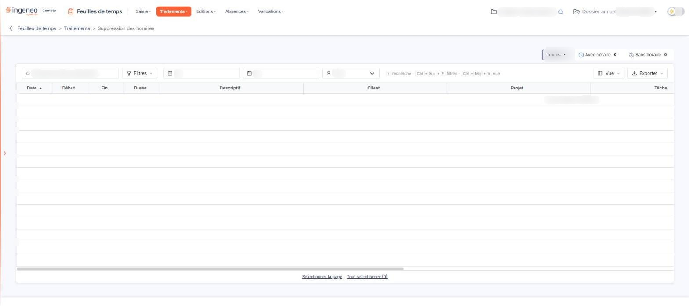

# Suppression des horaires


**Où le trouver :** Menu **Traitements › Suppression des horaires**



**En bref** — Cet écran permet de retirer en une fois les heures de début et de fin de lignes de temps saisies par créneaux. Les lignes sont conservées avec leur durée.

* Pour cibler des lignes : choisissez l'onglet « Avec horaire », « Sans horaire » ou « Toutes », puis les zones Du, Au et Intervenant.
* Pour supprimer les horaires : sélectionnez les lignes, bouton \[Supprimer les horaires], puis « Confirmer ».


Cette option vous permet de retirer, de manière groupée, les heures de début et de fin de lignes de temps saisies par créneaux horaires. Les lignes elles-mêmes sont conservées, avec leur durée : elles ne portent simplement plus d'horaire.

<figure><figcaption>
Écran « Suppression des horaires » de la nouvelle interface
</figcaption></figure>

## Les types de lignes à afficher

Au-dessus de la grille, trois onglets, suivis chacun du nombre de lignes concernées, commandent le contenu de la grille : « Avec horaire », qui retient les lignes dont l'heure de début ou l'heure de fin est renseignée, « Sans horaire », qui retient celles qui ne portent ni l'une ni l'autre, et « Toutes », qui est le choix retenu à l'ouverture. Un seul de ces onglets est actif à la fois. Il n'y a plus de bouton \[Filtrer] à cliquer ensuite : la grille se met à jour dès que vous changez d'onglet. Les colonnes affichées, elles, sont les mêmes dans les trois cas.

## Les filtres

Aucun filtre n'est obligatoire ; ils sont tous vides ou positionnés sur « Tous » à l'ouverture. Les zones Du, Au et Intervenant se trouvent dans la barre située au-dessus de la grille, avec le champ « Rechercher dans le descriptif… » et les boutons \[Filtres], \[Vue] et \[Exporter].

| Champ           | Ce qu'il faut savoir                                                                                                                                                                          |
| --------------- | --------------------------------------------------------------------------------------------------------------------------------------------------------------------------------------------- |
| **Du**          | **Au :** bornent la période sur la date des lignes de temps. Vous pouvez saisir les dates directement ou utiliser le pictogramme « Calendrier » placé à gauche, à l'intérieur de chaque zone. |
| **Intervenant** | Cette liste ne propose que les personnes ayant déjà au moins une ligne de temps enregistrée, précédées du choix « Tous ». Elle se réduit donc à « Tous » tant qu'aucun temps n'a été saisi.   |

Cet écran ne propose pas, dans sa barre, de liste « Projet » ni « Tâche ». Le champ « Rechercher dans le descriptif… » permet de retrouver une ligne par son descriptif, et le bouton \[Filtres] permet d'ajouter un critère sur une colonne de la grille.

bouton **\[Filtres]**

Il ouvre un volet dans lequel vous ajoutez un critère sur une colonne de la grille, puis cliquez sur \[Filtrer] pour l'appliquer ; le Bouton \[Vider les filtres] retire ces critères. Les zones Du, Au et Intervenant et les trois onglets n'ont pas besoin de ce volet.

Dès qu'un critère est posé, un lien « Tout effacer » apparaît à côté de \[Filtres].

**Lien « Tout effacer »**

Ce lien n'apparaît qu'à partir du moment où un critère est posé, et remplace l'ancien bouton \[Annuler les filtres]. Il vide les deux dates, remet la liste « Intervenant » sur « Tous » et le type de lignes sur « Toutes », met la grille à jour, puis disparaît de nouveau.

## La grille

La grille est identique à celle de l'option « Reclassements » : les colonnes « Date », « Début », « Fin », « Durée », « Descriptif », « Client », « Projet », « Tâche », « Code intervenant », « Nom intervenant », « Date de validation » et « Nom du valideur », les quatre dernières s'atteignant par le défilement horizontal. Chaque colonne se trie par un clic sur son en-tête. Il n'y a plus de case à cocher : un clic sur une ligne la sélectionne, et sous la grille les liens « Sélectionner la page » et « Tout sélectionner », suivi du nombre de lignes, étendent la sélection à la page ou à l'ensemble des pages. Le choix des colonnes affichées se fait par le bouton \[Vue]. Pour le détail de la sélection ligne à ligne, page par page ou sur l'ensemble des pages, reportez-vous au chapitre « Fonctionnement d'une grille » des généralités.

Lorsque aucune ligne de temps ne répond aux filtres, la grille affiche « Aucun élément à afficher. ».

bouton **\[Supprimer les horaires]**

C'est le seul bouton d'action de cet écran. Il n'est plus en bas de page : il est proposé dans le bandeau de sélection, qui n'apparaît que lorsqu'une ligne est sélectionnée. Sélectionnez d'abord dans la grille les lignes à traiter, puis cliquez sur ce bouton : le logiciel ouvre une fenêtre « Confirmation » qui vous demande « Souhaitez-vous supprimer les créneaux horaires des lignes sélectionnées pour ne conserver que les durées ? » et vous propose deux boutons, « Confirmer » et « Annuler ». Si vous confirmez, il retire l'heure de début et l'heure de fin des lignes retenues et ne conserve que leur durée. Cette opération est définitive. Après confirmation, le logiciel affiche « La suppression a bien été prise en compte. » et recharge la grille.

Ce bouton n'est plus proposé lorsque l'onglet « Sans horaire » est actif : les lignes affichées ne portent alors aucun horaire à retirer. Il réapparaît dès que vous activez « Avec horaire » ou « Toutes ».
