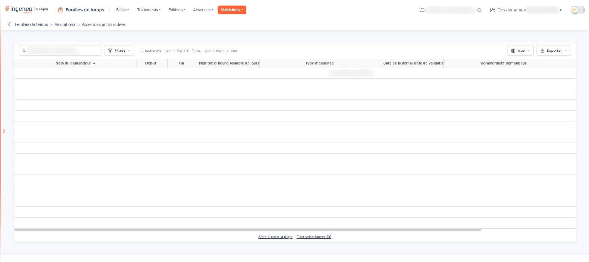

# Absences autovalidées


**Où le trouver :** Menu **Validations › Absences autovalidées**



**En bref** — Cet écran présente les demandes d'absence validées dès leur enregistrement, parce que le collaborateur n'a pas à les faire valider. Il en donne la vue d'ensemble.

* Pour retrouver une demande : champ « Rechercher un demandeur… », ou bouton \[Filtres].
* Pour supprimer des demandes : sélectionnez-les dans la grille, puis bouton \[Supprimer].


Cette option vous présente les demandes d'absence qui n'ont pas eu à être validées par un tiers : celles des collaborateurs dont la fiche répond « Non » à la question « Cet utilisateur doit-il faire valider ses demandes d'absence ? », dans l'écran « Utilisateurs » du panneau Paramètres (rubrique « Feuilles de temps »). Ces demandes sont validées dès leur enregistrement, elles n'apparaissent donc pas dans l'option « Validation des absences ». C'est ici que vous en gardez la vue d'ensemble.

<figure><figcaption>
Écran « Absences autovalidées » de la nouvelle interface
</figcaption></figure>

## La grille

Aucun filtre n'est posé à l'ouverture. Sous le fil d'Ariane, la barre de la grille porte la zone « Rechercher un demandeur… » et les boutons \[Filtres], \[Vue] et \[Exporter].

Elle présente une ligne par demande, avec les mêmes colonnes que l'option « Validation des absences » : « Nom du demandeur », « Début », « Fin », « Nombre d'heures », « Nombre de jours », « Type d'absence », « Date de la demande », « Date de validation », « Commentaire demandeur » et « Commentaire valideur ». Les dernières s'atteignent en faisant défiler la grille horizontalement. Chaque colonne se trie par un clic sur son en-tête.

Le bouton \[Vue] vous permet de choisir les colonnes affichées. Sous la grille, les liens « Sélectionner la page » et « Tout sélectionner », suivi du nombre de lignes, servent à la sélection. Pour le détail de la sélection ligne à ligne, page par page ou sur l'ensemble des pages, reportez-vous au chapitre « Fonctionnement d'une grille » des généralités.

Chaque ligne porte deux commandes, modifier et supprimer, l'une et l'autre soumises à vos droits. La commande de modification n'ouvre pas la demande d'absence : elle vous porte sur la fiche du collaborateur qui l'a déposée, dans l'écran « Utilisateurs » du panneau Paramètres (rubrique « Feuilles de temps ») — c'est là que se règle le fait qu'il doive ou non faire valider ses demandes. Une demande autovalidée se consulte, elle ne se modifie pas depuis cet écran ; en revanche, elle peut y être supprimée.

Lorsque aucune demande n'est autovalidée, la grille affiche « Aucun élément à afficher. ».

bouton **\[Supprimer]**

C'est le seul bouton de l'écran : une demande autovalidée n'a pas à être validée, il n'y a donc ici ni validation ni dévalidation.

Il supprime les demandes que vous avez sélectionnées dans la grille. Il se trouve dans le bandeau de sélection, qui n'apparaît que lorsqu'une ligne est sélectionnée.
