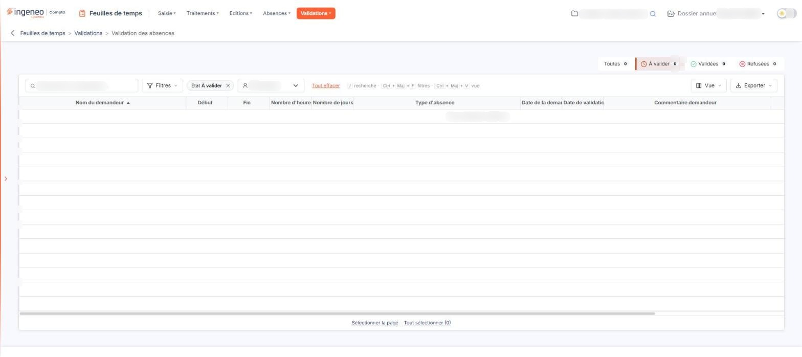

# Validation des absences


**Où le trouver :** Menu **Validations › Validation des absences**



**En bref** — Cet écran permet, en tant que valideur, de traiter les demandes d'absence des collaborateurs dont vous avez la charge.

* Pour traiter des demandes : onglet « À valider », sélectionnez les demandes, bouton \[Validations groupées], ajoutez au besoin un commentaire, puis validez.
* Pour supprimer des demandes : sélectionnez-les dans la grille, puis bouton \[Supprimer].


Cette option vous permet, en tant que valideur, de traiter les demandes d'absence des collaborateurs dont vous avez la charge. L'écran se compose d'une barre de filtres, de la grille des demandes et, dans le bandeau de sélection qui apparaît quand vous sélectionnez des demandes, de deux boutons.

<figure><figcaption>
Écran « Validation des absences » de la nouvelle interface
</figcaption></figure>

La grille ne présente que les demandes des personnes dont vous êtes valideur d'absences. Vos propres demandes n'y figurent pas : vous les retrouvez dans l'option « Saisie » du menu « Absences ». Les valideurs se désignent nominativement sur la fiche de chaque collaborateur, dans l'écran « Utilisateurs » du panneau Paramètres (rubrique « Feuilles de temps »), rubrique « Validation des absences » : ce n'est pas un droit de profil.

## Les filtres

Il n'y a pas de bouton pour appliquer les filtres.

| Champ                   | Ce qu'il faut savoir                                                                                                                                                                                                                                                                                                            |
| ----------------------- | ------------------------------------------------------------------------------------------------------------------------------------------------------------------------------------------------------------------------------------------------------------------------------------------------------------------------------- |
| **Onglets à compteurs** | Au-dessus de la grille, quatre onglets, « Toutes », « À valider », « Validées » et « Refusées », chacun suivi du nombre de demandes. « À valider » est retenu à l'ouverture : il limite la grille aux demandes que vous n'avez pas encore traitées. L'onglet « Toutes » les présente toutes, y compris celles qui le sont déjà. |
| **Recherche**           | Un champ « Rechercher un demandeur… » permet de chercher un demandeur dans la grille.                                                                                                                                                                                                                                           |
| **Demandeur**           | Le choix « Tous » et les collaborateurs dont vous êtes valideur d'absences. Cette liste se réduit à « Tous » lorsque vous n'êtes valideur de personne.                                                                                                                                                                          |

**Lien « Tout effacer »**

Placé à côté du bouton \[Filtres], ce lien apparaît dès qu'un critère est posé ; il remplace l'ancien bouton « Annuler les filtres ».

## La grille

La grille présente une ligne par demande d'absence, avec les colonnes « Nom du demandeur », « Début », « Fin », « Nombre d'heures », « Nombre de jours », « Type d'absence », « Date de la demande », « Date de validation », « Commentaire demandeur » et « Commentaire valideur ». Les dernières s'atteignent en faisant défiler la grille horizontalement. Chaque colonne se trie par un clic sur son en-tête.

Dans la barre, les boutons \[Filtres], \[Vue] (colonnes affichées) et \[Exporter] (aperçu, impression, export Excel ou PDF, envoi de la liste par e-mail) permettent de filtrer et de présenter la liste. Il n'y a pas de case à cocher : un clic sur une ligne la sélectionne, et « Sélectionner la page » et « Tout sélectionner » sous la grille étendent la sélection à la page ou à toutes les pages. Pour le détail de la sélection ligne à ligne, page par page ou sur l'ensemble des pages, reportez-vous au chapitre « Fonctionnement d'une grille » des généralités.

Lorsque aucune demande ne répond aux filtres, la grille affiche « Aucun élément à afficher. ».

bouton **\[Validations groupées]**

Sélectionnez d'abord dans la grille les demandes à valider : le bouton se trouve dans le bandeau de sélection, qui n'apparaît que lorsque des demandes sont sélectionnées. Cliquez ensuite sur ce bouton : le logiciel ouvre une fenêtre dans laquelle vous pouvez ajouter un commentaire commun qui sera repris dans chacune des absences, puis valider les demandes sélectionnées. Le demandeur est prévenu par courriel de la validation ou du refus de sa demande ; si vous avez saisi un commentaire, il y est repris. Le logiciel vous indique si les courriels ont bien été envoyés.

bouton **\[Supprimer]**

Il se trouve, lui aussi, dans le bandeau de sélection. Il supprime les demandes d'absence que vous avez sélectionnées dans la grille, qu'elles soient validées ou non.
