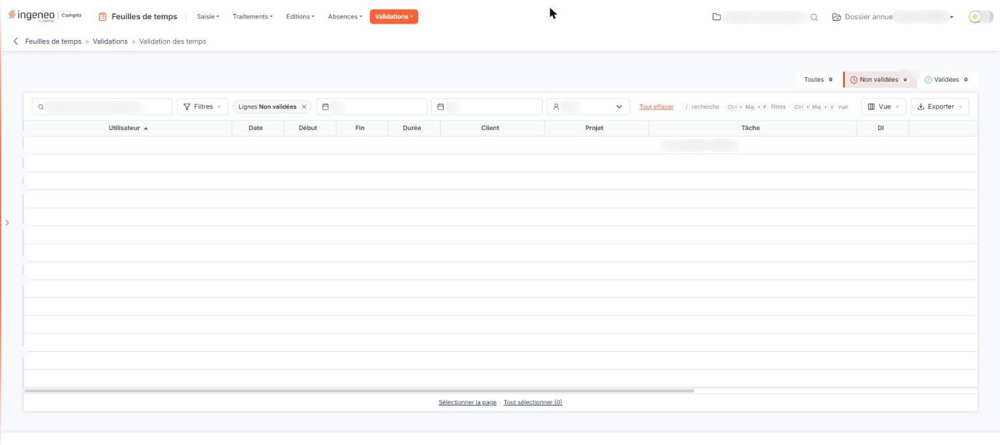

# Validation des temps


**Où le trouver :** Menu **Validations › Validation des temps**



**En bref** — Cet écran permet, en tant que valideur, de valider les lignes de temps des collaborateurs dont vous avez la charge, et d'annuler une validation déjà faite.

* Pour valider des temps : onglet « Non validées », sélectionnez les lignes, bouton \[Validation], puis confirmez.
* Pour annuler une validation : onglet « Validées », sélectionnez les lignes, puis bouton \[Dévalidation].


Cette option vous permet, en tant que valideur, de valider les lignes de temps saisies par les collaborateurs dont vous avez la charge, et d'annuler une validation déjà faite. L'écran se compose d'une barre de filtres, de la grille des lignes de temps et, dans le bandeau de sélection qui apparaît quand vous sélectionnez des lignes, des boutons de validation.

<figure><figcaption>
Écran « Validation des temps » de la nouvelle interface
</figcaption></figure>

La grille ne présente que les lignes de temps des personnes dont vous êtes valideur de feuilles de temps. Si vous n'êtes valideur de personne, aucune ligne ne s'affiche, quels que soient les filtres que vous appliquez. Les valideurs se désignent nominativement sur la fiche de chaque collaborateur, dans l'écran « Utilisateurs » du panneau Paramètres (rubrique « Feuilles de temps »), rubrique « Validation des feuilles de temps » : ce n'est pas un droit de profil.

## Les filtres

Aucun filtre n'est obligatoire.

| Champ                   | Ce qu'il faut savoir                                                                                                                                                                                            |
| ----------------------- | --------------------------------------------------------------------------------------------------------------------------------------------------------------------------------------------------------------- |
| **Onglets à compteurs** | Au-dessus de la grille, trois onglets, « Toutes », « Non validées » et « Validées », chacun suivi du nombre de lignes. « Non validées » est retenu à l'ouverture.                                               |
| **Recherche**           | Un champ « Rechercher dans le descriptif… » permet de chercher dans le descriptif des lignes de temps.                                                                                                          |
| **Du**                  | **Au :** bornent la période sur la date des lignes de temps. Les deux zones sont vides à l'ouverture. Saisissez les dates directement ou utilisez le calendrier proposé à gauche, à l'intérieur de chaque zone. |
| **Utilisateur**         | Le choix « Tous » et les collaborateurs dont vous êtes valideur de feuilles de temps. Cette liste se réduit à « Tous » lorsque vous n'êtes valideur de personne.                                                |

**Mise à jour de la grille**

Au-dessus de la grille, il n'y a plus de bouton \[Filtrer] : les onglets à compteurs, le champ de recherche, les zones Du et Au et la liste Utilisateur sont les critères de la grille.

**Lien « Tout effacer »**

Placé à côté du bouton \[Filtres], ce lien apparaît dès qu'un critère est posé ; il remplace l'ancien bouton « Annuler les filtres ».

## La grille

La grille présente une ligne par ligne de temps, avec les colonnes « Utilisateur », « Date », « Début », « Fin », « Durée », « Client », « Projet », « Tâche », « DI », « Descriptif », « Date de validation » et « Nom du valideur ». Les dernières s'atteignent en faisant défiler la grille horizontalement. Chaque colonne se trie par un clic sur son en-tête. À l'ouverture, la grille est classée sur « Utilisateur », par ordre croissant.

Les colonnes « Date de validation » et « Nom du valideur » sont présentes quel que soit le type de ligne affiché ; elles restent vides sur une ligne qui n'est pas encore validée.

Dans la barre, les boutons \[Filtres], \[Vue] (colonnes affichées) et \[Exporter] (aperçu, impression, export Excel ou PDF, envoi de la liste par e-mail) permettent de filtrer et de présenter la liste. Il n'y a pas de case à cocher : un clic sur une ligne la sélectionne, et « Sélectionner la page » et « Tout sélectionner » sous la grille étendent la sélection à la page ou à toutes les pages. Pour le détail de la sélection ligne à ligne, page par page ou sur l'ensemble des pages, reportez-vous au chapitre « Fonctionnement d'une grille » des généralités.

Lorsque aucune ligne de temps ne répond aux filtres, la grille affiche « Aucun élément à afficher. ».

bouton **\[Validation]**

Sélectionnez d'abord dans la grille les lignes de temps à valider : le bouton se trouve dans le bandeau de sélection, qui n'apparaît que lorsque des lignes sont sélectionnées. Cliquez ensuite sur ce bouton. Le logiciel ne valide pas directement : il vous demande d'abord de confirmer, en vous rappelant le nombre de lignes concernées. Le traitement n'a lieu qu'après cette confirmation ; il vous indique ensuite le nombre de lignes de temps validées. La dévalidation fonctionne de la même manière, avec ses propres libellés.

bouton **\[Dévalidation]**

Il se trouve, lui aussi, dans le bandeau de sélection, et vous permet d'annuler la validation des lignes que vous avez sélectionnées.

Les boutons \[Validation] et \[Dévalidation] s'ajustent au type de ligne retenu, et non au contenu de la grille : choisissez l'onglet voulu. Avec « Non validées », seul \[Validation] est proposé ; avec « Validées », seul \[Dévalidation] ; avec « Toutes », les deux boutons le sont. Chacun dépend en outre du droit correspondant : sans le droit de dévalider des temps, \[Dévalidation] ne s'affiche jamais.
