# Barre d'en-tête


**Où le trouver :** Pages communes à tous les modules : rubrique **Généralités** de l'aide



**En bref** — Cette barre, en haut des écrans des modules, donne accès aux fonctions toujours utiles : retour au tableau de bord, choix de la société et choix de l'exercice de travail.

* Pour revenir au tableau de bord : cliquez sur le logo « ingeneo Compta by SEPTEO ».
* Pour changer de société : loupe à côté du champ de la société, saisissez le « Contenu recherché », puis sélectionnez le résultat.
* Pour changer d'exercice : flèche du sélecteur « Dossier annuel », puis choix de l'exercice dans la liste.


La barre d'en-tête se trouve en haut des écrans des modules. Elle donne accès à des fonctions qui doivent rester atteignables depuis n'importe quel module : retour au tableau de bord, choix de la société et de l'exercice de travail.

<figure>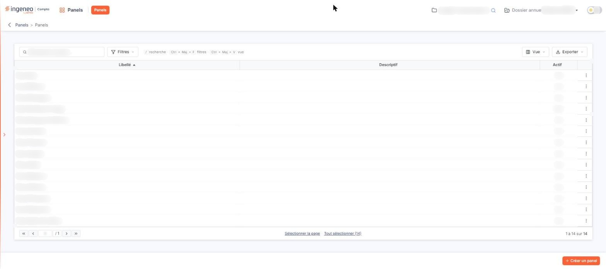<figcaption>
Écran « Barre d'en-tête » de la nouvelle interface
</figcaption></figure>

Le tableau de bord n'a pas de barre d'en-tête horizontale : sa partie haute porte les onglets de la zone centrale, et le logo, la société et le dossier annuel figurent dans la barre latérale (voir la page « Page d'accueil »).

Sur un écran de module, la barre comporte, de gauche à droite :

**Logo**

Le logo « ingeneo Compta by SEPTEO » est un lien vers le tableau de bord (infobulle « Tableau de bord »). Quel que soit l'écran sur lequel vous êtes, il vous y ramène.

**Module courant et menus du module**

Le pictogramme et le nom du module dans lequel vous êtes ; un clic ramène à l'accueil de ce module. À droite du nom, les menus du module sont des pastilles orange, une par menu (par exemple, pour le module « Panels », la pastille « Panels »). Un clic sur une pastille ouvre l'écran correspondant. Ces pastilles remplacent la barre de menus séparée.

**Société**

À droite de la barre, un pictogramme de dossier et un champ affichent la société sur laquelle vous travaillez. Une loupe, à côté du champ, a pour infobulle le raccourci « Ctrl + Alt + R » ; elle ouvre la fenêtre « Recherche » :

* le champ « Contenu recherché » filtre la liste ; son pictogramme (i) rappelle les raccourcis : Ctrl+Entrée lance la recherche, Ctrl+→ et Ctrl+← passent à la page suivante et à la page précédente, ↓ et ↑ passent au résultat suivant et au résultat précédent, Entrée sélectionne le résultat ;
* la grille comporte les colonnes **Code client**, **Raison sociale** et **Accès par mot de passe** (« Oui » ou « Non »), avec une pagination en pied ;
* la croix, en haut de la fenêtre, la ferme sans rien sélectionner.

**Dossier annuel**

Le sélecteur « Dossier annuel » indique l'exercice de travail, par exemple « Exercice 2025 ». Au survol de sa valeur, le logiciel affiche les dates de début et de fin de l'exercice. Cliquez sur la flèche pour ouvrir la liste des exercices : l'exercice courant est signalé par la mention « (courant) » et affiché en gras ; l'infobulle d'un exercice clôturé le précise (« Exercice clôturé »).

**Interrupteur clair / sombre**

À l'extrémité droite, un interrupteur (infobulle « Passer au mode sombre ») change l'apparence du logiciel.

Sous la barre, le fil d'Ariane est décrit dans la page « Composition d'une page ».

## La barre latérale ouverte sur un écran de module

<figure>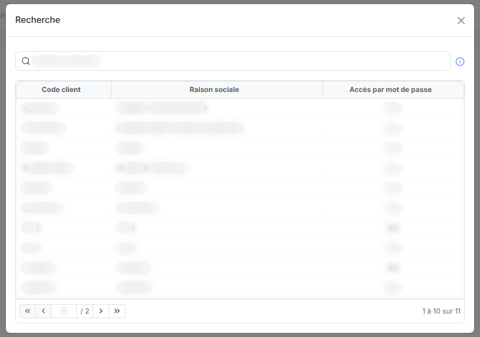<figcaption>
Rubrique « Société »
</figcaption></figure>

<figure>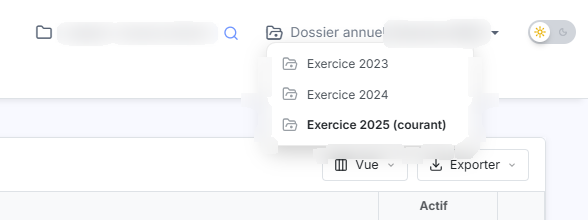<figcaption>
Rubrique « Dossier annuel »
</figcaption></figure>

<figure>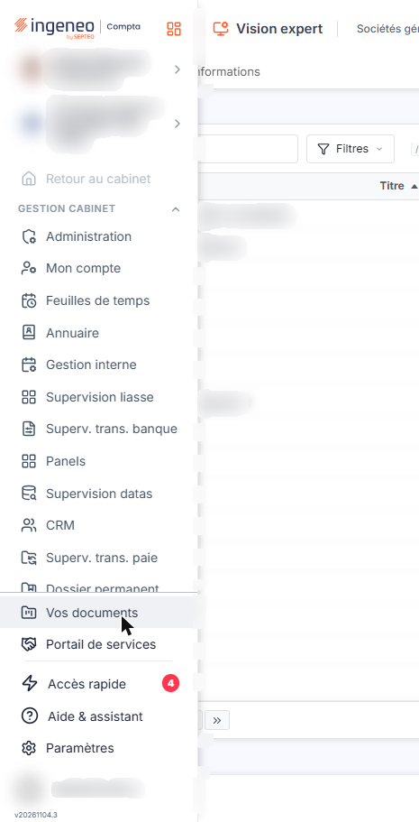<figcaption>
Rubrique « La barre latérale ouverte sur un écran de module »
</figcaption></figure>

<figure>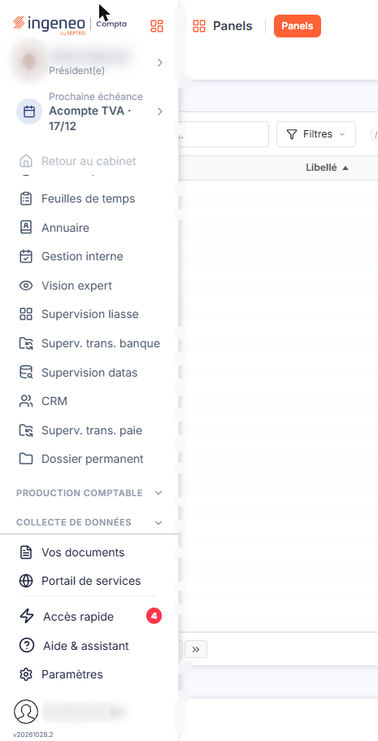<figcaption>
Rubrique « La barre latérale ouverte sur un écran de module »
</figcaption></figure>

<figure>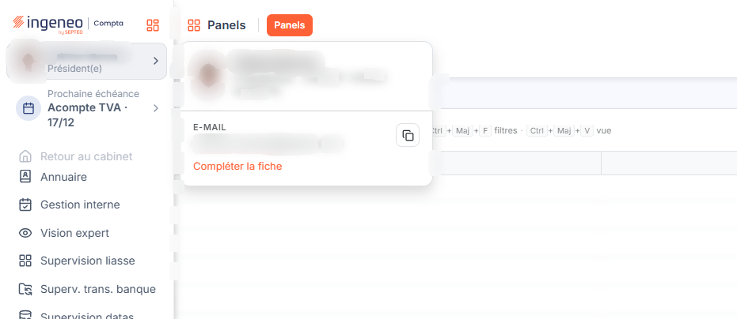<figcaption>
Rubrique « La barre latérale ouverte sur un écran de module »
</figcaption></figure>

<figure>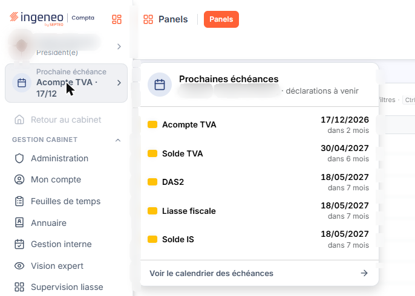<figcaption>
Rubrique « La barre latérale ouverte sur un écran de module »
</figcaption></figure>

<figure>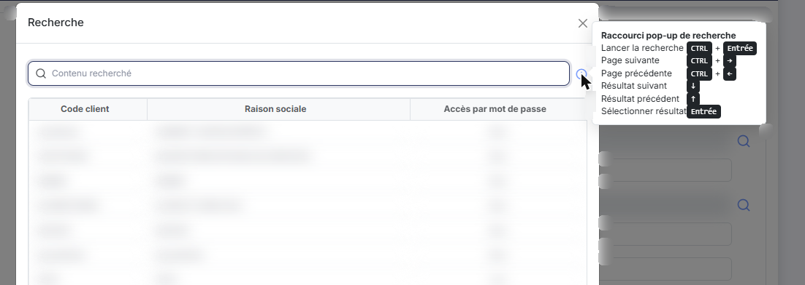<figcaption>
Rubrique « Société »
</figcaption></figure>

<figure>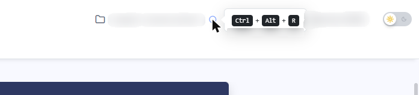<figcaption>
Rubrique « Société »
</figcaption></figure>

<figure>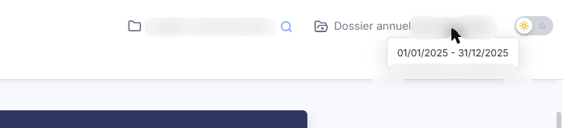<figcaption>
Rubrique « Dossier annuel »
</figcaption></figure>

Sur un écran de module, la barre latérale de navigation est masquée : une bande rouge, à gauche, porte une flèche (infobulle « Afficher le menu »). Un clic sur cette flèche ouvre la barre par-dessus le contenu. De haut en bas, on y trouve :

* le logo, avec à sa droite un pictogramme en forme de grille (infobulle « Tableau de bord ») qui ramène au tableau de bord ;
* la ligne du contact du dossier : avatar, nom, rôle et chevron. Un clic ouvre un panneau avec le nom, le rôle et la raison sociale, la rubrique « E-MAIL » (un bouton, infobulle « Copier », copie l'adresse) et le lien « Compléter la fiche » ;
* « Prochaine échéance » : la prochaine déclaration du dossier avec sa date, par exemple « Acompte TVA · 17/12 ». Un clic ouvre le panneau « Prochaines échéances », qui liste les déclarations à venir et propose le lien « Voir le calendrier des échéances → » ;
* « Retour au cabinet » : lien vers la société du cabinet. Sur la société du cabinet elle-même, il est grisé et inactif ;
* les groupes « GESTION CABINET », « PRODUCTION COMPTABLE » et « COLLECTE DE DONNÉES », identiques à ceux du tableau de bord, à ceci près que le module dans lequel vous êtes n'y figure pas ;
* le bloc du bas (« Vos documents », « Portail de services », « Accès rapide », « Aide & assistant », « Paramètres », votre nom et la version) décrit dans la page « Page d'accueil ».

Les sélecteurs « Dossier » et « Dossier annuel » ne figurent pas dans cette barre : ils sont dans la barre d'en-tête.

## Autres vues de l'écran

<figure>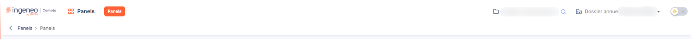<figcaption>
Logo
</figcaption></figure>

<figure>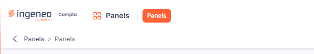<figcaption>
Module courant et menus du module
</figcaption></figure>

<figure>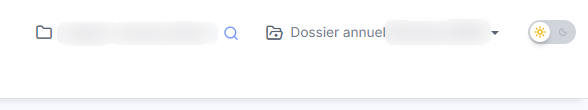<figcaption>
Interrupteur clair / sombre
</figcaption></figure>

<figure>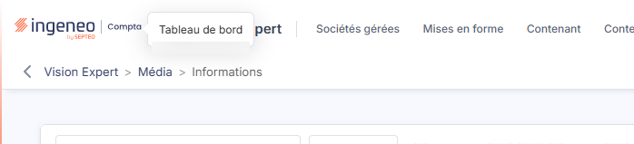<figcaption>
Logo
</figcaption></figure>

<figure>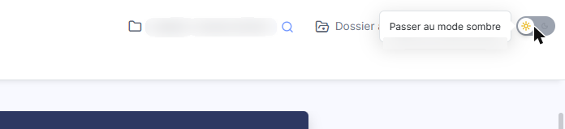<figcaption>
Interrupteur clair / sombre
</figcaption></figure>
