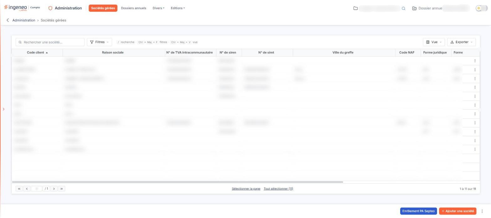
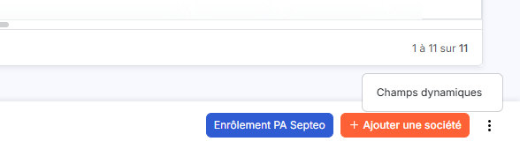
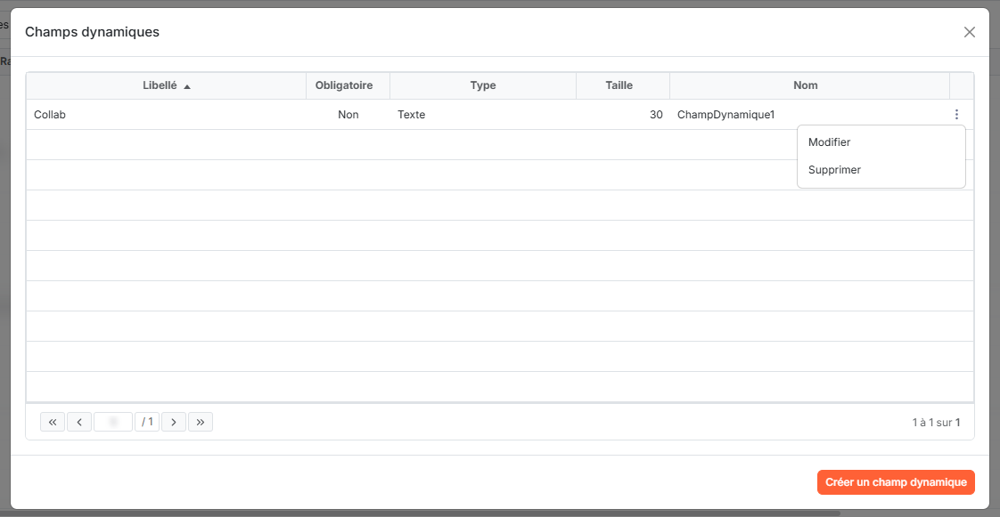
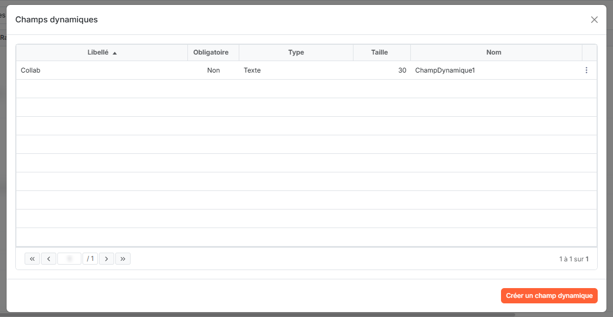
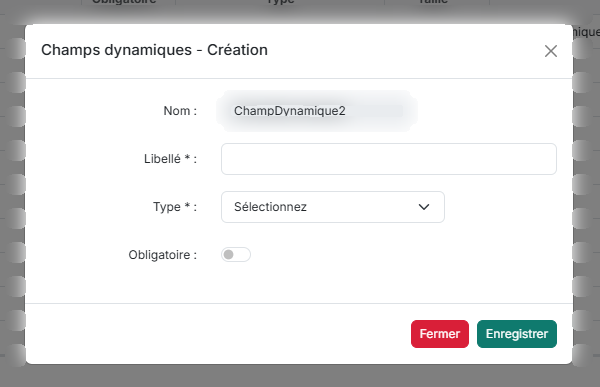
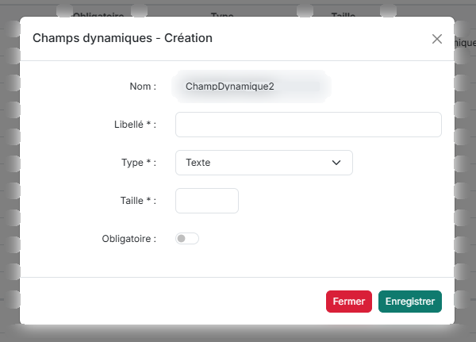
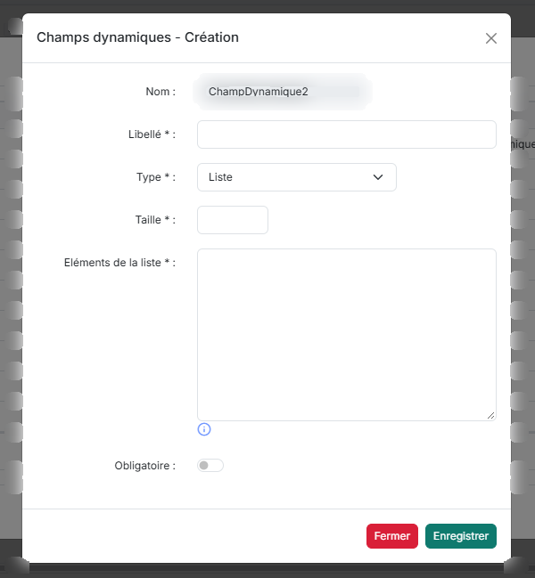
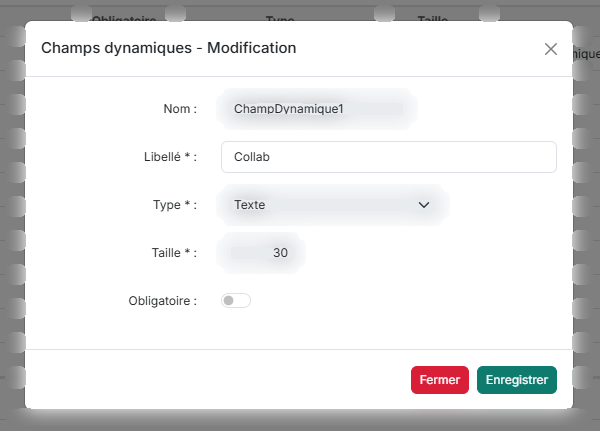
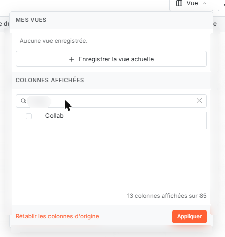
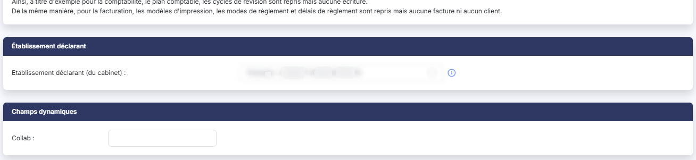

# Champs dynamiques


**Où le trouver :** Pages communes à tous les modules : rubrique **Généralités** de l'aide



**En bref** — Cet écran permet d'ajouter vos propres champs, jusqu'à 10 par fichier ; la page en décrit la création sur l'écran « Sociétés gérées » du module « Administration ».

* Pour ouvrir le réglage : petit bouton \[⋮] en bas à droite de la liste des sociétés gérées, puis « Champs dynamiques ».
* Pour créer un champ : bouton \[Créer un champ dynamique], renseignez « Libellé » et « Type », puis bouton \[Enregistrer].
* Pour afficher le champ dans la liste : bouton \[Vue], cochez-le sous « Colonnes affichées », puis bouton \[Appliquer].


Les champs dynamiques permettent de personnaliser un écran en lui ajoutant vos propres champs, jusqu'à 10 par fichier. Ils n'existent que sur certains écrans. Cette page décrit ceux de l'écran « Sociétés gérées » du module « Administration », qui est celui où l'on peut les créer et les voir.

<figure><figcaption>
Écran « Champs dynamiques » de la nouvelle interface
</figcaption></figure>

## Où se règlent les champs

<figure><figcaption>
Rubrique « Où se règlent les champs »
</figcaption></figure>

Sur la liste des sociétés gérées, en bas à droite de la page, un petit bouton « ⋮ » (« Autres actions ») se trouve à droite du bouton « Ajouter une société ». Il ouvre un menu qui propose « Champs dynamiques ». Cette entrée n'apparaît que si votre droit de gestion des champs vous est accordé.

## La fenêtre « Champs dynamiques »

<figure><figcaption>
Rubrique « La fenêtre « Champs dynamiques » »
</figcaption></figure>

<figure><figcaption>
Rubrique « La fenêtre « Champs dynamiques » »
</figcaption></figure>

<figure><figcaption>
Bouton [Créer un champ dynamique]
</figcaption></figure>

Elle présente la liste des champs déjà définis, avec les colonnes « Libellé », « Obligatoire », « Type », « Taille » et « Nom », puis le menu « ⋮ » de la ligne, qui propose « Modifier » et « Supprimer ». Par exemple, un champ de libellé « Collab » apparaît avec le type « Texte » et la taille « 30 ». Le pied de la fenêtre indique la pagination et le nombre de champs (« 1 à 1 sur 1 »).

bouton **\[Créer un champ dynamique]**

Il ouvre la fenêtre « Champs dynamiques - Création ». Quand vous avez déjà défini 10 champs pour le fichier, le logiciel refuse d'en créer un onzième.

## La fenêtre « Champs dynamiques - Création »

<figure><figcaption>
Rubrique « La fenêtre « Champs dynamiques - Création » »
</figcaption></figure>

<figure><figcaption>
Rubrique « La fenêtre « Champs dynamiques - Création » »
</figcaption></figure>

<figure><figcaption>
Rubrique « La fenêtre « Champs dynamiques - Création » »
</figcaption></figure>

<figure><figcaption>
Bouton [Enregistrer]
</figcaption></figure>

<figure><figcaption>
Bouton [Fermer]
</figcaption></figure>

| Champ                                                   | Ce qu'il faut savoir                                                                                                                                                                                                                                                                                                                                                                                                                  |
| ------------------------------------------------------- | ------------------------------------------------------------------------------------------------------------------------------------------------------------------------------------------------------------------------------------------------------------------------------------------------------------------------------------------------------------------------------------------------------------------------------------- |
| **Nom**                                                 | Proposé par le logiciel (par exemple « ChampDynamique2 »), il n'est pas modifiable.                                                                                                                                                                                                                                                                                                                                                   |
| 
<strong>Libellé</strong> <em>Obligatoire</em>
 | L'intitulé du champ, tel qu'il sera affiché (50 caractères au plus).                                                                                                                                                                                                                                                                                                                                                                  |
| 
<strong>Type</strong> <em>Obligatoire</em>
    | 
La nature des données. La liste propose « Sélectionnez », puis « Texte », « Date », « Booléen », « Numérique », « Numérique (entier) », « Numérique (monétaire) », « Numérique (quantité) » et « Liste ». Selon le type choisi, la fenêtre ajoute des champs : • « Texte » ajoute « Taille * » ; • « Liste » ajoute « Taille * » et « Eléments de la liste * » ; • les autres types n'ajoutent ni taille ni éléments.
 |
| **Obligatoire**                                         | Un interrupteur, désactivé au départ.                                                                                                                                                                                                                                                                                                                                                                                                 |

bouton **\[Enregistrer]**

Il enregistre le champ.

bouton **\[Fermer]**

Le bouton rouge ferme la fenêtre sans créer le champ ; la croix du haut la ferme aussi.

## Modifier un champ

<figure><figcaption>
Rubrique « Modifier un champ »
</figcaption></figure>

Le menu « ⋮ » de la ligne propose « Modifier ». Des valeurs ayant pu être saisies dans les fiches, le type d'un champ existant n'est plus modifiable, et sa taille ne l'est plus non plus, sauf pour le type « Liste ».

## Où les champs apparaissent

<figure><figcaption>
Rubrique « Dans la liste »
</figcaption></figure>

<figure><figcaption>
Rubrique « Dans la fiche »
</figcaption></figure>

**Dans la fiche**

Une rubrique « Champs dynamiques » est ajoutée à la fiche de création d'une société ; c'est sa dernière rubrique, après « Établissement déclarant ». Chaque champ y occupe une zone de saisie précédée de son libellé et de deux-points (« Collab : »), avec la taille maximale prévue pour un champ de type « Texte ».

**Dans la liste**

Chaque champ dynamique est proposé comme colonne dans le volet du bouton \[Vue], sous « Colonnes affichées » ; la colonne n'est pas cochée au départ. Cochez-la, puis cliquez sur le bouton \[Appliquer], pour l'afficher (voir la page « Fonctionnement d'une grille »).
