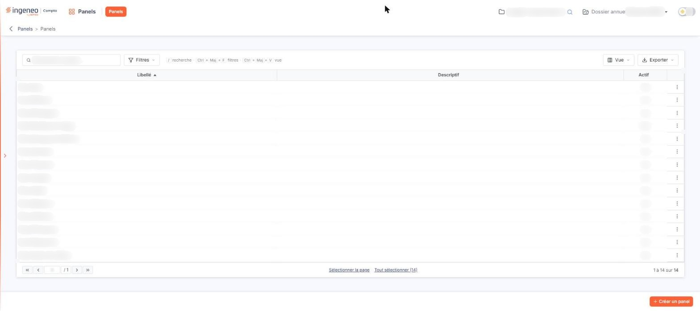
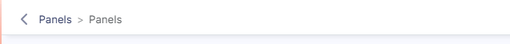
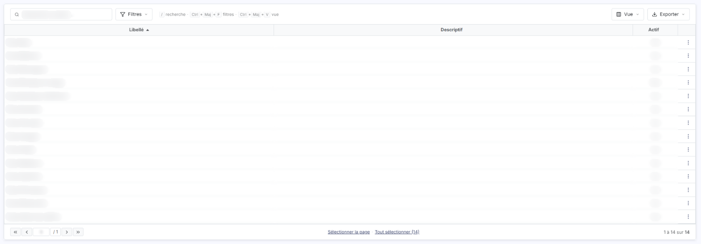
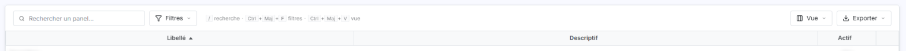
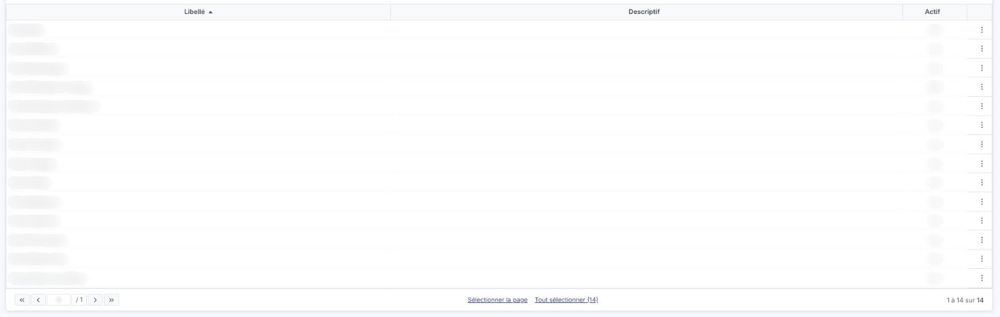
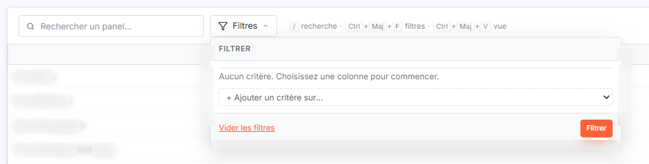
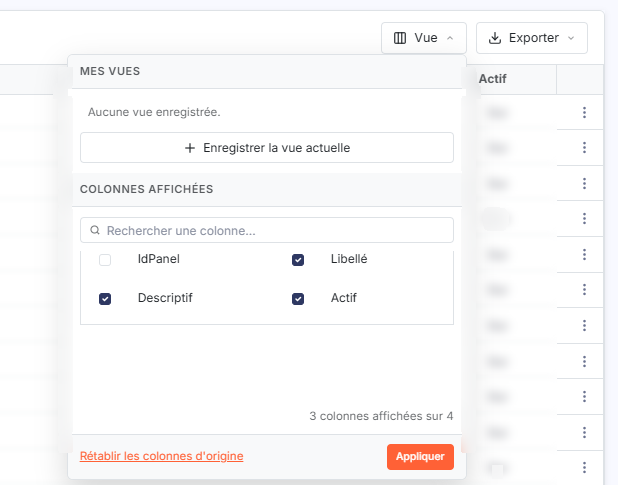
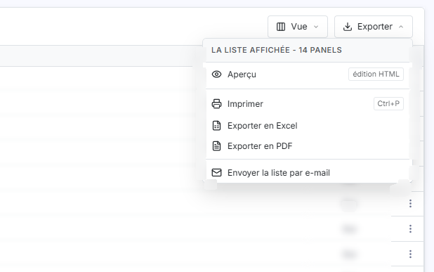
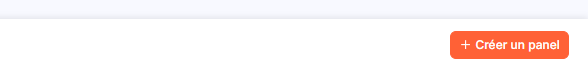
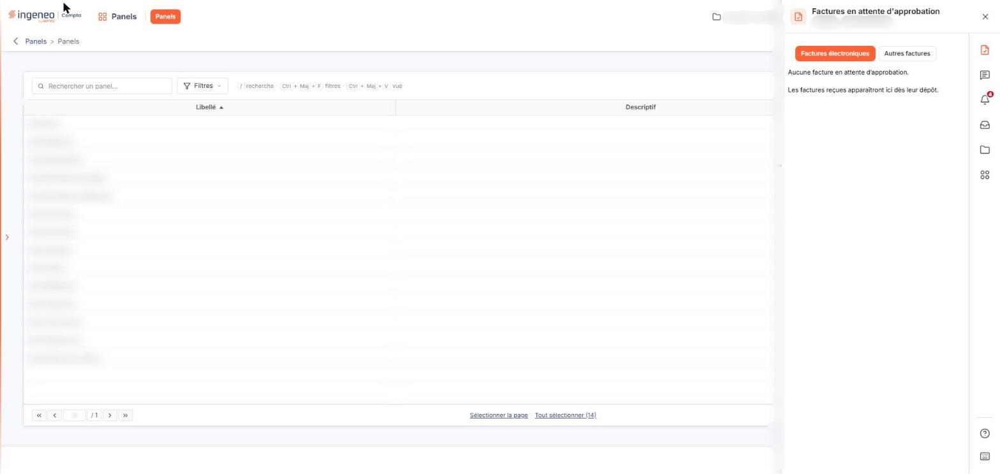

# Composition d'une page


**Où le trouver :** Pages communes à tous les modules : rubrique **Généralités** de l'aide



**En bref** — Cette page de présentation décrit les parties que l'on retrouve, de haut en bas, sur tout écran de module : barre d'en-tête, menus, fil d'Ariane, espace de travail et bouton de création.

* Pour ouvrir un autre écran du module : pastille orange du menu, à droite du nom du module dans la barre d'en-tête.
* Pour créer un élément : bouton orange en bas à droite de l'écran-liste (par exemple \[+ Créer un panel]).


Quand vous ouvrez un module, vous arrivez sur un écran de module. Il est composé de parties que l'on retrouve toujours dans le même ordre, de haut en bas. L'exemple ci-dessous est celui d'un écran-liste.

<figure><figcaption>
Écran « Composition d'une page » de la nouvelle interface
</figcaption></figure>

## La barre d'en-tête

<figure><figcaption>
Rubrique « La barre d'en-tête »
</figcaption></figure>

Elle porte le logo, le module courant, les menus du module, la société, le dossier annuel et l'interrupteur clair / sombre. Elle est décrite dans la page « Barre d'en-tête ».

## Les menus du module

<figure><figcaption>
Rubrique « Les menus du module »
</figcaption></figure>

Il n'y a pas de barre de menus séparée : les menus du module sont des pastilles orange, à droite du nom du module dans la barre d'en-tête. Un module qui n'a qu'un menu n'affiche qu'une pastille.

## Le fil d'Ariane

<figure><figcaption>
Rubrique « Le fil d'Ariane »
</figcaption></figure>

Sous la barre, une flèche « Revenir en arrière » précède le fil d'Ariane, qui indique le module, puis l'écran dans lequel vous êtes (par exemple « Panels > Panels »).

## L'espace de travail

<figure><figcaption>
Rubrique « L'espace de travail »
</figcaption></figure>

<figure><figcaption>
Rubrique « Barre d'outils de la grille »
</figcaption></figure>

<figure><figcaption>
Rubrique « La grille »
</figcaption></figure>

<figure><figcaption>
Rubrique « Barre d'outils de la grille »
</figcaption></figure>

<figure><figcaption>
Rubrique « Barre d'outils de la grille »
</figcaption></figure>

<figure><figcaption>
Rubrique « Barre d'outils de la grille »
</figcaption></figure>

Il occupe la plus grande partie de l'écran, dans une carte. Sur un écran-liste, la carte comporte la barre d'outils de la grille, puis la grille.

**Barre d'outils de la grille**

À gauche, un champ de recherche (par exemple « Rechercher un panel… »), le bouton \[Filtres] et un rappel des raccourcis (« / recherche · Ctrl+Maj+F filtres · Ctrl+Maj+V vue »). À droite, les boutons \[Vue] et \[Exporter].

| Champ        | Ce qu'il faut savoir                                                                                                                                                                                                                                                                                                                                                                    |
| ------------ | --------------------------------------------------------------------------------------------------------------------------------------------------------------------------------------------------------------------------------------------------------------------------------------------------------------------------------------------------------------------------------------- |
| **Filtres**  | Le menu « FILTRER » indique « Aucun critère. Choisissez une colonne pour commencer. » ; la liste « + Ajouter un critère sur… » propose les colonnes, le lien « Vider les filtres » retire les critères et le bouton \[Filtrer] applique ceux que vous avez posés.                                                                                                                       |
| **Vue**      | « MES VUES » liste vos vues enregistrées et propose « + Enregistrer la vue actuelle » ; « COLONNES AFFICHÉES » propose un champ « Rechercher une colonne… » et permet de cocher les colonnes à afficher, avec un compteur du type « 3 colonnes affichées sur 4 ». Le lien « Rétablir les colonnes d'origine » revient à l'affichage initial, et le bouton \[Appliquer] valide le choix. |
| **Exporter** | Le menu concerne la liste affichée et propose « Aperçu », « Imprimer » (Ctrl+P), « Exporter en Excel », « Exporter en PDF » et « Envoyer la liste par e-mail ».                                                                                                                                                                                                                         |

**La grille**

Les colonnes sont celles de l'écran ; un clic sur l'en-tête d'une colonne la trie. La dernière colonne, sans en-tête, porte le menu « ⋮ » de la ligne, qui propose les commandes de la ligne (par exemple « Modifier » et « Supprimer »). En pied de grille figurent la pagination, les liens « Sélectionner la page » et « Tout sélectionner » (avec le nombre de lignes) et le compteur « 1 à N sur N ».

## La barre de boutons du bas

<figure><figcaption>
Rubrique « La barre de boutons du bas »
</figcaption></figure>

En bas de l'écran, un bouton orange, à droite, permet de créer un élément (par exemple « + Créer un panel »). Son libellé est propre à chaque écran ; il ouvre la fiche de création.

## Les panneaux latéraux

<figure><figcaption>
Rubrique « Les panneaux latéraux »
</figcaption></figure>

La barre latérale de navigation (masquée, elle s'ouvre par la flèche du bord gauche), la fenêtre « Recherche » de la société et les panneaux de droite (« Accès rapide », « Aide & assistant ») s'affichent par-dessus l'écran. Ils sont décrits dans les pages « Page d'accueil » et « Barre d'en-tête ».
