# Fonctionnement d'un formulaire


**Où le trouver :** Pages communes à tous les modules : rubrique **Généralités** de l'aide



**En bref** — Cette page décrit ce que les fiches ont en commun : rubriques, champs obligatoires, listes, interrupteurs Oui/Non, boutons de choix exclusif et barre de boutons du bas.

* Pour valider une fiche : bouton \[Enregistrer] ; les modifications ne sont prises en compte que par ce bouton.
* Pour repérer les champs à remplir : cherchez l'astérisque après le libellé (« Libellé \* : »).
* Pour revenir à la liste : flèche « Revenir en arrière », à gauche du fil d'Ariane.


Un formulaire, ou fiche, est l'écran dans lequel vous créez ou modifiez un élément : un panel, un ticket, une société, etc. On l'ouvre depuis une liste, par le bouton de création ou par la commande de modification d'une ligne. Les rubriques et les champs sont propres à chaque fiche ; cette page décrit ce qu'elles ont en commun.

<figure>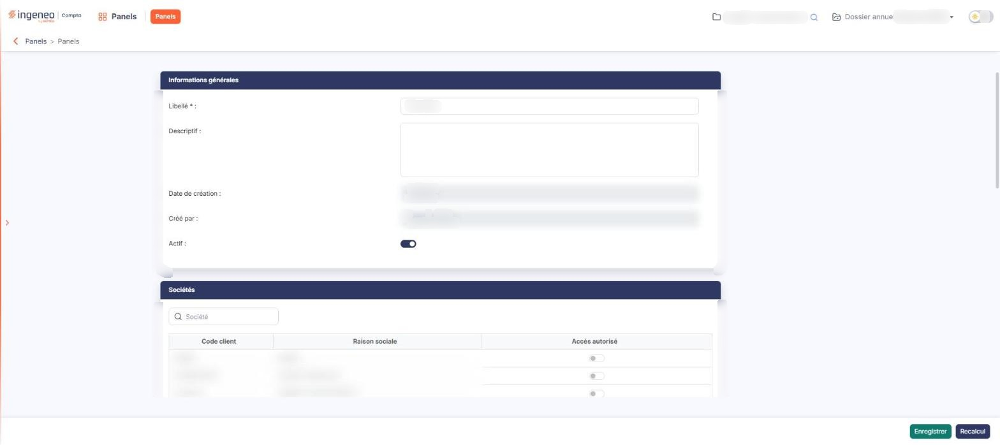<figcaption>
Écran « Fonctionnement d'un formulaire » de la nouvelle interface
</figcaption></figure>

## La présentation de la fiche

<figure>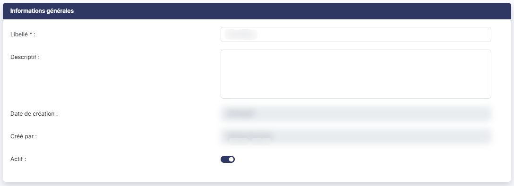<figcaption>
Rubrique « La présentation de la fiche »
</figcaption></figure>

<figure>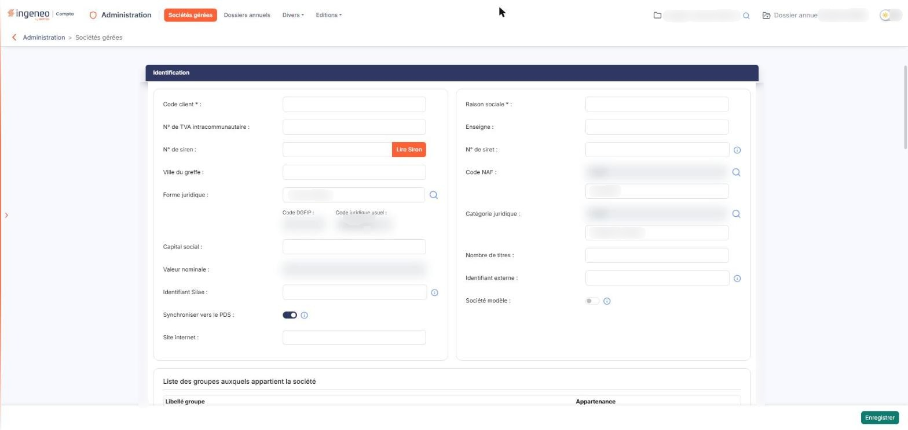<figcaption>
Rubrique « La présentation de la fiche »
</figcaption></figure>

Sous l'en-tête, le fil d'Ariane indique où vous êtes (par exemple « Panels > Panels ») ; à sa gauche, la flèche « Revenir en arrière » vous ramène à la liste. La fiche s'affiche en une colonne centrée, en rubriques empilées. Chaque rubrique est une carte dont le bandeau bleu foncé porte le titre en blanc (« Informations générales », « Sociétés », « Données »…). Les rubriques ne se replient pas. Une fiche très riche, comme celle d'une société, peut comporter de nombreuses rubriques, certaines sur deux colonnes ; leurs champs sont décrits dans les pages du module concerné.

## Les champs

<figure>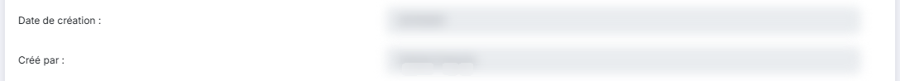<figcaption>
Rubrique « Champs non modifiables »
</figcaption></figure>

<figure>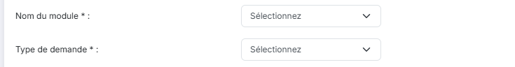<figcaption>
Rubrique « Listes »
</figcaption></figure>

<figure><figcaption>
Boutons de choix exclusif
</figcaption></figure>

<figure>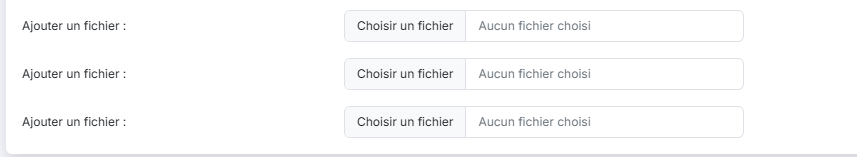<figcaption>
Rubrique « Ajout de fichiers »
</figcaption></figure>

<figure>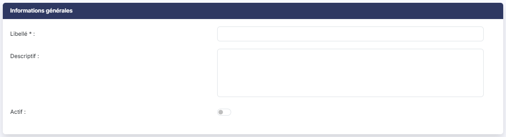<figcaption>
Rubrique « Texte et zone de texte »
</figcaption></figure>

<figure>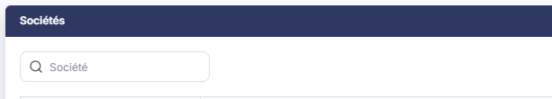<figcaption>
Rubrique « Champs de recherche »
</figcaption></figure>

<figure>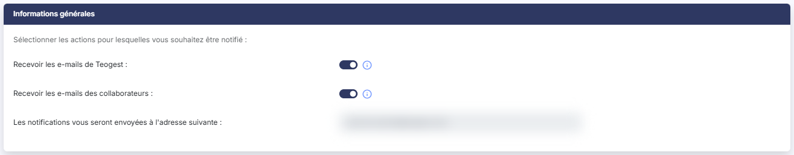<figcaption>
Rubrique « Interrupteurs Oui/Non »
</figcaption></figure>

<figure>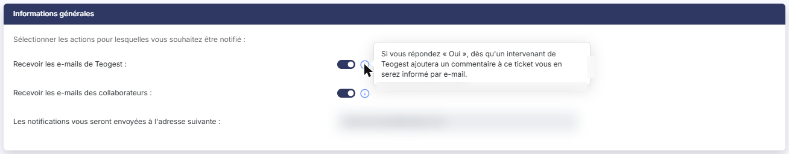<figcaption>
Rubrique « Infobulles »
</figcaption></figure>

Le libellé se trouve à gauche, suivi de deux-points, et le champ à droite (« Libellé \* : »). Une astérisque dans le libellé signale un champ obligatoire.

**Texte et zone de texte**

Certains champs limitent la saisie : le champ « Libellé » d'un panel ne se remplit pas au-delà de 30 caractères, et la zone de texte « Descriptif » est limitée à 1 024 caractères. La limite de chaque champ est propre à l'écran.

**Champs non modifiables**

Un champ à fond gris est en lecture seule : il affiche une information (par exemple « Date de création » et « Créé par » sur la fiche d'un panel existant) que vous ne pouvez pas changer.

**Listes**

Une liste propose un choix parmi des valeurs prédéfinies. Son premier choix, « Sélectionnez », signifie qu'aucune valeur n'est encore retenue (par exemple « Nom du module » et « Type de demande » sur un ticket).

**Interrupteurs Oui/Non**

Une bascule remplace la saisie de « Oui » ou « Non » : bleu foncé, elle est activée (Oui) ; grise, elle est désactivée (Non). Par exemple, sur la création d'un panel, l'interrupteur « Actif » est désactivé au départ ; sur la fiche de notifications, « Recevoir les e-mails de Teogest » et « Recevoir les e-mails des collaborateurs » sont deux interrupteurs.

**Boutons de choix exclusif**

Quand les choix sont peu nombreux, ils sont présentés comme des boutons dont un seul est retenu. Par exemple, la priorité d'un ticket se choisit entre « Basse », « Normale » (retenue par défaut) et « Haute ».

**Champs de recherche**

Un champ accompagné d'une loupe sert à retrouver un élément d'une autre liste ; par exemple le champ « Société » de la fiche d'un panel.

**Infobulles**

Un pictogramme (i) bleu à droite d'un champ affiche, au survol de la souris, une explication sur ce champ.

**Ajout de fichiers**

Sur la création d'un ticket, les lignes « Ajouter un fichier » proposent « Choisir un fichier » ; la mention « Aucun fichier choisi » indique qu'aucun fichier n'est encore joint.

## Les mini-grilles

<figure>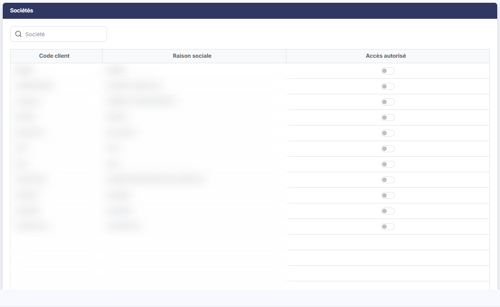<figcaption>
Rubrique « Les mini-grilles »
</figcaption></figure>

<figure>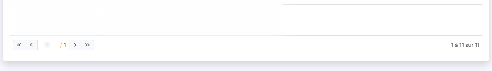<figcaption>
Rubrique « Les mini-grilles »
</figcaption></figure>

Une rubrique peut contenir une petite grille qui présente des éléments liés à la fiche. Par exemple, la rubrique « Sociétés » d'un panel comporte un champ de recherche « Société » (avec une loupe) au-dessus d'une grille aux colonnes « Code client », « Raison sociale » et « Accès autorisé » ; cette dernière colonne porte un interrupteur par ligne. Le pied de la mini-grille indique la page et le nombre d'éléments (« 1 à 11 sur 11 »).

## Création et modification

<figure>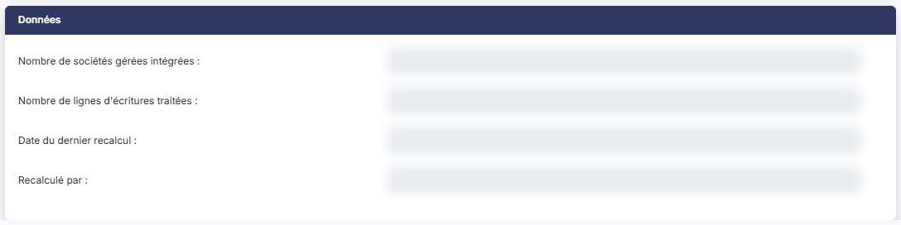<figcaption>
Rubrique « Création et modification »
</figcaption></figure>

Une même fiche peut ne pas présenter les mêmes rubriques en création et en modification. Par exemple, à la création d'un panel, le curseur se place d'emblée dans « Libellé », et les rubriques et champs qui décrivent un élément déjà enregistré (« Date de création », « Créé par », la rubrique « Données ») n'existent pas encore.

## La barre de boutons du bas

<figure>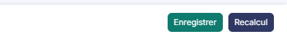<figcaption>
Bouton [Enregistrer]
</figcaption></figure>

<figure>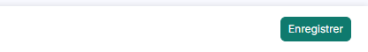<figcaption>
Rubrique « La barre de boutons du bas »
</figcaption></figure>

Une barre fixe, en bas de l'écran, aligne ses boutons à droite.

bouton **\[Enregistrer]**

Le bouton vert \[Enregistrer] valide la fiche : les modifications saisies dans un formulaire ne sont prises en compte que par ce bouton.

**Autres boutons**

Certaines fiches ajoutent un bouton à droite d'\[Enregistrer] ; par exemple, la fiche d'un panel existant porte le bouton \[Recalcul] (bleu foncé). Pour revenir à la liste, utilisez la flèche « Revenir en arrière » à gauche du fil d'Ariane.

## Les fenêtres secondaires

<figure>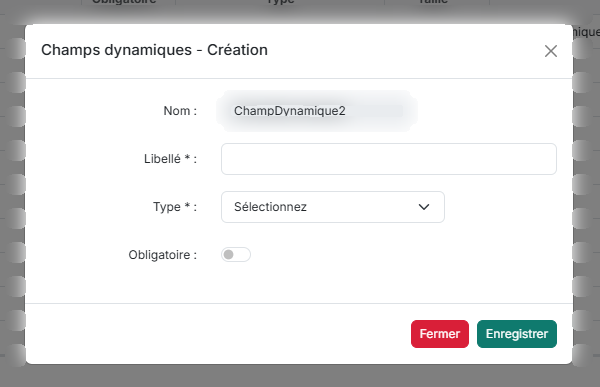<figcaption>
Rubrique « Les fenêtres secondaires »
</figcaption></figure>

Une fiche ou une liste peut ouvrir une fenêtre secondaire, par exemple « Champs dynamiques - Création » (voir la page « Champs dynamiques »). Elle porte une croix de fermeture en haut, et en bas le bouton \[Fermer] (rouge) et le bouton \[Enregistrer] (vert).
