# Fonctionnement d'une grille


**Où le trouver :** Pages communes à tous les modules : rubrique **Généralités** de l'aide



**En bref** — Cette page explique comment utiliser une grille, c'est-à-dire la liste des éléments d'un écran : recherche, filtres, choix des colonnes, tri, sélection des lignes et export.

* Pour filtrer la liste : bouton \[Filtres], choisissez une colonne dans « + Ajouter un critère sur… », réglez l'opérateur et la valeur, puis bouton \[Filtrer].
* Pour afficher d'autres colonnes : bouton \[Vue], cochez les colonnes voulues, puis bouton \[Appliquer].
* Pour sortir la liste : bouton \[Exporter], puis « Exporter en Excel » ou « Exporter en PDF ».


Une grille présente sous forme de tableau la liste des éléments d'un écran : sociétés, contacts, tickets, panels, etc. Elle se compose, de haut en bas, d'une barre d'outils, du tableau lui-même et d'un pied de grille. Le bouton de création se trouve en bas de la page. Les colonnes, les filtres proposés et les commandes de ligne varient d'un écran à l'autre ; les exemples ci-dessous sont ceux de l'écran « Panels ».

<figure>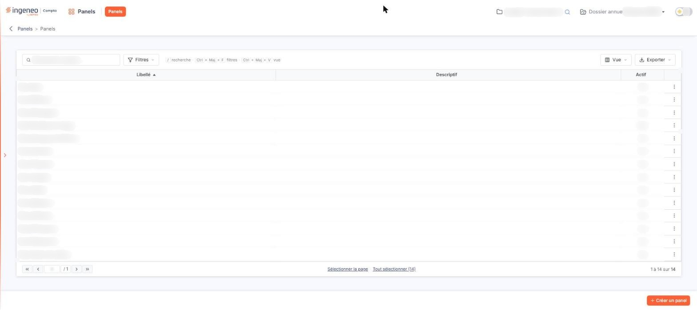<figcaption>
Écran « Fonctionnement d'une grille » de la nouvelle interface
</figcaption></figure>

## La barre d'outils

<figure>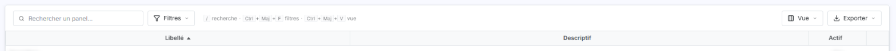<figcaption>
Rubrique « La barre d'outils »
</figcaption></figure>

<figure>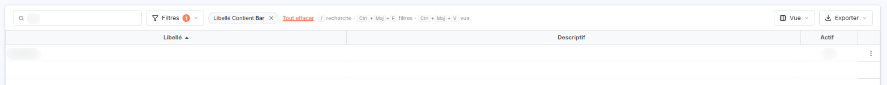<figcaption>
Rubrique « Champ de recherche »
</figcaption></figure>

<figure>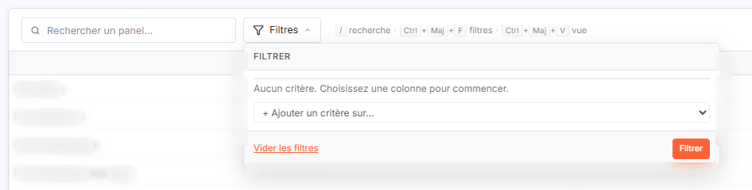<figcaption>
Bouton [Filtres]
</figcaption></figure>

<figure>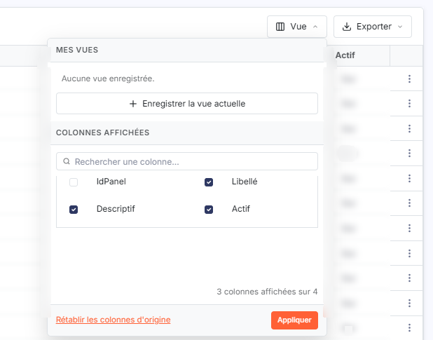<figcaption>
Bouton [Vue]
</figcaption></figure>

<figure>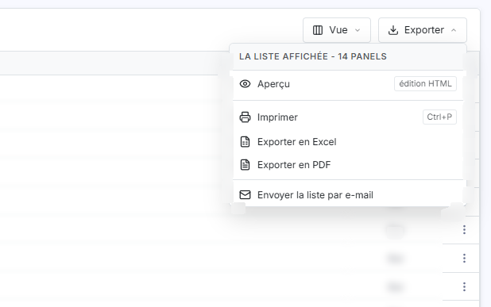<figcaption>
Bouton [Exporter]
</figcaption></figure>

<figure>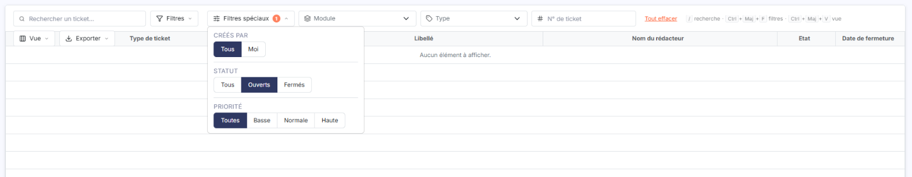<figcaption>
Rubrique « Filtres propres à un écran »
</figcaption></figure>

<figure>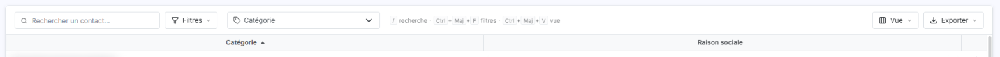<figcaption>
Rubrique « Filtres propres à un écran »
</figcaption></figure>

De gauche à droite : le champ de recherche, le bouton \[Filtres], un rappel des raccourcis clavier (« / recherche · Ctrl + Maj + F filtres · Ctrl + Maj + V vue ») puis, à droite, les boutons \[Vue] et \[Exporter]. Certains écrans n'affichent pas tous ces éléments, ni le rappel des raccourcis, et d'autres en ajoutent (voir plus bas).

**Champ de recherche**

Saisissez quelques lettres : la liste se met à jour seule après une courte pause, sans bouton à actionner. Le texte saisi devient un critère affiché sous la forme d'une puce, par exemple « Libellé Contient … » ; la croix de la puce l'enlève, et le lien « Tout effacer » retire l'ensemble des critères. Le texte grisé du champ nomme l'objet recherché (« Rechercher un panel… », « Rechercher un ticket… »).

bouton **\[Filtres]**

Il ouvre le volet « FILTRER ». Tant qu'aucun critère n'existe, le volet indique « Aucun critère. Choisissez une colonne pour commencer. ». La liste « + Ajouter un critère sur… » propose les colonnes de la grille ; après le choix d'une colonne, une ligne de critère apparaît : la colonne, un opérateur, une valeur et une croix pour supprimer le critère. Une colonne peut recevoir une seconde condition (la liste propose alors, par exemple, « Libellé (2e condition) »).

Les opérateurs dépendent de la nature de la colonne. Pour une colonne de texte, vous trouvez par exemple « Égal », « Contient », « Commence par », « Termine par » ou « Est vide » ; pour une colonne Oui/Non, « Oui » et « Non ». Avec « Égal », la valeur se choisit dans la liste des valeurs présentes dans la colonne.

Le lien « Vider les filtres » retire tous les critères, et le bouton \[Filtrer] applique ceux que vous avez posés. Quand des critères sont actifs, un badge numéroté s'affiche sur le bouton \[Filtres].

**Filtres propres à un écran**

Certains écrans ajoutent à la barre d'outils des filtres qui leur sont propres. Par exemple, sur « Tickets », un bouton \[Filtres spéciaux] propose les choix « Créés par » (Tous / Moi), « Statut » (Tous / Ouverts / Fermés) et « Priorité » ; le statut « Ouverts » est actif à l'arrivée, ce qui explique que la liste puisse s'afficher vide (le badge du bouton indique 1). Sur « Tickets », la barre ajoute aussi deux listes « Module » et « Type », un champ « N° de ticket » et le lien « Tout effacer ». Sur « Annuaire », une liste « Catégorie » se trouve à côté du bouton \[Filtres]. Sur « CRM > Actions », des dates, une liste d'utilisateurs et trois compteurs (« Toutes », « En cours », « Terminées ») figurent au-dessus de la liste.

bouton **\[Vue]**

Il ouvre un volet en deux parties.

| Champ                  | Ce qu'il faut savoir                                                                                                                                                                                                                                                                                                                                                                                                                                                                                                    |
| ---------------------- | ----------------------------------------------------------------------------------------------------------------------------------------------------------------------------------------------------------------------------------------------------------------------------------------------------------------------------------------------------------------------------------------------------------------------------------------------------------------------------------------------------------------------- |
| **Mes vues**           | Le volet affiche « Aucune vue enregistrée. » tant que vous n'en avez pas, et propose « + Enregistrer la vue actuelle ».                                                                                                                                                                                                                                                                                                                                                                                                 |
| **Colonnes affichées** | Un champ « Rechercher une colonne… » et des cases à cocher, une par colonne de la grille, y compris des colonnes qui ne sont pas affichées d'origine. Quand la liste est longue, elle est paginée (« 1/3 »). Cocher ou décocher une case ne change rien dans la grille tant que vous n'avez pas cliqué sur le bouton \[Appliquer]. En pied du volet, un compteur indique le nombre de colonnes affichées (« 3 colonnes affichées sur 4 ») et le lien « Rétablir les colonnes d'origine » revient à l'affichage initial. |

bouton **\[Exporter]**

Le volet porte pour titre « LA LISTE AFFICHÉE » suivi du nombre d'éléments, qui suit les filtres appliqués (« 14 PANELS »). Il propose « Aperçu » (édition HTML), « Imprimer » (Ctrl+P), « Exporter en Excel », « Exporter en PDF » et « Envoyer la liste par e-mail ».

## Le tableau

<figure>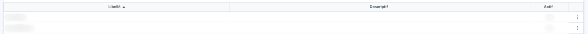<figcaption>
Rubrique « Les colonnes et le tri »
</figcaption></figure>

<figure>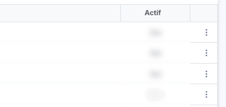<figcaption>
Rubrique « La colonne de commandes »
</figcaption></figure>

<figure>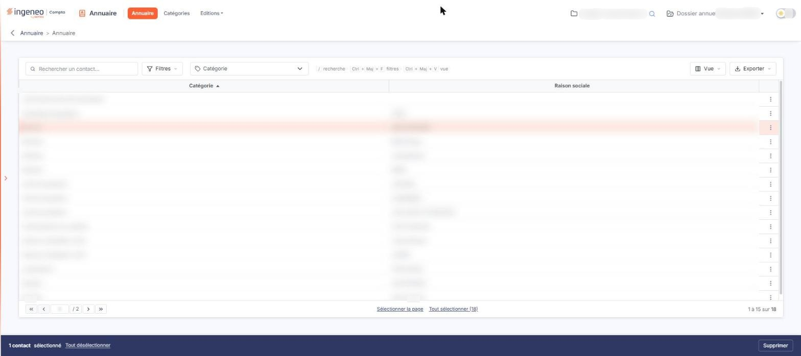<figcaption>
Rubrique « Sélectionner une ligne »
</figcaption></figure>

<figure>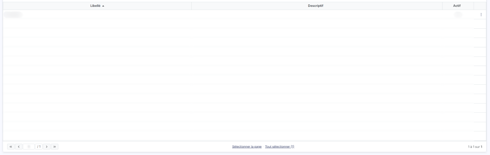<figcaption>
Rubrique « Lignes vides et liste vide »
</figcaption></figure>

<figure>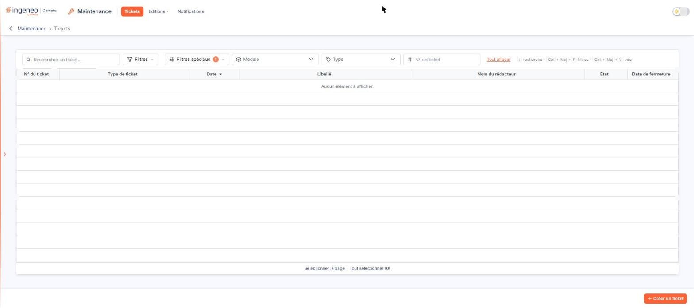<figcaption>
Rubrique « Lignes vides et liste vide »
</figcaption></figure>

**Les colonnes et le tri**

Un petit triangle, à côté du libellé d'une colonne, indique le tri en cours : « ▲ » ou « ▼ » selon le sens. Cliquez sur l'en-tête d'une autre colonne pour trier la liste sur cette colonne ; le triangle se déplace sur elle. Si les colonnes affichées dépassent la largeur de l'écran, une barre de défilement horizontale apparaît sous la grille.

**La colonne de commandes**

À l'extrémité droite de chaque ligne, une colonne sans titre porte les commandes de la ligne : au minimum le menu « ⋮ ». Certains écrans y ajoutent des pictogrammes directs ; par exemple « Missions en cours » affiche « Accéder au détail des tâches » (œil) et « Editer le grand livre » (document) avant le « ⋮ ».

**Sélectionner une ligne**

La grille n'affiche pas de case à cocher : cliquez sur une ligne pour la sélectionner (elle est surlignée en rose, avec un liseré orange à gauche). Un clic avec la touche Maj sélectionne toutes les lignes comprises entre la dernière ligne cliquée et la nouvelle ; un clic avec la touche Ctrl ajoute une ligne à la sélection.

**Double-clic**

Un double-clic sur une ligne déclenche la commande « Modifier » de cette ligne, quand elle est disponible, et ouvre donc la fiche ; certains écrans désignent une autre commande. Il n'a pas d'effet lorsque vous double-cliquez sur un lien, un bouton ou une commande de la ligne.

**Lignes vides et liste vide**

Des lignes grises vides complètent la hauteur de la grille sous les données. Quand aucun élément ne correspond, la première ligne affiche « Aucun élément à afficher. ».

## La barre de sélection

<figure>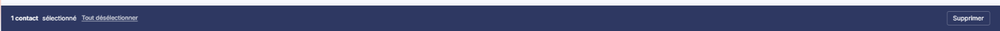<figcaption>
Rubrique « La barre de sélection »
</figcaption></figure>

Dès qu'une ligne est sélectionnée, une barre sombre s'affiche en bas de l'écran et remplace le bouton de création. Elle indique le nombre d'éléments sélectionnés (« 1 panel sélectionné », « 4 panels sélectionnés ») ; quand toute la liste est sélectionnée, elle ajoute « toutes les pages ». Elle propose le lien « Tout désélectionner » et, sur certains écrans comme « Panels », le bouton \[Supprimer] qui agit sur les lignes sélectionnées. Les boutons de cette barre varient d'un écran à l'autre.

## Le pied de grille

<figure>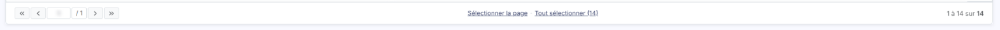<figcaption>
Rubrique « Le pied de grille »
</figcaption></figure>

<figure>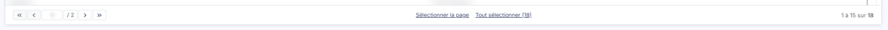<figcaption>
Rubrique « À gauche : la pagination »
</figcaption></figure>

<figure><figcaption>
Rubrique « Au centre : les liens de sélection »
</figcaption></figure>

**À gauche : la pagination**

Les flèches de page entourent le numéro de la page courante et le nombre de pages (« 1 / 2 »). La pagination n'apparaît pas quand la liste est vide.

**Au centre : les liens de sélection**

« Sélectionner la page » sélectionne les lignes de la page affichée ; « Tout sélectionner (14) » sélectionne toutes les lignes de la liste filtrée, le nombre entre parenthèses étant leur total. Quand les lignes de la page sont sélectionnées, le premier lien devient « Désélectionner la page » ; quand toute la liste l'est, le second devient « Tout désélectionner (14) ».

**À droite : le compteur**

« 1 à 14 sur 14 » indique les lignes affichées et le total de la liste, par exemple « 1 à 14 sur 18 » quand la liste compte deux pages. Le compteur n'apparaît pas quand la liste est vide.

## Le bouton de création

<figure>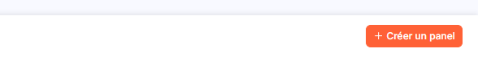<figcaption>
Rubrique « Le bouton de création »
</figcaption></figure>

En bas à droite de la page, un bouton orange crée un nouvel élément ; son libellé est propre à chaque écran (« + Créer un panel », « + Créer un ticket », « + Créer un contact », « + Ajouter une société »…). Il est remplacé par la barre de sélection tant qu'une ligne est sélectionnée. Certains écrans ajoutent d'autres boutons à côté, ainsi qu'un petit bouton « ⋮ » (« Autres actions »), comme « Sociétés gérées » (voir la page « Champs dynamiques »).
