# La synthèse du portefeuille


**Où le trouver :** Pages communes à tous les modules : rubrique **Généralités** de l'aide



**En bref** — Cet écran, réservé aux abonnés experts-comptables, présente pour l'ensemble de vos dossiers ce qui demande une action, l'avancement des déclarations et les dossiers à traiter en priorité.

* Pour choisir le périmètre des chiffres : bouton \[MON PORTEFEUILLE] ou bouton \[TOUT LE CABINET], puis bouton \[Rafraîchir] pour relancer le calcul.
* Pour voir le détail d'une alerte : cliquez sur l'un des cinq blocs (par exemple « RETARDS DÉCLARATIFS ») ; un tiroir liste les dossiers concernés.
* Pour consulter un dossier prioritaire : cliquez sur le dossier (code et raison sociale) dans « Dossiers prioritaires » pour ouvrir l'onglet « Synthèse client ».


La synthèse du portefeuille n'est disponible que pour les abonnés experts-comptables.

<figure>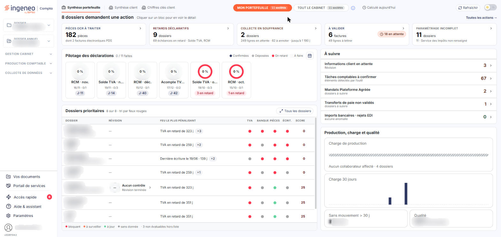<figcaption>
Écran « Barre d'en-tête - La synthèse du portefeuille » de la nouvelle interface
</figcaption></figure>

Dans la nouvelle interface, la synthèse du portefeuille est le premier onglet du tableau de bord. Elle présente, pour l'ensemble de vos dossiers, ce qui demande une action, l'avancement des déclarations et les dossiers à traiter en priorité. Le tableau de bord comporte trois onglets, dans cet ordre : « Synthèse portefeuille » (ouvert par défaut), « Synthèse client » et « Chiffres clés client » (ce dernier n'apparaît que si des indicateurs sont configurés).

## Onglet « Synthèse portefeuille »

<figure>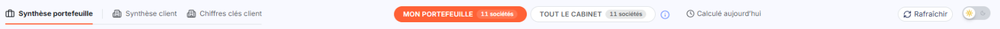<figcaption>
Rubrique « Ligne d'outils »
</figcaption></figure>

<figure>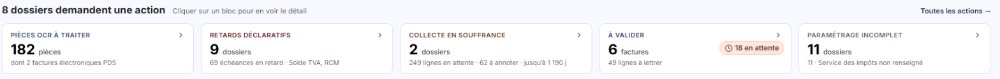<figcaption>
Rubrique « Bandeau d'action et blocs »
</figcaption></figure>

<figure>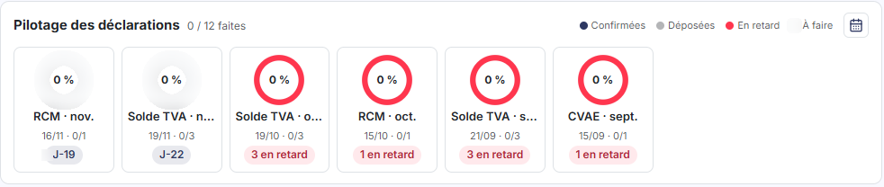<figcaption>
Rubrique « Pilotage des déclarations »
</figcaption></figure>

<figure>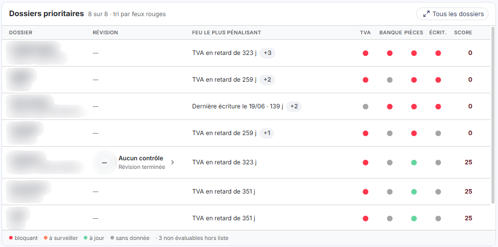<figcaption>
Rubrique « Dossiers prioritaires »
</figcaption></figure>

<figure>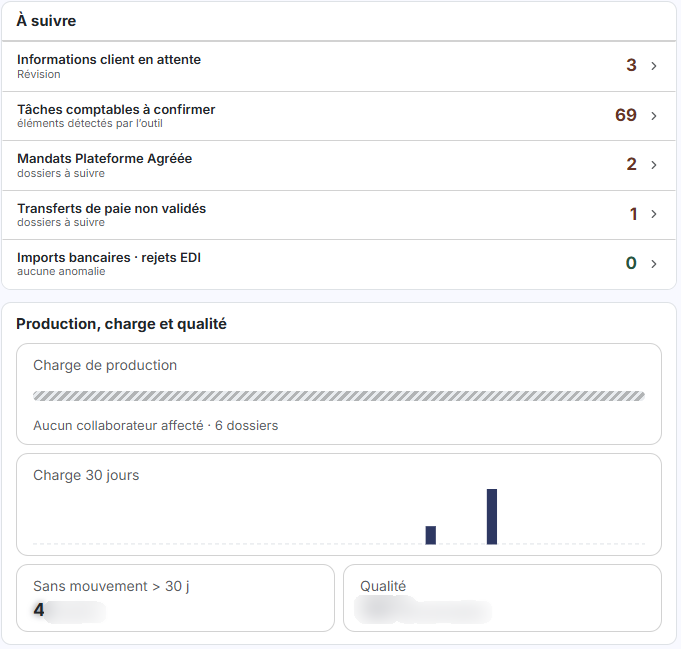<figcaption>
Rubrique « Colonne de droite »
</figcaption></figure>

<figure>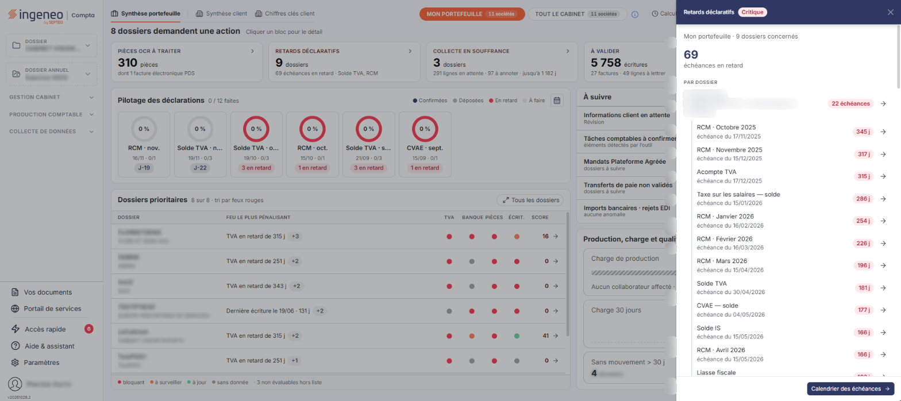<figcaption>
Rubrique « Bandeau d'action et blocs »
</figcaption></figure>

<figure>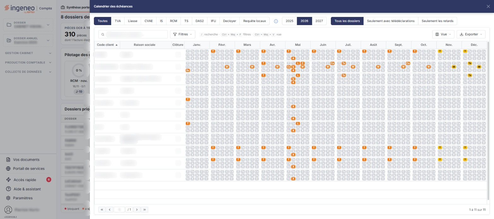<figcaption>
Rubrique « Pilotage des déclarations »
</figcaption></figure>

<figure>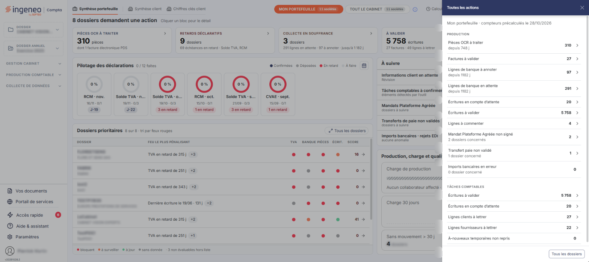<figcaption>
Rubrique « Bandeau d'action et blocs »
</figcaption></figure>

<figure>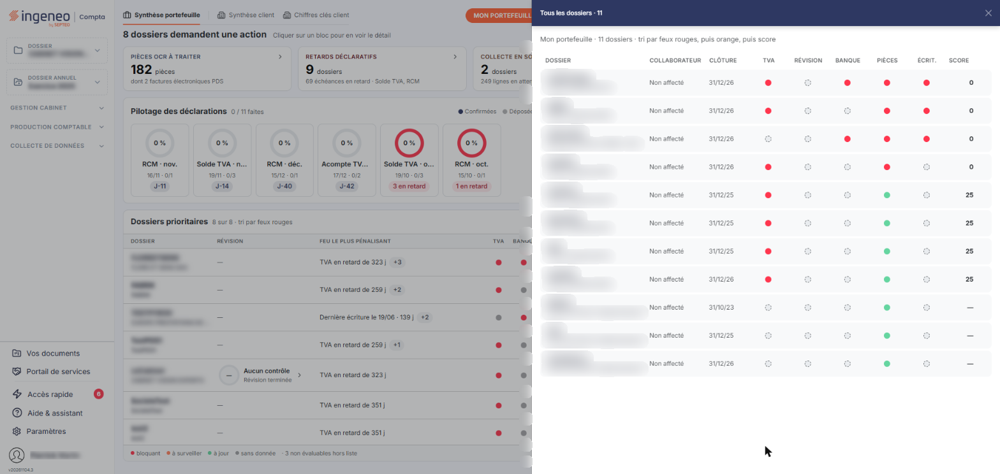<figcaption>
Rubrique « Dossiers prioritaires »
</figcaption></figure>

**Ligne d'outils**

Deux boutons choisissent le périmètre des chiffres : « MON PORTEFEUILLE » (actif à l'ouverture) et « TOUT LE CABINET », chacun avec le nombre de sociétés concernées. Le pictogramme (i) explique les périmètres : « Mon portefeuille » regroupe les sociétés activées à votre fiche, « Mon groupe de travail » celles des groupes de travail dont vous êtes membre, « Tout le cabinet » toutes les sociétés auxquelles vous avez accès. Ces périmètres sont indépendants, si bien que le premier nombre peut dépasser le dernier ; les compteurs des fenêtres ne portent que sur les sociétés dont un dossier annuel est ouvert.

La mention « Calculé aujourd'hui » indique la date du dernier calcul, et le bouton \[Rafraîchir] relance le calcul du portefeuille. L'interrupteur clair / sombre se trouve à l'extrémité droite.

**Bandeau d'action et blocs**

Le bandeau annonce le nombre de dossiers qui demandent une action et invite à cliquer sur un bloc pour le détail. Cinq blocs suivent : « PIÈCES OCR À TRAITER », « RETARDS DÉCLARATIFS », « COLLECTE EN SOUFFRANCE », « À VALIDER » et « PARAMÉTRAGE INCOMPLET ». Chacun affiche un compteur et un court résumé ; un clic ouvre, à droite, un tiroir de détail qui liste les dossiers concernés, avec le nombre d'éléments par dossier, et que la croix ou la touche Échap ferme. Par exemple, le tiroir « Retards déclaratifs » présente les échéances en retard par dossier, avec la date et le nombre de jours de retard, et un bouton « Calendrier des échéances » en pied.

Le lien « Toutes les actions → » ouvre le tiroir « Toutes les actions », qui regroupe tous les compteurs du périmètre en deux rubriques, « PRODUCTION » et « TÂCHES COMPTABLES », avec un bouton « Tous les dossiers » en pied.

**Pilotage des déclarations**

Le titre est suivi du nombre de déclarations faites sur le total (« 0 / 12 faites » par exemple) et d'une légende : « Confirmées », « Déposées », « En retard », « À faire ». Six jauges présentent les prochaines échéances et les dernières en retard, par nature et par mois, avec le nombre de déclarations faites et en retard.

Le bouton « Calendrier des échéances » ouvre un tiroir large : boutons de nature (« Toutes », « TVA », « Liasse », « CVAE », « IS », « RCM », « TS », « DAS2 », « IFU », etc.), années, choix « Tous les dossiers » / « Seulement avec télédéclarations » / « Seulement les retards », champ « Rechercher un dossier… », boutons « Filtres », « Vue » et « Exporter », et une grille par dossier (colonnes « Code client », « Raison sociale », « Clôture », puis un mois par colonne).

**Dossiers prioritaires**

Le tableau liste les dossiers triés par feux rouges, avec les colonnes DOSSIER, RÉVISION, FEU LE PLUS PÉNALISANT, TVA, BANQUE, PIÈCES, ÉCRIT. et SCORE (la colonne RÉVISION affiche l'état du dossier de révision, « — » quand aucun n'est en cours). Une légende précise le sens des couleurs : bloquant, à surveiller, à jour, sans donnée. La ligne elle-même n'est plus cliquable : un clic sur le dossier (code et raison sociale) ouvre l'onglet « Synthèse client » de ce dossier, et chaque pastille (TVA, Banque, Pièces, Écrit.) est un lien distinct, dont l'infobulle donne le détail (par exemple « TVA : en retard de 323 j »). Le bouton « Tous les dossiers » ouvre un tiroir avec tous les dossiers du périmètre.

**Colonne de droite**

« À suivre » présente cinq lignes avec un compteur : informations client en attente, tâches comptables à confirmer, mandats Plateforme Agréée, transferts de paie non validés, imports bancaires en rejet. « Production, charge et qualité » présente la charge de production, la charge sur 30 jours, les dossiers sans mouvement depuis plus de 30 jours et la qualité.

## Onglet « Synthèse client »

<figure>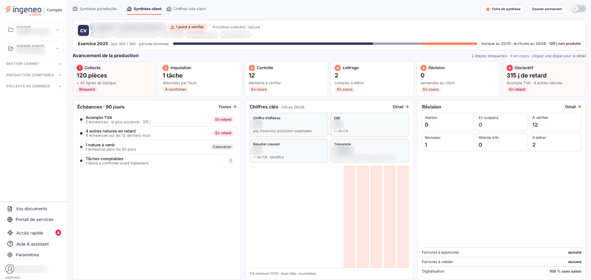<figcaption>
Rubrique « Onglet « Synthèse client » »
</figcaption></figure>

Cet onglet présente le dossier sélectionné : un bandeau d'identité (raison sociale, code, dirigeant, activité, capital, avancement de l'exercice et dates de dernière production), puis « Avancement de la production » en six étapes numérotées (Collecte, Imputation, Contrôle, Lettrage, Révision, Déclaratif) dont un clic ouvre le détail, et trois cartes : « Échéances · 90 jours », « Chiffres clés » et « Révision ». Les boutons « Fiche de synthèse » et « Dossier permanent » sont en haut à droite. Les boutons de périmètre et le bouton \[Rafraîchir] disparaissent.

## Onglet « Chiffres clés client »

<figure>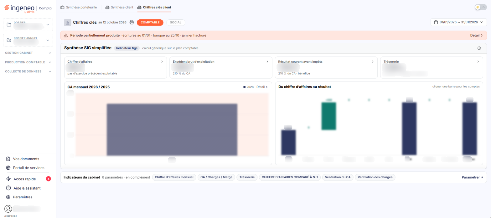<figcaption>
Rubrique « Onglet « Chiffres clés client » »
</figcaption></figure>

Cet onglet n'apparaît que si des indicateurs sont configurés. Il propose les boutons « COMPTABLE » et « SOCIAL », un sélecteur de période, l'impression, un bandeau « Période partiellement produite » (avec le lien « Détail ») lorsque la production du dossier n'est pas complète sur la période, la « Synthèse SIG simplifiée » avec quatre indicateurs (chiffre d'affaires, excédent brut d'exploitation, résultat courant avant impôts, trésorerie), le graphique « CA mensuel », la rubrique « Du chiffre d'affaires au résultat » et les « Indicateurs du cabinet », avec le lien « Paramétrer → ».
