# Page d'accueil


**Où le trouver :** Pages communes à tous les modules : rubrique **Généralités** de l'aide



**En bref** — Cet écran est le tableau de bord, page d'accueil du logiciel : il donne accès aux modules, au suivi de vos dossiers et aux panneaux d'aide et d'outils.

* Pour ouvrir un module : dépliez son groupe (« GESTION CABINET », « PRODUCTION COMPTABLE » ou « COLLECTE DE DONNÉES ») dans la barre latérale, puis cliquez sur son nom.
* Pour obtenir de l'aide : bouton \[Aide & assistant] de la barre latérale, puis pictogramme « Assistant IA (Ctrl J) » ou « Aide en ligne ».
* Pour changer l'apparence du logiciel : interrupteur (infobulle « Passer au mode sombre ») à l'extrémité droite de la ligne des onglets.


Après votre connexion, vous arrivez sur le tableau de bord : c'est la page d'accueil du logiciel. De là, vous ouvrez les modules, vous suivez l'activité de vos dossiers et vous accédez aux panneaux d'aide et d'outils.

<figure>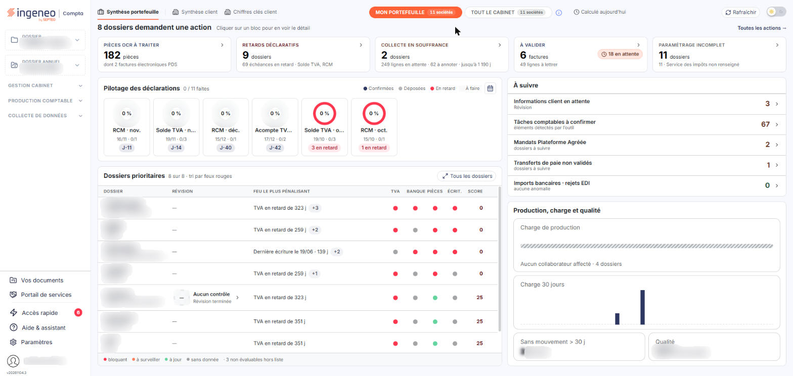<figcaption>
Écran « Page d'accueil » de la nouvelle interface
</figcaption></figure>

L'écran comporte trois zones : la barre latérale de navigation à gauche, la zone centrale organisée en onglets, et, à droite, un rail de pictogrammes qui n'apparaît que lorsqu'un panneau est ouvert. Le tableau de bord n'a pas de barre d'en-tête horizontale : les éléments de cette barre, que vous retrouvez sur les écrans des modules, sont décrits dans la page « Barre d'en-tête ».

## La barre latérale de navigation

<figure>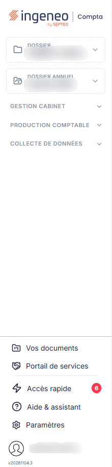<figcaption>
Rubrique « La barre latérale de navigation »
</figcaption></figure>

<figure>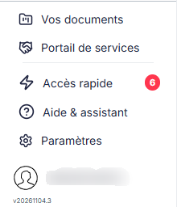<figcaption>
Rubrique « Contenu, de haut en bas »
</figcaption></figure>

<figure>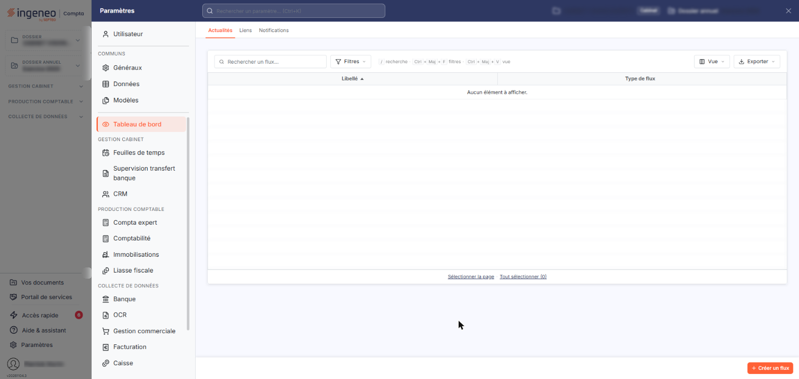<figcaption>
Rubrique « Contenu, de haut en bas »
</figcaption></figure>

**Ouverture et fermeture**

Sur le tableau de bord, la barre est affichée en permanence : elle ne porte plus de bouton pour la réduire.

Sur les écrans des modules, la barre est masquée par défaut : seule la bande étroite du bord gauche, portant une flèche (infobulle « Afficher le menu »), reste visible. Cliquez sur sa flèche pour ouvrir la barre par-dessus le contenu.

**Contenu, de haut en bas**

| Champ                                            | Ce qu'il faut savoir                                                                                                                                                                                                                                                                                                                                                                                                                                                                                                                                                                                                                                                                                                                                                                                      |
| ------------------------------------------------ | --------------------------------------------------------------------------------------------------------------------------------------------------------------------------------------------------------------------------------------------------------------------------------------------------------------------------------------------------------------------------------------------------------------------------------------------------------------------------------------------------------------------------------------------------------------------------------------------------------------------------------------------------------------------------------------------------------------------------------------------------------------------------------------------------------- |
| **Logo**                                         | « ingeneo Compta by SEPTEO ».                                                                                                                                                                                                                                                                                                                                                                                                                                                                                                                                                                                                                                                                                                                                                                             |
| **Sélecteurs « Dossier » et « Dossier annuel »** | Ce sont des menus déroulants, qui affichent la société et l'exercice sur lesquels vous travaillez.                                                                                                                                                                                                                                                                                                                                                                                                                                                                                                                                                                                                                                                                                                        |
| **Groupes de modules**                           | Les modules sont rangés en trois groupes repliables, « GESTION CABINET » (par exemple Administration, Mon compte, Annuaire), « PRODUCTION COMPTABLE » (par exemple Comptabilité, Immobilisations) et « COLLECTE DE DONNÉES » (par exemple Banque, OCR, Facturation). Cliquez sur le titre d'un groupe, ou sur son chevron, pour le déplier ou le replier. Les trois groupes sont repliés lors de votre première arrivée ; ceux que vous dépliez restent dans cet état d'une page à l'autre. Cliquez sur le nom d'un module pour l'ouvrir.                                                                                                                                                                                                                                                                 |
| **Épingle**                                      | Au survol d'un module, un pictogramme d'épingle apparaît (infobulle « Épingler », puis « Désépingler » quand le module est épinglé). Un module épinglé reste visible même lorsque son groupe est replié.                                                                                                                                                                                                                                                                                                                                                                                                                                                                                                                                                                                                  |
| **Bloc fixe du bas**                             | « Vos documents », « Portail de services », puis, sous un filet, « Accès rapide » (avec, le cas échéant, une pastille rouge qui compte les éléments à traiter), « Aide & assistant » et « Paramètres ». « Accès rapide » et « Aide & assistant » ouvrent les panneaux décrits en c) ; « Paramètres » ouvre le panneau « Paramètres » en place, sans quitter l'écran. Les infobulles de ces trois entrées rappellent leur raccourci : « Accès rapide (Ctrl M) », « Aide & assistant (Ctrl J) » et « Paramètres (Ctrl K) ». En haut du panneau « Paramètres », un champ « Rechercher un paramètre… (Ctrl+K) » propose, à mesure que vous saisissez, des écrans, des rubriques et des champs ; par exemple, « mot de passe » propose « Changer le mot de passe » (Utilisateur › Sécurité, repère « Champ »). |
| **Nom de l'utilisateur et version**              | En bas de la barre figurent votre nom, avec votre avatar, et le numéro de version du logiciel. Un clic sur votre nom ouvre la fenêtre « Photo de profil », qui porte aussi le bouton « Se déconnecter ».                                                                                                                                                                                                                                                                                                                                                                                                                                                                                                                                                                                                  |

## La zone centrale

<figure>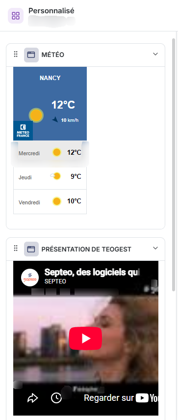<figcaption>
Rubrique « Panneau « Personnalisé » »
</figcaption></figure>

<figure>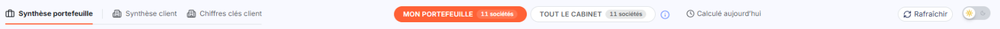<figcaption>
Rubrique « La zone centrale »
</figcaption></figure>

Elle comporte trois onglets, dans cet ordre : « Synthèse portefeuille » (onglet ouvert par défaut), « Synthèse client » et « Chiffres clés client » (ce dernier n'apparaît que si des indicateurs sont configurés). Ils sont décrits dans la page « Barre d'en-tête - La synthèse du portefeuille ».

À l'extrémité droite de la ligne des onglets, un interrupteur (infobulle « Passer au mode sombre ») permet de changer l'apparence du logiciel entre le mode clair et le mode sombre.

La disposition des blocs de l'onglet « Synthèse portefeuille » est fixe : elle ne se modifie pas. La personnalisation de votre tableau de bord passe par le panneau « Personnalisé », décrit en c).

## Les panneaux latéraux de droite

<figure>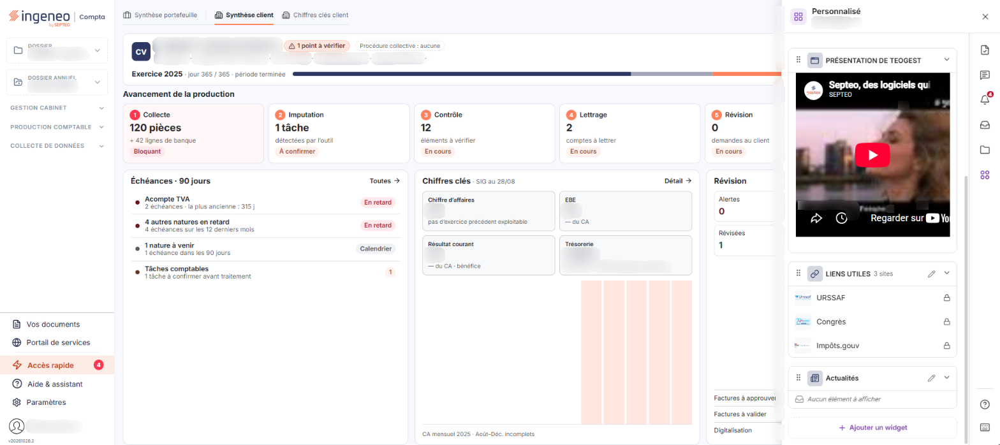<figcaption>
Rubrique « Rail « Accès rapide » »
</figcaption></figure>

<figure>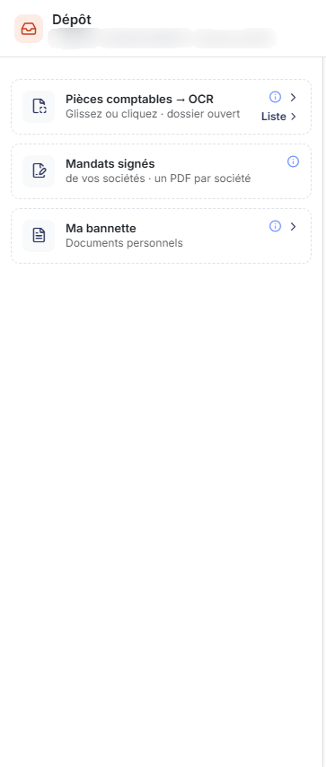<figcaption>
Rubrique « Rail « Accès rapide » »
</figcaption></figure>

<figure>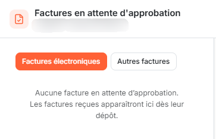<figcaption>
Rubrique « Rail « Accès rapide » »
</figcaption></figure>

<figure>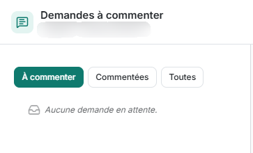<figcaption>
Rubrique « Rail « Accès rapide » »
</figcaption></figure>

<figure>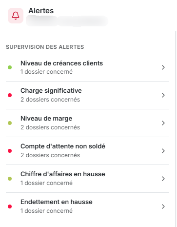<figcaption>
Rubrique « Rail « Accès rapide » »
</figcaption></figure>

<figure>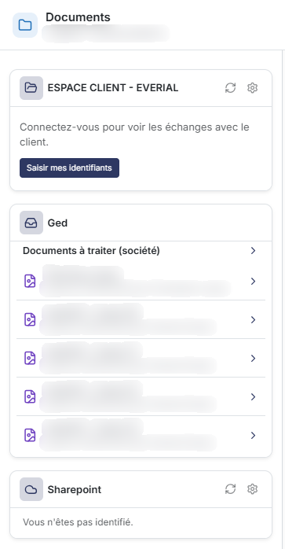<figcaption>
Rubrique « Rail « Accès rapide » »
</figcaption></figure>

<figure><figcaption>
Rubrique « Panneau « Assistant IA » »
</figcaption></figure>

<figure>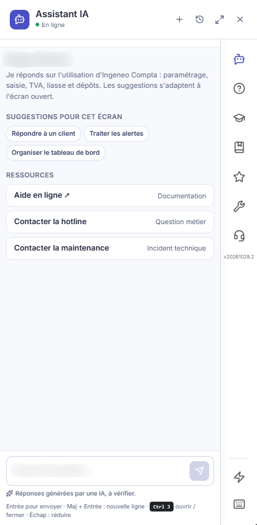<figcaption>
Rubrique « Rail « Aide &#x26; assistant » »
</figcaption></figure>

<figure>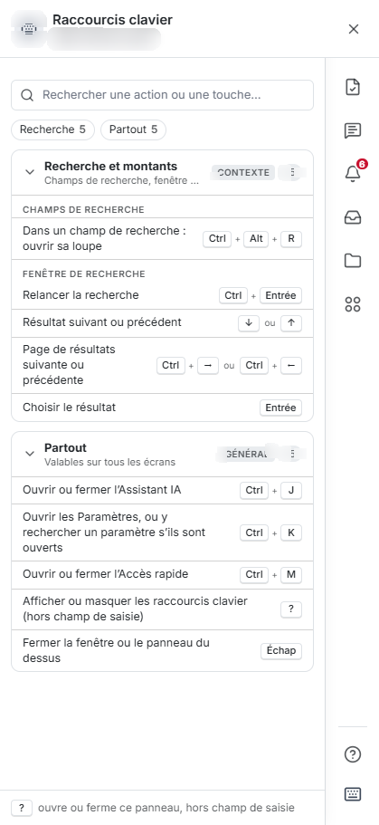<figcaption>
Rubrique « Raccourcis clavier »
</figcaption></figure>

Deux boutons de la barre latérale, « Accès rapide » et « Aide & assistant », ouvrent un panneau à droite de l'écran. Un rail de pictogrammes apparaît alors à son bord ; les infobulles s'affichent à gauche. En haut du panneau, la croix (« Fermer le panneau ») le ferme. En bas du rail, un bouton permet de basculer vers l'autre rail, et le pictogramme « Raccourcis clavier (?) » ouvre la liste des raccourcis.

**Rail « Accès rapide »**

Six pictogrammes, du haut vers le bas :

* « Factures en attente d'approbation » : deux boutons, « Factures électroniques » et « Autres factures » ; quand il n'y a rien à approuver, le panneau l'indique.
* « Demandes à commenter » : trois boutons, « À commenter », « Commentées » et « Toutes ».
* « Alertes » (avec une pastille rouge qui compte les alertes) : la rubrique « SUPERVISION DES ALERTES » présente, pour le périmètre indiqué (par exemple « mon portefeuille »), une ligne par alerte avec une pastille de couleur, son intitulé et le nombre de dossiers concernés.
* « Dépôt » : les cartes dépliables « Pièces comptables – OCR » (glisser ou cliquer pour déposer, lien « Liste ») et « Ma bannette », plus la carte « Mandats signés ». Cette dernière n'est proposée qu'aux cabinets d'expertise comptable, et seulement si la fenêtre correspondante est active ; hors du dossier cabinet, elle s'intitule « Mandat signé ».
* « Documents » : des cartes par source de documents, par exemple « Ged » (documents à traiter) ; une source qui exige une connexion vous invite à vous identifier.
* « Personnalisé » : vos widgets (voir ci-dessous).

| Champ                        | Ce qu'il faut savoir                                                                                                                                                                                                                                                                                                                                                                                                                                                                                                                                                                                                                                                                                                                                                                             |
| ---------------------------- | ------------------------------------------------------------------------------------------------------------------------------------------------------------------------------------------------------------------------------------------------------------------------------------------------------------------------------------------------------------------------------------------------------------------------------------------------------------------------------------------------------------------------------------------------------------------------------------------------------------------------------------------------------------------------------------------------------------------------------------------------------------------------------------------------ |
| **Panneau « Personnalisé »** | 
Il présente « Mes widgets » avec leur nombre, par exemple la météo, la présentation du logiciel, vos liens utiles et vos actualités. Chaque widget porte des boutons pour le déplacer vers le haut ou vers le bas, et pour le replier ou le déplier. Les boutons « Modifier les liens » et « Configurer mes flux d'actualités » règlent le contenu des widgets correspondants, et « Ajouter un widget », en bas du panneau, en ajoute un. <strong>Rail « Aide &#x26; assistant »</strong> Pictogrammes, du haut vers le bas : « Assistant IA (Ctrl J) », « Aide en ligne » (elle s'ouvre dans une nouvelle fenêtre), « Académie de formation », « Tutoriel », « Nouveautés », « Contacter la maintenance » et « Contacter la hotline ». Le numéro de version figure en bas du rail.
 |
| **Panneau « Assistant IA »** | Il s'ouvre avec le raccourci Ctrl J. Il propose des suggestions pour l'écran ouvert, des ressources (« Aide en ligne », « Contacter la hotline » pour une question métier, « Contacter la maintenance » pour un incident technique) et une zone « Posez votre question… ». En haut du panneau, quatre boutons permettent de démarrer une « Nouvelle conversation », d'ouvrir l'« Historique des conversations », d'« Agrandir le panneau » et de le fermer (« Fermer l'assistant IA »). Les réponses sont générées par une IA : le panneau vous invite à les vérifier. Entrée envoie la question, Maj + Entrée passe à la ligne et Échap réduit le panneau.                                                                                                                                      |

**Raccourcis clavier**

Le panneau liste les raccourcis de l'écran ouvert (« Selon l'écran ouvert »). Un champ « Rechercher une action ou une touche… » et des filtres permettent de retrouver un raccourci. Partout, Ctrl+J ouvre l'assistant, Ctrl+K ouvre les Paramètres (ou, s'ils sont déjà ouverts, y recherche un paramètre), Ctrl+M ouvre ou ferme l'Accès rapide, ? ouvre les raccourcis et Échap ferme le panneau.

## Autres éléments

<figure>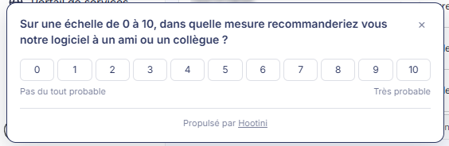<figcaption>
Rubrique « Autres éléments »
</figcaption></figure>

Un bandeau de sondage de satisfaction peut s'afficher en bas à gauche de l'écran du tableau de bord : il vous demande, sur une échelle de 0 à 10, si vous recommanderiez le logiciel à un collègue.
