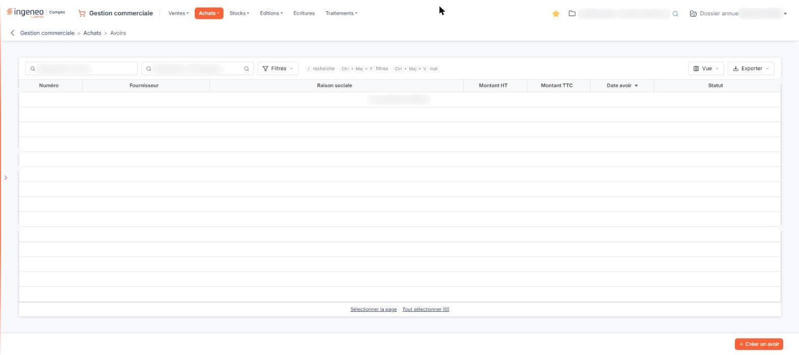
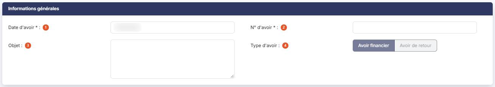
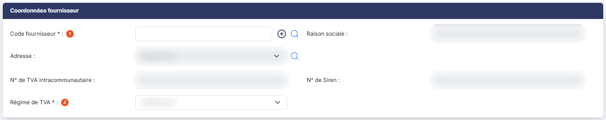
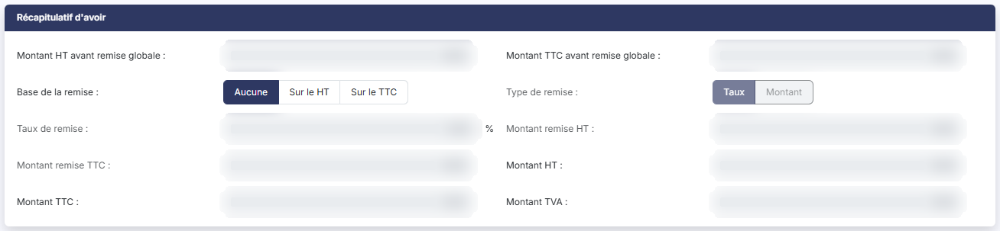
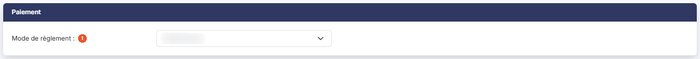
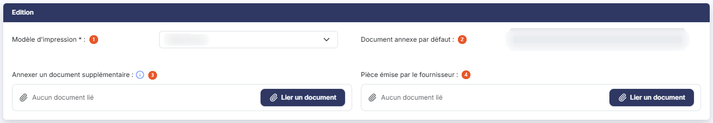

# Avoirs fournisseurs


**Où le trouver :** Menu **Achats › Avoirs**



**En bref** — Cet écran tient les avoirs fournisseurs du dossier annuel en cours ; ils fonctionnent sur le même principe que les avoirs de vente.

* Pour saisir un avoir fournisseur : bouton \[Créer un avoir], puis renseignez la fiche.


La chaîne « Achats » fonctionne de la même manière que la chaîne « Ventes ». Les pages de l'aide n'ont donc pas été dupliquées : pour tout ce qui est commun aux deux chaînes — coordonnées du tiers, lignes d'articles, récapitulatif, remise globale, édition —, reportez-vous au menu « Ventes », option « Avoirs », en remplaçant simplement le client par le fournisseur.

<figure><figcaption>
Écran « Avoirs » de la nouvelle interface
</figcaption></figure>

La présente page ne traite que de ce que l'avoir fournisseur a de propre.

## La liste des avoirs fournisseurs

La barre d'outils, au-dessus du tableau, comporte deux zones de recherche qui permettent de restreindre la liste :

| Champ                          | Ce qu'il faut savoir                                                                       |
| ------------------------------ | ------------------------------------------------------------------------------------------ |
| **Rechercher un fournisseur…** | Saisissez le code du fournisseur, ou utilisez le pictogramme « Loupe » pour le rechercher. |
| **Rechercher un avoir…**       | Saisissez tout ou partie du numéro recherché.                                              |

Elle porte aussi les boutons \[Filtres], \[Vue] et \[Exporter]. Dès qu'un critère est posé, le lien « Tout effacer » apparaît à côté de \[Filtres] et vous ramène à la liste complète. Tant que vous n'avez rien saisi, aucun filtre n'est actif : la liste présente tous les avoirs fournisseurs du dossier annuel.

Le tableau présente les colonnes **Numéro**, **Fournisseur**, **Raison sociale**, **Montant HT**, **Montant TTC**, **Date avoir** et **Statut**. Toutes sont triables : cliquez sur l'en-tête de la colonne sur laquelle vous souhaitez trier. Si vous n'avez encore saisi aucun avoir fournisseur, le logiciel affiche « Aucun élément à afficher. ».

Chaque ligne du tableau porte les commandes « Modifier » pour ouvrir l'avoir, « Afficher l'aperçu » pour le consulter sans l'ouvrir, « Supprimer », « Dupliquer » pour en créer un nouveau reprenant le contenu de celui-ci, « Télécharger » pour en récupérer le fichier et « Envoyer par mail ». Chacune est soumise à un droit distinct : selon les droits qui vous ont été attribués, certaines peuvent ne pas vous être proposées.

Il n'y a plus de case à cocher dans la liste : un clic sur une ligne la sélectionne, et sous le tableau les liens « Sélectionner la page » et « Tout sélectionner (n) » étendent la sélection. La barre du bas porte le bouton **\[Créer un avoir]**, qui crée un avoir fournisseur. Dès qu'un avoir est sélectionné, un bandeau de sélection apparaît au bas de l'écran ; il porte le bouton **\[Supprimer]**, qui supprime les avoirs sélectionnés dans la liste, ainsi que le lien « Tout désélectionner ».

## Rubrique « Informations générales »

<figure><figcaption>
Rubrique « Informations générales »
</figcaption></figure>

| Champ               | Ce qu'il faut savoir                                                                                                                                                                                                      |
| ------------------- | ------------------------------------------------------------------------------------------------------------------------------------------------------------------------------------------------------------------------- |
| 1. **Date d'avoir** | Champ obligatoire. Le logiciel vous propose la date du jour.                                                                                                                                                              |
| 2. **N° d'avoir**   | Champ obligatoire.                                                                                                                                                                                                        |
| 3. **Objet**        | Champ facultatif.                                                                                                                                                                                                         |
| 4. **Type d'avoir** | Deux boutons vous permettent de préciser s'il s'agit d'un « Avoir financier » — une remise, un rabais, une ristourne accordée par votre fournisseur — ou d'un « Avoir de retour », qui constate un retour de marchandise. |

Deux champs supplémentaires apparaissent dès que l'avoir a été enregistré : **Statut :** qui indique s'il est validé ou non, et **Comptabilisation :** qui indique si les écritures comptables relatives à l'avoir ont été générées ou non. Ni l'un ni l'autre n'est modifiable.

## Rubrique « Coordonnées fournisseur »

<figure><figcaption>
Rubrique « Coordonnées fournisseur »
</figcaption></figure>

| Champ                   | Ce qu'il faut savoir                                                                                                                                                                                                                                                                                                                                                                                                                                                                                                                                                                                                                                                                                                                                 |
| ----------------------- | ---------------------------------------------------------------------------------------------------------------------------------------------------------------------------------------------------------------------------------------------------------------------------------------------------------------------------------------------------------------------------------------------------------------------------------------------------------------------------------------------------------------------------------------------------------------------------------------------------------------------------------------------------------------------------------------------------------------------------------------------------- |
| 1. **Code fournisseur** | 
Champ obligatoire. Vous pouvez le rechercher en tapant ses premières lettres dans la zone de saisie, ou en cliquant sur le pictogramme « Loupe » pour ouvrir la fenêtre de recherche. Le pictogramme « Plus » vous permet de créer le fournisseur sans quitter l'avoir. La raison sociale, l'adresse, le numéro de TVA intracommunautaire et le numéro de Siren sont repris de la fiche du fournisseur et affichés sans possibilité de modification. Dès que vous avez choisi un fournisseur, le logiciel affiche également son numéro de Siret et les coordonnées de son contact : civilité, prénom, nom, fonction, adresse électronique, téléphone, télécopie, mobile, ainsi que l'adresse postale, le code postal, la ville et le pays.
 |
| 2. **Régime de TVA**    | Champ obligatoire, normalement repris de la fiche du fournisseur. Il permet de gérer tous les cas d'achat en local, dans l'Union européenne ou hors de l'Union.                                                                                                                                                                                                                                                                                                                                                                                                                                                                                                                                                                                      |

## Rubrique « Récapitulatif d'avoir »

<figure><figcaption>
Rubrique « Récapitulatif d'avoir »
</figcaption></figure>

Cette rubrique fonctionne exactement comme celle d'un avoir client : elle récapitule les montants avant et après remise globale et vous permet de régler cette remise.

## Rubrique « Paiement »

<figure><figcaption>
Rubrique « Paiement »
</figcaption></figure>

**Mode de règlement** : indiquez comment votre fournisseur vous rembourse, ou comment l'avoir sera imputé. Cette rubrique existe également sur les avoirs clients.

## Rubrique « Edition »

<figure><figcaption>
Rubrique « Edition »
</figcaption></figure>

| Champ                                     | Ce qu'il faut savoir                                                                                                                                                                                             |
| ----------------------------------------- | ---------------------------------------------------------------------------------------------------------------------------------------------------------------------------------------------------------------- |
| 1. **Modèle d'impression**                | Champ obligatoire. Indiquez le modèle d'impression à utiliser pour éditer l'avoir.                                                                                                                               |
| 2. **Document annexe par défaut**         | Affiche le document que vous avez défini comme annexe systématique des avoirs. Deux boutons vous permettent de le charger ou de le retirer ; ils n'apparaissent que lorsqu'un document par défaut a été défini.  |
| 3. **Annexer un document supplémentaire** | Cliquez sur bouton **\[Lier un document]** pour joindre un document à ce seul avoir ; tant qu'aucun document n'est lié, la zone indique « Aucun document lié ».                                                  |
| 4. **Pièce émise par le fournisseur**     | Cliquez sur bouton **\[Lier un document]** pour rattacher à l'avoir le document que votre fournisseur vous a adressé. Une fois le document chargé, le logiciel vous propose de le visualiser ou de le supprimer. |

Cette zone n'existe que sur les pièces d'achat, et elle a une conséquence importante : à la validation de l'avoir, si une pièce du fournisseur a été jointe, c'est ELLE qui est attachée aux lignes d'écritures, et non le document produit par le logiciel.

## Les boutons de l'avoir

bouton **\[Enregistrer]** : enregistre l'avoir.

bouton **\[Edition]** : édite l'avoir selon le modèle d'impression choisi dans la rubrique « Edition ».

bouton **\[Envoyer par mail]** : adresse l'avoir par courrier électronique.

bouton **\[Valider]** : valide l'avoir.

Pour fermer l'avoir et revenir à la liste, utilisez la flèche « Revenir en arrière », à gauche du fil d'Ariane.
