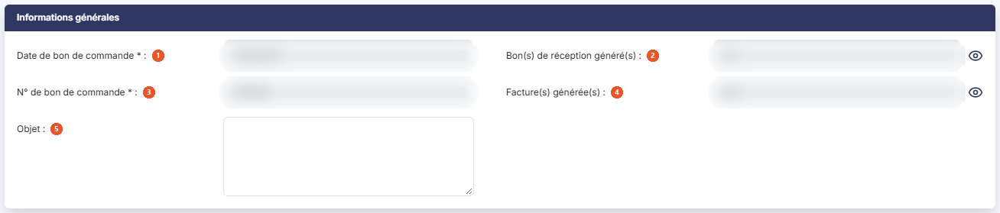
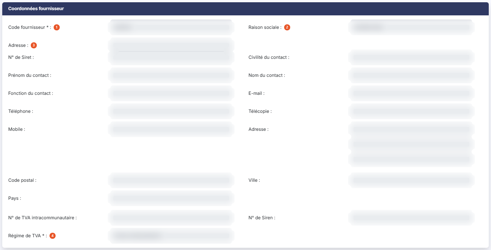
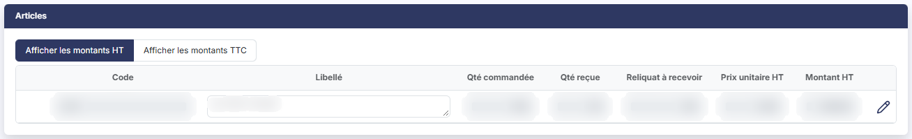
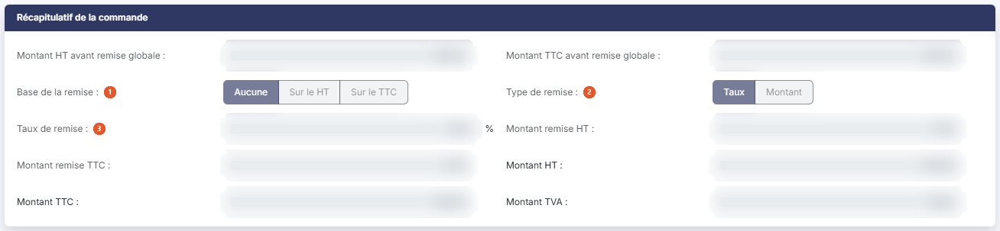
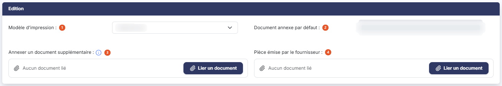

# Bons de commande fournisseurs


**Où le trouver :** Menu **Achats › Bons de commande**



**En bref** — Cet écran tient les bons de commande adressés à vos fournisseurs, que vous pouvez ensuite transformer en bons de réception ou en factures d'achat.

* Pour créer un bon de commande : bouton \[Créer un bon de commande], puis renseignez la fiche.
* Pour transformer une commande : ouvrez-la, puis bouton \[Générer un bon de réception] ou bouton \[Générer une facture].


Cette option permet de tenir le fichier des bons de commande que vous adressez à vos fournisseurs : consulter les bons déjà enregistrés, en créer de nouveaux, puis les transformer en bons de réception ou en factures d'achat.

<figure><figcaption>
Écran « Bons de commande » de la nouvelle interface
</figcaption></figure>

La chaîne « Achats » fonctionne sur le même principe que la chaîne « Ventes » : reportez-vous à l'aide du menu « Ventes », option « Bons de commande », pour le fonctionnement d'ensemble d'une pièce commerciale. La présente page ne traite que de l'écran des bons de commande fournisseurs.

## La liste des bons de commande

La liste présente une ligne par bon de commande, avec les colonnes suivantes : **Numéro**, **Fournisseur** (son code), **Raison sociale**, **Montant HT**, **Montant TTC** et **Date**. Toutes ces colonnes sont triables ; la liste s'ouvre triée sur la date.

Au-dessus de la liste, la barre d'outils propose deux zones de recherche qui restreignent l'affichage : **Rechercher un bon de commande…** et **Rechercher un fournisseur…**, cette dernière avec un pictogramme « Loupe » qui ouvre le fichier des fournisseurs. Elle porte aussi les boutons \[Filtres], \[Vue] et \[Exporter], décrits plus bas.

Aucun filtre n'est actif à l'ouverture de l'écran : tous les bons de commande du dossier annuel en cours sont affichés.

## Bouton \[Filtres]

Il ouvre un volet « Filtres » : choisissez une colonne dans la liste « Ajouter un critère sur… », renseignez le critère, puis cliquez sur Bouton \[Filtrer] pour l'appliquer à la liste. Bouton \[Vider les filtres] retire les critères posés.

Dès qu'un critère est posé, un lien « Tout effacer » apparaît à côté de \[Filtres] : il retire les critères et réaffiche la totalité des bons de commande. Tant qu'aucun critère n'est posé, ce lien n'est pas affiché.

## Les commandes de la ligne

Les commandes de la ligne apparaissent lorsque vous survolez celle-ci. Deux icônes sont proposées directement : « Télécharger », qui récupère la pièce au format fichier, et « Envoyer par mail », qui prépare l'envoi du bon par courrier électronique. Un troisième pictogramme (trois points verticaux, infobulle « Autres actions ») ouvre un menu qui propose :

* « Modifier » : ouvre la fiche du bon de commande ;
* « Dupliquer » : crée un nouveau bon de commande reprenant les données de celui-ci ;
* « Supprimer » : supprime le bon.

Une commande « Afficher l'aperçu » existe sur l'écran, mais elle n'est pas affichée sur les bons de commande : aucune icône d'aperçu n'apparaît sur la ligne.

Chacune de ces commandes est soumise à un droit distinct : selon votre profil, certaines peuvent ne pas apparaître sur la ligne.

## La barre d'outils de la liste

La barre d'outils au-dessus de la liste remplace les anciens pictogrammes d'en-tête : les deux zones de recherche, Bouton \[Filtres], Bouton \[Vue] (affichage et personnalisation des colonnes) et Bouton \[Exporter]. Le menu \[Exporter] propose : Aperçu édition HTML, Imprimer, Exporter en Excel, Exporter en PDF, Envoyer la liste par e-mail, l'orientation (Portrait ou Paysage), le format (Ajustée ou Fixe) et le bouton \[Lancer l'édition].

Sous la liste, « Sélectionner la page » sélectionne les lignes de la page et « Tout sélectionner (n) » celles de toutes les pages. Il n'y a plus de case à cocher en tête de liste : un clic sur une ligne la sélectionne. Dès qu'une ligne est sélectionnée, un bandeau de sélection apparaît au bas de l'écran (« 1 bon de commande sélectionné ») avec le lien « Tout désélectionner » et les boutons \[Supprimer], \[Envoyer tout par mail], \[Générer les factures] et \[Générer les bons de réception].

## Bouton \[Créer un bon de commande]

Placé en bas à droite de l'écran, hors de la liste, il ouvre la fiche d'un nouveau bon de commande, décrite ci-dessous.

## Bouton \[Générer les factures]

Ce bouton s'affiche dans le bandeau de sélection dès qu'un bon est sélectionné.

## Bouton \[Générer les bons de réception]

Ce bouton s'affiche dans le bandeau de sélection dès qu'un bon est sélectionné.

## Bouton \[Supprimer]

Il s'affiche dans le bandeau de sélection dès qu'un bon est sélectionné, et supprime en une seule fois tous les bons de commande sélectionnés dans la liste.

La fiche d'un bon de commande est organisée en cinq rubriques, présentées dans cet ordre : « Informations générales », « Coordonnées fournisseur », « Articles », « Récapitulatif de la commande » et « Edition ».

Il n'y a pas de rubrique « Paiement » sur un bon de commande, contrairement à un avoir d'achat.

## Rubrique « Informations générales »

<figure><figcaption>
Rubrique « Informations générales »
</figcaption></figure>

| Champ                                | Ce qu'il faut savoir                                                                                                                                                                                                                                                       |
| ------------------------------------ | -------------------------------------------------------------------------------------------------------------------------------------------------------------------------------------------------------------------------------------------------------------------------- |
| 1. **Date de bon de commande**       | Le logiciel propose la date du jour à la création ; elle se saisit directement ou se choisit dans le calendrier, qui s'ouvre au clic dans le champ.                                                                                                                        |
| 2. **Bon(s) de réception généré(s)** | Indique si un ou plusieurs bons de réception ont été générés à partir de cette commande.                                                                                                                                                                                   |
| 3. **N° de bon de commande**         | —                                                                                                                                                                                                                                                                          |
| 4. **Facture(s) générée(s)**         | Indique si une ou plusieurs factures d'achat ont été générées à partir de cette commande.                                                                                                                                                                                  |
| 5. **Objet**                         | 
Zone de texte libre sur plusieurs lignes, destinée à rappeler la nature de la commande. Deux indicateurs en lecture seule complètent cette rubrique dès que le bon de commande a été enregistré. Ils n'existent pas tant que la pièce est en cours de création :
 |

Il n'y a ni champ **Statut** ni champ **Comptabilisation** sur un bon de commande : ce sont ces deux indicateurs qui vous renseignent sur l'avancement de la commande.

## Rubrique « Coordonnées fournisseur »

<figure><figcaption>
Rubrique « Coordonnées fournisseur »
</figcaption></figure>

| Champ                   | Ce qu'il faut savoir                                                                                                                                                                                                                                                                                                                                                                                                                                                                                                                                                                                                                                                                                                                                                                                                                                                                                                                                                                      |
| ----------------------- | ----------------------------------------------------------------------------------------------------------------------------------------------------------------------------------------------------------------------------------------------------------------------------------------------------------------------------------------------------------------------------------------------------------------------------------------------------------------------------------------------------------------------------------------------------------------------------------------------------------------------------------------------------------------------------------------------------------------------------------------------------------------------------------------------------------------------------------------------------------------------------------------------------------------------------------------------------------------------------------------- |
| 1. **Code fournisseur** | Saisissez le début du code pour lancer la recherche, ou utilisez le pictogramme « Loupe » pour parcourir le fichier des fournisseurs. Le pictogramme « Plus » permet de créer le fournisseur sans quitter la commande.                                                                                                                                                                                                                                                                                                                                                                                                                                                                                                                                                                                                                                                                                                                                                                    |
| 2. **Raison sociale**   | Affichée automatiquement pour mémoire.                                                                                                                                                                                                                                                                                                                                                                                                                                                                                                                                                                                                                                                                                                                                                                                                                                                                                                                                                    |
| 3. **Adresse**          | 
Si le fournisseur possède plusieurs adresses, choisissez dans la liste celle qui doit figurer sur la commande. Le pictogramme « Loupe » donne accès au fichier des adresses. Une fois le fournisseur rattaché à la commande, la rubrique se complète des coordonnées du contact, toutes en lecture seule et toutes reprises de la fiche du fournisseur : <strong>N° de Siret</strong>, <strong>Civilité du contact</strong>, <strong>Prénom du contact</strong>, <strong>Nom du contact</strong>, <strong>Fonction du contact</strong>, <strong>E-mail</strong>, <strong>Téléphone</strong>, <strong>Télécopie</strong>, <strong>Mobile</strong>, <strong>Adresse</strong>, <strong>Code postal</strong>, <strong>Ville</strong> et <strong>Pays</strong>. Pour les corriger, passez par le menu « Fichiers », option « Fournisseurs ». <strong>N° de TVA intracommunautaire</strong> et <strong>N° de Siren :</strong> repris de la fiche du fournisseur, en lecture seule.
 |
| 4. **Régime de TVA**    | Choisissez dans la liste le régime à appliquer à la commande : **DOM TOM**, **EXPORT**, **France métr. taux réduit**, **France métropolitaine** ou **TVA intracommunautaire**. Le logiciel reprend le régime de la fiche du fournisseur ; vous pouvez le modifier pour cette commande.                                                                                                                                                                                                                                                                                                                                                                                                                                                                                                                                                                                                                                                                                                    |

## Rubrique « Articles »

<figure><figcaption>
Rubrique « Articles »
</figcaption></figure>

C'est le détail de la commande, saisi ligne à ligne.

Deux modes d'affichage sont proposés, **Afficher les montants HT** et **Afficher les montants TTC** ; la rubrique s'ouvre en hors taxes.

Les colonnes sont, dans l'ordre : **Code**, **Libellé**, **Qté commandée**, **Qté reçue**, **Reliquat à recevoir**, **Prix unitaire HT**, **Prix unitaire TTC**, **Montant HT** et **Montant TTC**. Les deux colonnes en toutes taxes n'apparaissent que dans le mode d'affichage correspondant.

Les colonnes **Qté reçue** et **Reliquat à recevoir** sont propres au bon de commande : elles vous indiquent, ligne par ligne, ce qui a déjà été réceptionné et ce qui reste attendu du fournisseur.

Deux boutons complètent la rubrique : Bouton \[Nouvelle ligne] ajoute une ligne d'article, Bouton \[Supprimer les lignes] retire celles que vous avez sélectionnées. Ces deux boutons ne sont proposés que tant que la commande est modifiable.

## Rubrique « Récapitulatif de la commande »

<figure><figcaption>
Rubrique « Récapitulatif de la commande »
</figcaption></figure>

Cette rubrique totalise la commande et permet d'appliquer une remise sur l'ensemble de la pièce. Aucun champ n'y est obligatoire.

**Montant HT avant remise globale** et **Montant TTC avant remise globale :** total des lignes d'articles.

| Champ                    | Ce qu'il faut savoir                                    |
| ------------------------ | ------------------------------------------------------- |
| 1. **Base de la remise** | Choisissez **Aucune**, **Sur le HT** ou **Sur le TTC**. |
| 2. **Type de remise**    | Choisissez **Taux** ou **Montant**.                     |
| 3. **Taux de remise**    | Exprimé en pourcentage.                                 |

**Montant remise HT** et **Montant remise TTC :** remise calculée par le logiciel.

**Montant HT**, **Montant TTC** et **Montant TVA :** totaux définitifs de la commande, remise déduite.

## Rubrique « Edition »

<figure><figcaption>
Rubrique « Edition »
</figcaption></figure>

| Champ                                     | Ce qu'il faut savoir                                                                                                                                                                                                                     |
| ----------------------------------------- | ---------------------------------------------------------------------------------------------------------------------------------------------------------------------------------------------------------------------------------------- |
| 1. **Modèle d'impression**                | Choisissez la présentation à utiliser pour éditer la commande. Les modèles se définissent dans le menu « Paramètres », option « Modèles d'impression » ; tant qu'aucun modèle n'a été créé, la liste ne propose que la valeur d'attente. |
| 2. **Document annexe par défaut**         | Document joint automatiquement à la pièce. Deux boutons n'apparaissent que lorsqu'un document est présent : Bouton \[Supprimer le document] et Bouton \[Charger le document par défaut].                                                 |
| 3. **Annexer un document supplémentaire** | Cliquez sur Bouton \[Lier un document] pour joindre un document à cette commande seulement ; « Aucun document lié » s'affiche tant qu'aucun n'est lié.                                                                                   |
| 4. **Pièce émise par le fournisseur**     | Même fonctionnement (Bouton \[Lier un document]), pour conserver le document que le fournisseur vous a adressé.                                                                                                                          |

## Les boutons de la fiche

Cinq boutons figurent dans la barre du bas de la fiche. À la création, ils se présentent dans cet ordre :

* Bouton \[Edition] ;
* Bouton \[Enregistrer] ;
* Bouton \[Envoyer par mail] ;
* Bouton \[Générer une facture] ;
* Bouton \[Générer un bon de réception].

Sur une commande déjà enregistrée, ce sont les mêmes cinq boutons, mais Bouton \[Enregistrer] passe en première position, avant Bouton \[Edition].

Il n'y a plus de bouton \[Retour] visible : pour revenir à la liste, utilisez la flèche « Revenir en arrière », à gauche du fil d'Ariane.

Il n'y a pas de Bouton \[Valider] sur un bon de commande, contrairement à un bon de réception ou à un avoir d'achat : un bon de commande n'a pas d'étape de validation.

## Bouton \[Générer un bon de réception]

<figure><figcaption>
Bouton [Générer un bon de réception]
</figcaption></figure>

Il déclenche la création du bon de réception correspondant à la commande affichée. L'indicateur **Bon(s) de réception généré(s)** de la rubrique « Informations générales » passe alors à « Oui ».

## Bouton \[Générer une facture]

<figure><figcaption>
Bouton [Générer une facture]
</figcaption></figure>

Il déclenche la création de la facture d'achat correspondant à la commande affichée, sans passer par l'étape du bon de réception. L'indicateur **Facture(s) générée(s)** passe alors à « Oui ».

## Bouton \[Edition]

<figure><figcaption>
Bouton [Edition]
</figcaption></figure>

Il édite la commande selon le modèle d'impression choisi dans la rubrique « Edition ».

## Bouton \[Envoyer par mail]

<figure><figcaption>
Bouton [Envoyer par mail]
</figcaption></figure>

Il prépare l'envoi de la commande par courrier électronique au fournisseur.
