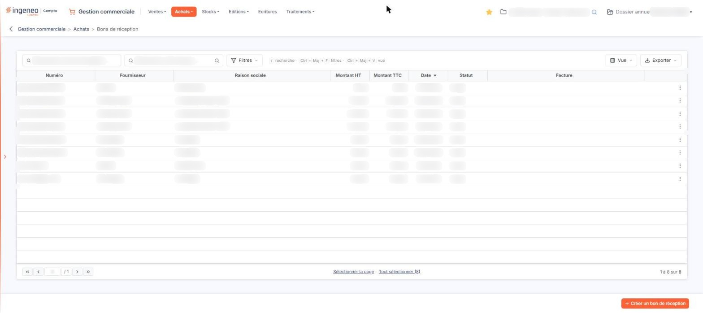
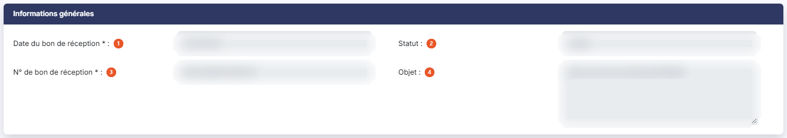
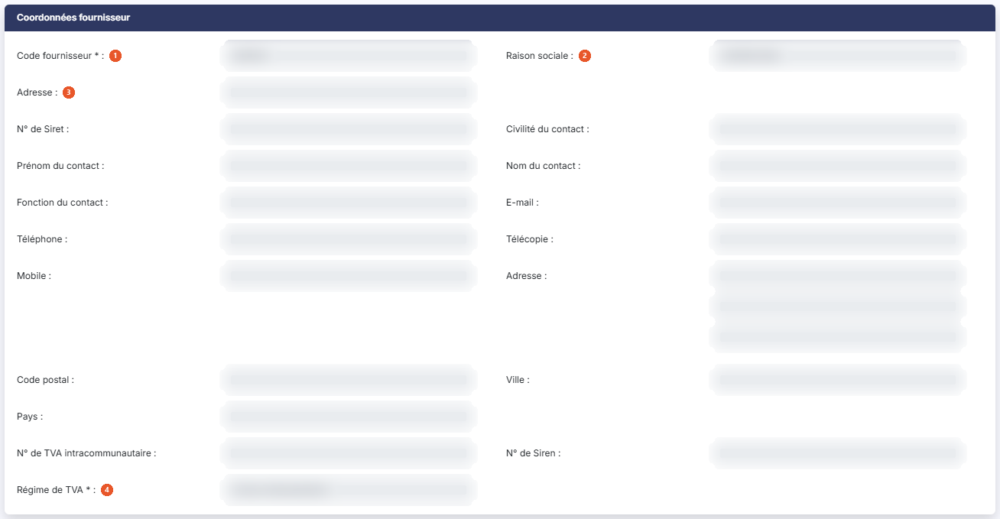
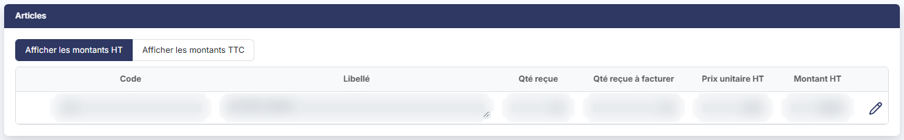
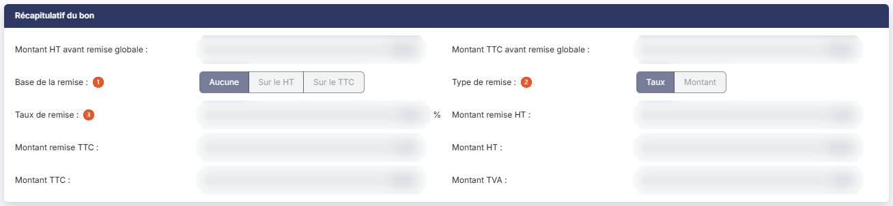
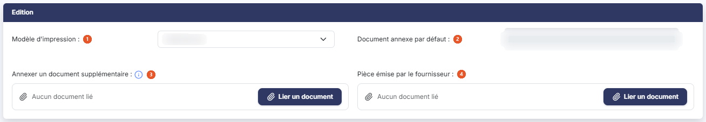

# Bons de réception


**Où le trouver :** Menu **Achats › Bons de réception**



**En bref** — Cet écran tient les bons de réception, c'est-à-dire les marchandises effectivement reçues de vos fournisseurs. Un bon validé peut être transformé en facture d'achat.

* Pour créer un bon de réception : bouton \[Créer un bon de réception], puis renseignez la fiche.
* Pour facturer plusieurs bons : sélectionnez-les, puis bouton \[Générer les factures].


Cette option permet de tenir le fichier des bons de réception, c'est-à-dire des marchandises effectivement reçues de vos fournisseurs. Un bon de réception peut être issu d'un bon de commande ou créé directement ; une fois validé, il peut être transformé en facture d'achat.

<figure><figcaption>
Écran « Bons de réception » de la nouvelle interface
</figcaption></figure>

La chaîne « Achats » fonctionne sur le même principe que la chaîne « Ventes » : reportez-vous à l'aide du menu « Ventes », option « Bons de livraison », pour le fonctionnement d'ensemble d'une pièce commerciale. La présente page ne traite que de l'écran des bons de réception fournisseurs.

## La liste des bons de réception

La liste présente une ligne par bon de réception, avec les colonnes suivantes : **Numéro**, **Fournisseur** (son code), **Raison sociale**, **Montant HT**, **Montant TTC**, **Date**, **Statut** et **Facture**. Toutes ces colonnes sont triables ; la liste s'ouvre triée sur la date.

La colonne **Statut** indique où en est la pièce : « Non validé » tant que la réception n'a pas été confirmée, « Validé » ensuite.

La colonne **Facture** vous signale la facture d'achat qui a été générée depuis le bon de réception ; elle reste vide tant qu'aucune facture n'a été produite.

Au-dessus de la liste, la barre d'outils propose deux zones de recherche qui restreignent l'affichage : **Rechercher un bon de réception…** et **Rechercher un fournisseur…**, cette dernière avec un pictogramme « Loupe » qui ouvre le fichier des fournisseurs. Elle porte aussi les boutons \[Filtres], \[Vue] et \[Exporter], décrits plus bas.

Aucun filtre n'est actif à l'ouverture de l'écran : tous les bons de réception du dossier annuel en cours sont affichés.

## Bouton \[Filtres]

Il ouvre un volet « Filtres » : choisissez une colonne dans la liste « Ajouter un critère sur… », renseignez le critère, puis cliquez sur Bouton \[Filtrer] pour l'appliquer à la liste. Bouton \[Vider les filtres] retire les critères posés.

Dès qu'un critère est posé, un lien « Tout effacer » apparaît à côté de \[Filtres] : il retire les critères et réaffiche la totalité des bons de réception. Tant qu'aucun critère n'est posé, ce lien n'est pas affiché.

## Les commandes de la ligne

Les commandes de la ligne apparaissent lorsque vous survolez celle-ci. Deux icônes sont proposées directement : « Télécharger », qui récupère la pièce au format fichier, et « Envoyer par mail », qui prépare l'envoi du bon par courrier électronique. Un troisième pictogramme (trois points verticaux, infobulle « Autres actions ») ouvre un menu qui propose :

* « Modifier » : ouvre la fiche du bon de réception ;
* « Dupliquer » : crée un nouveau bon de réception reprenant les données de celui-ci ;
* « Supprimer » : supprime le bon.

Ces commandes restent proposées sur les bons de réception au statut « Validé » : la validation n'en masque aucune. Une commande « Afficher l'aperçu » existe sur l'écran, mais elle n'est pas affichée sur les bons de réception : aucune icône d'aperçu n'apparaît sur la ligne. Selon votre profil, certaines commandes peuvent ne pas apparaître.

## La barre d'outils de la liste

La barre d'outils au-dessus de la liste remplace les anciens pictogrammes d'en-tête : les deux zones de recherche, Bouton \[Filtres], Bouton \[Vue] (affichage et personnalisation des colonnes) et Bouton \[Exporter]. Le menu \[Exporter] propose : Aperçu édition HTML, Imprimer, Exporter en Excel, Exporter en PDF, Envoyer la liste par e-mail, l'orientation (Portrait ou Paysage), le format (Ajustée ou Fixe) et le bouton \[Lancer l'édition].

Sous la liste, « Sélectionner la page » sélectionne les lignes de la page et « Tout sélectionner (n) » celles de toutes les pages. Il n'y a plus de case à cocher en tête de liste : un clic sur une ligne la sélectionne. Dès qu'une ligne est sélectionnée, un bandeau de sélection apparaît au bas de l'écran (« 1 bon de réception sélectionné ») avec le lien « Tout désélectionner » et les boutons \[Supprimer], \[Envoyer tout par mail], \[Générer les factures] et \[Valider].

## Bouton \[Créer un bon de réception]

Placé en bas à droite de l'écran, hors de la liste, il ouvre la fiche d'un nouveau bon de réception, décrite ci-dessous.

## Bouton \[Valider]

Ce bouton, qui s'affiche dans le bandeau de sélection dès qu'un bon est sélectionné, valide en une seule fois tous les bons de réception sélectionnés en cliquant sur leur ligne.

## Bouton \[Générer les factures]

Ce bouton, qui s'affiche dans le bandeau de sélection dès qu'un bon est sélectionné, génère les factures d'achat de manière groupée pour tous les bons de réception sélectionnés en cliquant sur leur ligne.

## Bouton \[Supprimer]

Il s'affiche dans le bandeau de sélection dès qu'un bon est sélectionné, et supprime en une seule fois tous les bons de réception sélectionnés dans la liste.

La fiche d'un bon de réception est organisée en cinq rubriques, présentées dans cet ordre : « Informations générales », « Coordonnées fournisseur », « Articles », « Récapitulatif du bon » et « Edition ».

Il n'y a pas de rubrique « Paiement » sur un bon de réception, contrairement à un avoir d'achat.

## Rubrique « Informations générales »

<figure><figcaption>
Rubrique « Informations générales »
</figcaption></figure>

| Champ                           | Ce qu'il faut savoir                                                                                                                                                                          |
| ------------------------------- | --------------------------------------------------------------------------------------------------------------------------------------------------------------------------------------------- |
| 1. **Date du bon de réception** | Le logiciel propose la date du jour ; elle se saisit directement ou se choisit dans le calendrier, qui s'ouvre au clic dans le champ.                                                         |
| 2. **Statut**                   | En lecture seule, et affiché seulement une fois le bon enregistré. Il n'existe pas tant que la pièce est en cours de création. C'est ce champ qui vous indique si la réception a été validée. |
| 3. **N° de bon de réception**   | —                                                                                                                                                                                             |
| 4. **Objet**                    | Zone de texte libre sur plusieurs lignes, destinée à rappeler la nature de la réception — par exemple la référence du bon de commande à l'origine du bon.                                     |

Il n'y a ni champ **Comptabilisation** ni indicateur de facture générée dans cette rubrique : la facture issue du bon se lit dans la colonne **Facture** de la liste.

## Rubrique « Coordonnées fournisseur »

<figure><figcaption>
Rubrique « Coordonnées fournisseur »
</figcaption></figure>

| Champ                   | Ce qu'il faut savoir                                                                                                                                                                                                                                                                                                                                                                                                                                                                                                                                                                                                                                                                                                                                                                                                                                                                                                                                                          |
| ----------------------- | ----------------------------------------------------------------------------------------------------------------------------------------------------------------------------------------------------------------------------------------------------------------------------------------------------------------------------------------------------------------------------------------------------------------------------------------------------------------------------------------------------------------------------------------------------------------------------------------------------------------------------------------------------------------------------------------------------------------------------------------------------------------------------------------------------------------------------------------------------------------------------------------------------------------------------------------------------------------------------- |
| 1. **Code fournisseur** | Saisissez le début du code pour lancer la recherche, ou utilisez le pictogramme « Loupe » pour parcourir le fichier des fournisseurs. Le pictogramme « Plus » permet de créer le fournisseur sans quitter le bon.                                                                                                                                                                                                                                                                                                                                                                                                                                                                                                                                                                                                                                                                                                                                                             |
| 2. **Raison sociale**   | Affichée automatiquement pour mémoire.                                                                                                                                                                                                                                                                                                                                                                                                                                                                                                                                                                                                                                                                                                                                                                                                                                                                                                                                        |
| 3. **Adresse**          | 
Si le fournisseur possède plusieurs adresses, choisissez dans la liste celle qui doit figurer sur le bon. Le pictogramme « Loupe » donne accès au fichier des adresses. Une fois le fournisseur rattaché au bon, la rubrique se complète des coordonnées du contact, toutes en lecture seule et toutes reprises de la fiche du fournisseur : <strong>N° de Siret</strong>, <strong>Civilité du contact</strong>, <strong>Prénom du contact</strong>, <strong>Nom du contact</strong>, <strong>Fonction du contact</strong>, <strong>E-mail</strong>, <strong>Téléphone</strong>, <strong>Télécopie</strong>, <strong>Mobile</strong>, <strong>Adresse</strong>, <strong>Code postal</strong>, <strong>Ville</strong> et <strong>Pays</strong>. Pour les corriger, passez par le menu « Fichiers », option « Fournisseurs ». <strong>N° de TVA intracommunautaire</strong> et <strong>N° de Siren :</strong> repris de la fiche du fournisseur, en lecture seule.
 |
| 4. **Régime de TVA**    | Choisissez dans la liste le régime à appliquer au bon : **DOM TOM**, **EXPORT**, **France métr. taux réduit**, **France métropolitaine** ou **TVA intracommunautaire**. Le logiciel reprend le régime de la fiche du fournisseur ; vous pouvez le modifier pour ce bon.                                                                                                                                                                                                                                                                                                                                                                                                                                                                                                                                                                                                                                                                                                       |

## Rubrique « Articles »

<figure><figcaption>
Rubrique « Articles »
</figcaption></figure>

C'est le détail de la réception, ligne à ligne.

Deux modes d'affichage sont proposés, **Afficher les montants HT** et **Afficher les montants TTC** ; la rubrique s'ouvre en hors taxes.

Les colonnes sont, dans l'ordre : **Code**, **Libellé**, **Qté reçue**, **Qté reçue à facturer**, **Prix unitaire HT**, **Prix unitaire TTC**, **Montant HT** et **Montant TTC**. Les deux colonnes en toutes taxes n'apparaissent que dans le mode d'affichage correspondant.

Les colonnes **Qté reçue** et **Qté reçue à facturer** sont propres au bon de réception : la première est la quantité que vous avez effectivement réceptionnée, la seconde celle qui reste à facturer.

Deux boutons complètent la rubrique : Bouton \[Nouvelle ligne] ajoute une ligne d'article, Bouton \[Supprimer les lignes] retire celles que vous avez sélectionnées.

## Rubrique « Récapitulatif du bon »

<figure><figcaption>
Rubrique « Récapitulatif du bon »
</figcaption></figure>

Cette rubrique totalise le bon de réception et permet d'appliquer une remise sur l'ensemble de la pièce. Aucun champ n'y est obligatoire.

**Montant HT avant remise globale** et **Montant TTC avant remise globale :** total des lignes d'articles.

| Champ                    | Ce qu'il faut savoir                                    |
| ------------------------ | ------------------------------------------------------- |
| 1. **Base de la remise** | Choisissez **Aucune**, **Sur le HT** ou **Sur le TTC**. |
| 2. **Type de remise**    | Choisissez **Taux** ou **Montant**.                     |
| 3. **Taux de remise**    | Exprimé en pourcentage.                                 |

**Montant remise HT** et **Montant remise TTC :** remise calculée par le logiciel.

**Montant HT**, **Montant TTC** et **Montant TVA :** totaux définitifs du bon, remise déduite.

## Rubrique « Edition »

<figure><figcaption>
Rubrique « Edition »
</figcaption></figure>

| Champ                                     | Ce qu'il faut savoir                                                                                                                                                                                                                |
| ----------------------------------------- | ----------------------------------------------------------------------------------------------------------------------------------------------------------------------------------------------------------------------------------- |
| 1. **Modèle d'impression**                | Choisissez la présentation à utiliser pour éditer le bon. Les modèles se définissent dans le menu « Paramètres », option « Modèles d'impression » ; tant qu'aucun modèle n'a été créé, la liste ne propose que la valeur d'attente. |
| 2. **Document annexe par défaut**         | Document joint automatiquement à la pièce. Un Bouton \[Supprimer le document] et un Bouton \[Charger le document par défaut] n'apparaissent que lorsqu'un document est présent.                                                     |
| 3. **Annexer un document supplémentaire** | Cliquez sur Bouton \[Lier un document] pour joindre un document à ce bon seulement ; « Aucun document lié » s'affiche tant qu'aucun n'est lié.                                                                                      |
| 4. **Pièce émise par le fournisseur**     | Même fonctionnement (Bouton \[Lier un document]), pour conserver le document que le fournisseur vous a adressé — bon de livraison, avis d'expédition.                                                                               |

## Les boutons de la fiche changent avec l'état du bon

C'est le point le plus important de cet écran : le bas de la fiche ne propose pas les mêmes boutons selon que la réception a été validée ou non.

Dans la barre du bas, tant que le bon est en création ou au statut « Non validé » :

* Bouton \[Edition] ;
* Bouton \[Enregistrer] ;
* Bouton \[Envoyer par mail] ;
* Bouton \[Valider].

Une fois le bon au statut « Validé » :

* Bouton \[Enregistrer] ;
* Bouton \[Edition] ;
* Bouton \[Envoyer par mail] ;
* Bouton \[Générer une facture].

Il n'y a plus de bouton \[Retour] visible : pour revenir à la liste, utilisez la flèche « Revenir en arrière », à gauche du fil d'Ariane.

Les deux boutons Bouton \[Valider] et Bouton \[Générer une facture] s'excluent donc : le premier disparaît quand le second apparaît.

## Bouton \[Valider]

Il confirme la réception : le champ **Statut** de la rubrique « Informations générales » passe à « Validé », et le bon devient facturable.

## Bouton \[Générer une facture]

<figure><figcaption>
Bouton [Générer une facture]
</figcaption></figure>

Il déclenche la création de la facture d'achat correspondant au bon de réception affiché. Ce bouton n'est proposé que sur un bon validé.

## Bouton \[Edition]

<figure><figcaption>
Bouton [Edition]
</figcaption></figure>

Il édite le bon de réception selon le modèle d'impression choisi dans la rubrique « Edition ».

## Bouton \[Envoyer par mail]

<figure><figcaption>
Bouton [Envoyer par mail]
</figcaption></figure>

Il prépare l'envoi du bon de réception par courrier électronique au fournisseur.
