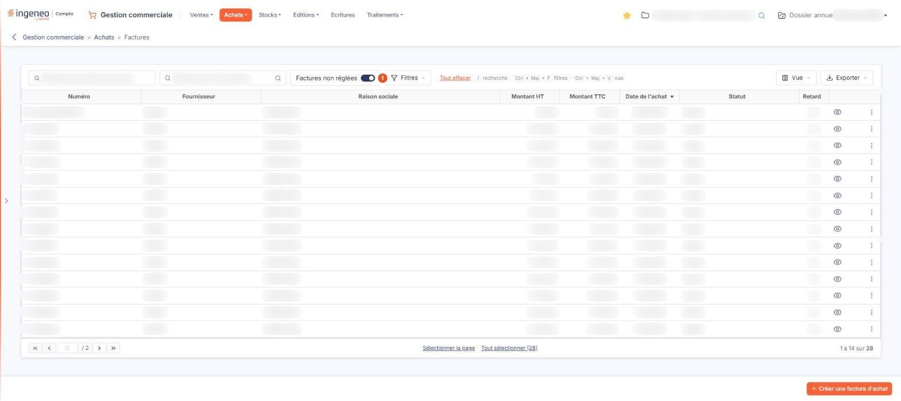
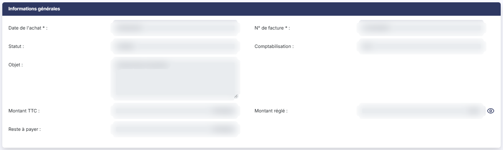
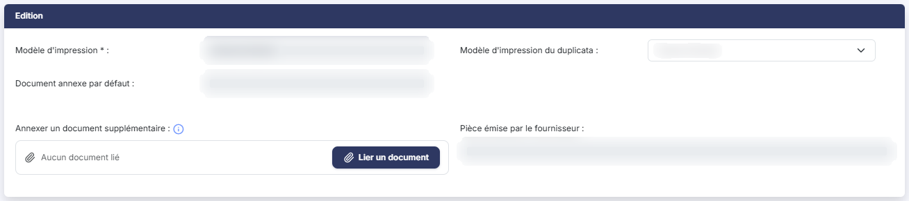

# Factures fournisseurs


**Où le trouver :** Menu **Achats › Factures**



**En bref** — Cet écran tient les factures fournisseurs. À l'ouverture, seules les factures qu'il vous reste à payer sont affichées.

* Pour saisir une facture fournisseur : bouton \[Créer une facture d'achat].
* Pour retrouver une facture déjà réglée : bouton \[Filtres spéciaux], puis désactivez l'interrupteur Factures non réglées.


La chaîne « Achats » fonctionne de la même manière que la chaîne « Ventes ». Les pages de l'aide n'ont donc pas été dupliquées : pour tout ce qui concerne la saisie d'une facture fournisseur — informations générales, coordonnées du tiers, lignes d'articles, récapitulatif, édition —, reportez-vous au menu « Ventes », option « Factures », en remplaçant le client par le fournisseur.

<figure><figcaption>
Écran « Factures » de la nouvelle interface
</figcaption></figure>


Attention toutefois : la fiche d'une facture fournisseur n'est pas identique à celle d'une facture de vente. Les écarts sont détaillés au paragraphe d).


La présente page traite de la liste des factures fournisseurs et de ce que la fiche a de propre.

## Le filtre de la liste

La barre d'outils, au-dessus du tableau, comporte deux zones de recherche, l'interrupteur « Factures non réglées », puis les boutons \[Filtres], \[Vue] et \[Exporter].

| Champ                               | Ce qu'il faut savoir                                                                                                                                                                                                                                                                                                                                                                                                               |
| ----------------------------------- | ---------------------------------------------------------------------------------------------------------------------------------------------------------------------------------------------------------------------------------------------------------------------------------------------------------------------------------------------------------------------------------------------------------------------------------- |
| 1. **Factures non réglées**         | Cet interrupteur, placé dans la barre à droite de la zone « Rechercher un fournisseur… » (il n'y a plus de menu « Filtres spéciaux »), est activé à l'ouverture de l'écran, et le lien « Tout effacer » s'affiche à côté de \[Filtres]. La liste ne vous présente donc, par défaut, que les factures qu'il vous reste à payer : si vous cherchez une facture que vous avez déjà réglée, commencez par désactiver cet interrupteur. |
| **Rechercher un fournisseur…**      | Saisissez le code du fournisseur, ou utilisez le pictogramme « Loupe » pour le rechercher.                                                                                                                                                                                                                                                                                                                                         |
| **Rechercher une facture d'achat…** | Saisissez tout ou partie du numéro recherché.                                                                                                                                                                                                                                                                                                                                                                                      |

La liste se recharge dès que vous modifiez l'un de ces éléments.

## Le tableau des factures fournisseurs

Le tableau présente les colonnes **Numéro**, **Fournisseur**, **Raison sociale**, **Montant HT**, **Montant TTC**, **Date de l'achat** et **Statut**. Toutes sont triables : cliquez sur l'en-tête de la colonne sur laquelle vous souhaitez trier.

La colonne **Statut** indique si la facture est validée ou non. Une facture dont l'échéance est dépassée s'affiche en rouge.

**Les commandes présentes sur chaque ligne**

Chaque ligne du tableau porte six commandes. L'icône « Afficher l'aperçu » (un œil), qui permet de consulter la facture sans l'ouvrir, est affichée en permanence ; deux autres icônes apparaissent lorsque vous survolez la ligne : « Télécharger », pour en récupérer le fichier, et « Envoyer par mail ». Un dernier pictogramme (trois points verticaux, infobulle « Autres actions ») ouvre un menu qui propose « Modifier » pour ouvrir la facture, « Dupliquer » pour créer une nouvelle facture reprenant le contenu de celle-ci, et « Supprimer ».

Selon les droits qui vous ont été attribués, certaines de ces commandes peuvent ne pas vous être proposées.

Il n'y a plus de case à cocher dans la liste : un clic sur une ligne la sélectionne, et sous le tableau les liens « Sélectionner la page » et « Tout sélectionner (n) » étendent la sélection. Le bouton \[Vue] gère les colonnes affichées et les vues enregistrées ; le bouton \[Exporter] propose « Aperçu édition HTML », « Imprimer », « Exporter en Excel », « Exporter en PDF » et « Envoyer la liste par e-mail ».

## Les boutons de la liste

bouton **\[Créer une facture d'achat]** : crée une facture fournisseur ; il se trouve dans la barre du bas, à droite.

bouton **\[Supprimer]** : supprime les factures fournisseurs sélectionnées dans la liste. Il n'est pas dans la barre du bas en permanence : il apparaît dans le bandeau de sélection, au bas de l'écran, dès qu'une facture est sélectionnée (« 1 facture d'achat sélectionnée »). Ce bandeau porte aussi le lien « Tout désélectionner » et le bouton \[Envoyer tout par mail].

## Autres vues de l'écran

<figure><figcaption>
Ce que la facture fournisseur a de propre
</figcaption></figure>

<figure><figcaption>
Ce que la facture fournisseur a de propre
</figcaption></figure>
