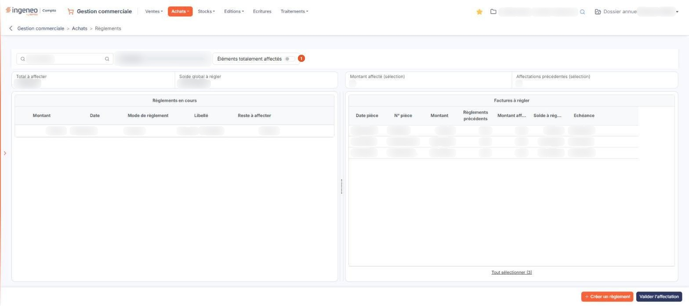
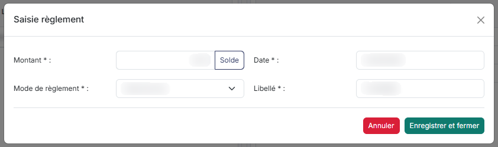

# Règlements fournisseurs


**Où le trouver :** Menu **Achats › Règlements**



**En bref** — Cet écran enregistre les règlements versés à vos fournisseurs et les affecte aux factures d'achat qu'ils payent, fournisseur par fournisseur.

* Pour enregistrer un paiement : choisissez le fournisseur en haut à gauche, puis bouton \[Créer un règlement].
* Pour imputer un règlement aux factures : bouton \[Valider l'affectation].


Cette option permet d'enregistrer les règlements que vous versez à vos fournisseurs et de les affecter aux factures d'achat qu'ils viennent payer. Vous y suivez ainsi le solde restant dû à chaque fournisseur.

<figure><figcaption>
Écran « Règlements » de la nouvelle interface
</figcaption></figure>

Ce n'est pas un écran de pièce commerciale : il n'y a ni liste de pièces, ni fiche à ouvrir. L'écran est divisé en deux parties : à gauche, sous le titre « Règlements en cours », les règlements que vous avez enregistrés ; à droite, sous le titre « Factures à régler », les factures qui n'ont pas encore été totalement payées. Votre travail consiste à rapprocher les unes des autres.

La chaîne « Achats » fonctionne sur le même principe que la chaîne « Ventes » : reportez-vous à l'aide du menu « Ventes », option « Règlements », pour le principe général de l'affectation. La présente page ne traite que de l'écran des règlements fournisseurs.

## Deux filtres masquent des lignes dès l'ouverture de l'écran

C'est le point à connaître avant tout autre, faute de quoi vous croirez l'écran vide ou incomplet.

| Champ                               | Ce qu'il faut savoir                                                                                                                                                                                                                                                                                                                                                                                                                                                                                                                                                                                                                                                                             |
| ----------------------------------- | ------------------------------------------------------------------------------------------------------------------------------------------------------------------------------------------------------------------------------------------------------------------------------------------------------------------------------------------------------------------------------------------------------------------------------------------------------------------------------------------------------------------------------------------------------------------------------------------------------------------------------------------------------------------------------------------------ |
| 1. **Éléments totalement affectés** | Cet interrupteur se trouve sur la ligne du fournisseur, à droite de sa raison sociale (il n'y a plus de menu « Filtres spéciaux ») ; il est désactivé à l'ouverture. Seuls les règlements qui n'ont pas été totalement affectés, et les factures qui ne sont pas totalement payées, vous sont donc présentés.                                                                                                                                                                                                                                                                                                                                                                                    |
| **Fournisseur**                     | Les deux parties de l'écran ne concernent JAMAIS qu'un seul fournisseur, celui dont le code figure en haut à gauche. Et ce code est prérempli par le logiciel à l'ouverture : il se positionne d'office sur le premier fournisseur ayant des règlements ou des échéances à pointer. Les règlements et les factures de tous les autres fournisseurs ne sont donc pas affichés. Pour changer de fournisseur, saisissez-le dans le champ « Rechercher un fournisseur… », ou utilisez le pictogramme « Loupe » dont l'infobulle est « Recherche avancée » et qui ouvre une fenêtre de recherche. La zone en lecture seule placée à droite du champ rappelle la raison sociale du fournisseur retenu. |
| **Total à affecter**                | Indicateur calculé par le logiciel, en lecture seule, affiché, en orange, dans un bloc encadré en haut à gauche de l'écran. Il totalise ce qui reste à affecter pour le fournisseur retenu. Un second indicateur, « Solde global à régler », est placé à sa droite dans le même bloc ; il affiche 0,00 tant que le volet de droite est vide.                                                                                                                                                                                                                                                                                                                                                     |

## La partie gauche : « Règlements en cours »

Chaque ligne est un règlement que vous avez enregistré. Les colonnes sont, dans l'ordre : **Montant**, **Date**, **Mode de règlement**, **Libellé** et **Reste à affecter**. Il n'y a pas de case à cocher affichée : un clic sur une ligne sélectionne le règlement (la ligne est surlignée et les cases « Montant affecté (sélection) » et « Affectations précédentes (sélection) » passent de « — » à des montants), un nouveau clic le désélectionne.

Deux pictogrammes apparaissent lorsque vous survolez la ligne :

* « Modifier » (un crayon) ouvre la fenêtre « Saisie règlement » sur le règlement de la ligne, décrite plus bas ;
* « Supprimer » (une corbeille).

Cette partie de l'écran ne se comporte pas comme les listes habituelles du logiciel : il n'y a ni pagination, ni tri des colonnes, ni personnalisation des colonnes, ni pictogrammes d'en-tête.

## La partie droite : « Factures à régler »

Chaque ligne est une facture d'achat du fournisseur retenu qui reste à payer, en tout ou partie. Les colonnes sont, dans l'ordre : **Date pièce**, **N° pièce**, **Montant**, **Règlements précédents**, **Montant affecté**, **Solde à régler** et **Echéance**.

**Règlements précédents** vous rappelle ce qui a déjà été payé sur cette facture lors de séances précédentes, **Montant affecté** ce que vous êtes en train de lui affecter, et **Solde à régler** ce qui resterait dû.

Aucun pictogramme n'est proposé sur ces lignes ; la sélection se fait par un clic sur la ligne, après avoir sélectionné un règlement à gauche (sans règlement sélectionné, le message rouge « Veuillez tout d'abord sélectionner un règlement. » s'affiche et rien n'est sélectionné). Sélectionner une facture lui affecte aussitôt le montant du règlement : les colonnes **Montant affecté** et **Solde à régler** de la facture, les cases « Montant affecté (sélection) » et « Affectations précédentes (sélection) » et l'indicateur « Total à affecter » se mettent à jour, et un lien « Tout désélectionner » remplace « Tout sélectionner (n) » sous le tableau. Comme la partie gauche, cette partie n'a ni pagination, ni tri, ni pictogrammes d'en-tête.

## Les cases « Montant affecté (sélection) » et « Affectations précédentes (sélection) »

En haut à droite de l'écran, ces deux cases encadrées, de style neutre, récapitulent le règlement que vous avez sélectionné dans la partie gauche : **Montant affecté** et **Affectations précédentes**. Tant qu'aucun règlement n'est sélectionné, elles affichent « — ».

## Redimensionner et replier la partie gauche

La séparation entre les deux parties de l'écran se déplace à la souris : vous pouvez élargir la partie gauche ou la réduire, la partie droite s'ajustant en conséquence.

Un double-clic sur la séparation rétablit la taille par défaut. La séparation ne porte qu'une poignée : il n'y a pas de chevron de repli.

## Bouton \[Créer un règlement]

<figure><figcaption>
Bouton [Créer un règlement]
</figcaption></figure>

Placé en bas à droite de l'écran, il ouvre la fenêtre « Saisie règlement » pour enregistrer un règlement au bénéfice du fournisseur retenu en haut de l'écran. Tant qu'aucun fournisseur n'est retenu, il n'ouvre rien et affiche le message « Veuillez sélectionner un fournisseur. ». Les champs sont les suivants :

| Champ                 | Ce qu'il faut savoir                                                                                                                                                                                                                                                                                                      |
| --------------------- | ------------------------------------------------------------------------------------------------------------------------------------------------------------------------------------------------------------------------------------------------------------------------------------------------------------------------- |
| **Montant**           | —                                                                                                                                                                                                                                                                                                                         |
| **Date**              | Le logiciel propose la date du jour ; elle doit être comprise dans la période de saisie définie pour le dossier annuel en cours.                                                                                                                                                                                          |
| **Mode de règlement** | Choisissez dans la liste : « Chèques », « Carte bancaire », « Prélèvement », « Virement », « Espèces », « Ticket Restaurant », « Ecart de règlement - », « Ecart de règlement + », « Import règl. compta » ou « Import remb. compta ». Ces modes se définissent dans le menu « Fichiers », option « Modes de règlement ». |
| **Libellé**           | Le logiciel le prérenseigne avec la raison sociale du fournisseur ; vous pouvez le modifier.                                                                                                                                                                                                                              |

Le Bouton \[Solde] est placé à côté de la zone **Montant :**, dont il sert à renseigner la valeur. Deux boutons ferment la fenêtre, en bas à droite : Bouton \[Enregistrer et fermer] et Bouton \[Annuler].

## Consulter un règlement déjà enregistré

L'icône « Modifier » (le crayon) de la partie gauche ouvre la même fenêtre « Saisie règlement », mais elle se présente alors tout autrement, et c'est normal :

* les quatre champs **Montant**, **Date**, **Mode de règlement** et **Libellé** sont TOUS en lecture seule : un règlement enregistré ne se modifie pas ;
* trois informations supplémentaires apparaissent, elles aussi en lecture seule : **Affectations précédentes**, **Montant affecté** et **Reste à affecter**. Elles vous disent où en est l'affectation de ce règlement ;
* le seul bouton proposé est Bouton \[Annuler]. Il n'y a ni bouton d'enregistrement ni bouton de solde.

Cette fenêtre est donc, sur un règlement existant, un simple écran de consultation. Pour corriger un règlement erroné, supprimez-le à l'aide de l'icône « Supprimer » (la corbeille) de sa ligne et saisissez-le de nouveau.

## Bouton \[Valider l'affectation]

C'est le seul bouton de l'écran qui enregistre votre travail : tout le reste — sélections, ouverture des fenêtres, redimensionnement de la partie gauche — se fait sans quitter la page.

Pour affecter un règlement, sélectionnez-le d'un clic dans la partie gauche, puis sélectionnez de même dans la partie droite la ou les factures qu'il vient payer, et cliquez enfin sur ce bouton.
