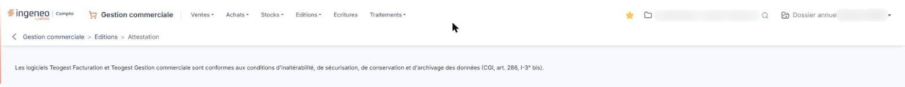

# Attestation


**Où le trouver :** Menu **Editions › Attestation**



**En bref** — Cet écran produit l'attestation individuelle de conformité du logiciel aux conditions d'inaltérabilité, de sécurisation, de conservation et d'archivage des données, au nom de la société gérée.

* Pour obtenir l'attestation : bouton \[Editer l'attestation].


Cette option permet d'éditer l'attestation individuelle de conformité relative à l'utilisation d'un logiciel de gestion satisfaisant à des conditions d'inaltérabilité, de sécurisation, de conservation et d'archivage des données (CGI, art. 286, I-3° bis).

<figure><figcaption>
Écran « Attestation » de la nouvelle interface
</figcaption></figure>

C'est le seul écran des éditions de ce menu qui ne vous demande rien du tout : vous n'avez ni période, ni filtre, ni format à indiquer. L'écran se réduit au rappel de la conformité des logiciels Teogest Facturation et Teogest Gestion commerciale, et au bouton qui produit le document.

## Bouton \[Editer l'attestation]

Il produit l'attestation.

Ce bouton est soumis à un droit distinct de celui du menu : selon votre profil, il peut ne pas vous être proposé. L'écran ne comporte aucun autre bouton.
