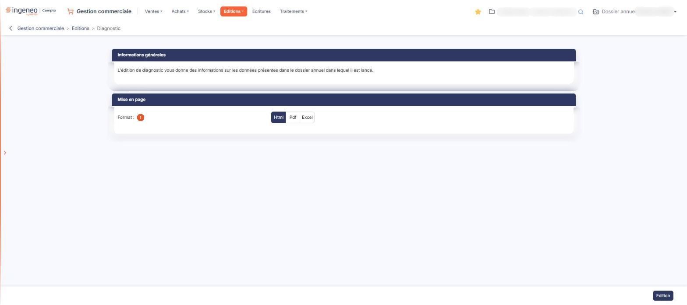

# Diagnostic


**Où le trouver :** Menu **Editions › Diagnostic**



**En bref** — Cette édition dresse l'inventaire des données du dossier annuel et signale les ruptures de numérotation des factures et avoirs de vente. Elle recalcule aussi les quantités des articles gérés en stock.

* Pour lancer le diagnostic : choisissez la mise en page, puis bouton \[Edition].


L'édition de diagnostic réalise une forme d'inventaire des données du dossier annuel dans lequel elle est lancée : elle vous dit combien de pièces et combien de fiches il contient, et signale les ruptures dans la numérotation des factures et des avoirs de vente. Ce sont les deux seules pièces dont la numérotation est contrôlée ; les numéros manquants sont recherchés sur la période de saisie du dossier annuel en cours, et le diagnostic vous indique expressément lorsqu'il n'y a aucun trou.

<figure><figcaption>
Écran « Diagnostic » de la nouvelle interface
</figcaption></figure>

Elle porte toujours sur l'intégralité du dossier annuel en cours : aucun critère de sélection ne vous est demandé. Vous n'avez à indiquer que la mise en page.

**Avant de lancer cette édition, sachez que le logiciel resynchronise à cette occasion les quantités des articles gérés en stock, et enregistre le résultat de ce recalcul.** Sont recalculées, pour chaque article géré en stock, la quantité commandée, la quantité facturée et la quantité livrée ou reçue non encore facturée, chacune du côté client et du côté fournisseur. Les articles qui ne sont pas gérés en stock ne sont pas touchés. Lancer le diagnostic n'est donc pas une simple consultation : c'est aussi un traitement qui met à jour vos articles, et il a lieu quel que soit le format demandé. L'écran ne vous en avertit pas.

## Rubrique « Informations générales »

Cette rubrique ne comporte aucun champ. Elle rappelle en une phrase que « l'édition de diagnostic vous donne des informations sur les données présentes dans le dossier annuel dans lequel il est lancé ».

## Rubrique « Mise en page »

| Champ           | Ce qu'il faut savoir                                                                                                                                                                                                                                                                                                                       |
| --------------- | ------------------------------------------------------------------------------------------------------------------------------------------------------------------------------------------------------------------------------------------------------------------------------------------------------------------------------------------ |
| 1. **Format**   | 
Choisissez <strong>Html</strong>, qui est la proposition par défaut, <strong>Pdf</strong> ou <strong>Excel</strong>. Cette rubrique ne présente pas les mêmes champs selon le format demandé : les deux champs suivants n'apparaissent que si vous choisissez le format <strong>Pdf</strong>, le seul des trois qui soit paginé.
 |
| **Orientation** | Choisissez **Portrait**, qui est la proposition par défaut, ou **Paysage**.                                                                                                                                                                                                                                                                |
| **Largeur**     | Choisissez **Fixe** ou **Ajustée**. Un pictogramme d'information rappelle à droite du champ que le second choix « ajuste la taille si la largeur des colonnes dépasse la largeur de la page ».                                                                                                                                             |


Attention : dès que vous passez au format **Pdf**, le logiciel coche lui-même **Ajustée**, alors que le réglage d'origine du formulaire est **Fixe**, et il ne revient jamais à **Fixe** si vous repassez à un autre format. Si vous voulez une largeur fixe, cochez-la vous-même après avoir choisi le format.


## Bouton \[Edition]

Il lance le diagnostic dans le format demandé. Il se trouve dans la barre du bas, à droite de l'écran, et c'est le seul bouton de cet écran.

Ce bouton est soumis à un droit distinct de celui du menu : selon votre profil, il peut ne pas vous être proposé.
