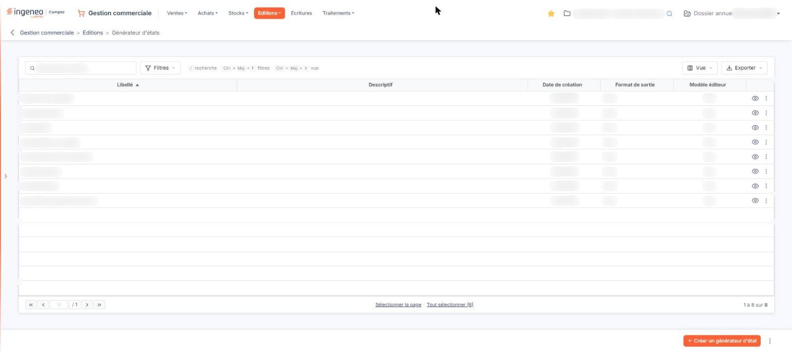

# Générateur d'états


**Où le trouver :** Menu **Editions › Générateur d'états**



**En bref** — L'aide du générateur d'états est commune à tous les modules : elle se trouve dans le chapitre « Généralités », option « Générateur d'états d'édition ».

* Pour en savoir plus : consultez le chapitre « Généralités », option « Générateur d'états d'édition ».


<figure><figcaption>
Écran « Générateur d'états » de la nouvelle interface
</figcaption></figure>

L'aide en ligne concernant le générateur d'états, commune à tous les modules du logiciel où il est présent, se trouve dans le chapitre « Généralités », option « Générateur d'états d'édition », en tête de la présente aide.
