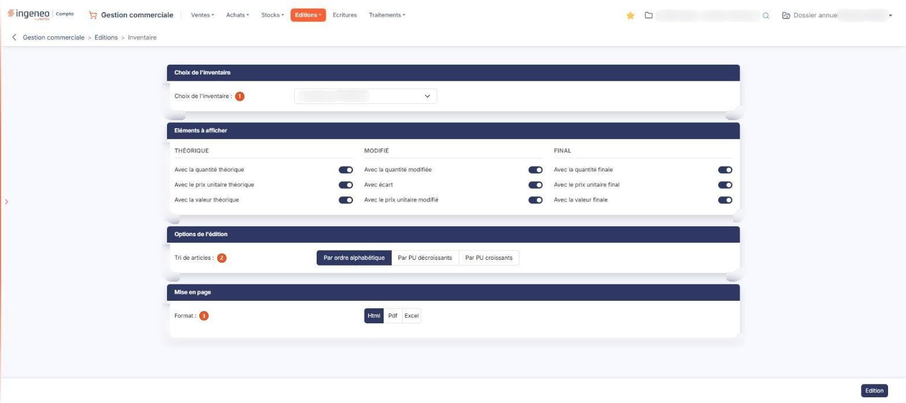

# Inventaire


**Où le trouver :** Menu **Editions › Inventaire**



**En bref** — Cette édition restitue un inventaire de stock déjà constitué dans le menu « Stocks », option « Inventaires », qu'il soit clôturé ou non.

* Pour éditer un inventaire : choisissez-le dans Choix de l'inventaire en contrôlant sa date, puis bouton \[Edition].


Cette édition restitue un inventaire de stock que vous avez déjà constitué dans le logiciel. Elle se fonde sur les inventaires créés dans le menu « Stocks », option « Inventaires ».

<figure><figcaption>
Écran « Inventaire » de la nouvelle interface
</figcaption></figure>

L'écran ne présente pas de liste : vous choisissez l'inventaire à éditer, les éléments que le document doit faire figurer, l'ordre de tri des articles et le format, puis vous lancez l'édition.

## Rubrique « Choix de l'inventaire »

**Choix de l'inventaire** : la liste propose les inventaires du dossier, désignés par leur date. Elle ne comporte aucune ligne vide : un inventaire vous est toujours proposé d'emblée, et c'est celui-là qui sera édité si vous ne changez rien. Contrôlez donc la date avant de lancer l'édition.


Attention à l'ordre de la liste : les inventaires y sont classés sur le libellé et non sur la date réelle, si bien que les exercices se trouvent entremêlés. Fiez-vous à la date affichée sur chaque ligne, pas à son rang dans la liste.


## Rubrique « Eléments à afficher »

Cette rubrique ne contient aucun bouton : les neuf éléments sont proposés directement, sous forme d'interrupteurs répartis en trois colonnes, « Théorique », « Modifié » et « Final ». Ils sont tous activés par défaut : l'édition les fait donc tous figurer, et vous désactivez ceux que vous ne voulez pas voir.

Colonne « Théorique » : **Avec la quantité théorique**, **Avec le prix unitaire théorique** et **Avec la valeur théorique**. Colonne « Modifié » : **Avec la quantité modifiée**, **Avec écart** et **Avec le prix unitaire modifié**. Colonne « Final » : **Avec la quantité finale**, **Avec le prix unitaire final** et **Avec la valeur finale**.

## Rubrique « Options de l'édition »

**Tri de articles** : choisissez **Par ordre alphabétique**, qui est la proposition par défaut, **Par PU décroissants** ou **Par PU croissants**. Ces deux derniers choix trient les articles sur leur prix unitaire.

## Rubrique « Mise en page »

| Champ           | Ce qu'il faut savoir                                                                                                                                                                                                                                                                                                                       |
| --------------- | ------------------------------------------------------------------------------------------------------------------------------------------------------------------------------------------------------------------------------------------------------------------------------------------------------------------------------------------ |
| 3. **Format**   | 
Choisissez <strong>Html</strong>, qui est la proposition par défaut, <strong>Pdf</strong> ou <strong>Excel</strong>. Cette rubrique ne présente pas les mêmes champs selon le format demandé : les deux champs suivants n'apparaissent que si vous choisissez le format <strong>Pdf</strong>, le seul des trois qui soit paginé.
 |
| **Orientation** | Choisissez **Portrait**, qui est la proposition par défaut, ou **Paysage**.                                                                                                                                                                                                                                                                |
| **Largeur**     | Choisissez **Fixe** ou **Ajustée**. Un pictogramme d'information rappelle à droite du champ que le second choix « ajuste la taille si la largeur des colonnes dépasse la largeur de la page ».                                                                                                                                             |


Attention : dès que vous passez au format **Pdf**, le logiciel coche lui-même **Ajustée**, alors que le réglage d'origine du formulaire est **Fixe**, et il ne revient jamais à **Fixe** si vous repassez à un autre format. Si vous voulez une largeur fixe, cochez-la vous-même après avoir choisi le format.


## Bouton \[Edition]

Il lance l'édition dans le format demandé, pour l'inventaire retenu. Il se trouve dans la barre du bas, à droite de l'écran.

Ce bouton est soumis à un droit distinct de celui du menu : selon votre profil, il peut ne pas vous être proposé.
